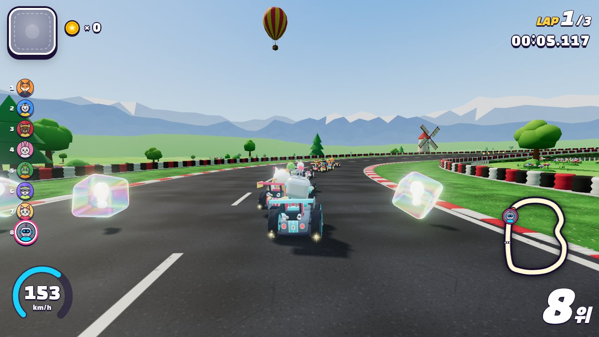
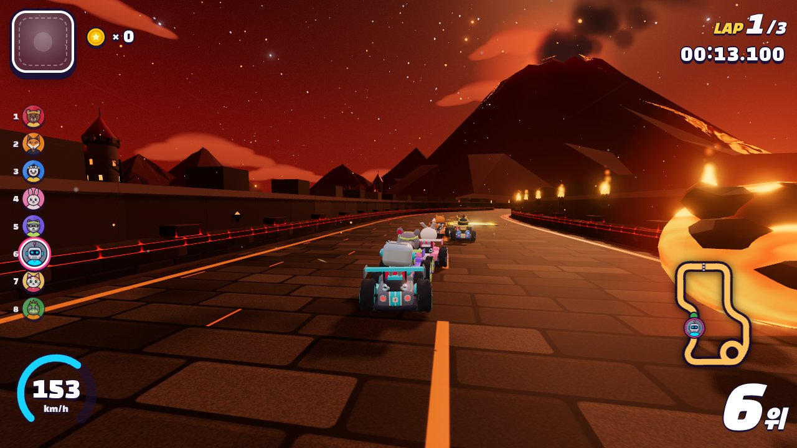
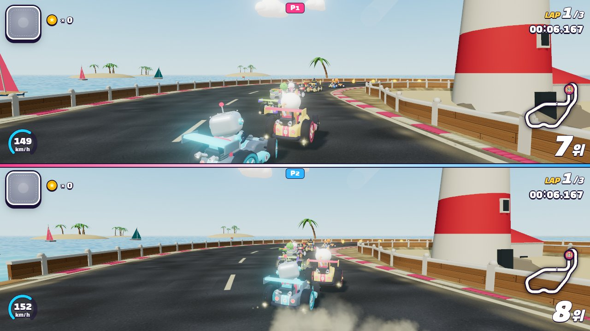
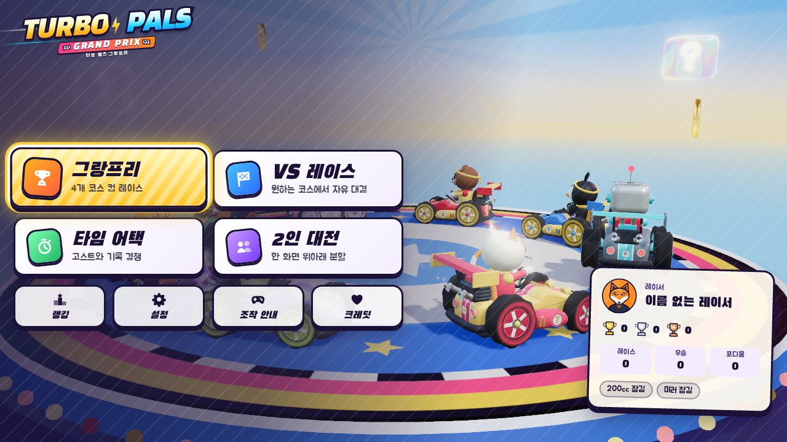
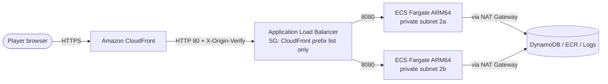

# TURBO PALS GRAND PRIX

[](LICENSE)
[](CHANGELOG.md)
[](package.json)
<a href="#english"></a>
<a href="#korean"></a>

Arcade 3D kart racing in the browser with drift mini-turbos, items, CPU rivals and server-verified time-trial rankings. | 드리프트 미니 터보, 아이템, CPU 라이벌, 서버가 검증하는 타임 어택 순위를 갖춘 브라우저용 아케이드 3D 카트 레이싱 게임입니다.


---

<a id="english"></a>

# English

## Overview

TURBO PALS GRAND PRIX is an arcade 3D kart racer that runs directly in the browser. It offers drift mini-turbos, 14 items,
8 original drivers, 8 tracks in 2 cups, a Grand Prix against 7 CPU rivals, 2-player split screen, and online time-trial
rankings that the server verifies by re-simulating every submitted run. Play it at https://my-kart.whchoi.net/.

> All characters, items, tracks, graphics and music are original content generated procedurally.
> The game uses no external image, 3D model or audio asset files and no third-party IP; the only bundled third-party
> assets are the open-licensed (OFL 1.1) Black Han Sans and Jua fonts.

### Screenshots

Captured from the current build at 1280x720 with the high quality tier (CPU racers at 150cc, the player kart on autopilot).

| Sunny Meadow Circuit: 8-kart VS race | Neon City Nights: night theme with bloom |
|:---:|:---:|
|  |  |
| **Lava Fortress: volcano and lava fields** | **2-player split screen on Palm Beach Boulevard** |
|  |  |
| **Main menu** | **Boost on Neon City Nights (202 km/h)** |
|  |  |

## Features

- **Driving** — Deterministic 60 Hz arcade physics, three-level drift mini-turbos, jump trick boosts, rocket starts, off-road, mud and ice surfaces, and a coin speed bonus.
- **Items** — 14 items: Banana, Bounce Orb and Homing Rocket (each also as a triple), Nitro (single and triple), Super Star, Thunder Cloud, Ink Squid, Turbo Rocket, Sky Bomb and Coin Pouch. Odds depend on race position, and an item held behind the kart (or a triple orb or rocket orbiting it) works as a shield.
- **CPU rivals** — Racing lines, curvature-based drifting, hazard avoidance, item tactics and rubber-banding, at three difficulty levels.
- **Modes** — Grand Prix (4-track cups with points and a podium), VS Race, Time Trial with ghosts, and 2-player split screen.
- **Verified online rankings** — The server re-runs each submitted input log with the same simulation code and records the run only when the result matches tick for tick.
- **Graphics** — three.js with procedural terrain, props and skies per theme, shadows, bloom, particles and automatic quality scaling.
- **Audio** — WebAudio synthesis: an original soundtrack for every track, a tempo lift on the final lap, and engine, drift and item sound effects.
- **Input** — Keyboard, standard gamepads (with rumble) and touch controls.
- **PWA** — Install the game, play every mode except online rankings offline, and receive updates only between races.

## Architecture



- The ALB runs in the public subnets and the tasks in the private subnets of the existing VPC `vpc-0dfa5610180dfa628`
  (ap-northeast-2). Task egress uses the VPC's existing NAT Gateway.
- The ALB security group admits only TCP 80 from the AWS-managed CloudFront origin-facing prefix list (`pl-22a6434b`).
- The ALB listener's default action returns 403. Requests reach the tasks only when the secret header that CloudFront adds
  (`X-Origin-Verify`) matches.
- Each Fargate task runs one Fastify server that serves the built client and the API. It re-simulates submitted time-trial
  runs in worker threads with the same `src/sim` code that runs in the browser.

See [docs/architecture.md](docs/architecture.md) for the module map and the simulation contract, and
[docs/design.md](docs/design.md) (game design) and [docs/infra.md](docs/infra.md) (infrastructure and operations,
both written in Korean) for details.

## Prerequisites

- Node.js 22.12.0 or later (`engines` in `package.json`) and npm
- Git
- A browser with WebGL 2 (three.js r186 no longer supports WebGL 1)
- Optional: Docker, for the DynamoDB Local repository tests and for building the container image
- Optional: Playwright Chromium (`npx playwright install chromium`), for `npm run qa:screens` and `tools/verify-live-pwa.mjs`
- Deployment only: AWS CLI credentials for the account pinned in `infra/lib/settings.ts`, a CDK-bootstrapped target
  environment, and a running Docker daemon (building the ARM64 image on an x86 host needs buildx or QEMU)

## Installation

```bash
# Clone the repository
git clone https://github.com/whchoi98/kart-game.git
cd kart-game

# Install the exact dependency versions from package-lock.json
npm ci
```

Alternatively, run `bash scripts/setup.sh`: it checks the Node.js version, runs `npm ci` and installs the commit-msg Git
hook. Add `--with-browsers` to also download Playwright Chromium. No `.env` file is needed (see Configuration).

## Usage

### Development server

```bash
npm run dev        # http://localhost:8200 (API: 8201)
```

Vite serves the client with hot module replacement on port 8200 and proxies `/api` and `/healthz` to the Fastify API on
port 8201. The API keeps rankings in memory and runs the real replay verification. Development-only render QA pages are at
`http://localhost:8200/dev/<page>.html` (for example `track.html`), and `http://localhost:8200/ui-preview.html` runs
the UI shell on a mock game view (add `?mockapi` to answer `/api/*` with an offline mock).

### Production build

```bash
npm run build && npm start   # http://127.0.0.1:8080

# Optional: build and run the production container image locally
docker build --platform linux/arm64 -t turbo-pals:local .
docker run --rm --read-only --cap-drop ALL -p 18080:8080 turbo-pals:local
curl -s http://127.0.0.1:18080/healthz
```

`npm run build` (`tools/build.mjs`) writes the client to `dist/client` and bundles the server into `dist/server`.
`npm start` serves both from one Fastify process. Without `TABLE_NAME`, rankings stay in memory.

### QA build and `?debug` hook

Release builds (`node tools/build.mjs`) do **not** contain the QA debug hook (`?debug` → `window.__turbo`). The
compile-time constant `__DEBUG_HOOK__` removes the code.

```bash
TURBO_DEBUG_HOOK=1 node tools/build.mjs   # QA build: includes the ?debug hook (never deploy it)
npx vite --config tools/vite-qa.config.mjs --port 8250 --strictPort   # QA dev server: hook always included
```

The `npm run dev` server also includes the hook, because it is not a build output. Output built with `vite build`
includes the hook only when `TURBO_DEBUG_HOOK=1`. `npm run qa:screens` drives the hook to capture per-track screenshots
(default URL `http://127.0.0.1:8200`, output `test-results/qa`).

A quality override such as `?debug&quality=low` applies only to that page's renderer and does not change the player's
saved settings.

### PWA (offline, install, update)

Only production builds register the service worker (`dist/client/sw.js`), which stores every game file. Every mode except
online rankings works offline. Time-trial records set offline stay in the browser and can be submitted from the main menu
or the ranking screen once the device is back online (records kept by a different app version are removed automatically,
because the server cannot verify them). A new version is applied only from a menu, after the race has ended.

Once caching completes, a reload still opens the stored version (the app shell). The game checks for a newly deployed
version at launch, when the player returns to the app and every 15 minutes, and downloads it in the background. The new
version takes effect when the player selects `업데이트` (Update) on the title screen or main menu, or closes every game
window and opens the game again.

Where the browser supports installation, the title screen and main menu show an install button. On iPhone and iPad
Safari, the button shows a guide for Share, then Add to Home Screen.

### Deploy

```bash
npx cdk diff TurboPalsStack   # review the changes first
npm run deploy                # cdk deploy --require-approval never --outputs-file cdk-outputs.json
npm run verify:live           # live acceptance checks; writes docs/quality/live-verify.json
```

`npm run verify:live -- --custom` runs the HTTP and end-to-end checks through the custom domain. The end-to-end check
submits a real verified run and deletes its rows afterwards. `node tools/verify-live-pwa.mjs https://my-kart.whchoi.net`
checks the service worker and offline play in headless Chromium. The stack targets one fixed account, region and VPC
(`infra/lib/settings.ts`) and refuses to synthesize for any other. Follow
[docs/runbooks/deploy-production.md](docs/runbooks/deploy-production.md) for the full procedure.

## Configuration

The server reads plain environment variables (`src/server/config.ts`); nothing loads a `.env` file. Every variable is
optional for local development. `.env.example` documents them all; export what you need, for example `PORT=9000 npm start`.
In production the ECS task definition (`infra/lib/service.ts`, `infra/lib/stack.ts`) sets them.

| Variable | Description | Default |
|----------|-------------|---------|
| `NODE_ENV` | `production` changes the default bind address to `0.0.0.0`, requires the built client (`dist/client/index.html`) and logs a startup warning when `TABLE_NAME` or every allowed origin is missing | unset (development) |
| `HOST` | Bind address; must be an IP address or `localhost` | `127.0.0.1` (`0.0.0.0` in production) |
| `PORT` | Listen port (1-65535) | `8080` |
| `STATIC_DIR` | Directory of the built client served as static files | `dist/client` |
| `APP_VERSION` | Version reported by `/healthz` and compared with the `version` of submitted runs | `<version>+<12-char build id>` from `dist/build.json` (bundled server), else the `package.json` version |
| `LOG_LEVEL` | pino log level (`trace`, `debug`, `info`, `warn`, `error`, `fatal`) | `info` |
| `TABLE_NAME` | DynamoDB table for rankings; when unset, rankings stay in memory and are lost on restart | unset (in-memory) |
| `AWS_REGION` | AWS region for DynamoDB (`AWS_DEFAULT_REGION` is also accepted) | unset |
| `PUBLIC_ORIGIN` | Site origin allowed to `POST /api/runs` (exact `scheme://host[:port]`) | unset (same host only) |
| `ALLOWED_ORIGINS` | Extra allowed origins, comma separated (at most 16 origins including `PUBLIC_ORIGIN`) | unset |
| `TURBO_DEBUG_HOOK` | `1` builds a QA build that keeps the `?debug` hook (never deploy it) | unset |
| `DYNAMODB_TEST_ENDPOINT` | DynamoDB Local endpoint for the repository tests | unset (those tests are skipped) |
| `CLAUDE_NOTIFY_WEBHOOK` | Slack-compatible webhook URL for the Claude Code notification hook (`.claude/hooks/notify.sh`) | unset (nothing is sent) |
| `CLAUDE_NOTIFY_DRY_RUN` | `1` prints the notification payload instead of sending it | unset |

## Project Structure

```text
kart-game/
  src/
    sim/            # Deterministic 60 Hz simulation shared by the browser and the server
      tracks/       # 8 track definitions and the cup catalog
    shared/         # HTTP contract types and security header constants
    client/         # Browser game (Vite root)
      game/         # Race session: simulation, rendering and audio glue, HUD model
      render/       # three.js renderer, themes, karts, particles, quality governor
      audio/        # WebAudio synthesis: songs, sequencer, sound effects, engine loops
      input/        # Keyboard, gamepad and touch input
      ui/           # Framework-free DOM app shell, screens and procedural art
      dev/          # Development-only render QA pages (not in production builds)
    server/         # Fastify API, static files, replay verification, ranking storage
  infra/            # AWS CDK v2 app (TurboPalsStack)
  test/             # vitest suites (sim, client, server, infra) and the shell harness
  tools/            # Build, dev server, QA, report and live verification scripts
  public/           # PWA manifest and icons
  scripts/          # Developer setup and Git hook installation
  docs/             # Architecture, design, infrastructure, ADRs, runbooks, references
    images/         # README screenshots
  Dockerfile        # Two-stage production image (node:24-alpine)
  .env.example      # Every environment variable with its default
```

## Testing

```bash
# Type-check the app and the CDK app
npm run typecheck

# Run every vitest suite (test/sim, test/client, test/server, test/infra)
npm test

# Run one area only
npx vitest run test/sim

# Run the shell harness: Claude Code hooks, secret patterns, documentation structure
npm run test:harness
```

The DynamoDB repository tests are skipped unless `DYNAMODB_TEST_ENDPOINT` points to DynamoDB Local (host `127.0.0.1`,
`localhost` or `[::1]`):

```bash
docker run -d --rm --name ddb -p 127.0.0.1:18765:8000 amazon/dynamodb-local
DYNAMODB_TEST_ENDPOINT=http://127.0.0.1:18765 npx vitest run test/server/repository.test.ts
docker stop ddb
```

Simulation and track reports (both cover every track unless you pass track ids):

```bash
# Headless CPU races, bot time trials and replay verification
npx tsx tools/sim-report.ts
# Track geometry checks and SVG plans in test-results/tracks/ (exits 1 on problems)
npx tsx tools/track-report.ts
```

## API Documentation

The Fastify server exposes one health check and three JSON endpoints.

| Method | Path | Purpose |
|--------|------|---------|
| `GET` | `/healthz` | Liveness check that returns `{ ok: true, version }` (it does not check DynamoDB) |
| `GET` | `/api/leaderboard?track=<trackId>&cc=<cc>` | Top 50 verified time-trial runs for one track and speed class (`50`, `100`, `150` or `200`) |
| `GET` | `/api/ghost/:id` | Input log and metadata of a ranked run, used for ghost races |
| `POST` | `/api/runs` | Submit a time-trial run as JSON; the server replays the input log and records the run only when the ticks and lap ticks match |

Each server process allows a client 12 run submissions and 120 reads per minute. Rejected runs return HTTP 422 with a code such as
`REPLAY_INVALID`, `VERSION_MISMATCH`, `TIME_MISMATCH` or `LAP_MISMATCH`, or HTTP 409 `DUPLICATE_RUN`. See
[docs/api-reference.md](docs/api-reference.md) for request and response schemas and every error code.

## Contributing

```text
1. Fork the repository
2. Create your branch (git checkout -b feat/amazing-feature)
3. Commit your changes (git commit -m 'feat: add amazing feature')
4. Push to the branch (git push origin feat/amazing-feature)
5. Open a Pull Request
```

- Write commit messages in the Conventional Commits format: `feat:` for a new feature, `fix:` for a bug fix, `docs:` for
  documentation only (also `test:`, `refactor:` and `chore:`).
- Run `npm run typecheck`, `npm test` and `npm run test:harness` before you open a Pull Request.
- Run `bash scripts/install-hooks.sh` once to install the commit-msg hook, which removes `Co-Authored-By` trailers.
- An edit to existing simulation code or existing track geometry under `src/sim/` that can alter a time-trial trajectory
  (kart physics, constants, character stats, existing track definitions, the track builder, input quantisation, the
  `RaceWorld.step` order, the nitro path) needs a `package.json` version bump and a [CHANGELOG](CHANGELOG.md) entry, so
  that older clients get `VERSION_MISMATCH` instead of `REPLAY_INVALID`. Adding a brand-new track alters no existing
  replay, so the rule does not force a bump. Any bump makes clients discard the offline runs they queued under the old
  version. The rule is described in [docs/architecture.md](docs/architecture.md).
- New contributors can start with [docs/onboarding.md](docs/onboarding.md).

## License

All rights reserved. Copyright (c) 2026 WooHyung Choi. The repository is public so that it can be viewed; no license is
granted to copy, modify, distribute or deploy the software or its content without prior written permission. Third-party
packages listed in `package.json` remain under their own licenses. See [LICENSE](LICENSE), and request permissions through
[GitHub Issues](https://github.com/whchoi98/kart-game/issues).

## Contact

- Maintainer: WooHyung Choi ([@whchoi98](https://github.com/whchoi98))
- Issues: [https://github.com/whchoi98/kart-game/issues](https://github.com/whchoi98/kart-game/issues)

---

<a id="korean"></a>

# 한국어

## 개요

TURBO PALS GRAND PRIX(터보 팰즈 그랑프리)는 브라우저에서 바로 즐기는 아케이드 3D 카트 레이싱 게임입니다. 드리프트 미니 터보,
14종 아이템, 8명의 오리지널 드라이버, 2개 컵 8개 트랙, CPU 7대와 겨루는 그랑프리, 분할 화면 2인 대전, 그리고 서버가
재시뮬레이션으로 검증하는 타임 어택 온라인 순위를 제공합니다. https://my-kart.whchoi.net/ 에서 바로 플레이할 수 있습니다.

> 캐릭터·아이템·트랙·그래픽·음악은 모두 절차적으로 생성한 오리지널 콘텐츠입니다.
> 외부 이미지·3D 모델·오디오 에셋 파일이나 타사 IP를 쓰지 않으며, 함께 번들되는 외부 에셋은 오픈 라이선스(OFL 1.1) 폰트인
> Black Han Sans와 Jua뿐입니다.

### 스크린샷

현재 빌드를 1280x720, 고화질(high) 티어로 캡처한 화면입니다(CPU는 150cc, 플레이어 카트는 자동 주행).

| 햇살 초원 서킷: 8대가 겨루는 VS 레이스 | 네온 시티 나이트: 블룸이 들어간 야간 테마 |
|:---:|:---:|
|  |  |
| **용암 요새: 화산과 용암 지대** | **야자수 해변 2인 분할 화면** |
|  |  |
| **메인 메뉴** | **네온 시티 나이트 부스트 (202 km/h)** |
|  |  |

## 주요 기능

- **주행** — 결정론적 60 Hz 아케이드 물리, 3단계 드리프트 미니 터보, 점프 트릭 부스트, 로켓 스타트, 오프로드·진흙·빙판 노면, 코인 속도 보너스를 갖췄습니다.
- **아이템** — 바나나·통통 구슬·추적 로켓(각각 ×3 포함), 니트로(×3 포함), 슈퍼 스타, 번개 구름, 먹물 문어, 터보 로켓, 선두 폭탄, 코인 주머니까지 14종입니다. 순위에 따라 나오는 확률이 달라지고, 카트 뒤에 매단 아이템(또는 주위를 도는 구슬·로켓 ×3)이 방패 역할을 합니다.
- **CPU 라이벌** — 레이싱 라인, 곡률 기반 드리프트, 위험물 회피, 아이템 전술, 러버밴딩을 쓰며 난이도는 3단계입니다.
- **모드** — 그랑프리(4개 트랙 포인트제, 시상대), VS 레이스, 고스트와 겨루는 타임 어택, 2인 분할 화면을 지원합니다.
- **검증된 온라인 순위** — 서버가 제출된 입력 로그를 같은 시뮬레이션 코드로 다시 실행하고, 틱 단위까지 일치할 때만 기록을 등록합니다.
- **그래픽** — three.js로 테마별 절차적 지형·소품·하늘, 그림자, 블룸, 파티클을 그리고 화질을 자동으로 조절합니다.
- **오디오** — WebAudio로 합성한 트랙별 오리지널 BGM, 마지막 랩의 템포 업, 엔진·드리프트·아이템 효과음을 들려줍니다.
- **입력** — 키보드, 표준 게임패드(진동 지원), 터치 컨트롤을 지원합니다.
- **PWA** — 앱으로 설치할 수 있고, 온라인 순위를 뺀 모든 모드를 오프라인에서 즐길 수 있으며, 업데이트는 레이스와 레이스 사이에만 적용됩니다.

## 아키텍처


- 기존 VPC `vpc-0dfa5610180dfa628`(ap-northeast-2)의 public 서브넷에 ALB를, private 서브넷에 태스크를 배치합니다.
  태스크의 아웃바운드 트래픽은 VPC의 기존 NAT Gateway를 사용합니다.
- ALB 보안 그룹은 AWS 관리형 CloudFront origin-facing prefix list(`pl-22a6434b`)의 TCP 80만 허용합니다.
- ALB 리스너의 기본 동작은 403이며, CloudFront가 붙이는 비밀 헤더(`X-Origin-Verify`)가 일치할 때만 요청을 태스크로
  전달합니다.
- 각 Fargate 태스크는 Fastify 서버 하나로 빌드된 클라이언트와 API를 함께 서빙합니다. 제출된 타임 어택 기록은 브라우저와 같은
  `src/sim` 코드로 worker thread에서 다시 시뮬레이션합니다.

모듈 구성과 시뮬레이션 계약은 [docs/architecture.md](docs/architecture.md)에, 게임 디자인은 [docs/design.md](docs/design.md)에,
인프라와 운영은 [docs/infra.md](docs/infra.md)에 자세히 정리되어 있습니다.

## 사전 요구 사항

- Node.js 22.12.0 이상(`package.json`의 `engines`)과 npm
- Git
- WebGL 2를 지원하는 브라우저(three.js r186은 WebGL 1을 더 이상 지원하지 않음)
- 선택: DynamoDB Local 저장소 테스트와 컨테이너 이미지 빌드에 쓸 Docker
- 선택: `npm run qa:screens`와 `tools/verify-live-pwa.mjs`에 쓸 Playwright Chromium(`npx playwright install chromium`)
- 배포할 때만: `infra/lib/settings.ts`에 고정된 계정의 AWS CLI 자격 증명, CDK 부트스트랩을 마친 대상 환경, 실행 중인
  Docker 데몬(x86 호스트에서 ARM64 이미지를 빌드하려면 buildx 또는 QEMU 필요)

## 설치 방법

```bash
# 저장소 복제
git clone https://github.com/whchoi98/kart-game.git
cd kart-game

# package-lock.json에 고정된 버전 그대로 의존성 설치
npm ci
```

`bash scripts/setup.sh`를 실행해도 됩니다. 이 스크립트는 Node.js 버전을 확인하고 `npm ci`를 실행한 뒤 commit-msg Git hook을
설치합니다. `--with-browsers`를 붙이면 Playwright Chromium도 함께 내려받습니다. `.env` 파일은 필요하지 않습니다(환경 설정 참고).

## 사용법

### 개발 서버

```bash
npm run dev        # http://localhost:8200 (API: 8201)
```

Vite가 8200 포트에서 HMR(hot module replacement)로 클라이언트를 서빙하고, `/api`와 `/healthz` 요청은 8201 포트의
Fastify API로 프록시합니다. 이 API는 순위를 메모리에 보관하며 리플레이 검증은 실제와 똑같이 수행합니다. 개발 전용 렌더 QA
페이지는 `http://localhost:8200/dev/<page>.html`(예: `track.html`)에 있고, `http://localhost:8200/ui-preview.html`은
목(mock) 게임 뷰 위에서 UI 셸을 띄웁니다(`?mockapi`를 붙이면 `/api/*` 요청에 오프라인 목이 응답합니다).

### 프로덕션 빌드

```bash
npm run build && npm start   # http://127.0.0.1:8080

# 선택: 프로덕션 컨테이너 이미지를 로컬에서 빌드하고 실행
docker build --platform linux/arm64 -t turbo-pals:local .
docker run --rm --read-only --cap-drop ALL -p 18080:8080 turbo-pals:local
curl -s http://127.0.0.1:18080/healthz
```

`npm run build`(`tools/build.mjs`)는 클라이언트를 `dist/client`에 만들고 서버를 `dist/server`로 번들합니다. `npm start`는
Fastify 프로세스 하나로 둘을 함께 서빙합니다. `TABLE_NAME`이 없으면 순위는 메모리에만 남습니다.

### QA 빌드와 `?debug` 훅

릴리스 빌드(`node tools/build.mjs`)에는 QA용 디버그 훅(`?debug` → `window.__turbo`)이 **들어 있지 않습니다**.
컴파일 타임 상수 `__DEBUG_HOOK__`로 코드 자체가 제거됩니다.

```bash
TURBO_DEBUG_HOOK=1 node tools/build.mjs   # QA 빌드: ?debug 훅 포함 (배포 금지)
npx vite --config tools/vite-qa.config.mjs --port 8250 --strictPort   # QA 개발 서버: 훅 항상 포함
```

`npm run dev` 개발 서버에도 훅이 들어 있습니다(빌드 결과물이 아니므로). `vite build`로 만드는 결과물은 `TURBO_DEBUG_HOOK=1`일
때만 훅을 포함합니다. `npm run qa:screens`는 이 훅으로 트랙별 스크린샷을 찍습니다(기본 URL `http://127.0.0.1:8200`, 출력
`test-results/qa`).

`?debug&quality=low` 같은 화질 지정은 그 페이지의 렌더러에만 적용되고 플레이어의 저장된 설정은 바꾸지 않습니다.

### PWA (오프라인 · 설치 · 업데이트)

프로덕션 빌드에서만 서비스 워커(`dist/client/sw.js`)가 등록되어 게임 파일 전체를 저장합니다. 온라인 랭킹을 뺀 모든 모드는
오프라인에서 동작하고, 오프라인에서 달린 타임 어택 기록은 브라우저에 보관했다가 온라인이 되면 메인 메뉴·랭킹 화면에서 등록할
수 있습니다(다른 앱 버전에서 보관한 기록은 서버가 검증할 수 없어 자동으로 정리됩니다). 새 버전은 레이스가 끝난 뒤 메뉴에서만
적용됩니다.

저장이 끝난 뒤에는 새로고침해도 저장된 버전(앱 셸)으로 열리고, 배포된 새 버전은 실행할 때·앱으로 돌아올 때·15분마다 확인해
뒤에서 받아 둡니다. 플레이어가 타이틀·메인 메뉴의 '업데이트'를 누르거나 게임 창을 모두 닫았다 열면 적용됩니다.

브라우저가 설치를 지원하면 타이틀 화면과 메인 메뉴에 설치 버튼이 나타납니다. iPhone·iPad의 Safari에서는 이 버튼이
'공유 → 홈 화면에 추가' 안내를 보여 줍니다.

### 배포

```bash
npx cdk diff TurboPalsStack   # 먼저 변경 사항 검토
npm run deploy                # cdk deploy --require-approval never --outputs-file cdk-outputs.json
npm run verify:live           # 라이브 인수 검사, 결과는 docs/quality/live-verify.json에 기록
```

`npm run verify:live -- --custom`은 HTTP 검사와 E2E 검사를 커스텀 도메인으로 실행합니다. E2E 검사는 실제로 검증된 기록을
제출한 뒤 해당 행을 다시 지웁니다. `node tools/verify-live-pwa.mjs https://my-kart.whchoi.net`은 헤드리스 Chromium으로 서비스
워커와 오프라인 플레이를 확인합니다. 스택은 고정된 계정·리전·VPC(`infra/lib/settings.ts`)만 대상으로 하며, 다른 값으로는
synth가 실패합니다. 전체 절차는 [docs/runbooks/deploy-production.md](docs/runbooks/deploy-production.md)를 따릅니다.

## 환경 설정

서버는 일반 환경 변수를 읽습니다(`src/server/config.ts`). `.env` 파일을 자동으로 읽는 곳은 없습니다. 로컬 개발에서는 모든 변수가
선택 사항이며, `.env.example`에 전부 정리되어 있으니 필요한 값만 export합니다(예: `PORT=9000 npm start`). 프로덕션에서는 ECS
태스크 정의(`infra/lib/service.ts`, `infra/lib/stack.ts`)가 값을 넣습니다.

| 변수 | 설명 | 기본값 |
|------|------|--------|
| `NODE_ENV` | `production`이면 기본 바인드 주소가 `0.0.0.0`으로 바뀌고, 빌드된 클라이언트(`dist/client/index.html`)가 필수가 되며, `TABLE_NAME`이나 허용 origin이 없을 때 시작 경고를 남깁니다 | 없음(개발 모드) |
| `HOST` | 바인드 주소. IP 주소 또는 `localhost`만 허용합니다 | `127.0.0.1` (production은 `0.0.0.0`) |
| `PORT` | 수신 포트(1-65535) | `8080` |
| `STATIC_DIR` | 정적 파일로 서빙할 빌드된 클라이언트 디렉터리 | `dist/client` |
| `APP_VERSION` | `/healthz`가 보고하고 제출된 기록의 `version`과 비교하는 버전 | `dist/build.json`의 `<version>+<12자 build id>`(번들된 서버), 없으면 `package.json` version |
| `LOG_LEVEL` | pino 로그 레벨(`trace`, `debug`, `info`, `warn`, `error`, `fatal`) | `info` |
| `TABLE_NAME` | 순위를 저장할 DynamoDB 테이블. 비어 있으면 메모리에 보관하며 재시작하면 사라집니다 | 없음(메모리) |
| `AWS_REGION` | DynamoDB 리전(`AWS_DEFAULT_REGION`도 인식) | 없음 |
| `PUBLIC_ORIGIN` | `POST /api/runs`를 허용할 사이트 origin(정확한 `scheme://host[:port]`) | 없음(같은 호스트만 허용) |
| `ALLOWED_ORIGINS` | 추가로 허용할 origin, 쉼표로 구분(`PUBLIC_ORIGIN`을 포함해 최대 16개) | 없음 |
| `TURBO_DEBUG_HOOK` | `1`이면 `?debug` 훅을 남긴 QA 빌드를 만듭니다(배포 금지) | 없음 |
| `DYNAMODB_TEST_ENDPOINT` | 저장소 테스트에 쓸 DynamoDB Local 엔드포인트 | 없음(해당 테스트는 건너뜀) |
| `CLAUDE_NOTIFY_WEBHOOK` | Claude Code 알림 hook(`.claude/hooks/notify.sh`)이 쓸 Slack 호환 webhook URL | 없음(전송하지 않음) |
| `CLAUDE_NOTIFY_DRY_RUN` | `1`이면 알림을 보내지 않고 payload를 출력합니다 | 없음 |

## 프로젝트 구조

```text
kart-game/
  src/
    sim/            # 브라우저와 서버가 함께 쓰는 결정론적 60 Hz 시뮬레이션
      tracks/       # 트랙 정의 8개와 컵 카탈로그
    shared/         # HTTP 계약 타입과 보안 헤더 상수
    client/         # 브라우저 게임 (Vite root)
      game/         # 레이스 세션: 시뮬레이션·렌더링·오디오 연결, HUD 모델
      render/       # three.js 렌더러, 테마, 카트, 파티클, 화질 거버너
      audio/        # WebAudio 합성: 곡, 시퀀서, 효과음, 엔진 루프
      input/        # 키보드·게임패드·터치 입력
      ui/           # 프레임워크 없는 DOM 앱 셸, 화면, 절차적 아트
      dev/          # 개발 전용 렌더 QA 페이지 (프로덕션 빌드에는 없음)
    server/         # Fastify API, 정적 파일, 리플레이 검증, 순위 저장소
  infra/            # AWS CDK v2 앱 (TurboPalsStack)
  test/             # vitest 테스트(sim, client, server, infra)와 셸 하네스
  tools/            # 빌드·개발 서버·QA·리포트·라이브 검증 스크립트
  public/           # PWA manifest와 아이콘
  scripts/          # 개발 환경 설정과 Git hook 설치
  docs/             # 아키텍처, 디자인, 인프라, ADR, 런북, 레퍼런스
    images/         # README 스크린샷
  Dockerfile        # 2단계 프로덕션 이미지 (node:24-alpine)
  .env.example      # 모든 환경 변수와 기본값
```

## 테스트

```bash
# 앱과 CDK 앱 타입 검사
npm run typecheck

# 모든 vitest 테스트 실행 (test/sim, test/client, test/server, test/infra)
npm test

# 한 영역만 실행
npx vitest run test/sim

# 셸 하네스 실행: Claude Code hook, 시크릿 패턴, 문서 구조
npm run test:harness
```

DynamoDB 저장소 테스트는 `DYNAMODB_TEST_ENDPOINT`가 DynamoDB Local(호스트 `127.0.0.1`, `localhost`, `[::1]` 중 하나)을
가리킬 때만 실행되고, 그렇지 않으면 건너뜁니다.

```bash
docker run -d --rm --name ddb -p 127.0.0.1:18765:8000 amazon/dynamodb-local
DYNAMODB_TEST_ENDPOINT=http://127.0.0.1:18765 npx vitest run test/server/repository.test.ts
docker stop ddb
```

시뮬레이션 리포트와 트랙 리포트입니다. 트랙 id를 넘기지 않으면 모든 트랙을 검사합니다.

```bash
# 헤드리스 CPU 레이스, 봇 타임 어택, 리플레이 검증
npx tsx tools/sim-report.ts
# 트랙 지오메트리 검사와 SVG 평면도 생성 (test-results/tracks/, 문제가 있으면 exit 1)
npx tsx tools/track-report.ts
```

## API 문서

Fastify 서버는 헬스 체크 하나와 JSON 엔드포인트 세 개를 제공합니다.

| 메서드 | 경로 | 용도 |
|--------|------|------|
| `GET` | `/healthz` | `{ ok: true, version }`을 돌려주는 liveness 검사(DynamoDB 상태는 확인하지 않음) |
| `GET` | `/api/leaderboard?track=<trackId>&cc=<cc>` | 트랙·속도 클래스(`50`, `100`, `150`, `200`)별로 검증된 타임 어택 상위 50개 기록 |
| `GET` | `/api/ghost/:id` | 고스트 레이스에 쓰는 순위 기록의 입력 로그와 메타데이터 |
| `POST` | `/api/runs` | 타임 어택 기록을 JSON으로 제출. 서버가 입력 로그를 재실행해 tick과 랩 tick이 일치할 때만 등록 |

서버 프로세스마다 클라이언트 하나에 분당 제출 12회, 조회 120회까지 허용합니다. 거절된 기록은 HTTP 422와 함께 `REPLAY_INVALID`, `VERSION_MISMATCH`,
`TIME_MISMATCH`, `LAP_MISMATCH` 같은 코드를 받거나, HTTP 409 `DUPLICATE_RUN`을 받습니다. 요청·응답 스키마와 전체 에러 코드는
[docs/api-reference.md](docs/api-reference.md)에 있습니다.

## 기여 방법

```text
1. 저장소를 Fork합니다
2. 브랜치를 만듭니다 (git checkout -b feat/amazing-feature)
3. 변경 사항을 커밋합니다 (git commit -m 'feat: add amazing feature')
4. 브랜치에 푸시합니다 (git push origin feat/amazing-feature)
5. Pull Request를 엽니다
```

- 커밋 메시지는 Conventional Commits 형식으로 씁니다. 새 기능은 `feat:`, 버그 수정은 `fix:`, 문서만 바꿀 때는 `docs:`를 쓰고,
  `test:`, `refactor:`, `chore:`도 쓸 수 있습니다.
- Pull Request를 열기 전에 `npm run typecheck`, `npm test`, `npm run test:harness`를 실행합니다.
- `bash scripts/install-hooks.sh`를 한 번 실행해 commit-msg hook을 설치합니다. 이 hook은 `Co-Authored-By` trailer를 지웁니다.
- `src/sim/`의 기존 시뮬레이션 코드나 기존 트랙 지오메트리를 고쳐 타임 어택 주행 궤적이 바뀔 수 있다면(카트 물리, 상수,
  캐릭터 능력치, 기존 트랙 정의, 트랙 빌더, 입력 양자화, `RaceWorld.step` 순서, 니트로 경로) `package.json` 버전 bump와
  [CHANGELOG](CHANGELOG.md) 항목이 필요합니다. 그래야 이전 클라이언트가 `REPLAY_INVALID` 대신 `VERSION_MISMATCH`를 받습니다.
  새 트랙을 추가하는 것만으로는 기존 리플레이가 바뀌지 않으므로 이 규칙이 bump를 요구하지 않습니다. 버전을 올리면
  클라이언트는 이전 버전에서 대기열에 넣어 둔 오프라인 기록을 버립니다. 이 규칙은 [docs/architecture.md](docs/architecture.md)에
  설명되어 있습니다.
- 처음 참여하는 분은 [docs/onboarding.md](docs/onboarding.md)부터 읽기를 권합니다.

## 라이선스

All rights reserved. Copyright (c) 2026 WooHyung Choi. 저장소는 열람할 수 있도록 공개되어 있지만, 저작권자의 사전 서면 허가
없이 소프트웨어나 콘텐츠를 복제·수정·재배포하거나 직접 운영(deploy)할 권리는 부여하지 않습니다. `package.json`에 나열된 서드파티 패키지에는 각자의
라이선스가 적용됩니다. 자세한 내용은 [LICENSE](LICENSE)에 있으며, 허가 요청은
[GitHub Issues](https://github.com/whchoi98/kart-game/issues)에서 받습니다.

## 연락처

- 메인테이너: WooHyung Choi ([@whchoi98](https://github.com/whchoi98))
- 이슈: [https://github.com/whchoi98/kart-game/issues](https://github.com/whchoi98/kart-game/issues)
