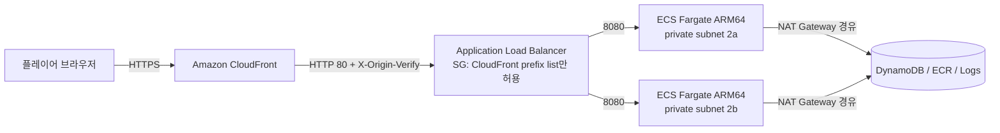

# TURBO PALS GRAND PRIX · 터보 팰즈 그랑프리

브라우저에서 바로 즐기는 아케이드 3D 카트 레이싱 게임입니다. 드리프트 미니 터보, 14종 아이템,
8명의 오리지널 드라이버, 2개 컵 8개 트랙, CPU 7대와 겨루는 그랑프리, 분할 화면 2인 대전,
서버가 재시뮬레이션으로 검증하는 타임 어택 온라인 순위를 제공합니다.

> 캐릭터·아이템·트랙·그래픽·음악은 모두 절차적으로 생성한 오리지널 콘텐츠입니다.
> 외부 에셋 파일이나 타사 IP를 쓰지 않습니다.

## 주요 기능

- **주행**: 결정론적 60 Hz 아케이드 물리, 3단계 드리프트 미니 터보, 점프 트릭 부스트,
  로켓 스타트, 오프로드·진흙·빙판 노면, 코인 속도 보너스.
- **아이템**: 바나나·통통 구슬·추적 로켓(각 ×3), 니트로(×3), 슈퍼 스타, 번개 구름,
  먹물 문어, 터보 로켓, 선두 폭탄, 코인 주머니. 순위 가중 확률과 방패(뒤에 매달기) 메커닉.
- **CPU**: 레이싱 라인·곡률 기반 드리프트·위험물 회피·아이템 전술·러버밴딩, 3단계 난이도.
- **모드**: 그랑프리(4개 트랙 포인트제, 시상대), VS 레이스, 타임 어택(고스트), 2인 분할 화면.
- **온라인 순위**: 입력 로그를 서버가 같은 시뮬레이션 코드로 재실행해 틱 단위로 일치할 때만 등록.
- **그래픽**: three.js, 테마별 절차적 지형·소품·하늘, 그림자, 블룸, 파티클, 자동 화질 조절.
- **오디오**: WebAudio 합성 — 트랙별 오리지널 BGM, 마지막 랩 템포 업, 엔진·드리프트·아이템 효과음.
- **입력**: 키보드, 표준 게임패드(진동), 터치 컨트롤.

## 아키텍처



- 기존 VPC `vpc-0dfa5610180dfa628`(ap-northeast-2)의 public 서브넷에 ALB, private 서브넷에 태스크를
  배치하고, 태스크의 아웃바운드는 VPC의 기존 NAT Gateway를 사용합니다.
- ALB 보안 그룹은 AWS 관리형 CloudFront origin-facing prefix list(`pl-22a6434b`)의 TCP 80만 허용합니다.
- ALB 리스너 기본 동작은 403이며, CloudFront가 붙이는 비밀 헤더(`X-Origin-Verify`)가 일치할 때만
  태스크로 전달합니다.

자세한 내용은 [docs/architecture.md](docs/architecture.md), [docs/design.md](docs/design.md),
[docs/infra.md](docs/infra.md)를 참고하세요.

## 개발

```sh
npm ci
npm run dev        # http://localhost:8200 (API: 8201)
npm run typecheck
npm test
npm run build && npm start   # http://127.0.0.1:8080
```

### QA 빌드와 `?debug` 훅

릴리스 빌드(`node tools/build.mjs`)에는 QA용 디버그 훅(`?debug` → `window.__turbo`)이 **들어 있지 않습니다**.
컴파일 타임 상수 `__DEBUG_HOOK__`로 코드 자체가 제거됩니다.

```sh
TURBO_DEBUG_HOOK=1 node tools/build.mjs   # QA 빌드: ?debug 훅 포함 (배포 금지)
npx vite --config tools/vite-qa.config.mjs --port 8250 --strictPort   # QA 개발 서버: 훅 항상 포함
```

`npm run dev` 개발 서버에도 훅이 들어 있습니다(빌드 결과물이 아니므로). `vite build`로 만드는 결과물은
`TURBO_DEBUG_HOOK=1`일 때만 훅을 포함합니다.

`?debug&quality=low` 같은 화질 지정은 그 페이지의 렌더러에만 적용되고 플레이어의 저장된 설정은 바꾸지 않습니다.

### PWA (오프라인 · 설치 · 업데이트)

프로덕션 빌드에서만 서비스 워커(`dist/client/sw.js`)가 등록되어 게임 파일 전체를 저장합니다.
온라인 랭킹을 뺀 모든 모드는 오프라인에서 동작하고, 오프라인에서 달린 타임 어택 기록은 브라우저에
보관했다가 온라인이 되면 메인 메뉴·랭킹 화면에서 등록할 수 있습니다(다른 앱 버전에서 보관한 기록은
서버가 검증할 수 없어 자동으로 정리됩니다). 새 버전은 레이스가 끝난 뒤 메뉴에서만 적용됩니다.
저장이 끝난 뒤에는 새로고침해도 저장된 버전(앱 셸)으로 열리고, 배포된 새 버전은 실행할 때·앱으로 돌아올 때·15분마다
확인해 뒤에서 받아 둡니다. 플레이어가 타이틀·메인 메뉴의 '업데이트'를 누르거나 게임 창을 모두 닫았다 열면 적용됩니다.

## 배포

```sh
npx cdk deploy --require-approval never --outputs-file cdk-outputs.json
npm run verify:live
```
