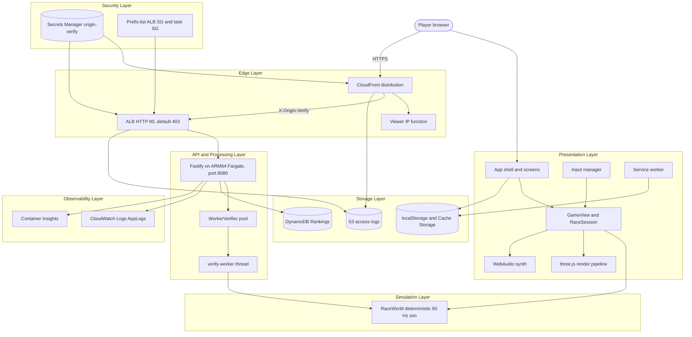
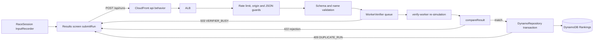
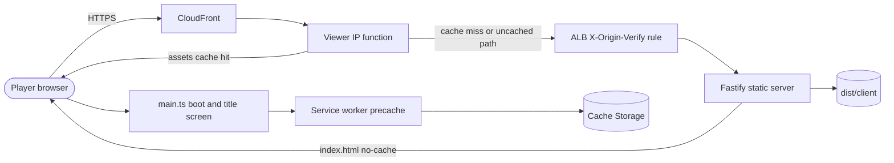

# TURBO PALS GRAND PRIX — Architecture

<a href="#english"></a>
<a href="#korean"></a>

---

<a id="english"></a>

# English

## System Overview

TURBO PALS GRAND PRIX is an arcade 3D kart racer (Mario Kart-style gameplay with fully original characters, items, tracks, art and music) that runs in the browser with three.js.
It is written in TypeScript: Vite 8 builds the client, Fastify 5 serves it from a `node:24-alpine` container on ARM64 ECS Fargate, and AWS CDK v2 deploys CloudFront → ALB → Fargate → DynamoDB in `ap-northeast-2`.
Races run entirely in the browser on a deterministic 60 Hz simulation (`src/sim/`). The server runs the same simulation code only to re-simulate submitted time-trial input logs; a time enters the leaderboard only when the re-simulation reproduces it exactly.

## Components

### Presentation Layer
- **src/client/** -- Browser entry and client plumbing. `main.ts` checks WebGL, then wires input, audio, `GameView`, the app shell and `PwaManager`; `api.ts` is the `/api/*` fetch client (8 s timeout); `sw.ts`, `sw-policy.ts` and `pwa.ts` implement the offline-first service worker (registered in production builds only).
- **src/client/ui/** -- Framework-free DOM app shell (`startApp()`): screen stack, menus, GP/VS/TT/Duo flows, HUD, results, podium, settings. `ui/screens/` holds one module per screen, `ui/art/` code-drawn SVG and canvas art. UI copy is Korean.
- **src/client/game/** -- `createGameView()` glue. `RaceSession` steps `RaceWorld`, interpolates poses, records time-trial input, plays the ghost and routes race events; `HudModel` turns events and world state into `HudSnapshot`s.
- **src/client/render/** -- three.js r186 pipeline: renderer with an auto quality governor, bloom and overlays, chase cameras, track meshes, kart and item models, particles, menu showroom. `render/themes/` builds the 8 themed sceneries.
- **src/client/audio/** -- WebAudio-only synthesis: mixer, sequencer, instruments, drums, SFX, engine loops, spatialisation. `audio/songs/` holds the 14 songs as code. Falls back to a silent system when WebAudio is missing.
- **src/client/input/** -- Keyboard, gamepad and touch to `KartInput` and menu actions (`createInputManager()`).
- **src/client/dev/** -- Dev-only render QA pages under `/dev/` on `npm run dev`; not part of the production build.

### Simulation Layer
- **src/sim/** -- Pure deterministic simulation shared by client and server: kart physics, items, CPU AI, race rules, input logs, replay verification. Fixed 60 Hz step; no DOM, three.js, `Math.random`, `Date` or transcendental `Math.*` calls (`dmath.ts` replaces them).
- **src/sim/tracks/** -- 8 track definitions (`TrackDef`) and the menu catalog: 2 cups of 4 tracks, 3 laps each.

### API / Processing Layer
- **src/shared/api.ts** -- HTTP contract shared by browser and server (`API_LIMITS`, request and response types, `RunRejectionCode`).
- **src/server/** -- Fastify 5 server: `GET /healthz`, `GET /api/leaderboard`, `GET /api/ghost/:id`, `POST /api/runs`, the built client with SPA fallback, and per-client rate limits (submit 12, read 120, page 600 per 60 s).
- **src/server/verifier.ts** -- `WorkerVerifier`: a worker-thread pool that runs `verifyTimeTrial` off the event loop with a per-run timeout and a bounded queue.
- **Dockerfile** -- Two-stage `node:24-alpine` image; the runtime stage holds only `dist/` and runs `node dist/server/index.js` as `1000:1000`.
- **infra/lib/service.ts** -- Compute half: ECS cluster, ARM64 Fargate task definition (1 vCPU, 2 GiB, read-only root filesystem) and service (2-6 tasks in the private subnets).

### Storage Layer
- **src/server/dynamo-repository.ts** -- Single-table DynamoDB repository: one row per player per board, personal-best swaps in one `TransactWriteItems`, ghost logs outside the board partition. `memory-repository.ts` replaces it when `TABLE_NAME` is empty (dev, tests).
- **infra/lib/data.ts** -- DynamoDB `Rankings` table (`pk`/`sk`, on-demand, PITR, deletion protection, retained on destroy).
- **infra/lib/logs.ts** -- S3 bucket for CloudFront (`cloudfront/`) and ALB (`alb/`) access logs, 30-day expiry, retained on destroy.
- **src/client/storage.ts** -- Browser-side state in localStorage under `tpgp.v1.` (settings, player id, personal bests, trophies, stats, offline time-trial queue), with an in-memory fallback.

### Edge Layer
- **infra/lib/edge.ts** -- CloudFront distribution (HTTP/2 and HTTP/3, IPv6, PriceClass 200, HTTPS redirect): uncached default and `/api/*` behaviors, a 365-day cache for hashed `/assets/*`, a viewer-request function that writes `x-turbo-client-ip`, and a security response headers policy.
- **infra/lib/service.ts** -- Edge half: internet-facing ALB on HTTP :80 in the public subnets; the listener answers a fixed 403 unless the priority-10 rule sees a valid `X-Origin-Verify` header.

### Security Layer
- **src/shared/csp.ts** -- Single source of the CSP, Permissions-Policy, HSTS and other header values; the server uses the CSP without `upgrade-insecure-requests`, CloudFront adds it and HSTS.
- **src/server/security.ts** -- Origin allow-list for `POST /api/runs`, JSON content-type guard, rate-limit client key (`x-turbo-client-ip`, else the socket address; IPv6 grouped by /64).
- **infra/lib/data.ts** -- Origin-verify secret in Secrets Manager (generation N, plus N-1 during a rotation); only the ALB rule and the CloudFront origin header reference it.
- **infra/bin/app.ts** -- cdk-nag `AwsSolutionsChecks` run at synth; a violation fails the synth, and the 8 accepted exceptions carry their reasons in code.

### Observability Layer
- **src/server/index.ts** -- pino JSON logs (`service: turbo-pals`, version) with one access line per request (route template, status, duration; successful `/healthz` calls are not logged). Names, IPs, player ids and bodies are never logged.
- **infra/lib/service.ts** -- awslogs to the `AppLogs` log group (1 month), Container Insights V2 on the cluster, ALB and container health checks on `/healthz` (liveness only; it does not probe DynamoDB).
- **tools/verify-live.ts** -- Live acceptance run against the deployed stack (35 checks, report in `docs/quality/live-verify.json`); `tools/verify-live-pwa.mjs` adds 8 headless-browser PWA and offline checks. The stack defines no CloudWatch alarms.

## Full Architecture Diagram



## Data Flow Summary

### Page Load

CloudFront answers hashed `/assets/*` from its cache; everything else goes to the origin uncached. Fastify serves `index.html`, `sw.js`, `build.json` and the manifest with `no-cache` and `assets/` as immutable. After the title screen appears, a production build registers the service worker, which precaches the whole game so it also starts offline.


### Time-Trial Submission and Verification

`POST /api/runs` is checked in this order: rate limit (429), origin (403), content type (415), body size and schema (413, 400), name and character (400). The verifier then re-simulates the log; `compareResult` turns a mismatch into a 422, the repository rejects a log another player already owns with 409, and an accepted run returns 200 with its rank. Offline, the results screen queues one run per track and class and submits it later.



## Module Map

| Path | Responsibility |
| --- | --- |
| `src/sim/` | Pure deterministic simulation shared by client and server (no DOM, three.js, `Math.random`, `Date` or transcendental `Math.*`). |
| `src/sim/types.ts` | **Contract**: every shared data type (track definitions, built tracks, karts, inputs, items, 32 `RaceEvent` kinds, race config and results). +Y is up, yaw 0 faces +Z, units are m, s and rad. |
| `src/sim/dmath.ts` | Deterministic `dsin`/`dcos`/`datan`/`datan2`/`dexp`, `wrapAngle`, `damp` and helpers built from IEEE-exact operations only. Use these in sim code. |
| `src/sim/rng.ts` | `Rng` (mulberry32, seedable) and `hashString` (FNV-1a). |
| `src/sim/constants.ts` | Tick rate (`TICK_HZ` 60, `DT`), countdown and rocket-start windows, `PHYS` tuning, `SPEED_CLASSES`, `CPU_LEVELS`, `GP_POINTS`. |
| `src/sim/characters.ts` | 8 original drivers (`CHARACTERS`, `CHARACTER_IDS`, `getCharacter`, `isCharacterId`). |
| `src/sim/item-defs.ts` | 14 items (`ITEMS`, `ITEM_IDS`) and position-weighted odds (`ITEM_WEIGHTS`, `rankBucket`). |
| `src/sim/tracks/catalog.ts` | Track and cup metadata for menus (`TRACK_CATALOG`, `CUPS`, `tracksOfCup`, `getTrackMeta`). Its order defines `TRACK_DEFS` and the server's track-id enum. |
| `src/sim/tracks/*.ts` | Track geometry definitions (`TrackDef`). `tracks/index.ts` exports `TRACK_DEFS`, `hasTrackDef`, `getTrackDef`. |
| `src/sim/track-builder.ts` | `buildTrack(def, { mirror })` → `BuiltTrack` (Catmull-Rom spline → ~1 m samples, frames, curvature, walls, features, 8-slot grid), `mirrorDef`, cached `getBuiltTrack`. |
| `src/sim/track-query.ts` | Fast local queries: `projectToTrack`, `surfaceAt`, `pointAt`, `wrapS`, `sampleIndex`, `deltaS`, `trackYaw`. |
| `src/sim/kart-physics.ts` | Arcade kart dynamics (steering, drift and mini-turbo, hops and tricks, jumps, walls, surfaces, falls and respawn, hits). |
| `src/sim/items.ts` | Item roulette, usage, shields, projectiles, hazards and hits. |
| `src/sim/ai.ts` | CPU drivers (racing line, drift controller, mover and projectile avoidance, item tactics, rubber-banding). |
| `src/sim/race.ts` | `RaceWorld`: owns karts, projectiles, item boxes, coins and movers, steps the race, emits `RaceEvent`s. |
| `src/sim/input-log.ts` | 16-bit input quantisation and run-length-encoded base64 logs (`InputRecorder`, `decodeLog`). |
| `src/sim/replay.ts` | `createTimeTrialConfig`, `verifyTimeTrial` (server-side re-simulation), `GhostPlayer`. |
| `src/shared/api.ts` | HTTP API contract (leaderboard, submit, ghost). |
| `src/shared/csp.ts` | CSP, Permissions-Policy and security header constants shared by Fastify and CloudFront. |
| `src/client/contracts.ts` | **Contract** for client subsystems: `AudioSystem`, `InputManager`, `GameView`, `HudSnapshot`, `Settings`. |
| `src/client/` (root files) | `main.ts` boot, `api.ts` fetch client, `storage.ts` persistence, `pwa.ts`, `sw.ts` and `sw-policy.ts` service worker. |
| `src/client/audio/` | Procedural WebAudio music, SFX and engine loops (`createAudioSystem()`); `audio/songs/` holds the song definitions. |
| `src/client/input/` | Keyboard, gamepad and touch → `KartInput`; menu navigation (`createInputManager()`). |
| `src/client/ui/` | App shell and flows (GP/VS/TT/Duo), menus, HUD, results, podium, settings (`startApp()`); `ui/screens/` per screen, `ui/art/` code-drawn art. |
| `src/client/game/` | `createGameView()` glue: `RaceSession` (RaceWorld stepping, interpolation, ghost, input recording, render, audio, HUD snapshots) and `HudModel`. |
| `src/client/render/` | three.js: renderer and quality governor, post-processing, track meshes, themed scenery (`render/themes/`), kart models, items, particles, cameras, showroom. |
| `src/client/dev/` | Dev-only render QA pages; not in the production build. |
| `src/server/` | Fastify: static files, `/healthz`, `/api/*`, rate limits, replay verification worker pool, DynamoDB and memory repositories. |
| `infra/` | CDK: CloudFront → ALB (CloudFront prefix-list SG and `X-Origin-Verify`) → private ARM64 Fargate (existing VPC and NAT GW) → DynamoDB. |
| `tools/` | Production build (`build.mjs`), dev servers, QA screenshots, track and sim reports, live verification, performance probes. |
| `test/` | vitest suites `test/sim`, `test/client`, `test/server`, `test/infra`; shell harness `test/harness`. |

## Simulation API

The public surface of `src/sim` used by the client, the server and the tools:

```typescript
// tracks/index.ts
export const TRACK_DEFS: readonly TrackDef[];              // TRACK_CATALOG order
export function hasTrackDef(id: string): boolean;
export function getTrackDef(id: string): TrackDef;         // throws on an unknown id

// track-builder.ts
export function mirrorDef(def: TrackDef): TrackDef;
export function buildTrack(def: TrackDef, opts?: { mirror?: boolean }): BuiltTrack;
export function getBuiltTrack(id: string, mirror?: boolean): BuiltTrack;  // cached per id and mirror; treat as immutable

// track-query.ts
export function wrapS(t: BuiltTrack, s: number): number;
export function sampleIndex(t: BuiltTrack, s: number): number;
export function deltaS(t: BuiltTrack, a: number, b: number): number;
export function projectToTrack(t: BuiltTrack, x: number, z: number, hint: number, y?: number): TrackProjection;
export function surfaceAt(t: BuiltTrack, p: TrackProjection): SurfaceInfo;
export function pointAt(t: BuiltTrack, s: number, d: number): { x: number; y: number; z: number; i: number; yaw: number };
export function trackYaw(t: BuiltTrack, i: number): number;

// race.ts
export class RaceWorld {
  constructor(config: RaceConfig, track?: BuiltTrack);    // default track: getBuiltTrack(config.trackId, config.mirror)
  readonly config: RaceConfig; readonly track: BuiltTrack;
  readonly laps: number;                                   // config.laps ?? track.def.laps
  readonly rng: Rng;                                       // world RNG, seeded from config.seed
  readonly ctx: PhysicsContext;
  tick: number;                                            // ticks since countdown start
  phase: RacePhase;                                        // 'countdown' -> 'racing' -> 'done'
  karts: KartState[];
  projectiles: Projectile[];
  itemBoxes: Array<{ x: number; y: number; z: number; active: boolean; timer: number }>;
  coins: Array<{ x: number; y: number; z: number; active: boolean; timer: number }>;
  thunderCooldown: number;
  humanLeadProgress: number | null;                        // leading unfinished human (rubber-banding)
  doneTick: number;                                        // absolute tick the race ended, -1 before
  get racing(): boolean;                                   // phase !== 'countdown'
  get moverCount(): number;
  step(humanInputs: readonly KartInput[]): void;           // one 60 Hz tick; index = human player number, not kart index
  drainEvents(): RaceEvent[];
  raceTicks(): number;                                     // ticks since GO (0 during countdown)
  moverPosition(index: number): { x: number; y: number; z: number; yaw: number };
  moverPositionAt(index: number, tick: number): { x: number; y: number; z: number; yaw: number };
  moverAt(index: number, aheadTicks?: number): { x: number; z: number; radius: number };
  nextProjectileId(): number;
  results(): RaceResult[];                                 // final once phase === 'done'; unfinished karts are estimated
}

// input-log.ts
export const STEER_STEPS = 63;
export const NEUTRAL_INPUT: KartInput;                     // frozen, all controls released
export function encodeInputWord(i: KartInput): number;    // bits 0-6 steer+63, 7 throttle, 8 brake, 9 drift, 10 item, 11 back
export function decodeInputWord(w: number): KartInput;
export function quantizeInput(i: KartInput): KartInput;   // applied to every human input inside step()
export class InputRecorder { push(i: KartInput): void; get length(): number; encode(): string }
export function decodeLog(s: string, maxTicks?: number): Uint16Array;  // default 54000; one word per tick; throws on malformed input

// replay.ts
export const TIME_TRIAL_SEED = 0x7a11;
export const MAX_TT_TICKS: number;                         // COUNTDOWN_TICKS + 60 * 60 * 12 = 43380
export function createTimeTrialConfig(trackId: string, cc: SpeedClass, charId: CharacterId): RaceConfig;
export type VerifyResult = { ok: true; ticks: number; lapTicks: number[] } | { ok: false; reason: string };
export function verifyTimeTrial(input: { trackId: string; cc: SpeedClass; charId: CharacterId; log: string }): VerifyResult;
export class GhostPlayer {
  constructor(trackId: string, cc: SpeedClass, charId: CharacterId, log: string);
  readonly world: RaceWorld;
  get kart(): KartState;
  get done(): boolean;
  step(): void;                                            // next word (NEUTRAL_INPUT after the log), events drained
}
```

### Time-Trial Log Contract

- A time-trial run records one input word per tick **from tick 0 of the countdown** up to and including the tick on which the kart crosses the finish line of the final lap.
- `createTimeTrialConfig` returns mode `'tt'`, one human kart, `mirror: false`, `items: false`, seed `TIME_TRIAL_SEED`. `RaceWorld` then creates no item boxes and no coins, and the kart starts with `nitro3` (3 uses). There is no mirror time trial.
- `ticks` is the kart's `finishTick`: race ticks since GO at the finish, equal to `raceTicks()` after that step. Lap 1 is measured from GO, so `lapTicks` sums to `ticks`.
- `verifyTimeTrial` rejects `unknown track`, `unknown character`, `bad speed class`, `malformed log: ...`, `log continues after the finish` and `run did not finish`.

## Game Loop

- `GameView` (`src/client/game/index.ts`) owns the `requestAnimationFrame` loop, clamps the frame delta to 0-0.1 s, and calls `RaceSession.frame(dt, paused)` while a race is active (the menu showroom renders otherwise).
- `RaceSession.frame` (`src/client/game/race-session.ts`) clamps again (NaN or negative → 0, above 0.25 s → 0.25 s). During the 4.6 s camera intro the simulation does not step; afterwards it calls `stepSimulation(dt)`. While paused nothing steps and no events are produced, but the frame still renders.
- `stepSimulation` runs a fixed-step accumulator at `DT = 1/60` s with at most 5 steps per frame. If more than one tick of time is still left after 5 steps, the remainder is dropped (`acc = 0`) so a slow device slows the race instead of spiralling.
- Each step: poll every human player with `InputManager.poll(player, DT)` (debug bots may replace the input and mark the run `assisted`); in a time trial, push player 1's input into the `InputRecorder` until the kart finishes; save the previous poses; `world.step(inputs)`; step the ghost exactly once (`GhostPlayer.step()`); `world.drainEvents()`. A `respawn` event resets the previous pose so the teleport is not interpolated.
- After stepping, the events of all steps are handled once per frame: `HudModel.onEvents`, then `audio.handleEvents`, particles, camera shake (`settings.shake`), gamepad rumble (`settings.rumble`) and start lights.
- Rendering interpolates between the previous and current kart poses with `alpha = min(1, acc / DT)`, then updates cameras, renders, and calls `onFinish` once, 3.2 s after `phase` becomes `'done'`.

## Simulation Versioning

The server accepts a time trial only if re-simulating its input log reproduces the claimed `ticks` and `lapTicks` exactly. Client and server must therefore run the same simulation, and the version check tells a player with a stale client to reload instead of reporting a corrupt run.

### What Is Compared

- The client sends `version: APP_VERSION` in `SubmitRunRequest`. `APP_VERSION` is the `package.json` `version` compiled in by Vite (`__APP_VERSION__` in `vite.config.ts`), for example `1.0.0`.
- The server version is the `APP_VERSION` environment variable, else `version+id[0:12]` from `dist/build.json`, else the `package.json` `version`. On ECS, CDK sets it to `<package.json version>+<first 12 hex of the image asset hash>` (currently `1.0.0+bc87c1a48e07`); `GET /healthz` reports it.
- `compareResult` (`src/server/app.ts`) compares only the semver core (`version.split('+')[0]`), and **only when the re-simulation failed**: a different core gives 422 `VERSION_MISMATCH`, the same core gives 422 `REPLAY_INVALID`. A successful re-simulation is then checked for `TIME_MISMATCH` and `LAP_MISMATCH` and is accepted whatever its version.
- At boot the client drops queued offline runs whose semver core differs from its own (`dropStalePendingRuns`), because the server would refuse them.

### When to Bump the Version

- **Any edit to existing simulation code or existing track geometry under `src/sim/` that can alter a time-trial trajectory requires a `package.json` version bump** (and a CHANGELOG entry), deployed together with the change. That covers kart physics, `PHYS`, `SPEED_CLASSES`, countdown and start-boost constants, character stats, the definitions of existing tracks, `track-builder` and `track-query`, input quantisation and the log format, the order and rules of `RaceWorld.step`, the nitro path in `items.ts` (time trials start with `nitro3`) and `dmath`.
- Adding a brand-new track (a new `TrackDef` plus its catalog entry) alters no existing replay, so this rule does not force a bump. Any bump, whatever the reason, makes clients discard the offline runs they queued under the old semver core at their next boot (`dropStalePendingRuns`).
- AI changes do not affect time-trial verification (no CPU karts; the AI drives the human kart only after the finish), but they do change GP and VS races.
- Only the core counts: the `+<hash>` suffix changes with every image build and never triggers `VERSION_MISMATCH`.
- Without a bump, stale clients get `REPLAY_INVALID` (or `TIME_MISMATCH`/`LAP_MISMATCH` if an old log happens to finish with another time) instead of the clear `VERSION_MISMATCH`.
- `.claude/hooks/check-doc-sync.sh` prints this reminder after every edit of a non-Markdown file under `src/sim/`.
- Run `npm run verify:live` only against the build you just deployed: its honest-run check records a bot run with the local simulation and submits it to the deployed server.

### Verification Worker and Budgets

- `WorkerVerifier` (`src/server/verifier.ts`) runs `verifyTimeTrial` in a worker thread: `dist/server/verify-worker.js` from the production bundle (built by `tools/build.mjs`), or `src/server/verify-worker.ts` through `ts-worker-bootstrap.mjs` when the server runs from source (`npm run dev`).
- Pool size `max(1, min(2, availableParallelism()))`; workers start with the server (`warmVerifier`).
- Per run: an 8 s wall-clock timeout. On expiry the worker is terminated and the run fails with `verification timed out`, answered as 422 like any failed re-simulation.
- Queue: at most 32 waiting runs, each for at most 6 s, then 503 `VERIFIER_BUSY` with `Retry-After: 3`. The 6 s limit makes the server fail fast before the browser's 8 s API timeout.
- Worker heap: 256 MB old generation, 32 MB young generation. A worker crash, exit or malformed reply gives 503 `SERVICE_UNAVAILABLE` with `Retry-After: 2`.
- Input limits: `decodeLog(log, MAX_TT_TICKS)` caps a log at 43380 ticks (countdown plus 12 minutes); the request schema caps `log` at 200000 characters.

## Visual and Audio Identity

- Design intent: bright, toy-like, saturated palette; chunky rounded shapes; soft shadows; strong silhouettes.
- All game content is procedural code: track meshes, terrain, sky, karts and chibi drivers are generated geometry, textures are drawn on canvases at runtime (`render/textures.ts`), and music and SFX are synthesised with WebAudio from a song DSL (`audio/pattern.ts`, `audio/songs/`). There is no third-party art or music and no Nintendo IP; `test/client/audio-songs.test.ts` rejects song titles that match Nintendo names, and trackside banner brands are fictional.
- Eight themes (meadow, beach, canyon, city, snow, jungle, volcano, galaxy) each have a palette (`THEME_PALETTES`), a scenery module and their own song; city, volcano and galaxy are night themes.
- UI copy is Korean first (`lang="ko"`); English appears only in decorative labels such as `GO!`, `FINISH!` and `FINAL LAP`. The only third-party creative assets are the Black Han Sans (display) and Jua (body) fonts, bundled through `@fontsource` under OFL 1.1.

## Infrastructure

Details, security boundaries and cost estimates are in [infra.md](infra.md) (Korean).

### Deployment Region
- `ap-northeast-2` (Asia Pacific, Seoul), account `061525506239`, existing VPC `vpc-0dfa5610180dfa628` (`10.100.0.0/16`) in `ap-northeast-2a` and `ap-northeast-2b`.
- CloudFront is global (PriceClass 200). The viewer certificate (`*.whchoi.net`) is an existing ACM certificate in `us-east-1`; the stack imports it and creates none.

### Modules / Resources
| Module | Resources | Description |
|--------|-----------|-------------|
| `infra/bin/app.ts` | CDK app, cdk-nag `AwsSolutionsChecks` | Reads context (`account`, `region`, `vpcId`, `cloudfrontPrefixListId`, `originSecretGeneration`, `domainName`, `certificateArn`) and creates `TurboPalsStack`. |
| `infra/lib/settings.ts` | None (constants) | Target account, region, VPC, subnets, prefix list `pl-22a6434b`, port 8080, task size, 2-6 tasks, scaling targets, custom domain. |
| `infra/lib/stack.ts` | Stack, 7 outputs | Refuses any other account, region, VPC, prefix list, domain or certificate region; wires the constructs; sets `PUBLIC_ORIGIN` and `ALLOWED_ORIGINS`; tags `Project=turbo-pals`; the distribution depends on the ALB rule. |
| `infra/lib/network.ts` | None created (`Vpc.fromLookup`) | Imports the existing VPC and its public and private subnets in 2a and 2b; verifies the subnet IDs. |
| `infra/lib/data.ts` | DynamoDB table, Secrets Manager secret (2 during rotation) | `Rankings` table (on-demand, PITR, deletion protection, retained); 48-character origin-verify secret per generation. |
| `infra/lib/logs.ts` | S3 bucket, bucket policy | Access logs for CloudFront and ALB, TLS-only, 30-day expiry, retained. |
| `infra/lib/service.ts` | 2 security groups and their rules, ALB, listener, listener rule, target group, Docker image asset, ECS cluster, log group, Fargate task definition and service, IAM roles and policies, autoscaling | ALB SG admits only the CloudFront prefix list on TCP 80; tasks accept only the ALB on 8080 and leave only on TCP 443 through the VPC's NAT gateways; the task role may only `GetItem`, `PutItem`, `DeleteItem` and `Query` the table; scaling on 60% CPU and 600 requests per target. |
| `infra/lib/edge.ts` | CloudFront distribution, function, response headers policy, cache policy, origin request policy | Behaviors default, `/assets/*`, `/api/*`; error responses never cached; custom domain with TLSv1.2_2021 and SNI when configured. |

The synthesized template holds 30 resources. The stack owns no VPC, subnet, NAT gateway, route or VPC endpoint.

### Deployed Resources
- SiteUrl: `https://my-kart.whchoi.net/` (DNS CNAME managed outside this account; see [runbooks/custom-domain.md](runbooks/custom-domain.md))
- NativeSiteUrl: `https://d374w2735k9eto.cloudfront.net/`
- DistributionId: `E3M557KCLIGK5L`
- AlbDnsName, ClusterName, ServiceName, TableName: generated names, written to the git-ignored `cdk-outputs.json` by every deploy. The ALB answers only CloudFront.
- Health: `GET /healthz` returns `{"ok":true,"version":"<semver>+<asset hash>"}`.

```bash
jq -r '.TurboPalsStack | to_entries[] | "\(.key)=\(.value)"' cdk-outputs.json
curl -s https://my-kart.whchoi.net/healthz
```

## Key Design Decisions

- One deterministic simulation shared by browser and server, with time trials verified by re-simulating the input log ([ADR-001](decisions/ADR-001-deterministic-simulation-server-verification.md)) -- the leaderboard never trusts a claimed time and no authoritative game server is needed; `dmath` replaces `Math.sin` and friends because engines may approximate them differently.
- CloudFront-only origin access: prefix-list security group, `X-Origin-Verify` secret rule and a fixed-403 listener default ([ADR-002](decisions/ADR-002-cloudfront-only-origin-access.md)) -- HTTPS, edge security headers and the per-viewer rate-limit key cannot be bypassed by calling the ALB directly, and the secret rotates by generation without downtime.
- ARM64 Fargate tasks in the existing VPC and NAT gateways, with no network resources in the stack ([ADR-003](decisions/ADR-003-fargate-arm64-in-existing-vpc.md)) -- reuses the network the account already runs, cannot change shared routing, and hard guards refuse any other account, region or VPC.
- On-demand, single-table DynamoDB leaderboard with transactional writes ([ADR-004](decisions/ADR-004-dynamodb-on-demand-leaderboard.md)) -- low, spiky traffic pays per request, and one transaction keeps the best pointer, ranking row, ghost and log claim consistent; PITR, deletion protection and retention protect the records.
- Procedural, original content only ([ADR-005](decisions/ADR-005-procedural-original-content.md)) -- nothing to license, no Nintendo IP, and all art and music ship as reviewable code.
- Offline-first PWA with race-safe updates ([ADR-006](decisions/ADR-006-offline-first-pwa-race-safe-updates.md)) -- the game starts offline after the first visit, the cached shell always matches the worker that serves it, and an update never activates while any window is racing.
- Claude Code harness adapted to this repository ([ADR-007](decisions/ADR-007-claude-code-harness-adaptations.md)) -- invariants no vitest test guards (simulation version bumps, `.dockerignore` parity with `IMAGE_CONTEXT_EXCLUDE`, doc sync, secret scanning) are flagged at edit time by Claude Code hooks; `npm run test:harness` tests those hooks and checks the `.dockerignore` parity and the documentation structure.

## Operations
- Deployment: see [docs/runbooks/deploy-production.md](runbooks/deploy-production.md)
- Rollback: see [docs/runbooks/rollback-production.md](runbooks/rollback-production.md)
- Teardown: see [docs/runbooks/teardown.md](runbooks/teardown.md)
- Origin secret rotation: see [docs/runbooks/rotate-origin-secret.md](runbooks/rotate-origin-secret.md)
- Custom domain and DNS: see [docs/runbooks/custom-domain.md](runbooks/custom-domain.md)
- Incident Response: see [docs/runbooks/incident-response.md](runbooks/incident-response.md)
- Related: [infra.md](infra.md), [design.md](design.md), [api-reference.md](api-reference.md), [onboarding.md](onboarding.md)

Release and live acceptance (prerequisites in the deployment runbook):

```bash
npm run deploy
npm run verify:live -- --custom
node tools/verify-live-pwa.mjs https://my-kart.whchoi.net
```

---

<a id="korean"></a>

# 한국어

## 시스템 개요

TURBO PALS GRAND PRIX는 브라우저에서 three.js로 동작하는 아케이드 3D 카트 레이서입니다. 게임 방식은 Mario Kart 계열이지만 캐릭터, 아이템, 트랙, 아트, 음악은 모두 독자적으로 만들었습니다.
코드는 TypeScript로 작성했습니다. 클라이언트는 Vite 8로 빌드하고, ARM64 ECS Fargate에서 도는 `node:24-alpine` 컨테이너의 Fastify 5가 이를 서빙합니다. AWS CDK v2가 `ap-northeast-2`에 CloudFront → ALB → Fargate → DynamoDB를 배포합니다.
레이스는 전부 브라우저에서 결정론적 60 Hz 시뮬레이션(`src/sim/`)으로 진행됩니다. 서버는 같은 시뮬레이션 코드를 제출된 타임 트라이얼 입력 로그를 재시뮬레이션할 때만 실행합니다. 재시뮬레이션이 기록을 정확히 재현해야 랭킹에 오릅니다.

## 구성 요소

### 프레젠테이션 계층
- **src/client/** -- 브라우저 진입점과 클라이언트 기반 코드입니다. `main.ts`는 WebGL을 확인한 뒤 입력, 오디오, `GameView`, 앱 셸, `PwaManager`를 연결합니다. `api.ts`는 `/api/*` fetch 클라이언트(타임아웃 8 s)이고, `sw.ts`, `sw-policy.ts`, `pwa.ts`가 오프라인 우선 서비스 워커를 구현합니다(프로덕션 빌드에서만 등록).
- **src/client/ui/** -- 프레임워크 없는 DOM 앱 셸(`startApp()`)입니다. 화면 스택, 메뉴, GP/VS/TT/Duo 흐름, HUD, 결과, 포디움, 설정을 담당합니다. `ui/screens/`에는 화면별 모듈이, `ui/art/`에는 코드로 그리는 SVG와 캔버스 아트가 있습니다. UI 문구는 한국어입니다.
- **src/client/game/** -- `createGameView()` 접착층입니다. `RaceSession`이 `RaceWorld`를 진행시키고, 포즈를 보간하고, 타임 트라이얼 입력을 기록하고, 고스트를 재생하고, 레이스 이벤트를 분배합니다. `HudModel`은 이벤트와 월드 상태를 `HudSnapshot`으로 바꿉니다.
- **src/client/render/** -- three.js r186 파이프라인입니다. 자동 품질 거버너가 있는 렌더러, 블룸과 오버레이, 추적 카메라, 트랙 메시, 카트와 아이템 모델, 파티클, 메뉴 쇼룸으로 구성됩니다. `render/themes/`가 테마 배경 8종을 만듭니다.
- **src/client/audio/** -- WebAudio만으로 소리를 합성합니다. 믹서, 시퀀서, 악기, 드럼, 효과음, 엔진 루프, 공간화가 있고 `audio/songs/`에 곡 14개가 코드로 들어 있습니다. WebAudio가 없으면 무음 시스템으로 대체합니다.
- **src/client/input/** -- 키보드, 게임패드, 터치 입력을 `KartInput`과 메뉴 액션으로 바꿉니다(`createInputManager()`).
- **src/client/dev/** -- `npm run dev`의 `/dev/` 아래에서 여는 개발 전용 렌더 QA 페이지입니다. 프로덕션 빌드에는 들어가지 않습니다.

### 시뮬레이션 계층
- **src/sim/** -- 클라이언트와 서버가 공유하는 순수 결정론적 시뮬레이션입니다. 카트 물리, 아이템, CPU AI, 레이스 규칙, 입력 로그, 리플레이 검증을 담고 있습니다. 60 Hz 고정 스텝이며 DOM, three.js, `Math.random`, `Date`, 초월함수 `Math.*` 호출을 쓰지 않습니다(`dmath.ts`가 대신합니다).
- **src/sim/tracks/** -- 트랙 정의(`TrackDef`) 8개와 메뉴 카탈로그입니다. 컵 2개에 트랙이 4개씩 있고 모두 3랩입니다.

### API / 처리 계층
- **src/shared/api.ts** -- 브라우저와 서버가 공유하는 HTTP 계약입니다(`API_LIMITS`, 요청·응답 타입, `RunRejectionCode`).
- **src/server/** -- Fastify 5 서버입니다. `GET /healthz`, `GET /api/leaderboard`, `GET /api/ghost/:id`, `POST /api/runs`, SPA fallback을 포함한 빌드된 클라이언트 서빙, 클라이언트별 rate limit(60 s당 submit 12, read 120, page 600)을 제공합니다.
- **src/server/verifier.ts** -- `WorkerVerifier`입니다. worker thread 풀에서 `verifyTimeTrial`을 이벤트 루프 밖에서 실행하며, 실행마다 타임아웃을 두고 대기열 길이를 제한합니다.
- **Dockerfile** -- 2단계 `node:24-alpine` 이미지입니다. 런타임 단계에는 `dist/`만 있고 `1000:1000` 사용자로 `node dist/server/index.js`를 실행합니다.
- **infra/lib/service.ts** -- 컴퓨팅 부분입니다. ECS 클러스터, ARM64 Fargate 태스크 정의(1 vCPU, 2 GiB, 읽기 전용 루트 파일시스템), 프라이빗 서브넷의 서비스(태스크 2~6개)를 만듭니다.

### 스토리지 계층
- **src/server/dynamo-repository.ts** -- 단일 테이블 DynamoDB 저장소입니다. 보드마다 플레이어당 1행을 두고, 개인 기록 교체는 `TransactWriteItems` 한 번으로 처리하며, 고스트 로그는 보드 파티션 밖에 저장합니다. `TABLE_NAME`이 비어 있으면(개발, 테스트) `memory-repository.ts`가 대신합니다.
- **infra/lib/data.ts** -- DynamoDB `Rankings` 테이블입니다(`pk`/`sk`, 온디맨드, PITR, 삭제 보호, destroy 시 보존).
- **infra/lib/logs.ts** -- CloudFront(`cloudfront/`)와 ALB(`alb/`) 액세스 로그용 S3 버킷입니다. 30일 뒤 만료되고 destroy 시 보존됩니다.
- **src/client/storage.ts** -- 브라우저 쪽 상태를 `tpgp.v1.` 접두사로 localStorage에 저장합니다(설정, 플레이어 id, 개인 기록, 트로피, 통계, 오프라인 타임 트라이얼 대기열). 쓸 수 없으면 메모리로 대체합니다.

### 엣지 계층
- **infra/lib/edge.ts** -- CloudFront 배포입니다(HTTP/2와 HTTP/3, IPv6, PriceClass 200, HTTPS 리디렉션). 기본 경로와 `/api/*`는 캐시하지 않고, 해시된 `/assets/*`는 365일 캐시합니다. viewer-request 함수가 `x-turbo-client-ip`를 쓰고, 보안 응답 헤더 정책을 적용합니다.
- **infra/lib/service.ts** -- 엣지 부분입니다. 퍼블릭 서브넷의 인터넷 연결 ALB가 HTTP :80으로 받습니다. 우선순위 10 규칙이 올바른 `X-Origin-Verify` 헤더를 확인하지 못하면 리스너는 고정 403을 응답합니다.

### 보안 계층
- **src/shared/csp.ts** -- CSP, Permissions-Policy, HSTS 등 헤더 값의 단일 원천입니다. 서버는 `upgrade-insecure-requests` 없는 CSP를 쓰고, CloudFront는 이 지시어와 HSTS를 더합니다.
- **src/server/security.ts** -- `POST /api/runs`의 Origin 허용 목록, JSON content-type 검사, rate limit 클라이언트 키(`x-turbo-client-ip`, 없으면 소켓 주소, IPv6는 /64 단위)를 담당합니다.
- **infra/lib/data.ts** -- Secrets Manager의 origin-verify 시크릿입니다(세대 N, 회전 중에는 N-1도 유지). ALB 규칙과 CloudFront 오리진 헤더만 이 값을 참조합니다.
- **infra/bin/app.ts** -- synth 단계에서 cdk-nag `AwsSolutionsChecks`를 실행합니다. 위반이 있으면 synth가 실패하고, 허용한 예외 8건은 사유와 함께 코드에 적혀 있습니다.

### 관측성 계층
- **src/server/index.ts** -- pino JSON 로그(`service: turbo-pals`, 버전)를 남기고 요청마다 접근 로그 한 줄(route 템플릿, 상태 코드, 소요 시간)을 기록합니다. 성공한 `/healthz` 호출은 기록하지 않습니다. 이름, IP, 플레이어 id, 요청 본문은 절대 기록하지 않습니다.
- **infra/lib/service.ts** -- awslogs로 `AppLogs` 로그 그룹(1개월 보관)에 보내고, 클러스터에 Container Insights V2를 켜고, ALB와 컨테이너 헬스 체크를 `/healthz`로 수행합니다. `/healthz`는 liveness만 보며 DynamoDB를 확인하지 않습니다.
- **tools/verify-live.ts** -- 배포된 스택을 대상으로 라이브 인수 검사 35개를 실행하고 결과를 `docs/quality/live-verify.json`에 씁니다. `tools/verify-live-pwa.mjs`는 헤드리스 브라우저로 PWA와 오프라인 검사 8개를 더 합니다. 스택에는 CloudWatch 알람이 없습니다.

## 전체 아키텍처 다이어그램


## 데이터 흐름 요약

### 페이지 로드

CloudFront는 해시된 `/assets/*`를 캐시에서 바로 응답하고, 나머지 요청은 캐시 없이 오리진으로 보냅니다. Fastify는 `index.html`, `sw.js`, `build.json`, manifest를 `no-cache`로, `assets/`를 immutable로 서빙합니다. 프로덕션 빌드는 타이틀 화면이 뜬 뒤 서비스 워커를 등록하고, 서비스 워커가 게임 전체를 프리캐시하므로 오프라인에서도 시작할 수 있습니다.



### 타임 트라이얼 제출과 검증

`POST /api/runs`는 rate limit(429), Origin(403), content type(415), 본문 크기와 스키마(413, 400), 이름과 캐릭터(400) 순으로 검사합니다. 이어서 verifier가 로그를 재시뮬레이션합니다. `compareResult`는 불일치를 422로 바꾸고, 다른 플레이어가 이미 등록한 로그는 저장소가 409로 거절하며, 수락된 기록은 순위와 함께 200으로 응답합니다. 오프라인이면 결과 화면이 트랙과 클래스 조합마다 1건씩 대기열에 넣었다가 나중에 제출합니다.


## 모듈 맵

| 경로 | 담당 |
| --- | --- |
| `src/sim/` | 클라이언트와 서버가 공유하는 순수 결정론적 시뮬레이션입니다(DOM, three.js, `Math.random`, `Date`, 초월함수 `Math.*` 사용 금지). |
| `src/sim/types.ts` | **계약**: 공유 데이터 타입 전체(트랙 정의, 빌드된 트랙, 카트, 입력, 아이템, `RaceEvent` 32종, 레이스 설정과 결과). +Y가 위, yaw 0이 +Z 방향이며 단위는 m, s, rad입니다. |
| `src/sim/dmath.ts` | IEEE에서 정확한 연산만으로 만든 결정론적 `dsin`/`dcos`/`datan`/`datan2`/`dexp`, `wrapAngle`, `damp`와 보조 함수입니다. sim 코드에서는 이것을 씁니다. |
| `src/sim/rng.ts` | `Rng`(mulberry32, seed 지정 가능)와 `hashString`(FNV-1a)입니다. |
| `src/sim/constants.ts` | tick rate(`TICK_HZ` 60, `DT`), 카운트다운과 로켓 스타트 구간, `PHYS` 튜닝, `SPEED_CLASSES`, `CPU_LEVELS`, `GP_POINTS`입니다. |
| `src/sim/characters.ts` | 오리지널 드라이버 8명(`CHARACTERS`, `CHARACTER_IDS`, `getCharacter`, `isCharacterId`)입니다. |
| `src/sim/item-defs.ts` | 아이템 14종(`ITEMS`, `ITEM_IDS`)과 순위별 가중 확률(`ITEM_WEIGHTS`, `rankBucket`)입니다. |
| `src/sim/tracks/catalog.ts` | 메뉴용 트랙·컵 메타데이터(`TRACK_CATALOG`, `CUPS`, `tracksOfCup`, `getTrackMeta`)입니다. 이 순서가 `TRACK_DEFS`와 서버의 트랙 id enum을 정합니다. |
| `src/sim/tracks/*.ts` | 트랙 지오메트리 정의(`TrackDef`)입니다. `tracks/index.ts`가 `TRACK_DEFS`, `hasTrackDef`, `getTrackDef`를 export합니다. |
| `src/sim/track-builder.ts` | `buildTrack(def, { mirror })` → `BuiltTrack`(Catmull-Rom 스플라인 → 약 1 m 샘플, 프레임, 곡률, 벽, 피처, 8칸 그리드), `mirrorDef`, 캐시하는 `getBuiltTrack`입니다. |
| `src/sim/track-query.ts` | 빠른 국소 질의 `projectToTrack`, `surfaceAt`, `pointAt`, `wrapS`, `sampleIndex`, `deltaS`, `trackYaw`입니다. |
| `src/sim/kart-physics.ts` | 아케이드 카트 동역학(조향, 드리프트와 미니 터보, 홉과 트릭, 점프, 벽, 노면, 낙하와 리스폰, 피격)입니다. |
| `src/sim/items.ts` | 아이템 룰렛, 사용, 실드, 투사체, 장애물, 피격입니다. |
| `src/sim/ai.ts` | CPU 드라이버(레이싱 라인, 드리프트 제어, 무버와 투사체 회피, 아이템 전술, 러버밴딩)입니다. |
| `src/sim/race.ts` | `RaceWorld`: 카트, 투사체, 아이템 박스, 코인, 무버를 소유하고 레이스를 진행하며 `RaceEvent`를 발생시킵니다. |
| `src/sim/input-log.ts` | 16비트 입력 양자화와 run-length 인코딩 base64 로그(`InputRecorder`, `decodeLog`)입니다. |
| `src/sim/replay.ts` | `createTimeTrialConfig`, `verifyTimeTrial`(서버 측 재시뮬레이션), `GhostPlayer`입니다. |
| `src/shared/api.ts` | HTTP API 계약(랭킹, 제출, 고스트)입니다. |
| `src/shared/csp.ts` | Fastify와 CloudFront가 함께 쓰는 CSP, Permissions-Policy, 보안 헤더 상수입니다. |
| `src/client/contracts.ts` | 클라이언트 하위 시스템의 **계약**: `AudioSystem`, `InputManager`, `GameView`, `HudSnapshot`, `Settings`입니다. |
| `src/client/` (루트 파일) | `main.ts` 부트, `api.ts` fetch 클라이언트, `storage.ts` 영속화, `pwa.ts`, `sw.ts`, `sw-policy.ts` 서비스 워커입니다. |
| `src/client/audio/` | 절차적 WebAudio 음악, 효과음, 엔진 루프(`createAudioSystem()`)입니다. `audio/songs/`에 곡 정의가 있습니다. |
| `src/client/input/` | 키보드, 게임패드, 터치 → `KartInput`, 메뉴 내비게이션(`createInputManager()`)입니다. |
| `src/client/ui/` | 앱 셸과 흐름(GP/VS/TT/Duo), 메뉴, HUD, 결과, 포디움, 설정(`startApp()`)입니다. `ui/screens/`는 화면별 모듈, `ui/art/`는 코드로 그리는 아트입니다. |
| `src/client/game/` | `createGameView()` 접착층입니다. `RaceSession`(RaceWorld 진행, 보간, 고스트, 입력 기록, 렌더, 오디오, HUD 스냅샷)과 `HudModel`로 구성됩니다. |
| `src/client/render/` | three.js 렌더러와 품질 거버너, 후처리, 트랙 메시, 테마 배경(`render/themes/`), 카트 모델, 아이템, 파티클, 카메라, 쇼룸입니다. |
| `src/client/dev/` | 개발 전용 렌더 QA 페이지입니다. 프로덕션 빌드에는 없습니다. |
| `src/server/` | Fastify: 정적 파일, `/healthz`, `/api/*`, rate limit, 리플레이 검증 워커 풀, DynamoDB와 메모리 저장소입니다. |
| `infra/` | CDK: CloudFront → ALB(CloudFront prefix list SG와 `X-Origin-Verify`) → 프라이빗 ARM64 Fargate(기존 VPC와 NAT GW) → DynamoDB입니다. |
| `tools/` | 프로덕션 빌드(`build.mjs`), 개발 서버, QA 스크린샷, 트랙·시뮬레이션 리포트, 라이브 검증, 성능 측정 도구입니다. |
| `test/` | vitest 스위트 `test/sim`, `test/client`, `test/server`, `test/infra`와 셸 하네스 `test/harness`입니다. |

## 시뮬레이션 API

클라이언트, 서버, 도구가 사용하는 `src/sim`의 공개 표면입니다.

```typescript
// tracks/index.ts
export const TRACK_DEFS: readonly TrackDef[];              // TRACK_CATALOG order
export function hasTrackDef(id: string): boolean;
export function getTrackDef(id: string): TrackDef;         // throws on an unknown id

// track-builder.ts
export function mirrorDef(def: TrackDef): TrackDef;
export function buildTrack(def: TrackDef, opts?: { mirror?: boolean }): BuiltTrack;
export function getBuiltTrack(id: string, mirror?: boolean): BuiltTrack;  // cached per id and mirror; treat as immutable

// track-query.ts
export function wrapS(t: BuiltTrack, s: number): number;
export function sampleIndex(t: BuiltTrack, s: number): number;
export function deltaS(t: BuiltTrack, a: number, b: number): number;
export function projectToTrack(t: BuiltTrack, x: number, z: number, hint: number, y?: number): TrackProjection;
export function surfaceAt(t: BuiltTrack, p: TrackProjection): SurfaceInfo;
export function pointAt(t: BuiltTrack, s: number, d: number): { x: number; y: number; z: number; i: number; yaw: number };
export function trackYaw(t: BuiltTrack, i: number): number;

// race.ts
export class RaceWorld {
  constructor(config: RaceConfig, track?: BuiltTrack);    // default track: getBuiltTrack(config.trackId, config.mirror)
  readonly config: RaceConfig; readonly track: BuiltTrack;
  readonly laps: number;                                   // config.laps ?? track.def.laps
  readonly rng: Rng;                                       // world RNG, seeded from config.seed
  readonly ctx: PhysicsContext;
  tick: number;                                            // ticks since countdown start
  phase: RacePhase;                                        // 'countdown' -> 'racing' -> 'done'
  karts: KartState[];
  projectiles: Projectile[];
  itemBoxes: Array<{ x: number; y: number; z: number; active: boolean; timer: number }>;
  coins: Array<{ x: number; y: number; z: number; active: boolean; timer: number }>;
  thunderCooldown: number;
  humanLeadProgress: number | null;                        // leading unfinished human (rubber-banding)
  doneTick: number;                                        // absolute tick the race ended, -1 before
  get racing(): boolean;                                   // phase !== 'countdown'
  get moverCount(): number;
  step(humanInputs: readonly KartInput[]): void;           // one 60 Hz tick; index = human player number, not kart index
  drainEvents(): RaceEvent[];
  raceTicks(): number;                                     // ticks since GO (0 during countdown)
  moverPosition(index: number): { x: number; y: number; z: number; yaw: number };
  moverPositionAt(index: number, tick: number): { x: number; y: number; z: number; yaw: number };
  moverAt(index: number, aheadTicks?: number): { x: number; z: number; radius: number };
  nextProjectileId(): number;
  results(): RaceResult[];                                 // final once phase === 'done'; unfinished karts are estimated
}

// input-log.ts
export const STEER_STEPS = 63;
export const NEUTRAL_INPUT: KartInput;                     // frozen, all controls released
export function encodeInputWord(i: KartInput): number;    // bits 0-6 steer+63, 7 throttle, 8 brake, 9 drift, 10 item, 11 back
export function decodeInputWord(w: number): KartInput;
export function quantizeInput(i: KartInput): KartInput;   // applied to every human input inside step()
export class InputRecorder { push(i: KartInput): void; get length(): number; encode(): string }
export function decodeLog(s: string, maxTicks?: number): Uint16Array;  // default 54000; one word per tick; throws on malformed input

// replay.ts
export const TIME_TRIAL_SEED = 0x7a11;
export const MAX_TT_TICKS: number;                         // COUNTDOWN_TICKS + 60 * 60 * 12 = 43380
export function createTimeTrialConfig(trackId: string, cc: SpeedClass, charId: CharacterId): RaceConfig;
export type VerifyResult = { ok: true; ticks: number; lapTicks: number[] } | { ok: false; reason: string };
export function verifyTimeTrial(input: { trackId: string; cc: SpeedClass; charId: CharacterId; log: string }): VerifyResult;
export class GhostPlayer {
  constructor(trackId: string, cc: SpeedClass, charId: CharacterId, log: string);
  readonly world: RaceWorld;
  get kart(): KartState;
  get done(): boolean;
  step(): void;                                            // next word (NEUTRAL_INPUT after the log), events drained
}
```

### 타임 트라이얼 로그 계약

- 타임 트라이얼 기록은 **카운트다운 tick 0부터** 마지막 랩의 결승선을 통과한 tick까지(그 tick 포함) tick마다 입력 word 1개를 담습니다.
- `createTimeTrialConfig`는 mode `'tt'`, 사람 카트 1대, `mirror: false`, `items: false`, seed `TIME_TRIAL_SEED`를 돌려줍니다. 이 설정이면 `RaceWorld`는 아이템 박스와 코인을 만들지 않고, 카트는 `nitro3`(3회)를 들고 출발합니다. 미러 타임 트라이얼은 없습니다.
- `ticks`는 카트의 `finishTick`, 즉 완주 시점의 GO 이후 레이스 tick 수이며 그 step 직후의 `raceTicks()`와 같습니다. 1랩을 GO부터 재므로 `lapTicks`의 합은 `ticks`와 같습니다.
- `verifyTimeTrial`이 거절하는 사유는 `unknown track`, `unknown character`, `bad speed class`, `malformed log: ...`, `log continues after the finish`, `run did not finish`입니다.

## 게임 루프

- `GameView`(`src/client/game/index.ts`)가 `requestAnimationFrame` 루프를 소유합니다. 프레임 간격을 0~0.1 s로 자르고, 레이스 중이면 `RaceSession.frame(dt, paused)`를 호출합니다(레이스가 없으면 메뉴 쇼룸을 렌더합니다).
- `RaceSession.frame`(`src/client/game/race-session.ts`)은 간격을 한 번 더 정리합니다(NaN이나 음수는 0, 0.25 s 초과는 0.25 s). 4.6 s 카메라 인트로 동안에는 시뮬레이션을 진행하지 않고, 인트로가 끝나면 `stepSimulation(dt)`를 호출합니다. 일시정지 중에는 진행도 이벤트도 없지만 화면은 계속 렌더합니다.
- `stepSimulation`은 `DT = 1/60` s 고정 스텝 누산기이며 프레임당 최대 5스텝을 돌립니다. 5스텝을 돌고도 1 tick보다 많은 시간이 남으면 나머지를 버립니다(`acc = 0`). 그래서 느린 기기에서는 처리가 밀려 쌓이지 않고 레이스가 느려집니다.
- 스텝마다 사람 플레이어별로 `InputManager.poll(player, DT)`를 읽습니다(디버그 봇이 입력을 대신하면 기록에 `assisted` 표시가 붙습니다). 타임 트라이얼에서는 카트가 완주하기 전까지 플레이어 1의 입력을 `InputRecorder`에 넣습니다. 이어서 이전 포즈를 저장하고, `world.step(inputs)`, 고스트 1스텝(`GhostPlayer.step()`), `world.drainEvents()`를 실행합니다. `respawn` 이벤트가 오면 이전 포즈를 리셋해 순간이동 구간을 보간하지 않습니다.
- 스텝이 끝나면 모든 스텝의 이벤트를 프레임당 한 번 처리합니다. `HudModel.onEvents` 다음에 `audio.handleEvents`, 파티클, 카메라 흔들림(`settings.shake`), 게임패드 진동(`settings.rumble`), 출발 신호등 순입니다.
- 렌더는 `alpha = min(1, acc / DT)`로 이전 카트 포즈와 현재 포즈 사이를 보간합니다. 그 뒤 카메라를 갱신하고 렌더하며, `phase`가 `'done'`이 되고 3.2 s가 지나면 `onFinish`를 한 번만 호출합니다.

## 시뮬레이션 버전 관리

서버는 입력 로그를 재시뮬레이션한 결과가 제출된 `ticks`와 `lapTicks`를 정확히 재현할 때만 타임 트라이얼을 받아들입니다. 따라서 클라이언트와 서버가 같은 시뮬레이션을 돌려야 합니다. 버전 검사는 오래된 클라이언트를 쓰는 플레이어에게 기록이 손상됐다고 하는 대신 새로고침하라고 알려 주는 장치입니다.

### 비교 대상

- 클라이언트는 `SubmitRunRequest`에 `version: APP_VERSION`을 담아 보냅니다. `APP_VERSION`은 Vite가 컴파일 시점에 넣는 `package.json` `version`입니다(`vite.config.ts`의 `__APP_VERSION__`, 예: `1.0.0`).
- 서버 버전은 환경 변수 `APP_VERSION`, 없으면 `dist/build.json`의 `version+id[0:12]`, 그것도 없으면 `package.json` `version`입니다. ECS에서는 CDK가 `<package.json version>+<이미지 asset 해시 앞 12자리>`로 설정하며(현재 `1.0.0+bc87c1a48e07`), `GET /healthz`가 이 값을 보여 줍니다.
- `compareResult`(`src/server/app.ts`)는 semver core(`version.split('+')[0]`)만 비교하고, **재시뮬레이션이 실패했을 때만** 비교합니다. core가 다르면 422 `VERSION_MISMATCH`, 같으면 422 `REPLAY_INVALID`입니다. 재시뮬레이션이 성공하면 `TIME_MISMATCH`와 `LAP_MISMATCH`만 확인하고, 버전과 상관없이 수락합니다.
- 클라이언트는 부팅할 때 semver core가 자신과 다른 오프라인 대기 기록을 지웁니다(`dropStalePendingRuns`). 서버가 어차피 거절할 기록이기 때문입니다.

### 버전을 올려야 하는 경우

- **`src/sim/`의 기존 시뮬레이션 코드나 기존 트랙 지오메트리를 고쳐 타임 트라이얼 궤적이 바뀔 수 있다면 `package.json` 버전 bump**(와 CHANGELOG 항목)가 필요하며, 변경과 같은 배포에 실어야 합니다. 대상은 카트 물리, `PHYS`, `SPEED_CLASSES`, 카운트다운과 스타트 부스트 상수, 캐릭터 스탯, 기존 트랙의 정의, `track-builder`와 `track-query`, 입력 양자화와 로그 형식, `RaceWorld.step`의 순서와 판정 규칙, `items.ts`의 니트로 경로(타임 트라이얼은 `nitro3`로 시작), `dmath`입니다.
- 새 트랙을 추가하는 것(새 `TrackDef`와 카탈로그 항목)만으로는 기존 리플레이가 바뀌지 않으므로 이 규칙이 bump를 요구하지 않습니다. 다만 이유가 무엇이든 버전을 올리면 클라이언트는 다음 부팅 때 이전 semver core로 대기열에 넣어 둔 오프라인 기록을 버립니다(`dropStalePendingRuns`).
- AI 변경은 타임 트라이얼 검증에 영향을 주지 않습니다(CPU 카트가 없고, AI는 완주한 뒤에만 사람 카트를 운전합니다). 다만 GP와 VS 레이스는 달라집니다.
- core만 비교합니다. `+<hash>` 접미사는 이미지를 빌드할 때마다 바뀌지만 `VERSION_MISMATCH`를 일으키지 않습니다.
- bump하지 않으면 오래된 클라이언트는 명확한 `VERSION_MISMATCH` 대신 `REPLAY_INVALID`를 받습니다(옛 로그가 우연히 다른 시간으로 완주하면 `TIME_MISMATCH`나 `LAP_MISMATCH`).
- `.claude/hooks/check-doc-sync.sh`는 `src/sim/` 아래의 Markdown이 아닌 파일을 수정할 때마다 이 규칙을 알려 줍니다.
- `npm run verify:live`는 방금 배포한 빌드에 대해서만 실행합니다. 정상 기록 검사는 로컬 시뮬레이션으로 봇 주행을 기록해 배포된 서버에 제출하기 때문입니다.

### 검증 워커와 예산

- `WorkerVerifier`(`src/server/verifier.ts`)는 `verifyTimeTrial`을 worker thread에서 실행합니다. 프로덕션 번들에서는 `tools/build.mjs`가 만든 `dist/server/verify-worker.js`를, 소스로 실행할 때(`npm run dev`)는 `ts-worker-bootstrap.mjs`를 거쳐 `src/server/verify-worker.ts`를 씁니다.
- 풀 크기는 `max(1, min(2, availableParallelism()))`이고, 워커는 서버와 함께 미리 뜹니다(`warmVerifier`).
- 실행마다 wall-clock 기준 8 s 타임아웃이 있습니다. 시간을 넘기면 워커를 종료하고 `verification timed out`으로 실패 처리하며, 다른 재시뮬레이션 실패와 똑같이 422로 응답합니다.
- 대기열은 최대 32건이고 건마다 최대 6 s까지 기다립니다. 넘으면 503 `VERIFIER_BUSY`와 `Retry-After: 3`을 돌려줍니다. 6 s 한도는 브라우저의 API 타임아웃 8 s보다 먼저 실패를 알리려는 값입니다.
- 워커 힙 한도는 old generation 256 MB, young generation 32 MB입니다. 워커가 죽거나 종료되거나 잘못된 응답을 보내면 503 `SERVICE_UNAVAILABLE`과 `Retry-After: 2`를 돌려줍니다.
- 입력 한도: `decodeLog(log, MAX_TT_TICKS)`는 로그를 43380 tick(카운트다운과 12분)으로 제한하고, 요청 스키마는 `log`를 200000자로 제한합니다.

## 비주얼과 오디오 아이덴티티

- 디자인 방향은 밝고 장난감 같은 고채도 색감, 통통하고 둥근 형태, 부드러운 그림자, 뚜렷한 실루엣입니다.
- 게임 콘텐츠는 모두 코드로 생성합니다. 트랙 메시, 지형, 하늘, 카트, 치비 드라이버는 런타임에 만드는 지오메트리이고, 텍스처는 캔버스에 그립니다(`render/textures.ts`). 음악과 효과음은 곡 DSL(`audio/pattern.ts`, `audio/songs/`)을 바탕으로 WebAudio로 합성합니다. 서드파티 아트나 음악, Nintendo IP는 쓰지 않습니다. `test/client/audio-songs.test.ts`는 Nintendo 관련 이름과 겹치는 곡 제목을 거절하고, 트랙 옆 배너의 브랜드도 모두 가상입니다.
- 테마 8종(meadow, beach, canyon, city, snow, jungle, volcano, galaxy)마다 팔레트(`THEME_PALETTES`), 배경 모듈, 전용 곡이 있습니다. city, volcano, galaxy는 야간 테마입니다.
- UI 문구는 한국어가 우선입니다(`lang="ko"`). 영어는 `GO!`, `FINISH!`, `FINAL LAP` 같은 장식 라벨에만 씁니다. 서드파티 창작물은 `@fontsource`로 번들한 Black Han Sans(제목용)와 Jua(본문용) 폰트뿐이며, 둘 다 OFL 1.1입니다.

## 인프라

세부 구성, 보안 경계, 예상 비용은 [infra.md](infra.md)에 있습니다.

### 배포 리전
- `ap-northeast-2`(아시아 태평양, 서울), 계정 `061525506239`, 기존 VPC `vpc-0dfa5610180dfa628`(`10.100.0.0/16`)의 `ap-northeast-2a`와 `ap-northeast-2b`를 씁니다.
- CloudFront는 글로벌 서비스입니다(PriceClass 200). 뷰어 인증서(`*.whchoi.net`)는 `us-east-1` ACM에 이미 있는 인증서이며, 스택은 이를 가져다 쓸 뿐 새로 만들지 않습니다.

### 모듈 / 리소스
| 모듈 | 리소스 | 설명 |
|--------|-----------|-------------|
| `infra/bin/app.ts` | CDK 앱, cdk-nag `AwsSolutionsChecks` | context(`account`, `region`, `vpcId`, `cloudfrontPrefixListId`, `originSecretGeneration`, `domainName`, `certificateArn`)를 읽어 `TurboPalsStack`을 만듭니다. |
| `infra/lib/settings.ts` | 없음(상수) | 대상 계정, 리전, VPC, 서브넷, prefix list `pl-22a6434b`, 포트 8080, 태스크 크기, 태스크 2~6개, 스케일링 목표, 커스텀 도메인입니다. |
| `infra/lib/stack.ts` | 스택, 출력 7개 | 다른 계정, 리전, VPC, prefix list, 도메인, 인증서 리전을 거부합니다. construct를 연결하고 `PUBLIC_ORIGIN`과 `ALLOWED_ORIGINS`를 설정하며 `Project=turbo-pals` 태그를 붙입니다. 배포(distribution)는 ALB 규칙에 의존합니다. |
| `infra/lib/network.ts` | 생성 없음(`Vpc.fromLookup`) | 기존 VPC와 2a, 2b의 퍼블릭·프라이빗 서브넷을 가져오고 서브넷 ID를 검증합니다. |
| `infra/lib/data.ts` | DynamoDB 테이블, Secrets Manager 시크릿(회전 중 2개) | `Rankings` 테이블(온디맨드, PITR, 삭제 보호, 보존)과 세대별 48자 origin-verify 시크릿입니다. |
| `infra/lib/logs.ts` | S3 버킷, 버킷 정책 | CloudFront와 ALB 액세스 로그를 받습니다. TLS 전용, 30일 만료, 보존입니다. |
| `infra/lib/service.ts` | 보안 그룹 2개와 규칙, ALB, 리스너, 리스너 규칙, 타깃 그룹, Docker 이미지 asset, ECS 클러스터, 로그 그룹, Fargate 태스크 정의와 서비스, IAM 역할과 정책, 오토스케일링 | ALB SG는 CloudFront prefix list의 TCP 80만 받습니다. 태스크는 ALB의 8080만 받고, 나가는 트래픽은 VPC의 NAT 게이트웨이를 거치는 TCP 443뿐입니다. 태스크 역할은 테이블에 `GetItem`, `PutItem`, `DeleteItem`, `Query`만 할 수 있습니다. CPU 60%와 타깃당 요청 600을 기준으로 스케일링합니다. |
| `infra/lib/edge.ts` | CloudFront 배포, 함수, 응답 헤더 정책, 캐시 정책, 오리진 요청 정책 | behavior는 기본, `/assets/*`, `/api/*` 세 가지이고 에러 응답은 캐시하지 않습니다. 커스텀 도메인을 설정하면 TLSv1.2_2021과 SNI를 씁니다. |

합성된 템플릿에는 리소스 30개가 있습니다. 스택은 VPC, 서브넷, NAT 게이트웨이, 라우트, VPC 엔드포인트를 하나도 소유하지 않습니다.

### 배포된 리소스
- SiteUrl: `https://my-kart.whchoi.net/`(DNS CNAME은 이 계정 밖에서 관리합니다. [runbooks/custom-domain.md](runbooks/custom-domain.md) 참고)
- NativeSiteUrl: `https://d374w2735k9eto.cloudfront.net/`
- DistributionId: `E3M557KCLIGK5L`
- AlbDnsName, ClusterName, ServiceName, TableName: 자동 생성된 이름이며 배포할 때마다 git에서 제외된 `cdk-outputs.json`에 기록됩니다. ALB는 CloudFront에만 응답합니다.
- 헬스 체크: `GET /healthz`는 `{"ok":true,"version":"<semver>+<asset hash>"}`를 돌려줍니다.

```bash
jq -r '.TurboPalsStack | to_entries[] | "\(.key)=\(.value)"' cdk-outputs.json
curl -s https://my-kart.whchoi.net/healthz
```

## 주요 설계 결정

- 브라우저와 서버가 결정론적 시뮬레이션 하나를 공유하고, 타임 트라이얼은 입력 로그를 재시뮬레이션해 검증합니다([ADR-001](decisions/ADR-001-deterministic-simulation-server-verification.md)) -- 랭킹이 클라이언트가 주장하는 시간을 믿지 않아도 되고, 권한 있는 게임 서버도 필요 없습니다. 엔진마다 `Math.sin` 같은 함수의 근삿값이 다를 수 있어 `dmath`로 대체했습니다.
- CloudFront만 오리진에 접근하도록 prefix list 보안 그룹, `X-Origin-Verify` 시크릿 규칙, 고정 403 리스너 기본 동작을 둡니다([ADR-002](decisions/ADR-002-cloudfront-only-origin-access.md)) -- ALB를 직접 호출해 HTTPS, 엣지 보안 헤더, 뷰어별 rate limit 키를 우회할 수 없고, 시크릿은 세대 교체로 무중단 회전합니다.
- ARM64 Fargate 태스크를 기존 VPC와 NAT 게이트웨이 위에 올리고 스택에는 네트워크 리소스를 두지 않습니다([ADR-003](decisions/ADR-003-fargate-arm64-in-existing-vpc.md)) -- 계정에서 이미 운영하는 네트워크를 재사용하고, 공유 라우팅을 바꿀 수 없으며, 하드 가드가 다른 계정, 리전, VPC를 거부합니다.
- 온디맨드 단일 테이블 DynamoDB 랭킹에 트랜잭션 쓰기를 씁니다([ADR-004](decisions/ADR-004-dynamodb-on-demand-leaderboard.md)) -- 적고 들쭉날쭉한 트래픽은 요청 단위 과금이 맞고, 트랜잭션 하나로 개인 기록 포인터, 순위 행, 고스트, 로그 소유권을 일관되게 유지합니다. PITR, 삭제 보호, 보존 정책이 기록을 지킵니다.
- 콘텐츠는 모두 절차적으로 만든 오리지널입니다([ADR-005](decisions/ADR-005-procedural-original-content.md)) -- 라이선스할 것이 없고, Nintendo IP를 쓰지 않으며, 아트와 음악이 모두 리뷰 가능한 코드로 배포됩니다.
- 오프라인 우선 PWA이며 업데이트는 레이스를 방해하지 않습니다([ADR-006](decisions/ADR-006-offline-first-pwa-race-safe-updates.md)) -- 첫 방문 후에는 오프라인에서도 시작되고, 캐시된 셸은 항상 자신을 서빙하는 워커와 같은 빌드이며, 어느 창이든 레이스 중이면 업데이트를 활성화하지 않습니다.
- Claude Code 하네스를 이 저장소에 맞게 조정했습니다([ADR-007](decisions/ADR-007-claude-code-harness-adaptations.md)) -- vitest가 지키지 않는 불변식(시뮬레이션 버전 bump, `.dockerignore`와 `IMAGE_CONTEXT_EXCLUDE` 일치, 문서 동기화, 시크릿 스캔)은 Claude Code hook이 편집 시점에 알려 줍니다. `npm run test:harness`는 그 hook들을 테스트하고 `.dockerignore` 일치와 문서 구조를 검사합니다.

## 운영
- 배포: [docs/runbooks/deploy-production.md](runbooks/deploy-production.md) 참고
- 롤백: [docs/runbooks/rollback-production.md](runbooks/rollback-production.md) 참고
- 삭제: [docs/runbooks/teardown.md](runbooks/teardown.md) 참고
- 오리진 시크릿 회전: [docs/runbooks/rotate-origin-secret.md](runbooks/rotate-origin-secret.md) 참고
- 커스텀 도메인과 DNS: [docs/runbooks/custom-domain.md](runbooks/custom-domain.md) 참고
- 장애 대응: [docs/runbooks/incident-response.md](runbooks/incident-response.md) 참고
- 관련 문서: [infra.md](infra.md), [design.md](design.md), [api-reference.md](api-reference.md), [onboarding.md](onboarding.md)

릴리스와 라이브 인수 검사(사전 조건은 배포 런북에 있습니다):

```bash
npm run deploy
npm run verify:live -- --custom
node tools/verify-live-pwa.mjs https://my-kart.whchoi.net
```
