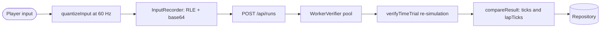

# ADR-001: Deterministic Simulation and Server-Side Time-Trial Verification

<a href="#english"></a>
<a href="#korean"></a>

---

<a id="english"></a>

# English

## Status
Accepted (2026-09-24)

## Context
- Time-trial (`타임 어택`) records go to a public online leaderboard (`GET /api/leaderboard`) and can be downloaded as ghosts (`GET /api/ghost/:id`). Any HTTP client can call `POST /api/runs`, so a submitted time proves nothing on its own.
- The client runs in browsers with different JavaScript engines; the server is Node.js (Fastify) on ECS Fargate. ECMAScript requires only `+`, `-`, `*`, `/`, `Math.sqrt` and a few others (`floor`, `abs`, `min`, `max`, `sign`) to be exactly IEEE-754 rounded. `Math.sin/cos/atan2/exp/pow` are implementation-approximated and differ between V8, SpiderMonkey and JavaScriptCore (header of `src/sim/dmath.ts`).
- Time trials must also work offline and be submitted later ([ADR-006](ADR-006-offline-first-pwa-race-safe-updates.md)).
- A ghost must replay exactly the run that produced its time.

## Options Considered

### Option 1: Trust the client-reported time
- **Pros**: Trivial server; no code shared between client and server.
- **Cons**: Any client can post any time. Plausibility bounds (for example a minimum lap time per track) catch only extreme values, and nothing proves that a ghost matches its time.

### Option 2: Server-authoritative live race
- **Pros**: The server observes every tick while the race is driven.
- **Cons**: Needs a persistent connection and server CPU for every race in progress; adds latency to a single-player mode; makes offline time trials impossible.

### Option 3: Client-signed results
- **Pros**: Cheap to verify.
- **Cons**: The signing key ships in the public JavaScript bundle, so anyone can sign a forged time; a signature says nothing about how the time was driven.

### Option 4: Shared deterministic simulation, re-simulated from the input log (chosen)
- **Pros**: The server recomputes the exact result from the inputs alone; verification works after the fact (offline runs, retries); the submitted log doubles as the ghost; the payload is small.
- **Cons**: The whole simulation must be bit-reproducible on every engine; every trajectory-changing simulation change becomes a protocol change; re-simulation costs server CPU.

## Decision
Adopt option 4.

### Determinism rules
- `src/sim/` is pure TypeScript shared by the client bundle (Vite) and the server bundle (esbuild, `dist/server/verify-worker.js`). It uses no DOM, no three.js, no `Math.random`, no `Date` and no `Math.sin/cos/tan/atan/atan2/exp/pow/log/hypot`.
- Trigonometry and exponentials come from `src/sim/dmath.ts` (`dsin`, `dcos`, `datan`, `datan2`, `dexp`): range reduction plus fixed polynomials and series built only from exactly rounded operations.
- Fixed time step: `TICK_HZ = 60`, `DT = 1/60` (`src/sim/constants.ts`). The client steps `RaceWorld` from an accumulator (at most 5 steps per frame) and interpolates poses for rendering; frame time never reaches the simulation.
- Randomness: seeded `Rng` (mulberry32, integer operations only, `src/sim/rng.ts`). `createTimeTrialConfig` fixes `TIME_TRIAL_SEED = 0x7a11`, one kart, no mirror and no items; for mode `tt`, `RaceWorld` spawns no item boxes or coins and starts the kart with `nitro3`. Without CPU karts and item boxes the time-trial path consumes no world RNG.
- Inputs: `RaceWorld.step()` passes every human input through `quantizeInput`: steer rounded to 63 steps per side, one 16-bit word per tick (bits 0-6 steer + 63, 7 throttle, 8 brake, 9 drift, 10 item, 11 back). A live race and its replay consume identical inputs.
- Logs: `InputRecorder` stores one word per tick from countdown tick 0 through the finish tick inclusive, run-length encoded as `(word, count)` uint16 pairs after a two-byte header (format version `1`, then `0`), then base64 (`src/sim/input-log.ts`). The API caps a log at 200 000 characters (`API_LIMITS.logMax`).

### Server verification
- `POST /api/runs` checks the rate limit, the `Origin`, the content type, the JSON schema, the player name and the character, then hands `{trackId, cc, charId, log}` to `WorkerVerifier` (`src/server/verifier.ts`). The `worker_threads` pool runs `max(1, min(2, availableParallelism()))` workers with a 256 MB old-generation heap each. A run that exceeds its 8 s budget has its worker terminated and is rejected; a full queue (32) or a queue wait over 6 s answers `503 VERIFIER_BUSY`.
- The worker calls `verifyTimeTrial` (`src/sim/replay.ts`): decode the log (at most `MAX_TT_TICKS` = 43 380 ticks), step a fresh time-trial world one word per tick, and require that the kart finishes on exactly the last word.
- `compareResult` (`src/server/app.ts`) accepts a run only when the re-simulated `ticks` and every `lapTicks` entry equal the claimed values. Otherwise the answer is HTTP 422 with `REPLAY_INVALID`, `VERSION_MISMATCH`, `TIME_MISMATCH` or `LAP_MISMATCH`.
- `logDigest` (`src/server/validation.ts`) hashes the canonical decoded input sequence. The first player who registers a sequence owns it, so a downloaded ghost submitted again by someone else, re-encoded or not, gets `409 DUPLICATE_RUN`.



### Version bump rule
- Any change under `src/sim/` that can alter a time-trial trajectory needs a `package.json` `version` bump and a CHANGELOG entry: physics, constants and character stats, the geometry of existing tracks, the track builder and queries, input quantisation, the `RaceWorld.step` order, the nitro item path and `dmath`. CPU AI does not affect time trials: there are no CPU karts, and the AI drives the player's kart only after the finish.
- On ECS the server's version is `APP_VERSION` = `<package.json version>+<first 12 hex characters of the image asset hash>` (`infra/lib/service.ts`). Only when re-simulation fails does the server compare the semver core (the part before `+`) of the client's `version` with its own: different means `VERSION_MISMATCH` (reload and race again), equal means `REPLAY_INVALID`.
- At startup the client drops queued offline submissions whose semver core differs from its own (`dropStalePendingRuns`, `src/client/storage.ts`), so any bump discards runs recorded offline under the old core.
- Adding a brand-new track alters no existing replay, so the rule does not force a bump for it; editing an existing track does.
- `.claude/hooks/check-doc-sync.sh` reminds Claude of this rule (`[sim-version]`) after every edit of a non-Markdown file under `src/sim/`.

## Consequences

### Positive
- Forged times are rejected. `tools/verify-live.ts` submits a bot run claiming `finishTick - 60` and expects 422 ("Tampered time is rejected by server re-simulation (422)"), then expects the honest run to be accepted.
- Ghosts are exact: `GhostPlayer` replays a stored log in its own world, one step per world tick.
- Offline and retried submissions stay verifiable, because verification needs only the log.
- The same code drives CPU races, the diagnostics in `tools/sim-report.ts` and the tests (`test/sim/sim.test.ts`: "is deterministic for identical seeds", "accepts an honest bot run and rejects tampering"; `test/server/replay.integration.test.ts`).

### Negative
- The ban on non-exact math in `src/sim/` is a convention. No lint rule or test enforces it; the "deterministic math" test only checks `dmath` against `Math` within 1e-10.
- Every trajectory-changing simulation edit is a breaking protocol change. Without a version bump, stale clients get `REPLAY_INVALID` (or `TIME_MISMATCH`/`LAP_MISMATCH` if an old log happens to finish with another time) instead of `VERSION_MISMATCH`. The first live verification hit exactly this: the deployed server simulated differently from local code that had not been deployed yet.
- Stored ghosts and leaderboard rows are neither migrated nor filtered by `version`; after a trajectory change an old ghost can replay differently from its recorded run.
- Verification costs server CPU: up to 8 s per run and at most 2 workers per task. A queue wait (up to 6 s) plus a run (up to 8 s) can outlast the browser's 8 s API timeout (`src/client/api.ts`), so a run may be stored after the client gave up; a retry is idempotent through `logHash`.
- A new `KartInput` field changes the log format, the simulation and the server verification at once.

## References
- [docs/architecture.md](../architecture.md) (Simulation versioning)
- [docs/api-reference.md](../api-reference.md), [docs/reference/api.md](../reference/api.md) (`POST /api/runs` rejection codes)
- [src/sim/dmath.ts](../../src/sim/dmath.ts), [src/sim/rng.ts](../../src/sim/rng.ts), [src/sim/constants.ts](../../src/sim/constants.ts), [src/sim/input-log.ts](../../src/sim/input-log.ts), [src/sim/race.ts](../../src/sim/race.ts), [src/sim/replay.ts](../../src/sim/replay.ts)
- [src/server/verifier.ts](../../src/server/verifier.ts), [src/server/verify-worker.ts](../../src/server/verify-worker.ts), [src/server/app.ts](../../src/server/app.ts), [src/server/validation.ts](../../src/server/validation.ts)
- [src/client/game/race-session.ts](../../src/client/game/race-session.ts), [src/client/storage.ts](../../src/client/storage.ts)
- [.claude/hooks/check-doc-sync.sh](../../.claude/hooks/check-doc-sync.sh)
- [test/sim/sim.test.ts](../../test/sim/sim.test.ts), [test/server/replay.integration.test.ts](../../test/server/replay.integration.test.ts), [tools/sim-report.ts](../../tools/sim-report.ts), [tools/verify-live.ts](../../tools/verify-live.ts)
- [ADR-004](ADR-004-dynamodb-on-demand-leaderboard.md) (log claims in storage), [ADR-006](ADR-006-offline-first-pwa-race-safe-updates.md) (offline queue)

Run the tests that guard this decision:

```bash
npx vitest run test/sim test/server/replay.integration.test.ts
npx tsx tools/sim-report.ts sunny-meadow
```

---

<a id="korean"></a>

# 한국어

## 상태
승인됨 (2026-09-24)

## 배경
- 타임 어택 기록은 공개 온라인 랭킹(`GET /api/leaderboard`)에 올라가고 고스트로 내려받을 수 있습니다(`GET /api/ghost/:id`). HTTP 클라이언트라면 누구나 `POST /api/runs`를 호출할 수 있으므로, 제출된 시간만으로는 아무것도 증명되지 않습니다.
- 클라이언트는 JavaScript 엔진이 서로 다른 여러 브라우저에서 실행되고, 서버는 ECS Fargate 위의 Node.js(Fastify)입니다. ECMAScript가 IEEE-754 기준으로 정확히 반올림하도록 요구하는 연산은 `+`, `-`, `*`, `/`, `Math.sqrt`와 몇 가지(`floor`, `abs`, `min`, `max`, `sign`)뿐입니다. `Math.sin/cos/atan2/exp/pow`는 구현에 맡겨진 근사값이라 V8, SpiderMonkey, JavaScriptCore마다 결과가 다릅니다(`src/sim/dmath.ts` 머리 주석).
- 타임 어택은 오프라인에서도 달리고 나중에 제출할 수 있어야 합니다([ADR-006](ADR-006-offline-first-pwa-race-safe-updates.md)).
- 고스트는 그 시간을 만든 주행을 정확히 그대로 재현해야 합니다.

## 검토한 옵션

### 옵션 1: 클라이언트가 보고한 시간을 믿기
- **장점**: 서버가 단순하고 클라이언트와 서버가 코드를 공유할 필요가 없습니다.
- **단점**: 아무 클라이언트나 아무 시간이든 올릴 수 있습니다. 트랙별 최소 랩 시간 같은 타당성 검사는 극단적인 값만 걸러 내고, 고스트가 그 시간과 일치한다는 증명도 없습니다.

### 옵션 2: 서버가 실시간으로 레이스를 진행
- **장점**: 레이스가 진행되는 동안 서버가 모든 틱을 직접 봅니다.
- **단점**: 진행 중인 레이스마다 지속 연결과 서버 CPU가 필요하고, 1인 모드에 지연이 생기며, 오프라인 타임 어택이 불가능해집니다.

### 옵션 3: 클라이언트 서명 결과
- **장점**: 검증 비용이 적습니다.
- **단점**: 서명 키가 공개 JavaScript 번들에 들어가므로 누구나 위조한 시간에 서명할 수 있습니다. 서명은 그 시간을 어떻게 달렸는지에 대해 아무것도 말해 주지 않습니다.

### 옵션 4: 결정론적 시뮬레이션을 공유하고 입력 로그로 재시뮬레이션 (채택)
- **장점**: 서버가 입력만으로 정확한 결과를 다시 계산합니다. 사후 검증이 가능해 오프라인 기록과 재시도도 처리되고, 제출한 로그가 그대로 고스트가 되며, 전송량도 작습니다.
- **단점**: 시뮬레이션 전체가 모든 엔진에서 비트 단위로 재현되어야 합니다. 궤적을 바꾸는 시뮬레이션 변경은 모두 프로토콜 변경이 되고, 재시뮬레이션에 서버 CPU가 듭니다.

## 결정
옵션 4를 채택합니다.

### 결정론 규칙
- `src/sim/`은 클라이언트 번들(Vite)과 서버 번들(esbuild, `dist/server/verify-worker.js`)이 함께 쓰는 순수 TypeScript입니다. DOM, three.js, `Math.random`, `Date`, `Math.sin/cos/tan/atan/atan2/exp/pow/log/hypot`을 쓰지 않습니다.
- 삼각함수와 지수함수는 `src/sim/dmath.ts`(`dsin`, `dcos`, `datan`, `datan2`, `dexp`)를 씁니다. 범위 축소 뒤 정해진 다항식과 급수로 계산하며, 정확히 반올림되는 연산만 사용합니다.
- 고정 시간 간격: `TICK_HZ = 60`, `DT = 1/60`(`src/sim/constants.ts`). 클라이언트는 accumulator로 `RaceWorld`를 진행하고(프레임당 최대 5스텝) 렌더링할 때만 자세를 보간합니다. 프레임 시간은 시뮬레이션에 들어가지 않습니다.
- 난수: 시드 기반 `Rng`(mulberry32, 정수 연산만 사용, `src/sim/rng.ts`). `createTimeTrialConfig`는 `TIME_TRIAL_SEED = 0x7a11`, 카트 1대, 미러 없음, 아이템 없음으로 고정하고, `RaceWorld`는 mode `tt`일 때 아이템 박스와 코인을 만들지 않으며 카트를 `nitro3`으로 출발시킵니다. CPU 카트와 아이템 박스가 없으므로 타임 어택 경로는 world RNG를 소비하지 않습니다.
- 입력: `RaceWorld.step()`은 사람의 입력을 모두 `quantizeInput`에 통과시킵니다. steer는 한쪽 63단계로 반올림되고, 틱마다 16비트 word 하나가 됩니다(비트 0-6 steer + 63, 7 throttle, 8 brake, 9 drift, 10 item, 11 back). 그래서 실제 레이스와 그 리플레이는 똑같은 입력을 받습니다.
- 로그: `InputRecorder`는 카운트다운 0틱부터 결승 틱까지(결승 틱 포함) 틱마다 word 하나를 기록합니다. 2바이트 헤더(포맷 버전 `1`, 이어서 `0`) 뒤에 `(word, count)` uint16 쌍으로 run-length 인코딩한 다음 base64로 바꿉니다(`src/sim/input-log.ts`). API는 로그를 최대 200 000자로 제한합니다(`API_LIMITS.logMax`).

### 서버 검증
- `POST /api/runs`는 rate limit, `Origin`, content type, JSON 스키마, 닉네임, 캐릭터를 차례로 확인한 뒤 `{trackId, cc, charId, log}`를 `WorkerVerifier`(`src/server/verifier.ts`)에 넘깁니다. 이 `worker_threads` 풀은 worker를 `max(1, min(2, availableParallelism()))`개 띄우고, worker마다 old-generation 힙을 256 MB로 제한합니다. 8 s 예산을 넘긴 주행은 worker를 종료하고 거절합니다. 대기열(32개)이 가득 찼거나 대기가 6 s를 넘으면 `503 VERIFIER_BUSY`로 응답합니다.
- worker는 `verifyTimeTrial`(`src/sim/replay.ts`)을 실행합니다. 로그를 디코드하고(최대 `MAX_TT_TICKS` = 43 380틱), 새 타임 어택 world를 word 하나당 한 틱씩 진행한 뒤, 카트가 정확히 마지막 word에서 완주했는지 확인합니다.
- `compareResult`(`src/server/app.ts`)는 재시뮬레이션한 `ticks`와 `lapTicks`의 모든 값이 제출 값과 같을 때만 기록을 받아들입니다. 다르면 HTTP 422와 함께 `REPLAY_INVALID`, `VERSION_MISMATCH`, `TIME_MISMATCH`, `LAP_MISMATCH` 중 하나를 돌려줍니다.
- `logDigest`(`src/server/validation.ts`)는 디코드한 입력 시퀀스를 정규화해 해시합니다. 시퀀스를 처음 등록한 플레이어가 소유자가 되므로, 다른 사람이 내려받은 고스트를 다시 제출하면 재인코딩 여부와 상관없이 `409 DUPLICATE_RUN`을 받습니다.


### 버전 bump 규칙
- `src/sim/`에서 타임 어택 궤적을 바꿀 수 있는 변경에는 `package.json`의 `version` bump와 CHANGELOG 항목이 필요합니다. 대상은 물리, 상수와 캐릭터 능력치, 기존 트랙의 지오메트리, 트랙 빌더와 쿼리, 입력 양자화, `RaceWorld.step` 순서, 니트로 아이템 경로, `dmath`입니다. CPU AI는 타임 어택에 영향을 주지 않습니다. CPU 카트가 없고, AI는 결승 이후에만 플레이어 카트를 몰기 때문입니다.
- ECS에서 서버 버전은 `APP_VERSION` = `<package.json version>+<이미지 asset 해시 앞 12자>`입니다(`infra/lib/service.ts`). 서버는 재시뮬레이션이 실패했을 때만 클라이언트 `version`의 semver core(`+` 앞부분)를 자신의 것과 비교합니다. 다르면 `VERSION_MISMATCH`(새로고침 후 다시 달리라는 안내), 같으면 `REPLAY_INVALID`입니다.
- 클라이언트는 시작할 때 semver core가 자신과 다른 오프라인 대기 제출을 지웁니다(`dropStalePendingRuns`, `src/client/storage.ts`). 따라서 버전을 올리면 이전 core로 오프라인에서 기록한 주행은 모두 사라집니다.
- 새 트랙을 추가해도 기존 리플레이는 바뀌지 않으므로 이 규칙상 bump가 필수는 아닙니다. 기존 트랙을 고치면 bump가 필요합니다.
- `.claude/hooks/check-doc-sync.sh`는 `src/sim/` 아래의 Markdown이 아닌 파일을 고칠 때마다 Claude에게 이 규칙을 알립니다(`[sim-version]`).

## 영향

### 긍정적
- 위조한 시간은 거절됩니다. `tools/verify-live.ts`는 `finishTick - 60`을 주장하는 봇 주행을 제출해 422를 기대하고("Tampered time is rejected by server re-simulation (422)"), 이어서 정상 주행이 수락되는지 확인합니다.
- 고스트가 정확합니다. `GhostPlayer`는 저장된 로그를 자기 world에서 world 틱마다 한 스텝씩 재생합니다.
- 검증에는 로그만 있으면 되므로 오프라인 기록과 재시도도 검증할 수 있습니다.
- 같은 코드가 CPU 레이스, `tools/sim-report.ts` 진단, 테스트를 모두 구동합니다(`test/sim/sim.test.ts`의 "is deterministic for identical seeds", "accepts an honest bot run and rejects tampering", 그리고 `test/server/replay.integration.test.ts`).

### 부정적
- `src/sim/`에서 부정확한 수학 함수를 쓰지 않는 것은 관례일 뿐입니다. 이를 강제하는 lint 규칙이나 테스트가 없고, "deterministic math" 테스트는 `dmath`가 `Math`와 1e-10 이내로 맞는지만 봅니다.
- 궤적을 바꾸는 시뮬레이션 수정은 모두 호환성을 깨는 프로토콜 변경입니다. 버전을 올리지 않으면 이전 클라이언트는 `VERSION_MISMATCH` 대신 `REPLAY_INVALID`를 받습니다(이전 로그가 우연히 다른 시간으로 완주하면 `TIME_MISMATCH`나 `LAP_MISMATCH`). 첫 라이브 검증에서 바로 이 문제가 났습니다. 배포된 서버가 아직 배포하지 않은 로컬 코드와 다르게 시뮬레이션했습니다.
- 저장된 고스트와 랭킹 행은 `version`으로 이전하거나 걸러 내지 않습니다. 궤적이 바뀐 뒤에는 이전 고스트가 기록된 주행과 다르게 재생될 수 있습니다.
- 검증에 서버 CPU가 듭니다. 주행당 최대 8 s이고 태스크당 worker는 최대 2개입니다. 대기(최대 6 s)와 실행(최대 8 s)을 합치면 브라우저의 API 타임아웃 8 s(`src/client/api.ts`)를 넘을 수 있어, 클라이언트가 포기한 뒤에 기록이 저장될 수도 있습니다. 재시도는 `logHash` 덕분에 멱등입니다.
- `KartInput`에 필드를 추가하면 로그 포맷, 시뮬레이션, 서버 검증이 한꺼번에 바뀝니다.

## 참고 자료
- [docs/architecture.md](../architecture.md) (Simulation versioning)
- [docs/api-reference.md](../api-reference.md), [docs/reference/api.md](../reference/api.md) (`POST /api/runs` 거부 코드)
- [src/sim/dmath.ts](../../src/sim/dmath.ts), [src/sim/rng.ts](../../src/sim/rng.ts), [src/sim/constants.ts](../../src/sim/constants.ts), [src/sim/input-log.ts](../../src/sim/input-log.ts), [src/sim/race.ts](../../src/sim/race.ts), [src/sim/replay.ts](../../src/sim/replay.ts)
- [src/server/verifier.ts](../../src/server/verifier.ts), [src/server/verify-worker.ts](../../src/server/verify-worker.ts), [src/server/app.ts](../../src/server/app.ts), [src/server/validation.ts](../../src/server/validation.ts)
- [src/client/game/race-session.ts](../../src/client/game/race-session.ts), [src/client/storage.ts](../../src/client/storage.ts)
- [.claude/hooks/check-doc-sync.sh](../../.claude/hooks/check-doc-sync.sh)
- [test/sim/sim.test.ts](../../test/sim/sim.test.ts), [test/server/replay.integration.test.ts](../../test/server/replay.integration.test.ts), [tools/sim-report.ts](../../tools/sim-report.ts), [tools/verify-live.ts](../../tools/verify-live.ts)
- [ADR-004](ADR-004-dynamodb-on-demand-leaderboard.md) (저장소의 로그 소유권), [ADR-006](ADR-006-offline-first-pwa-race-safe-updates.md) (오프라인 대기열)

이 결정을 지키는 테스트를 실행합니다.

```bash
npx vitest run test/sim test/server/replay.integration.test.ts
npx tsx tools/sim-report.ts sunny-meadow
```
