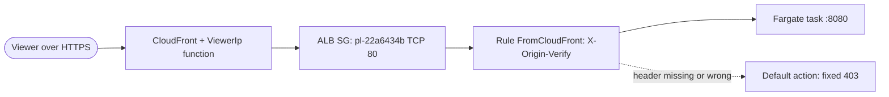

# ADR-002: CloudFront-Only Origin Access

<a href="#english"></a>
<a href="#korean"></a>

---

<a id="english"></a>

# English

## Status
Accepted (2026-09-24)

## Context
- The requested topology is CloudFront → ALB behind a security group limited to the CloudFront prefix list → ECS Fargate in the existing VPC ([ADR-003](ADR-003-fargate-arm64-in-existing-vpc.md)). The ALB is internet-facing in the public subnets, and CloudFront reaches it as a custom origin over HTTP on port 80.
- Several protections exist only at the edge: the HTTP to HTTPS redirect, TLS for the custom domain, HSTS and `upgrade-insecure-requests` (the origin omits both because it also runs over plain HTTP locally and in Docker), and the one-year edge cache for `/assets/*`.
- The server rate-limits per viewer. It runs with `trustProxy: false`, so the socket peer is always the ALB; the viewer address must come from a header that only CloudFront can set. A request that reached the ALB directly could forge that header.
- The CloudFront origin-facing prefix list contains the addresses of CloudFront's origin-facing servers, which every distribution uses, including distributions in other AWS accounts. Network filtering alone therefore cannot tell this distribution apart from others.

## Options Considered

### Option 1: Prefix-list security group plus a secret origin header (chosen)
- **Pros**: AWS maintains the prefix list; sources outside CloudFront cannot even open a connection; the header check stops other CloudFront distributions; no additional service is needed.
- **Cons**: A shared secret must be generated, stored and rotated; the CloudFront to ALB hop stays plain HTTP.

### Option 2: CloudFront VPC origin with an internal ALB
- **Pros**: The ALB would have no public endpoint and no shared secret.
- **Cons**: Not the topology this project was asked to build (an internet-facing ALB behind a prefix-list security group). The stack tests (`test/infra/stack.test.ts`) and the live checks (`tools/verify-live.ts`, "ALB is internet-facing in the public subnets") are written around that topology. A later ADR can revisit it.

### Option 3: AWS WAF web ACL instead of the listener rule
- **Pros**: Managed rule groups and rate-based rules at the edge or on the ALB.
- **Cons**: An additional billed service that still needs a secret header or an IP set to recognise CloudFront; per-viewer rate limiting already exists in the application. WAF is acknowledged as out of scope for this release (`AwsSolutions-CFR2` in `infra/lib/edge.ts`).

### Option 4: Public ALB with a self-maintained IP allow list of CloudFront ranges
- **Pros**: No dependency on a managed prefix list.
- **Cons**: CloudFront address ranges change, so the list needs its own automation or it goes stale (blocking edge servers or admitting unknown hosts); like the prefix list it still admits other customers' distributions.

## Decision
Adopt option 1.

### Network layer
- `AlbSg` (`infra/lib/service.ts`) has exactly one ingress rule, `Peer.prefixList('pl-22a6434b')` (`com.amazonaws.global.cloudfront.origin-facing`) on TCP 80, and one egress rule to `TaskSg` on TCP 8080. Both security groups use `allowAllOutbound: false` and `disableInlineRules: true`.
- `TurboPalsStack` refuses any other prefix-list id (`infra/lib/stack.ts`).
- The ALB drops invalid header fields and uses the strictest desync mitigation mode.

### Origin secret
- `Data` (`infra/lib/data.ts`) generates the value in Secrets Manager: 48 characters, no punctuation, no spaces. CloudFront sends it as the origin custom header `X-Origin-Verify` and the listener rule compares it. Both read it through a CloudFormation dynamic reference (`{{resolve:secretsmanager:…}}`); the plaintext never appears in the template, the stack outputs, the task environment or IAM policies (test "keeps the generated secret out of the task, IAM policies and outputs").
- Listener `Http` (port 80, `open: false`) answers with a fixed `403` (`text/plain`, `Forbidden`) by default. Rule `FromCloudFront` (priority 10) forwards to the target group only when `X-Origin-Verify` equals an accepted value.
- Rotation without downtime uses the context value `originSecretGeneration` (an integer from 1 to 999, default 1). Generation N creates secret N and keeps secret N-1; the rule accepts both while CloudFront switches to N. The distribution depends on the listener rule, so the rule is updated first. Generation N+1 deletes N-1. Secrets Manager's built-in rotation is not used (`AwsSolutions-SMG4`), because it could not propagate a value that is embedded through dynamic references.

```bash
npx cdk deploy TurboPalsStack -c originSecretGeneration=2
```

After the deploy, record `"originSecretGeneration": 2` in the `context` block of `cdk.json`, so that later deploys do not roll the rotation back.

### Viewer address
- The CloudFront Function `ViewerIp` (`cloudfront-js-2.0`, viewer request, attached to every behavior) overwrites `x-turbo-client-ip` with `event.viewer.ip` (`VIEWER_IP_FUNCTION_CODE` in `infra/lib/edge.ts`). Cache misses on `/assets/*` forward only this header.
- The server keys its rate limits on that header when it holds a valid IP address and on the socket peer otherwise (`clientKey` in `src/server/security.ts`). It never logs the address or persists it; only the in-memory rate-limit counters hold it for their window.



## Consequences

### Positive
- Direct access to the ALB fails. From outside CloudFront the TCP connection times out, and a CloudFront request without the right header gets 403. `tools/verify-live.ts` checks the prefix-list rule, the default 403, the header condition on every forwarding rule and blocked direct access.
- Security headers, HSTS and edge caching cannot be bypassed, and the viewer IP used for rate limiting is trustworthy.
- A rotation is an ordinary deploy with no 403 window.

### Negative
- The CloudFront to ALB hop is plain HTTP (`AwsSolutions-CFR5` acknowledged), so the secret header crosses that hop unencrypted.
- Rotation is manual. If `cdk.json` is not updated afterwards, the next deploy without `-c originSecretGeneration` rolls back to generation 1.
- There is no WAF, so no managed bot or layer-7 rule protection beyond the application's rate limits. The rate-limit counters live in each task's memory (no shared store is configured).
- The internet-facing ALB keeps public IPv4 addresses, which are billed.

## References
- [infra/lib/service.ts](../../infra/lib/service.ts), [infra/lib/edge.ts](../../infra/lib/edge.ts), [infra/lib/data.ts](../../infra/lib/data.ts), [infra/lib/stack.ts](../../infra/lib/stack.ts), [infra/lib/settings.ts](../../infra/lib/settings.ts)
- [src/shared/csp.ts](../../src/shared/csp.ts), [src/server/security.ts](../../src/server/security.ts)
- [test/infra/stack.test.ts](../../test/infra/stack.test.ts) ("origin authentication", "origin secret rotation", "edge"), [tools/verify-live.ts](../../tools/verify-live.ts)
- [docs/infra.md](../infra.md) (security boundary, secret rotation)
- [docs/runbooks/rotate-origin-secret.md](../runbooks/rotate-origin-secret.md) (rotation procedure)
- [ADR-003](ADR-003-fargate-arm64-in-existing-vpc.md)

---

<a id="korean"></a>

# 한국어

## 상태
승인됨 (2026-09-24)

## 배경
- 요구된 구성은 CloudFront → CloudFront prefix list로만 열린 보안 그룹 뒤의 ALB → 기존 VPC의 ECS Fargate입니다([ADR-003](ADR-003-fargate-arm64-in-existing-vpc.md)). ALB는 퍼블릭 서브넷의 internet-facing ALB이고, CloudFront는 이 ALB를 커스텀 오리진으로 삼아 HTTP 80번 포트로 접속합니다.
- 여러 보호 장치가 엣지에만 있습니다. HTTP에서 HTTPS로의 리디렉션, 커스텀 도메인 TLS, HSTS와 `upgrade-insecure-requests`(오리진은 로컬과 Docker에서 평문 HTTP로도 돌기 때문에 둘 다 붙이지 않습니다), `/assets/*`의 1년 엣지 캐시가 그렇습니다.
- 서버는 viewer별로 rate limit을 겁니다. `trustProxy: false`로 동작하므로 소켓 상대방은 늘 ALB입니다. 따라서 viewer 주소는 CloudFront만 설정할 수 있는 헤더에서 와야 합니다. ALB에 직접 들어온 요청은 이 헤더를 위조할 수 있습니다.
- CloudFront origin-facing prefix list에는 모든 배포가 함께 쓰는 CloudFront 오리진 측 서버 주소가 들어 있고, 다른 AWS 계정의 배포도 여기에 포함됩니다. 네트워크 필터만으로는 이 배포와 다른 배포를 구분할 수 없습니다.

## 검토한 옵션

### 옵션 1: prefix list 보안 그룹과 비밀 오리진 헤더 (채택)
- **장점**: prefix list는 AWS가 관리합니다. CloudFront 밖의 출발지는 연결조차 맺지 못하고, 헤더 검사가 다른 CloudFront 배포를 막습니다. 추가 서비스가 필요 없습니다.
- **단점**: 공유 시크릿을 생성하고 보관하고 회전해야 합니다. CloudFront와 ALB 사이 구간은 평문 HTTP로 남습니다.

### 옵션 2: 내부 ALB와 CloudFront VPC 오리진
- **장점**: ALB에 퍼블릭 엔드포인트도 공유 시크릿도 없어집니다.
- **단점**: 이 프로젝트에 요구된 구성(prefix list 보안 그룹 뒤의 internet-facing ALB)이 아닙니다. 스택 테스트(`test/infra/stack.test.ts`)와 라이브 검사(`tools/verify-live.ts`의 "ALB is internet-facing in the public subnets")도 그 구성을 전제로 작성되어 있습니다. 필요하면 이후 ADR에서 다시 검토합니다.

### 옵션 3: 리스너 규칙 대신 AWS WAF 웹 ACL
- **장점**: 엣지나 ALB에서 관리형 규칙 그룹과 rate 기반 규칙을 쓸 수 있습니다.
- **단점**: 별도로 과금되는 서비스인데도 CloudFront를 식별하려면 여전히 비밀 헤더나 IP 집합이 필요하고, viewer별 rate limit은 이미 애플리케이션에 있습니다. WAF는 이번 릴리스 범위 밖으로 acknowledge되어 있습니다(`infra/lib/edge.ts`의 `AwsSolutions-CFR2`).

### 옵션 4: CloudFront 대역을 직접 관리하는 IP 허용 목록과 퍼블릭 ALB
- **장점**: 관리형 prefix list에 의존하지 않습니다.
- **단점**: CloudFront 주소 대역은 바뀌므로 목록을 갱신하는 자동화가 따로 필요하고, 없으면 목록이 낡아 엣지 서버를 막거나 모르는 호스트를 들입니다. prefix list와 마찬가지로 다른 고객의 배포도 통과시킵니다.

## 결정
옵션 1을 채택합니다.

### 네트워크 계층
- `AlbSg`(`infra/lib/service.ts`)의 인바운드 규칙은 `Peer.prefixList('pl-22a6434b')`(`com.amazonaws.global.cloudfront.origin-facing`) TCP 80 하나뿐이고, 아웃바운드 규칙은 `TaskSg` TCP 8080 하나뿐입니다. 두 보안 그룹 모두 `allowAllOutbound: false`, `disableInlineRules: true`를 씁니다.
- `TurboPalsStack`은 다른 prefix list ID를 거부합니다(`infra/lib/stack.ts`).
- ALB는 잘못된 헤더 필드를 버리고 가장 엄격한 desync 완화 모드를 씁니다.

### 오리진 시크릿
- `Data`(`infra/lib/data.ts`)가 Secrets Manager에서 값을 생성합니다. 48자이고 구두점과 공백이 없습니다. CloudFront는 이 값을 오리진 커스텀 헤더 `X-Origin-Verify`로 보내고 리스너 규칙이 이를 비교합니다. 둘 다 CloudFormation 동적 참조(`{{resolve:secretsmanager:…}}`)로 값을 읽으므로 평문은 템플릿, 스택 출력, 태스크 환경 변수, IAM 정책 어디에도 나타나지 않습니다(테스트 "keeps the generated secret out of the task, IAM policies and outputs").
- 리스너 `Http`(80번 포트, `open: false`)의 기본 동작은 고정 `403`(`text/plain`, `Forbidden`)입니다. 규칙 `FromCloudFront`(우선순위 10)는 `X-Origin-Verify`가 허용된 값과 같을 때만 타깃 그룹으로 전달합니다.
- 무중단 회전에는 context 값 `originSecretGeneration`(1~999 정수, 기본값 1)을 씁니다. 세대 N으로 배포하면 시크릿 N을 만들고 시크릿 N-1을 유지합니다. CloudFront가 N으로 바뀌는 동안 규칙은 둘 다 허용합니다. CloudFront 배포가 리스너 규칙에 의존하므로 규칙이 먼저 갱신됩니다. 세대 N+1에서는 N-1이 삭제됩니다. Secrets Manager 자체 회전은 쓰지 않습니다(`AwsSolutions-SMG4`). 동적 참조로 박힌 값에는 회전 결과가 전파되지 않기 때문입니다.

```bash
npx cdk deploy TurboPalsStack -c originSecretGeneration=2
```

배포가 끝나면 `cdk.json`의 `context` 블록에 `"originSecretGeneration": 2`를 기록합니다. 그래야 이후 배포가 회전을 되돌리지 않습니다.

### viewer 주소
- CloudFront Function `ViewerIp`(`cloudfront-js-2.0`, viewer request, 모든 behavior에 연결)는 `x-turbo-client-ip`를 `event.viewer.ip`로 덮어씁니다(`infra/lib/edge.ts`의 `VIEWER_IP_FUNCTION_CODE`). `/assets/*` 캐시 미스는 이 헤더만 오리진으로 전달합니다.
- 서버는 이 헤더가 유효한 IP 주소이면 그 값을, 아니면 소켓 상대방 주소를 rate limit 키로 씁니다(`src/server/security.ts`의 `clientKey`). 주소를 로그에 남기거나 영구 저장하지 않으며, 메모리의 rate limit 카운터만 해당 시간 창 동안 이 값을 들고 있습니다.


## 영향

### 긍정적
- ALB에 직접 접근할 수 없습니다. CloudFront 밖에서는 TCP 연결이 타임아웃되고, 올바른 헤더가 없는 CloudFront 요청은 403을 받습니다. `tools/verify-live.ts`가 prefix list 규칙, 기본 403, 모든 전달 규칙의 헤더 조건, 직접 접근 차단을 확인합니다.
- 보안 헤더, HSTS, 엣지 캐시를 우회할 수 없고, rate limit에 쓰는 viewer IP를 믿을 수 있습니다.
- 회전은 403 구간 없는 일반 배포입니다.

### 부정적
- CloudFront와 ALB 사이 구간이 평문 HTTP이므로(`AwsSolutions-CFR5` acknowledge) 비밀 헤더가 이 구간을 암호화 없이 지나갑니다.
- 회전은 수동입니다. 회전 후 `cdk.json`을 고치지 않으면 `-c originSecretGeneration` 없이 실행한 다음 배포가 세대 1로 되돌아갑니다.
- WAF가 없으므로 애플리케이션 rate limit 외에는 관리형 봇 차단이나 L7 규칙 보호가 없습니다. rate limit 카운터는 태스크마다 메모리에 따로 있습니다(공유 저장소를 설정하지 않았습니다).
- internet-facing ALB는 과금되는 퍼블릭 IPv4 주소를 계속 가집니다.

## 참고 자료
- [infra/lib/service.ts](../../infra/lib/service.ts), [infra/lib/edge.ts](../../infra/lib/edge.ts), [infra/lib/data.ts](../../infra/lib/data.ts), [infra/lib/stack.ts](../../infra/lib/stack.ts), [infra/lib/settings.ts](../../infra/lib/settings.ts)
- [src/shared/csp.ts](../../src/shared/csp.ts), [src/server/security.ts](../../src/server/security.ts)
- [test/infra/stack.test.ts](../../test/infra/stack.test.ts) ("origin authentication", "origin secret rotation", "edge"), [tools/verify-live.ts](../../tools/verify-live.ts)
- [docs/infra.md](../infra.md) (보안 경계, 시크릿 회전)
- [docs/runbooks/rotate-origin-secret.md](../runbooks/rotate-origin-secret.md) (회전 절차)
- [ADR-003](ADR-003-fargate-arm64-in-existing-vpc.md)
