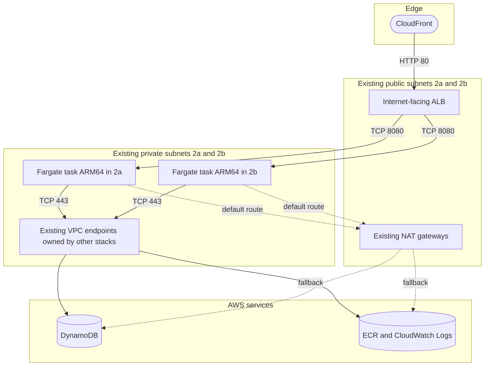

# ADR-003: ECS Fargate on ARM64 in the Existing VPC

---

# English

## Status
Accepted (2026-09-24)

## Context
- The only target is account `061525506239`, region `ap-northeast-2`. It already has the VPC `vpc-0dfa5610180dfa628` (`10.100.0.0/16`) with public and private subnets in `ap-northeast-2a` and `ap-northeast-2b`. The private subnets route `0.0.0.0/0` to the VPC's NAT gateways (`nat-00b8a70dc184a4d0c` in 2a, `nat-08379e076e2e6e234` in 2b). Other stacks also own VPC endpoints there: a read-only check on 2026-10-18 found S3 and DynamoDB gateway endpoints on both private route tables and `ecr.api`, `ecr.dkr` and `logs` interface endpoints with private DNS in the private subnets.
- Subnets, routes, the internet gateway and the NAT gateways stay owned by the network team (`infra/lib/network.ts`). The requirement was to reuse this VPC and its NAT gateways, not to build a network.
- The server is one long-running Node.js process (Fastify) that serves the static client and the API and re-simulates time trials on worker threads ([ADR-001](ADR-001-deterministic-simulation-server-verification.md)). Rankings live in DynamoDB ([ADR-004](ADR-004-dynamodb-on-demand-leaderboard.md)); esbuild inlines every server dependency into a pure JavaScript bundle.

## Options Considered

### Option 1: ECS Fargate on ARM64 (Graviton) in the existing private subnets (chosen)
- **Pros**: No servers or AMIs to patch; Fargate on Graviton is billed at a lower rate than x86_64 for the same task size; tasks stay private and use the existing NAT egress.
- **Cons**: The image must be built for `linux/arm64` (an ARM host, or Docker buildx with QEMU on x86); egress depends on routes and gateways the stack does not own.

### Option 2: ECS Fargate on x86_64
- **Pros**: Builds natively on x86 hosts and CI runners.
- **Cons**: Higher Fargate rate for the same size, with no functional gain for a pure JavaScript server.

### Option 3: A new VPC owned by the stack
- **Pros**: Self-contained; created and destroyed with the stack.
- **Cons**: Contradicts the requirement to reuse the existing VPC and NAT gateways; adds NAT gateway (or interface endpoint) hours on top of the existing ones; moves network ownership into an application stack.

### Option 4: Tasks in the public subnets with public IPs
- **Pros**: No NAT data processing charge.
- **Cons**: Every task gets a public address and leaves through the internet gateway instead of the network team's NAT gateways; the live checks require task ENIs without public IPs.

## Decision
Adopt option 1.

### Network placement
- `Network` (`infra/lib/network.ts`) imports the VPC with `ec2.Vpc.fromLookup` and creates nothing. The lookup result is checked in as `cdk.context.json`, so synth reuses it instead of querying the account.
- Subnet selection: `PUBLIC` for the ALB and `PRIVATE_WITH_EGRESS` for the tasks, one subnet per AZ in 2a and 2b. When the real VPC is resolved, the selected ids must equal `PUBLIC_SUBNET_IDS` and `PRIVATE_SUBNET_IDS` (`infra/lib/settings.ts`), otherwise synth throws.
- `TurboPalsStack` throws for any other account, region, VPC id or prefix list (`infra/lib/stack.ts`).
- `TaskSg` admits only the ALB security group on TCP 8080 and allows egress only on TCP 443 to `0.0.0.0/0`, which reaches ECR, CloudWatch Logs and DynamoDB through the existing VPC endpoints where they exist and through the existing NAT gateways otherwise. The stack creates no VPC endpoints.

### Compute
- `FargateTaskDefinition` (`infra/lib/service.ts`): 1 vCPU (`TASK_CPU = 1024`), 2 GiB (`TASK_MEMORY_MIB = 2048`), `ARM64` and `LINUX`, platform version 1.4.0. `DockerImageAsset` builds the `Dockerfile` (base `node:24-alpine`, pinned by digest) with `Platform.LINUX_ARM64`.
- Container: user `1000:1000`, read-only root file system, all Linux capabilities dropped, init process, not privileged, 30 s stop timeout, health check on `http://127.0.0.1:8080/healthz`.
- `FargateService`: 2 tasks (`MIN_TASKS`) in the private subnets with `assignPublicIp: false`, AZ rebalancing on, deployment circuit breaker with rollback, 100 % minimum and 200 % maximum healthy, 60 s health-check grace period, ECS Exec off.
- Auto scaling between 2 and 6 tasks (`MIN_TASKS`, `MAX_TASKS`): CPU target 60 %, `ALBRequestCountPerTarget` 600; scale-in cooldown 180 s, scale-out cooldown 60 s.
- Memory budget in the code: up to two verifier workers, each limited to a 256 MB old-generation and 32 MB young-generation heap (`src/server/verifier.ts`), run beside the main Fastify process. On SIGTERM the server drains within 25 s (`src/server/index.ts`), inside the 30 s stop timeout.

## Consequences

### Positive
- The stack owns no VPC, subnet, route, NAT gateway, internet gateway, EIP or endpoint. `test/infra/stack.test.ts` asserts this ("creates no VPC, subnet, route, NAT gateway, internet gateway, EIP or endpoint"), and `tools/verify-live.ts` checks it on the live stack. Destroying the stack leaves the network untouched.
- NAT gateway and VPC endpoint hours stay with the existing infrastructure; the stack adds only per-GB data processing (cost table in `docs/infra.md`).
- Tasks have no public IP and accept traffic only from the ALB; a failed deployment rolls back automatically.

### Negative
- The stack is hard-wired to one environment. Supporting another account or VPC means changing `infra/lib/settings.ts`, the `cdk.json` context and the constants in `test/infra/stack.test.ts` together.
- Egress depends on routes, NAT gateways and VPC endpoints the stack does not own. If they change (for example an endpoint security group stops admitting `10.100.0.0/16`), tasks can no longer pull images, write logs or reach DynamoDB. Refresh `cdk.context.json` (`npx cdk context --clear`) only after verifying the routes.
- Building the image on an x86 host needs Docker buildx with QEMU.
- Two tasks run at all times, even without traffic; `docs/infra.md` estimates about $66 per month for them.
- The stack may not add VPC endpoints of its own, so which traffic avoids NAT data processing depends on the endpoints other stacks keep in the VPC. As of 2026-10-18 they carry image pulls, log writes and DynamoDB calls; if they are removed, that traffic and its cost move to the NAT gateways.

## References
- [infra/lib/network.ts](../../infra/lib/network.ts), [infra/lib/service.ts](../../infra/lib/service.ts), [infra/lib/stack.ts](../../infra/lib/stack.ts), [infra/lib/settings.ts](../../infra/lib/settings.ts), [infra/bin/app.ts](../../infra/bin/app.ts)
- [cdk.json](../../cdk.json), [cdk.context.json](../../cdk.context.json), [Dockerfile](../../Dockerfile)
- [src/server/verifier.ts](../../src/server/verifier.ts), [src/server/index.ts](../../src/server/index.ts)
- [test/infra/stack.test.ts](../../test/infra/stack.test.ts) ("existing network only", "compute"), [tools/verify-live.ts](../../tools/verify-live.ts)
- [docs/infra.md](../infra.md) (network, cost estimate)
- [docs/reference/infrastructure.md](../reference/infrastructure.md), [docs/reference/iac.md](../reference/iac.md), [docs/runbooks/deploy-production.md](../runbooks/deploy-production.md)
- [ADR-002](ADR-002-cloudfront-only-origin-access.md)

---

# 한국어

## 상태
승인됨 (2026-09-24)

## 배경
- 배포 대상은 계정 `061525506239`, 리전 `ap-northeast-2` 하나뿐입니다. 이 계정에는 이미 VPC `vpc-0dfa5610180dfa628`(`10.100.0.0/16`)이 있고 `ap-northeast-2a`와 `ap-northeast-2b`에 퍼블릭·프라이빗 서브넷이 있습니다. 프라이빗 서브넷의 `0.0.0.0/0` 경로는 VPC의 NAT 게이트웨이(2a의 `nat-00b8a70dc184a4d0c`, 2b의 `nat-08379e076e2e6e234`)로 향합니다. 다른 스택이 소유한 VPC 엔드포인트도 있습니다. 2026-10-18 읽기 전용 조회에서는 두 프라이빗 라우트 테이블에 S3와 DynamoDB 게이트웨이 엔드포인트가 붙어 있었고, 프라이빗 서브넷에 private DNS를 켠 `ecr.api`, `ecr.dkr`, `logs` 인터페이스 엔드포인트가 있었습니다.
- 서브넷, 라우트, 인터넷 게이트웨이, NAT 게이트웨이는 네트워크 팀 소유로 남습니다(`infra/lib/network.ts`). 요구 사항은 네트워크를 새로 만드는 것이 아니라 이 VPC와 NAT 게이트웨이를 재사용하는 것이었습니다.
- 서버는 오래 실행되는 Node.js(Fastify) 프로세스 하나입니다. 정적 클라이언트와 API를 서빙하고, worker thread에서 타임 어택을 재시뮬레이션합니다([ADR-001](ADR-001-deterministic-simulation-server-verification.md)). 랭킹은 DynamoDB에 있고([ADR-004](ADR-004-dynamodb-on-demand-leaderboard.md)), esbuild가 서버 의존성을 모두 인라인해 순수 JavaScript 번들을 만듭니다.

## 검토한 옵션

### 옵션 1: 기존 프라이빗 서브넷의 ARM64(Graviton) ECS Fargate (채택)
- **장점**: 패치할 서버나 AMI가 없습니다. 같은 태스크 크기라면 Graviton Fargate 요금이 x86_64보다 낮습니다. 태스크는 프라이빗에 머물고 기존 NAT로 나갑니다.
- **단점**: 이미지를 `linux/arm64`로 빌드해야 합니다(ARM 호스트, 또는 x86에서 Docker buildx와 QEMU). 이그레스가 스택이 소유하지 않은 라우트와 게이트웨이에 의존합니다.

### 옵션 2: x86_64 ECS Fargate
- **장점**: x86 호스트와 CI 러너에서 그대로 빌드됩니다.
- **단점**: 같은 크기에서 Fargate 요금이 더 높고, 순수 JavaScript 서버라 기능상 얻는 것이 없습니다.

### 옵션 3: 스택이 소유하는 새 VPC
- **장점**: 스택 하나로 완결되고 스택과 함께 만들고 지울 수 있습니다.
- **단점**: 기존 VPC와 NAT 게이트웨이를 재사용하라는 요구 사항에 어긋납니다. 기존 NAT 위에 NAT 게이트웨이(또는 인터페이스 엔드포인트) 시간 요금이 더해지고, 네트워크 소유권이 애플리케이션 스택으로 넘어옵니다.

### 옵션 4: 퍼블릭 IP를 가진 퍼블릭 서브넷 태스크
- **장점**: NAT 데이터 처리 요금이 없습니다.
- **단점**: 태스크마다 퍼블릭 주소가 붙고, 네트워크 팀의 NAT 게이트웨이 대신 인터넷 게이트웨이로 나갑니다. 라이브 검사는 태스크 ENI에 퍼블릭 IP가 없을 것을 요구합니다.

## 결정
옵션 1을 채택합니다.

### 네트워크 배치
- `Network`(`infra/lib/network.ts`)는 `ec2.Vpc.fromLookup`으로 VPC를 가져올 뿐 아무것도 만들지 않습니다. 조회 결과는 `cdk.context.json`으로 커밋되어 있어, synth는 계정을 조회하지 않고 이 값을 다시 씁니다.
- 서브넷 선택: ALB는 `PUBLIC`, 태스크는 `PRIVATE_WITH_EGRESS`이고, 2a와 2b에서 AZ마다 하나씩 고릅니다. 실제 VPC가 조회되면 선택된 ID가 `PUBLIC_SUBNET_IDS`, `PRIVATE_SUBNET_IDS`(`infra/lib/settings.ts`)와 같아야 하며, 다르면 synth가 예외를 던집니다.
- `TurboPalsStack`은 다른 계정, 리전, VPC ID, prefix list에 대해 예외를 던집니다(`infra/lib/stack.ts`).
- `TaskSg`는 ALB 보안 그룹의 TCP 8080만 받아들이고, 이그레스는 `0.0.0.0/0` TCP 443만 허용합니다. 이 경로로 ECR, CloudWatch Logs, DynamoDB에 접근하며, 기존 VPC 엔드포인트가 있으면 그쪽을, 없으면 기존 NAT 게이트웨이를 거칩니다. 스택은 VPC 엔드포인트를 만들지 않습니다.

### 컴퓨팅
- `FargateTaskDefinition`(`infra/lib/service.ts`): 1 vCPU(`TASK_CPU = 1024`), 2 GiB(`TASK_MEMORY_MIB = 2048`), `ARM64`와 `LINUX`, 플랫폼 버전 1.4.0. `DockerImageAsset`이 `Dockerfile`(digest로 고정한 `node:24-alpine` 기반)을 `Platform.LINUX_ARM64`로 빌드합니다.
- 컨테이너: 사용자 `1000:1000`, 읽기 전용 루트 파일 시스템, 모든 Linux capability 제거, init 프로세스, 비특권, 정지 타임아웃 30 s, `http://127.0.0.1:8080/healthz` 헬스 체크.
- `FargateService`: 프라이빗 서브넷에 태스크 2개(`MIN_TASKS`), `assignPublicIp: false`, AZ 재분산 켜짐, 롤백을 포함한 배포 서킷 브레이커, 최소 정상 100 %와 최대 200 %, 헬스 체크 유예 60 s, ECS Exec 꺼짐.
- 오토스케일링은 태스크 2~6개(`MIN_TASKS`, `MAX_TASKS`)이고, CPU 목표 60 %와 `ALBRequestCountPerTarget` 600을 씁니다. 축소 쿨다운은 180 s, 확장 쿨다운은 60 s입니다.
- 코드에 드러난 메모리 사용: 검증 worker가 최대 2개이고, 각각 old-generation 256 MB와 young-generation 32 MB 힙으로 제한되며(`src/server/verifier.ts`) 메인 Fastify 프로세스와 함께 돕니다. 서버는 SIGTERM을 받으면 25 s 안에 연결을 정리하므로(`src/server/index.ts`) 정지 타임아웃 30 s 안에 끝납니다.

## 영향

### 긍정적
- 스택은 VPC, 서브넷, 라우트, NAT 게이트웨이, 인터넷 게이트웨이, EIP, 엔드포인트를 하나도 소유하지 않습니다. `test/infra/stack.test.ts`가 이를 단언하고("creates no VPC, subnet, route, NAT gateway, internet gateway, EIP or endpoint"), `tools/verify-live.ts`가 라이브 스택에서 확인합니다. 스택을 지워도 네트워크는 그대로입니다.
- NAT 게이트웨이와 VPC 엔드포인트의 시간 요금은 기존 인프라가 부담하고, 스택이 더하는 것은 GB당 데이터 처리 요금뿐입니다(`docs/infra.md`의 비용 표).
- 태스크에는 퍼블릭 IP가 없고 ALB의 트래픽만 받습니다. 배포가 실패하면 자동으로 롤백됩니다.

### 부정적
- 스택이 한 환경에 고정되어 있습니다. 다른 계정이나 VPC를 지원하려면 `infra/lib/settings.ts`, `cdk.json` context, `test/infra/stack.test.ts`의 상수를 함께 바꿔야 합니다.
- 이그레스가 스택 소유가 아닌 라우트, NAT 게이트웨이, VPC 엔드포인트에 의존합니다. 이것들이 바뀌면(예: 엔드포인트 보안 그룹이 `10.100.0.0/16`을 더 이상 허용하지 않으면) 태스크는 이미지를 받지 못하고 로그도 쓰지 못하며 DynamoDB에도 닿지 못합니다. `cdk.context.json`은 라우트를 확인한 뒤에만 새로 고칩니다(`npx cdk context --clear`).
- x86 호스트에서 이미지를 빌드하려면 Docker buildx와 QEMU가 필요합니다.
- 트래픽이 없어도 태스크 2개가 늘 실행됩니다. `docs/infra.md`는 이 비용을 월 약 $66로 추정합니다.
- 스택은 자체 VPC 엔드포인트를 추가할 수 없으므로, 어떤 트래픽이 NAT 데이터 처리 요금을 피하는지는 다른 스택이 VPC에 둔 엔드포인트에 달려 있습니다. 2026-10-18 기준으로는 이미지 pull, 로그 쓰기, DynamoDB 호출이 이 엔드포인트를 탑니다. 엔드포인트가 사라지면 이 트래픽과 비용은 NAT 게이트웨이로 옮겨 갑니다.

## 참고 자료
- [infra/lib/network.ts](../../infra/lib/network.ts), [infra/lib/service.ts](../../infra/lib/service.ts), [infra/lib/stack.ts](../../infra/lib/stack.ts), [infra/lib/settings.ts](../../infra/lib/settings.ts), [infra/bin/app.ts](../../infra/bin/app.ts)
- [cdk.json](../../cdk.json), [cdk.context.json](../../cdk.context.json), [Dockerfile](../../Dockerfile)
- [src/server/verifier.ts](../../src/server/verifier.ts), [src/server/index.ts](../../src/server/index.ts)
- [test/infra/stack.test.ts](../../test/infra/stack.test.ts) ("existing network only", "compute"), [tools/verify-live.ts](../../tools/verify-live.ts)
- [docs/infra.md](../infra.md) (네트워크, 비용 추정)
- [docs/reference/infrastructure.md](../reference/infrastructure.md), [docs/reference/iac.md](../reference/iac.md), [docs/runbooks/deploy-production.md](../runbooks/deploy-production.md)
- [ADR-002](ADR-002-cloudfront-only-origin-access.md)
