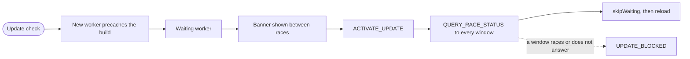
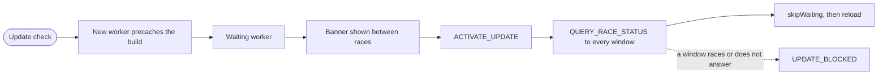

# ADR-006: Offline-First PWA with Race-Safe Updates

<a href="#english"></a>
<a href="#korean"></a>

---

<a id="english"></a>

# English

## Status
Accepted (2026-09-24)

## Context
- The whole game runs in the browser, and every mode except the online leaderboard needs no server. Players can install it as an app (Web App Manifest, `public/manifest.webmanifest`).
- Time trials driven offline are queued in the browser and submitted later; the server verifies them by re-simulation ([ADR-001](ADR-001-deterministic-simulation-server-verification.md)).
- A deploy replaces the client. Swapping code under a running race would break the race and its input recording. Players may also keep several windows open.
- A page and its assets must come from the same build. A page from one build running against a worker or assets from another build can fail in unpredictable ways.

## Options Considered

### Option 1: No service worker, HTTP caching only
- **Pros**: Simplest; a reload always picks up the newest deploy.
- **Cons**: No offline play and no installable offline app.

### Option 2: A generated generic worker (precache plus automatic `skipWaiting`)
- **Pros**: Little custom code.
- **Cons**: Automatic activation can swap versions under a running race; a race-status handshake between the worker and every window and the shell/build consistency checks would still have to be written.

### Option 3: Precache with network-first navigations
- **Pros**: Online players always load the newest page.
- **Cons**: A new page can load under the old worker and mix versions, and a slow or flaky connection delays every launch.

### Option 4: Custom worker: precache everything, cache-only app shell, idle-gated activation (chosen)
- **Pros**: After the first complete download the game starts offline; a page always matches the worker that served it; an update never activates while any window is racing.
- **Cons**: Custom worker code to maintain; updates wait for the player; the first visit downloads the whole game.

## Decision
Adopt option 4.

### Build identity
- `tools/build.mjs` derives the client build id from the first 16 hex characters of a SHA-256 over every file in `dist/client` (except `sw.js` and `build.json`) plus the sources of `src/client/sw.ts` and `src/client/sw-policy.ts`, so a worker-only change still produces a new id.
- It stamps `<meta name="turbo-pals-build" content="…">` into `index.html`, writes `dist/client/build.json` (`{id, version}`) and bundles `sw.js` with `__PRECACHE__` (every shell file plus `/build.json`, without `/dev/*` and `.woff`), `__BUILD__` and `__VERSION__`.

### Install and activate (`src/client/sw.ts`)
- The cache name is `turbo-pals-<version>-<build>`. Install downloads every precache entry (6 requests at a time, `cache: 'reload'`) and rejects any response that is not OK or is opaque. It then checks that the cached `index.html` carries exactly one build meta tag equal to the cached `build.json` id (`shellMatchesBuild`), and only then writes the completion marker `/__turbo_pals_offline_complete__`. On any failure the cache is deleted and the install fails.
- Activation requires a complete cache. It deletes every `turbo-pals-*` cache except the current one and the last-good one: the cache the previous worker served (recorded in `turbo-pals.sw-state`), otherwise the newest complete one. Pages still open on the previous version keep their hashed assets.

### Fetch routing (`src/client/sw-policy.ts`)
- Network only: non-GET requests, other origins, `/api`, `/api/*`, `/healthz`, `/sw.js`.
- Navigations: the cached `/index.html` once this build's cache is complete; before that the network, then any cached shell, then a 503 text response (`오프라인 파일이 아직 준비되지 않았어요…`).
- Cache first: `/assets/*`, `/icons/*`, `/manifest.webmanifest`, `/favicon.svg`, `/icon-maskable.svg`, `/build.json`.
- The server sends `no-cache` for everything except `assets/` (`public, max-age=31536000, immutable`, `src/server/static.ts`), and CloudFront caches only `/assets/*`, so the worker script is never served stale.

### Updates (`src/client/pwa.ts`)
- `PwaManager` registers `/sw.js` with `updateViaCache: 'none'`, only in production builds and only after the title screen is shown. It checks for updates on launch, when the page becomes visible, when the browser comes online, and every 15 minutes (`UPDATE_CHECK_MS`); it skips a check made within 5 minutes of the previous one or during a race.
- A new worker installs and waits. The update banner appears only when no race is active, and `applyUpdate()` refuses during a race.
- Applying an update posts `ACTIVATE_UPDATE`. The worker sends `QUERY_RACE_STATUS` over a `MessageChannel` to every window and calls `skipWaiting()` only if every window answers `RACE_STATUS` with `inRace: false` within 2 s, no new window appeared meanwhile, and no window sent an unsolicited `CLIENT_STATUS` that reports a race. Otherwise it answers `UPDATE_BLOCKED`.
- On `controllerchange` the page saves the settings and the current menu selections (`persistForReload`; the selections are restored if the reload happens within 5 minutes) and reloads into the new version.



## Consequences

### Positive
- After the first complete download the game runs offline. `tools/verify-live-pwa.mjs` checks this in headless Chromium against the live site: more than 150 precached entries, control after reload, the offline readiness chip, an offline cold reload with title and 3D canvas, and the main menu offline.
- A page always runs with the worker and cache of its own build; `tools/verify-live.ts` checks that the shell build id matches `build.json` and the worker ("Shell build id matches build.json and the service worker").
- No update ever interrupts a race, in any window.
- The pure routing and cache policies are unit tested (`test/client/sw-policy.test.ts`).

### Negative
- The first visit downloads the whole game (176 files, about 3.4 MiB for build `0e18641074f0a351`), and a single failed entry fails the whole install, which then starts over.
- Updates are not immediate: a deploy reaches a player only after they press the update button or close every window. Until then, a time-trial run from the old build gets `VERSION_MISMATCH` when the new server can no longer reproduce it after a version bump, and after the update reload, runs still queued from another version core are dropped at start-up (`dropStalePendingRuns` in `src/client/storage.ts`).
- Cache Storage holds two versions after an activation (current and last-good), plus the cache of a waiting update.
- The worker flow itself (`src/client/sw.ts`) has no unit test; only the live check covers it. The development server registers no worker, so PWA behaviour can be tried locally only with a production build (`npm run build && npm start`).

## References
- [src/client/sw.ts](../../src/client/sw.ts), [src/client/sw-policy.ts](../../src/client/sw-policy.ts), [src/client/pwa.ts](../../src/client/pwa.ts), [src/client/ui/pwa-ui.ts](../../src/client/ui/pwa-ui.ts), [src/client/ui/pwa-state.ts](../../src/client/ui/pwa-state.ts), [src/client/storage.ts](../../src/client/storage.ts)
- [tools/build.mjs](../../tools/build.mjs), [src/server/static.ts](../../src/server/static.ts), [infra/lib/edge.ts](../../infra/lib/edge.ts)
- [test/client/sw-policy.test.ts](../../test/client/sw-policy.test.ts), [test/client/pwa-ui.test.ts](../../test/client/pwa-ui.test.ts), [tools/verify-live-pwa.mjs](../../tools/verify-live-pwa.mjs), [tools/verify-live.ts](../../tools/verify-live.ts)
- [README.md](../../README.md) (PWA section)
- [docs/reference/frontend.md](../reference/frontend.md)
- [ADR-001](ADR-001-deterministic-simulation-server-verification.md), [ADR-005](ADR-005-procedural-original-content.md)

Check the policies locally and the live behaviour against the custom domain:

```bash
npx vitest run test/client/sw-policy.test.ts test/client/pwa-ui.test.ts
node tools/verify-live-pwa.mjs https://my-kart.whchoi.net
```

---

<a id="korean"></a>

# 한국어

## 상태
승인됨 (2026-09-24)

## 배경
- 게임 전체가 브라우저에서 돌고, 온라인 랭킹을 뺀 모든 모드는 서버가 필요 없습니다. 플레이어는 게임을 앱으로 설치할 수 있습니다(Web App Manifest, `public/manifest.webmanifest`).
- 오프라인에서 달린 타임 어택 기록은 브라우저에 대기시켰다가 나중에 제출하고, 서버가 재시뮬레이션으로 검증합니다([ADR-001](ADR-001-deterministic-simulation-server-verification.md)).
- 배포하면 클라이언트가 바뀝니다. 진행 중인 레이스 밑에서 코드를 바꾸면 레이스와 입력 기록이 깨집니다. 플레이어가 창을 여러 개 띄워 둘 수도 있습니다.
- 페이지와 에셋은 같은 빌드에서 와야 합니다. 한 빌드의 페이지가 다른 빌드의 worker나 에셋과 함께 돌면 예측하기 어려운 방식으로 실패할 수 있습니다.

## 검토한 옵션

### 옵션 1: 서비스 워커 없이 HTTP 캐시만 사용
- **장점**: 가장 단순하고, 새로고침하면 언제나 최신 배포를 받습니다.
- **단점**: 오프라인 플레이도, 오프라인으로 동작하는 설치형 앱도 없습니다.

### 옵션 2: 자동 생성되는 범용 worker(프리캐시와 자동 `skipWaiting`)
- **장점**: 직접 작성할 코드가 적습니다.
- **단점**: 자동 활성화가 진행 중인 레이스 밑에서 버전을 바꿀 수 있습니다. worker와 모든 창 사이의 레이스 상태 확인, 셸과 빌드의 일치 검사는 어차피 따로 작성해야 합니다.

### 옵션 3: 프리캐시와 네트워크 우선 내비게이션
- **장점**: 온라인 플레이어는 항상 최신 페이지를 받습니다.
- **단점**: 이전 worker 아래에서 새 페이지가 열려 버전이 섞일 수 있고, 느리거나 불안정한 연결에서는 실행할 때마다 늦어집니다.

### 옵션 4: 직접 작성한 worker: 전체 프리캐시, 캐시 전용 앱 셸, 유휴 상태에서만 활성화 (채택)
- **장점**: 첫 다운로드가 끝나면 오프라인에서도 게임이 시작됩니다. 페이지는 언제나 자신을 서빙한 worker와 같은 버전이고, 어느 창이든 레이스 중이면 업데이트가 활성화되지 않습니다.
- **단점**: 유지보수할 worker 코드가 생기고, 업데이트가 플레이어의 선택을 기다리며, 첫 방문에 게임 전체를 내려받습니다.

## 결정
옵션 4를 채택합니다.

### 빌드 식별자
- `tools/build.mjs`는 `dist/client`의 모든 파일(`sw.js`와 `build.json` 제외)과 `src/client/sw.ts`, `src/client/sw-policy.ts` 소스를 SHA-256으로 해시해 앞 16자를 클라이언트 빌드 ID로 씁니다. 그래서 worker만 바뀌어도 새 ID가 나옵니다.
- `index.html`에 `<meta name="turbo-pals-build" content="…">`를 넣고, `dist/client/build.json`(`{id, version}`)을 쓰고, `__PRECACHE__`(셸 파일 전체와 `/build.json`, `/dev/*`와 `.woff` 제외), `__BUILD__`, `__VERSION__`을 넣어 `sw.js`를 번들합니다.

### 설치와 활성화 (`src/client/sw.ts`)
- 캐시 이름은 `turbo-pals-<version>-<build>`입니다. 설치 단계는 프리캐시 항목을 모두 내려받고(동시 요청 6개, `cache: 'reload'`), OK가 아니거나 opaque인 응답을 거부합니다. 이어서 캐시한 `index.html`에 빌드 meta 태그가 정확히 하나 있고 그 값이 캐시한 `build.json`의 id와 같은지 확인한 뒤(`shellMatchesBuild`), 그때서야 완료 마커 `/__turbo_pals_offline_complete__`를 씁니다. 하나라도 실패하면 캐시를 지우고 설치를 실패시킵니다.
- 활성화는 캐시가 완성되었을 때만 진행합니다. 현재 캐시와 last-good 캐시를 뺀 모든 `turbo-pals-*` 캐시를 지웁니다. last-good은 직전 worker가 서빙하던 캐시(`turbo-pals.sw-state`에 기록)이고, 기록이 없으면 가장 최근의 완성된 캐시입니다. 이전 버전으로 열려 있는 페이지는 자신의 해시 에셋을 계속 쓸 수 있습니다.

### 요청 라우팅 (`src/client/sw-policy.ts`)
- 네트워크로만: GET이 아닌 요청, 다른 origin, `/api`, `/api/*`, `/healthz`, `/sw.js`.
- 내비게이션: 이 빌드의 캐시가 완성되면 캐시한 `/index.html`. 그전에는 네트워크, 그다음 캐시된 셸, 마지막으로 503 텍스트 응답(`오프라인 파일이 아직 준비되지 않았어요…`).
- 캐시 우선: `/assets/*`, `/icons/*`, `/manifest.webmanifest`, `/favicon.svg`, `/icon-maskable.svg`, `/build.json`.
- 서버는 `assets/`(`public, max-age=31536000, immutable`, `src/server/static.ts`)를 뺀 모든 응답에 `no-cache`를 보내고 CloudFront는 `/assets/*`만 캐시하므로, worker 스크립트가 낡은 상태로 서빙되지 않습니다.

### 업데이트 (`src/client/pwa.ts`)
- `PwaManager`는 프로덕션 빌드에서만, 그리고 타이틀 화면이 뜬 뒤에 `/sw.js`를 `updateViaCache: 'none'`으로 등록합니다. 업데이트는 실행할 때, 페이지가 다시 보일 때, 브라우저가 온라인이 될 때, 그리고 15분마다(`UPDATE_CHECK_MS`) 확인합니다. 직전 확인 후 5분이 지나지 않았거나 레이스 중이면 건너뜁니다.
- 새 worker는 설치된 뒤 대기합니다. 업데이트 배너는 레이스가 없을 때만 보이고, `applyUpdate()`는 레이스 중이면 거부합니다.
- 업데이트를 적용하면 `ACTIVATE_UPDATE`를 보냅니다. worker는 모든 창에 `MessageChannel`로 `QUERY_RACE_STATUS`를 보내고, 모든 창이 2 s 안에 `inRace: false`인 `RACE_STATUS`로 답하고, 그사이 새 창이 생기지 않았으며, 레이스 중이라고 알리는 `CLIENT_STATUS`가 따로 오지 않았을 때만 `skipWaiting()`을 호출합니다. 아니면 `UPDATE_BLOCKED`로 답합니다.
- `controllerchange`가 오면 페이지는 설정과 현재 메뉴 선택값을 저장하고(`persistForReload`, 5분 안에 다시 열리면 선택값을 복원) 새 버전으로 다시 불러옵니다.



## 영향

### 긍정적
- 첫 다운로드가 끝나면 게임이 오프라인에서 돕니다. `tools/verify-live-pwa.mjs`가 헤드리스 Chromium으로 라이브 사이트에서 이를 확인합니다. 프리캐시 항목 150개 초과, 새로고침 후 worker 제어, 오프라인 준비 표시, 오프라인 콜드 리로드에서 타이틀과 3D 캔버스, 오프라인 메인 메뉴가 검사 대상입니다.
- 페이지는 항상 자신의 빌드와 같은 worker와 캐시로 돕니다. `tools/verify-live.ts`가 셸의 빌드 ID와 `build.json`, worker가 일치하는지 확인합니다("Shell build id matches build.json and the service worker").
- 어느 창에서든 업데이트가 레이스를 끊지 않습니다.
- 순수 함수로 분리한 라우팅과 캐시 정책은 단위 테스트가 있습니다(`test/client/sw-policy.test.ts`).

### 부정적
- 첫 방문에 게임 전체를 내려받고(빌드 `0e18641074f0a351` 기준 파일 176개, 약 3.4 MiB), 항목 하나만 실패해도 설치 전체가 실패해 처음부터 다시 시작합니다.
- 업데이트가 즉시 반영되지 않습니다. 플레이어가 업데이트 버튼을 누르거나 모든 창을 닫아야 새 배포가 적용됩니다. 그전까지 이전 빌드에서 달린 타임 어택은 버전을 올린 새 서버가 재현하지 못하면 `VERSION_MISMATCH`를 받고, 업데이트로 다시 불러온 뒤에는 버전 코어가 다른 대기 기록을 시작할 때 지웁니다(`src/client/storage.ts`의 `dropStalePendingRuns`).
- 활성화 후에도 Cache Storage에 버전 두 개(현재와 last-good)가 남고, 대기 중인 업데이트가 있으면 그 캐시도 더해집니다.
- worker 흐름 자체(`src/client/sw.ts`)에는 단위 테스트가 없고 라이브 검사만 있습니다. 개발 서버는 worker를 등록하지 않으므로, PWA 동작은 로컬에서 프로덕션 빌드(`npm run build && npm start`)로만 확인할 수 있습니다.

## 참고 자료
- [src/client/sw.ts](../../src/client/sw.ts), [src/client/sw-policy.ts](../../src/client/sw-policy.ts), [src/client/pwa.ts](../../src/client/pwa.ts), [src/client/ui/pwa-ui.ts](../../src/client/ui/pwa-ui.ts), [src/client/ui/pwa-state.ts](../../src/client/ui/pwa-state.ts), [src/client/storage.ts](../../src/client/storage.ts)
- [tools/build.mjs](../../tools/build.mjs), [src/server/static.ts](../../src/server/static.ts), [infra/lib/edge.ts](../../infra/lib/edge.ts)
- [test/client/sw-policy.test.ts](../../test/client/sw-policy.test.ts), [test/client/pwa-ui.test.ts](../../test/client/pwa-ui.test.ts), [tools/verify-live-pwa.mjs](../../tools/verify-live-pwa.mjs), [tools/verify-live.ts](../../tools/verify-live.ts)
- [README.md](../../README.md) (PWA 섹션)
- [docs/reference/frontend.md](../reference/frontend.md)
- [ADR-001](ADR-001-deterministic-simulation-server-verification.md), [ADR-005](ADR-005-procedural-original-content.md)

로컬에서 정책 테스트를, 커스텀 도메인에서 라이브 동작을 확인합니다.

```bash
npx vitest run test/client/sw-policy.test.ts test/client/pwa-ui.test.ts
node tools/verify-live-pwa.mjs https://my-kart.whchoi.net
```
