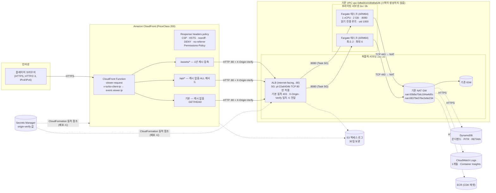

# TURBO PALS GRAND PRIX — 인프라 & 운영 가이드

> 대상 환경: 계정 `061525506239` · 리전 `ap-northeast-2`(서울) · 기존 VPC `vpc-0dfa5610180dfa628`(10.100.0.0/16)
> 스택: `TurboPalsStack` (AWS CDK v2, TypeScript) · 태그 `Project=turbo-pals`

이 문서는 게임 서버(Fastify), 컨테이너 이미지, AWS CDK 스택의 구성과 보안 경계, 예상 비용, 배포·롤백·삭제 절차를 설명합니다.

---

## 1. 토폴로지



| 구간 | 프로토콜 | 통제 수단 |
| --- | --- | --- |
| 브라우저 → CloudFront | HTTPS 전용 (HTTP는 301 리디렉션) | 기본 `*.cloudfront.net` 인증서, HSTS 1년 |
| CloudFront → ALB | HTTP :80 | ALB 보안 그룹은 **CloudFront origin-facing 관리형 prefix list(`pl-22a6434b`)만** 허용, 리스너는 `X-Origin-Verify` 헤더가 맞을 때만 전달(그 외 403) |
| ALB → 태스크 | HTTP :8080 | Task SG 인바운드는 ALB SG에서 온 8080만 허용 |
| 태스크 → AWS API | HTTPS :443 | Task SG 아웃바운드는 TCP 443만, 프라이빗 서브넷의 기본 경로(기존 NAT GW)로 나감 |

스택이 기존 VPC 안에 두는 것은 ALB, **보안 그룹 2개**, Fargate 태스크 ENI뿐입니다. VPC·서브넷·라우트·NAT GW·IGW·EIP·VPC 엔드포인트는 만들거나 수정하지 않습니다(`test/infra/stack.test.ts`가 검증).

### 1.1 CDK 구성 요소

| 파일 | Construct | 주요 리소스 |
| --- | --- | --- |
| `infra/lib/network.ts` | `Network` | `Vpc.fromLookup`(cdk.context.json), 2a/2b 고정 서브넷 선택(PUBLIC=ALB, PRIVATE_WITH_EGRESS=태스크), 선택된 서브넷 ID가 검증된 4개와 다르면 synth 실패 |
| `infra/lib/data.ts` | `Data` | DynamoDB `pk`/`sk` 테이블(온디맨드, PITR, 삭제 보호, RETAIN), origin-verify 시크릿(48자 생성) |
| `infra/lib/logs.ts` | `AccessLogs` | CloudFront·ALB 액세스 로그 S3 버킷(퍼블릭 차단, SSE-S3, TLS 강제, 30일 만료) |
| `infra/lib/service.ts` | `Service` | ALB·리스너·리스너 규칙·타깃 그룹, ECS 클러스터(Container Insights), Fargate 태스크/서비스, 오토스케일링, Docker 이미지 에셋 |
| `infra/lib/edge.ts` | `Edge` | CloudFront 배포, viewer-request Function, 응답 헤더 정책, `/assets/*` 캐시·오리진 요청 정책 |
| `infra/lib/stack.ts` | `TurboPalsStack` | 위 구성 조립, 안전 가드, 출력값 |
| `src/shared/csp.ts` | — | CSP·Permissions-Policy·보안 헤더의 **단일 원본**(서버와 CloudFront가 같은 값을 사용) |

출력값: `SiteUrl`, `DistributionId`, `AlbDnsName`, `ClusterName`, `ServiceName`, `TableName`.

---

## 2. 보안 경계

1. **오리진 은닉 — prefix list 보안 그룹.** ALB는 internet-facing이지만 보안 그룹 인바운드 규칙은 `pl-22a6434b`(com.amazonaws.global.cloudfront.origin-facing) TCP 80 **단 하나**입니다. CloudFront 이외의 IP에서 ALB DNS로 접속하면 연결 자체가 타임아웃됩니다.
2. **오리진 시크릿 헤더.** CloudFront는 오리진 요청마다 `X-Origin-Verify: <Secrets Manager 생성 값>`을 붙입니다. ALB 리스너 기본 동작은 고정 403이고, 이 헤더가 일치하는 요청만 타깃 그룹으로 전달합니다. 다른 계정의 CloudFront 배포처럼 prefix list를 통과하는 트래픽도 이 단계에서 차단됩니다. 값은 CloudFormation 동적 참조(`{{resolve:secretsmanager:…}}`)로만 템플릿에 들어가므로 템플릿·출력·태스크 환경 변수·IAM 정책 어디에도 평문이 없습니다. 뷰어가 같은 이름의 헤더를 보내도 CloudFront 오리진 커스텀 헤더가 덮어씁니다.
3. **프라이빗 태스크.** Fargate 태스크는 프라이빗 서브넷(`subnet-07b1e65682847dce9`, `subnet-095297380cd45e1eb`)에서 `AssignPublicIp=DISABLED`로 실행됩니다. 인바운드는 ALB SG의 8080뿐입니다.
4. **NAT 경유 이그레스.** 태스크 아웃바운드는 TCP 443만 허용되며, 프라이빗 서브넷 라우트 테이블의 기존 NAT GW(`nat-00b8a70dc184a4d0c`, `nat-08379e076e2e6e234`)를 거쳐 ECR·CloudWatch Logs·DynamoDB에 접근합니다. DNS(AmazonProvidedDNS)는 보안 그룹 규칙의 영향을 받지 않습니다.
5. **컨테이너 하드닝.** ARM64 Node 24 Alpine, 런타임 이미지에는 번들된 `dist/`만 존재(npm/yarn 제거), uid:gid `1000:1000`, 읽기 전용 루트 파일시스템, 모든 Linux capability 제거, `privileged: false`, init 프로세스, ECS Exec 비활성화. 애플리케이션 파일은 root 소유라 런타임 사용자가 수정할 수 없습니다.
6. **최소 권한 IAM.** 태스크 역할은 자기 테이블 ARN에 대한 `GetItem`/`PutItem`/`DeleteItem`/`Query`만 가집니다(`TransactWriteItems`는 항목별 Put/Delete 권한으로 인가, Scan·UpdateItem 없음). 실행 역할의 `Resource: *`는 리소스 수준 권한을 지원하지 않는 `ecr:GetAuthorizationToken` 하나뿐입니다.
7. **브라우저 보안 헤더.** `src/shared/csp.ts`의 CSP는 self 전용이며 `'unsafe-eval'`과 외부 호스트가 없습니다. 스크립트는 외부 파일만 허용하고(인라인 `<script>` 불가), 스타일만 `'unsafe-inline'`을 허용합니다 — `src/client/index.html`이 번들 로드 전에 그려야 하는 스플래시·오류 화면 CSS를 인라인 `<style>`로 갖고 있기 때문입니다(이 블록을 스타일시트로 옮기면 `style-src 'self'`로 좁힐 수 있음). CloudFront 응답 헤더 정책이 CSP(+`upgrade-insecure-requests`), HSTS(1년, includeSubDomains), `X-Content-Type-Options: nosniff`, `X-Frame-Options: DENY`, `Referrer-Policy: no-referrer`, `Permissions-Policy`(gamepad·fullscreen·screen-wake-lock만 self 허용), COOP/CORP same-origin을 모든 동작에 강제합니다. 서버도 동일한 값을 보냅니다(평문 HTTP 로컬 실행을 위해 `upgrade-insecure-requests`만 제외).
8. **남용 방지.** viewer-request Function이 `x-turbo-client-ip`를 `event.viewer.ip`로 **덮어써** 스푸핑을 막고, 서버는 이 값을 속도 제한 키로만 사용합니다(로그·저장 안 함, IPv6는 /64 단위). 제한: `POST /api/runs` 12회/분, `GET /api/*` 120회/분(존재하지 않는 `/api/*` 경로는 메서드와 무관하게 이 예산을 사용), 페이지·정적 파일 600회/분(태스크별 메모리 카운터이므로 실효 한도는 태스크 수만큼 늘어납니다). POST는 `Origin`이 있으면 `PUBLIC_ORIGIN`과 일치해야 하고 `application/json`만 받습니다. 본문 한도 256 KB.
9. **기록 위조 방지.** 제출된 입력 로그는 워커 스레드에서 `verifyTimeTrial`(결정론적 시뮬레이션)로 재시뮬레이션되고, 재시뮬레이션 결과의 `ticks`와 `lapTicks`가 제출값과 정확히 같을 때만 저장됩니다. 한 건당 CPU 예산 8초, 대기열 32건·대기 6초(초과 시 503). 고스트 로그는 공개되므로 입력 시퀀스별 최초 등록자만 해당 로그를 사용할 수 있습니다(고스트 도용 방지). 소유권 키는 로그 문자열이 아니라 **디코딩·정규화한 틱별 입력의 SHA-256**이라서, 런 분할·base64 패딩 비트 변경처럼 같은 입력을 다르게 인코딩한 로그도 같은 로그로 취급됩니다. 단, 시뮬레이션 결과에 영향이 없는 입력 비트를 일부러 바꾼 로그까지 막지는 못합니다(재시뮬레이션이 같은 기록을 인정하므로 동률 등록만 가능).
10. **데이터 보호.** DynamoDB는 AWS 관리형 KMS 암호화, PITR(35일), 삭제 보호, `RETAIN`. 공개 API 응답은 스키마 허용 목록으로 직렬화되어 `playerId`가 절대 노출되지 않습니다.
11. **정책 검사.** `cdk synth` 때마다 cdk-nag `AwsSolutionsChecks`가 실행되어 위반이 있으면 합성이 실패합니다. 예외(acknowledge)는 사유와 함께 코드에 있습니다 — CFR1(지역 제한 없음), CFR2(WAF 범위 외), CFR4(기본 인증서의 TLS 정책), CFR5(요구된 HTTP 오리진, SG+시크릿으로 보호), SMG4(동적 참조 시크릿은 세대 교체로 회전), S1(로그 버킷 자체 로깅 불필요), ECS2(비밀 없는 환경 변수), IAM5(`ecr:GetAuthorizationToken`).
12. **배포 대상 가드.** 스택 생성자는 계정·리전·VPC·prefix list가 위 값과 다르면 즉시 예외를 던집니다.

---

## 3. 애플리케이션 서버 (`src/server`)

| 엔드포인트 | 설명 |
| --- | --- |
| `GET /healthz` | `{ ok: true, version }` · `no-store` · 속도 제한 없음. `version`은 `APP_VERSION`(= `package.json` 버전 + `+` + 이미지 에셋 해시 12자) |
| `GET /api/leaderboard?track=<id>&cc=<50\|100\|150\|200>` | 상위 50개, 플레이어당 최고 기록 1행, 동률은 먼저 달성한 기록 우선 |
| `POST /api/runs` | 엄격한 스키마 검증 → 이름 NFC 정규화(1~12자 한글·영문·숫자·공백·`_`·`-`) → 재시뮬레이션 → 개인 최고 기록이면 교체 저장. 불일치 시 422(`REPLAY_INVALID`/`VERSION_MISMATCH`/`TIME_MISMATCH`/`LAP_MISMATCH`), 남의 고스트 로그 재제출은 409(`DUPLICATE_RUN`). 느린 기록은 `personalBest: false`와 기존 최고 기록의 순위를 반환 |
| `GET /api/ghost/:id` | 순위 행의 입력 로그(고스트). 교체된 기록은 404 |
| 정적 파일 | `index.html`·기타 루트 파일 `no-cache`, `/assets/*` `public, max-age=31536000, immutable`, 확장자 없는 GET 경로는 SPA 폴백 |

오류 응답은 항상 `{ "error": "<CODE>", "message": "<한국어 안내>" }`입니다(잘못된 퍼센트 인코딩 URL처럼 라우터 단계에서 거부되는 요청도 포함). 정적 파일 경로의 잘못된 요청(디렉터리, NUL 바이트, 너무 긴 파일명)은 404, 만족할 수 없는 Range는 416으로 답하며 5xx로 기록하지 않습니다. 로그는 JSON 한 줄(route 템플릿·상태·지연 시간·검증 소요 시간만; 이름·로그·IP·playerId 미기록)입니다.

**DynamoDB 단일 테이블 레이아웃**

| pk | sk | 내용 |
| --- | --- | --- |
| `LB#<track>#<cc>` | `<ticks 9자리>#<runId>` | 순위 행(이름·캐릭터·랩 기록). `Query … Limit 50`으로 상위 조회 |
| `PB#<track>#<cc>#<playerId>` | `PB` | 플레이어의 현재 최고 기록 포인터 |
| `GHOST#<runId>` | `GHOST` | 고스트 입력 로그(최대 200 KB, 순위 파티션 밖에 저장) |
| `LOG#<입력 시퀀스 해시>` | `LOG` | 이 입력 시퀀스를 처음 등록한 플레이어(영구, `logDigest`: 디코딩·정규화한 틱별 입력의 SHA-256). 다른 플레이어가 공개된 고스트 로그를 그대로 또는 재인코딩해 제출하면 409 `DUPLICATE_RUN` |

개인 최고 기록 교체는 `TransactWriteItems` 한 번(포인터 조건부 Put + 새 순위 행/고스트/로그 소유권 Put + 이전 행/고스트 Delete)으로 처리되며, 포인터의 이전 id를 조건으로 걸어 같은 플레이어의 동시 제출에도 행이 하나만 남습니다(DynamoDB Local로 동시성 테스트 통과).

---

## 4. 빌드와 로컬 실행

```bash
npm run dev          # Vite :8200 (HMR, /api·/healthz → :8201 프록시) + tsx watch 서버 :8201 (메모리 저장소)
npm run build        # dist/client(Vite) + dist/server/{index,verify-worker}.js(esbuild, 의존성 전부 번들) + dist/build.json
npm start            # node dist/server/index.js

docker build --platform linux/arm64 -t turbo-pals:local .
docker run --rm --read-only --cap-drop ALL -p 18080:8080 turbo-pals:local
curl -s http://127.0.0.1:18080/healthz
```

테스트:

```bash
npx tsc --noEmit                                   # 앱·서버·테스트
npx tsc --noEmit -p infra/tsconfig.json            # CDK
npx vitest run test/server test/infra
# DynamoDB 저장소를 실제 트랜잭션으로 검증 (선택)
docker run -d --rm --name ddb -p 127.0.0.1:18765:8000 amazon/dynamodb-local -jar DynamoDBLocal.jar -inMemory
DYNAMODB_TEST_ENDPOINT=http://127.0.0.1:18765 npx vitest run test/server/repository.test.ts
```

환경 변수: `PORT`(8080) · `HOST`(프로덕션 0.0.0.0) · `STATIC_DIR`(dist/client) · `TABLE_NAME`(비우면 메모리 저장소) · `AWS_REGION` · `APP_VERSION` · `PUBLIC_ORIGIN`/`ALLOWED_ORIGINS`(쉼표 구분 정확한 오리진) · `LOG_LEVEL`.

---

## 5. 배포

사전 조건: 대상 계정 자격 증명(`aws sts get-caller-identity`가 `061525506239`), CDK 부트스트랩 완료(`cdk-hnb659fds` 스택), Docker 실행 중(이미지는 `linux/arm64`로 빌드되므로 x86 호스트에서는 buildx/QEMU 필요).

```bash
cd ~/my-project/kart-game
npx tsc --noEmit && npx tsc --noEmit -p infra/tsconfig.json
npx vitest run test/server test/infra
npx cdk synth --quiet                      # cdk-nag 포함, 위반 시 실패
npx cdk diff TurboPalsStack                # 보안 그룹·IAM 변경 확인
npx cdk deploy TurboPalsStack --outputs-file cdk-outputs.json
# (package.json의 npm run deploy 는 승인 없이 배포합니다)
```

배포 후 확인:

```bash
SITE=$(jq -r .TurboPalsStack.SiteUrl cdk-outputs.json)
ALB=$(jq -r .TurboPalsStack.AlbDnsName cdk-outputs.json)
curl -s "${SITE}healthz"                                              # {"ok":true,"version":"1.0.0+…"}
curl -sI "$SITE" | grep -iE 'content-security-policy|strict-transport-security|x-frame-options'
curl -s -o /dev/null -w '%{http_code}\n' --max-time 5 "http://$ALB/" # 000(타임아웃)이어야 정상: CloudFront 외 접근 차단
```

처음 배포 시 CloudFront 배포 생성·전파에 수 분이 걸립니다. `index.html`은 엣지에서 캐시하지 않고 `/assets/*`는 파일명에 해시가 있으므로, 새 버전 배포 후 **캐시 무효화는 필요 없습니다**.

### 5.1 오리진 시크릿 회전 (무중단)

```bash
npx cdk deploy TurboPalsStack -c originSecretGeneration=2
```

세대 N으로 배포하면 새 시크릿 N이 생성되고, ALB 규칙은 N과 N-1을 모두 허용하며(규칙이 배포보다 먼저 갱신되도록 의존성 설정), CloudFront는 N을 보냅니다. 전파 중에도 403이 나지 않습니다. 다음 회전(N+1) 때 N-1이 삭제됩니다. 회전 후에는 `cdk.json`의 `context`에 `"originSecretGeneration": 2`를 기록해 이후 배포가 되돌리지 않게 합니다.

---

## 6. 롤백

- **자동:** ECS 배포 서킷 브레이커(rollback 활성화)가 새 태스크가 헬스 체크(`/healthz`, 컨테이너·ALB 양쪽)를 통과하지 못하면 이전 태스크 정의로 되돌립니다. `minHealthyPercent 100 / maxHealthyPercent 200`이므로 교체 중에도 기존 2개 태스크가 유지됩니다. CloudFormation 업데이트가 실패하면 스택 전체가 자동 롤백됩니다.
- **수동(권장):** 정상 커밋으로 되돌려 재배포합니다.
  ```bash
  git checkout <정상-커밋> && npx cdk deploy TurboPalsStack --outputs-file cdk-outputs.json
  ```
- **긴급(이미지만 되돌리기):** 이전 태스크 정의 리비전으로 서비스를 갱신합니다. 다음 `cdk deploy`가 다시 덮어쓰므로 이후 코드도 되돌려야 합니다.
  ```bash
  CLUSTER=$(jq -r .TurboPalsStack.ClusterName cdk-outputs.json)
  SERVICE=$(jq -r .TurboPalsStack.ServiceName cdk-outputs.json)
  FAMILY=$(aws ecs describe-services --cluster "$CLUSTER" --services "$SERVICE" --region ap-northeast-2 \
    --query 'services[0].taskDefinition' --output text | sed -E 's#.*/([^:]+):[0-9]+$#\1#')
  aws ecs list-task-definitions --family-prefix "$FAMILY" --sort DESC --region ap-northeast-2
  aws ecs update-service --cluster "$CLUSTER" --service "$SERVICE" \
    --task-definition "$FAMILY:<이전-리비전>" --region ap-northeast-2
  ```
- **데이터:** 잘못된 쓰기는 PITR로 복구합니다(새 테이블로 복원 후 `TABLE_NAME` 전환).
  ```bash
  aws dynamodb restore-table-to-point-in-time --source-table-name <TableName> \
    --target-table-name <TableName>-restore --restore-date-time <ISO-8601> --region ap-northeast-2
  ```

---

## 7. 삭제

```bash
npx cdk destroy TurboPalsStack
```

삭제 후에도 **의도적으로 남는 리소스**: DynamoDB 랭킹 테이블(RETAIN + 삭제 보호), 액세스 로그 S3 버킷(RETAIN, 객체는 30일 후 만료), CDK 부트스트랩 ECR 저장소의 이미지. 완전히 지우려면(되돌릴 수 없음):

```bash
aws dynamodb update-table --table-name <TableName> --no-deletion-protection-enabled --region ap-northeast-2
aws dynamodb delete-table --table-name <TableName> --region ap-northeast-2
aws s3 rb s3://<액세스-로그-버킷> --force
```

기존 VPC·서브넷·NAT GW는 이 스택 소유가 아니므로 삭제되지 않습니다.

---

## 8. 비용 추정

> **추정치입니다.** 2026-09-23에 AWS Price List API로 조회한 서울 리전 온디맨드 단가(USD, 세금 제외, 월 730시간)와 아래 가정을 기준으로 계산했습니다. 실제 비용은 트래픽, 태스크 수, 로그량, 프리 티어 적용 여부에 따라 달라집니다.

| 항목 | 단가 | 가정 / 산식 | 월 예상 |
| --- | --- | --- | --- |
| Fargate ARM64 (상시 2태스크) | vCPU $0.03725/h, 메모리 $0.00409/GB-h | 2 × (1 × 0.03725 + 2 × 0.00409) × 730 | **약 $66** |
| └ 최대 6태스크로 확장 시 | 〃 | 위 × 3 (확장된 시간만큼만 과금) | 최대 약 $199 |
| ALB | $0.0225/h + $0.008/LCU-h | 16.4 + LCU 평균 1개 × 0.008 × 730 | 약 $22 |
| 퍼블릭 IPv4 (ALB) | $0.005/IP-h | AZ 2개 × 0.005 × 730 | 약 $7 |
| CloudFront 전송·요청 | 아시아·태평양 $0.120/GB(첫 10 TB), HTTPS $0.012/1만 건 | 상시 무료 한도(월 1 TB, 1,000만 요청) 이내 가정 | $0 (초과분만 과금) |
| CloudFront Functions | $0.10/100만 호출 | 월 200만 호출 무료 이내 가정 | $0 |
| DynamoDB 온디맨드 | 쓰기 $0.68/100만 WRU, 읽기 $0.1355/100만 RRU, 저장 25 GB 무료 후 $0.27075/GB, PITR $0.2166/GB | 신기록 월 10만 건(트랜잭션·고스트 포함 건당 약 25~50 WRU) + 순위 조회 100만 회(약 4 RRU) + 1 GB | 약 $4 |
| NAT GW 데이터 처리 | $0.059/GB | 이미지 pull(태스크 시작당 약 60 MB), 로그, DynamoDB API 합계 약 10 GB (NAT 시간 요금은 기존 인프라 부담) | 약 $1 |
| CloudWatch Logs | 수집 $0.76/GB, 보관 $0.0314/GB-월 | 요청 로그 약 1 GB/월 | 약 $1 |
| Container Insights | 지표 수 기준 | 태스크 2~6개 소규모 클러스터 | 수 달러 |
| Secrets Manager | $0.40/시크릿-월 | 1개(회전 후 2개) | $0.4~0.8 |
| S3 액세스 로그 · ECR 저장 | S3 표준 / $0.10/GB-월 | 30일 만료 로그, 이미지 약 60 MB × 보관 개수 | $1 미만 |
| **합계 (저트래픽, 상시 2태스크)** | | | **월 약 $100 내외** |

비용 절감 선택지: 트래픽이 낮은 시간대에 최소 태스크를 1로 낮추기(가용성 저하), Container Insights 비활성화, CloudFront PriceClass 100(아시아 지연 증가 가능). 모두 요구 사항과의 트레이드오프이므로 기본값은 유지했습니다.

---

## 9. 운영 참고

- **로그:** CloudWatch Logs 그룹(1개월 보관, 스트림 접두사 `app`). 주요 이벤트: `listening`, `request`, `run_accepted`, `run_rejected`(검증 실패 사유 코드 포함), `request_failed`(`StorageError`/`VerifierUnavailableError` 사유), `shutdown`/`stopped`.
- **헬스 체크:** 컨테이너(30초 간격, node fetch)와 ALB 타깃 그룹(15초, 2회 성공/3회 실패). 성공한 `/healthz`는 로그에 남기지 않습니다.
- **종료:** ECS가 타깃 등록 해제(20초) 후 SIGTERM을 보내면 서버는 새 연결을 받지 않고 처리 중 요청과 검증 워커를 정리한 뒤 종료합니다(`stopTimeout` 30초, 자체 강제 종료 25초).
- **스케일링:** 서비스 CPU 평균 60% 또는 타깃당 분당 요청 600을 목표로 2~6태스크 사이에서 조정합니다(scale-out 60초, scale-in 180초 쿨다운).
- **Keep-alive:** 서버 keep-alive 65초 > ALB 유휴 60초 > CloudFront 오리진 keep-alive 30초 순으로 설정해 재사용 연결 경합으로 인한 502를 방지합니다.
- **커스텀 도메인:** 현재는 `*.cloudfront.net` 기본 도메인을 사용합니다. 도메인을 붙이려면 us-east-1 ACM 인증서와 CloudFront `domainNames`/`certificate`를 추가하고 `PUBLIC_ORIGIN`에 새 오리진을 포함해야 합니다(이 경우 TLSv1.2_2021 정책 적용 가능).
