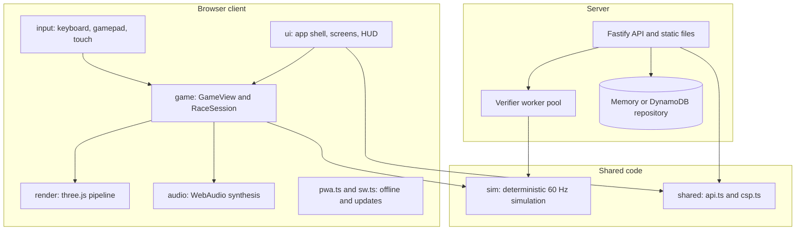

# Developer Onboarding

<a href="#english"></a>
<a href="#korean"></a>

---

<a id="english"></a>

# English

## Quick Start

### 1. Prerequisites

- [ ] Git.
- [ ] Node.js 22.12 or later (`engines` in `package.json` is `>=22.12.0`; `scripts/setup.sh` refuses older versions). npm comes with Node.
- [ ] A desktop browser with WebGL. Without it the game stops at `3D 그래픽을 사용할 수 없어요`.
- [ ] Repository access: <https://github.com/whchoi98/kart-game> is public.
- [ ] Environment variables: none are required locally. [.env.example](../.env.example) documents every variable; nothing loads a `.env` file automatically.
- [ ] Optional: Docker, for the container image (`linux/arm64`; an x86 host needs buildx or QEMU) and for the DynamoDB Local tests.
- [ ] Optional: Playwright Chromium, for `npm run qa:screens` and `tools/verify-live-pwa.mjs` (installed by `--with-browsers` below).
- [ ] Only for deploys and live checks: the AWS CLI with credentials for account `061525506239`. Day-to-day development needs no AWS access.

### 2. Setup

```bash
git clone https://github.com/whchoi98/kart-game.git
cd kart-game
bash scripts/setup.sh
```

Use `bash scripts/setup.sh --with-browsers` to also download Playwright Chromium. The script checks Git and the Node.js version, runs `npm ci` (exact versions from `package-lock.json`), makes the Claude Code hooks and the harness runner executable, and installs the Git `commit-msg` hook through `scripts/install-hooks.sh`. It does not create a `.env` file.

### 3. Verify

```bash
npm run typecheck
npm test
npm run test:harness
npm run dev
```

- `npm run typecheck` type-checks the app and the CDK app (`infra/tsconfig.json`).
- `npm test` runs vitest over `test/sim`, `test/client`, `test/server` and `test/infra`. The DynamoDB Local cases in `test/server/repository.test.ts` are skipped unless `DYNAMODB_TEST_ENDPOINT` is set (see Troubleshooting).
- `npm run test:harness` runs the shell harness: Claude Code hooks, secret patterns, project structure and the documentation contracts.
- `npm run dev` starts Vite on <http://localhost:8200> and the API on `127.0.0.1:8201` with an in-memory leaderboard. Open the page, start a race, and press Ctrl+C to stop both processes.

To run the production build locally (the service worker and the offline mode work only in this build):

```bash
npm run build && npm start
```

Then open <http://127.0.0.1:8080>.

## Project Overview

TURBO PALS GRAND PRIX (`터보 팰즈 그랑프리`) is an arcade 3D kart racer for the browser, built with three.js and WebAudio, plus a Fastify server that verifies time-trial records by re-simulating them. Production runs on AWS: CloudFront, an ALB that only CloudFront can reach, ECS Fargate ARM64 tasks and DynamoDB.



| Path | Contents |
| --- | --- |
| `src/sim/` | Deterministic race simulation used by the browser and the server; tracks in `src/sim/tracks/` |
| `src/shared/` | Browser and server contract (`api.ts`) and the single source of the security headers (`csp.ts`) |
| `src/client/` | Game client: `ui/`, `game/`, `render/`, `audio/`, `input/`, dev-only pages in `dev/`, PWA in `pwa.ts` and `sw.ts` |
| `src/server/` | Fastify server, replay verifier worker pool, memory and DynamoDB repositories |
| `infra/` | AWS CDK app (`TurboPalsStack`) |
| `tools/` | Build, dev server, QA screenshots, simulation and track reports, live verification |
| `test/` | vitest suites and the shell harness in `test/harness/` |
| `docs/` | Architecture, ADRs, runbooks, implementation references |

Read next:

- [CLAUDE.md](../CLAUDE.md): project context, rules and key commands. Every module directory has its own `CLAUDE.md`; read it before you edit that module.
- [docs/architecture.md](architecture.md): components, data flow, infrastructure and the simulation versioning rule.
- [docs/decisions/](decisions/): architecture decision records (ADRs).
- [docs/design.md](design.md): the game design document (Korean).
- [docs/api-reference.md](api-reference.md) and [docs/reference/INDEX.md](reference/INDEX.md): HTTP API and per-layer implementation references.

## Development Workflow

- **Branches**: start from `main` and use `feat/`, `fix/`, `docs/` or `refactor/` prefixes, for example `feat/frost-peak-shortcut`.
- **Commits**: Conventional Commits (`feat:`, `fix:`, `docs:`, `refactor:`, `test:`, `chore:`), optionally with a scope such as `fix(server): ...`.
- **commit-msg hook**: `scripts/install-hooks.sh` (run by `scripts/setup.sh`) installs a hook that removes `Co-Authored-By` trailers in any letter case. It respects `core.hooksPath` and keeps a foreign hook as `commit-msg.local-backup`. Run `bash scripts/install-hooks.sh` yourself if you did not use `scripts/setup.sh`.
- **Claude Code**: `.claude/settings.json` registers hooks for session context, documentation reminders after edits, a secret scan of the staged content before `git commit` (it blocks the commit and prints only file names and pattern labels) and notifications. To run the same scan by hand: `bash .claude/hooks/secret-scan.sh --staged`. The `/review`, `/test-all` and `/deploy` commands live in `.claude/commands/`.

```bash
git checkout -b feat/short-description
npm run typecheck && npm test && npm run test:harness
git add -A
git commit -m "feat(ui): short description"
git push -u origin feat/short-description
```

Pull request checklist:

- [ ] `npm run typecheck`, `npm test` and `npm run test:harness` pass.
- [ ] A change to existing `src/sim` code or to the geometry of an existing track that can alter a time-trial trajectory bumps the `package.json` version and adds a CHANGELOG entry (a brand-new track alone does not need a bump).
- [ ] API changes update [docs/api-reference.md](api-reference.md) and [docs/reference/api.md](reference/api.md).
- [ ] New player-facing text is Korean; a new server error code has a message in `CODE_MESSAGES` (`src/client/api.ts`).
- [ ] Infrastructure changes pass `npm run synth` (cdk-nag) and come with a reviewed `npx cdk diff TurboPalsStack`.
- [ ] `.dockerignore` and `IMAGE_CONTEXT_EXCLUDE` (`infra/lib/service.ts`) stay identical.
- [ ] A new directory under `src/` has its own `CLAUDE.md`, and changed behaviour is reflected in the docs.

Deployments happen only through [runbooks/deploy-production.md](runbooks/deploy-production.md). Never destroy `TurboPalsStack` without an explicit request from the owner.

Useful local pages while `npm run dev` runs:

| URL | Purpose |
| --- | --- |
| <http://localhost:8200/?debug> | The game with the QA hook `window.__turbo` |
| <http://localhost:8200/ui-preview.html?mockapi&speed=4> | The real UI shell on a mock game view and a mock API |
| `http://localhost:8200/dev/<page>.html` | Render QA pages: `fx`, `karts`, `scenery-a`, `scenery-b`, `track` |

## Key Concepts

### Deterministic simulation and the version rule

- `src/sim` steps at a fixed 60 Hz with deterministic math (`dmath.ts`) and a seeded RNG, and the browser and the server run the same code. A time-trial record carries the input log (one input word per tick); the server replays it in a worker thread and accepts it only when the finish ticks and lap ticks match exactly. Otherwise it answers 422.
- A change to existing simulation code or to the geometry of an existing track that can alter a trajectory needs a `package.json` version bump and a CHANGELOG entry. A brand-new track changes no existing replay, so it does not force a bump. The server compares the semver core of the client's version only when the replay fails: a stale client then gets `VERSION_MISMATCH` (shown as `게임 버전이 달라요. 새로고침한 뒤 다시 도전해 주세요.`) instead of `REPLAY_INVALID`, which looks like cheating. Clients also discard offline records of another version core at startup, so every bump drops the runs players queued offline under the old version.
- The Claude Code hook prints a `[sim-version]` reminder after edits under `src/sim/`. Adding a `KartInput` field changes the input-log protocol and the server verification. See [ADR-001](decisions/ADR-001-deterministic-simulation-server-verification.md).

### QA debug hook

- `?debug` exposes `window.__turbo` (`view`, `app`, `ready`, `startRace(config, { autopilotHuman?, ghost? })`, `state()`) only when `__DEBUG_HOOK__` is true: on the dev server (`npm run dev`), in a QA build (`TURBO_DEBUG_HOOK=1 node tools/build.mjs`) and on the QA server (`npx vite --config tools/vite-qa.config.mjs --port 8250 --strictPort`).
- Release builds compile the hook out. Never deploy a QA build; `tools/verify-live-pwa.mjs` checks that the live site has no hook.
- `?debug&quality=low` (or `auto`, `medium`, `high`) changes only that page's renderer, never the saved settings. `npm run qa:screens` drives the hook against <http://127.0.0.1:8200> by default.

### PWA update policy

- The service worker is registered only in production builds. It precaches the whole game and answers navigations with the cached app shell of its own version, so a page always matches the worker that served it.
- Updates are checked at launch, when the game becomes visible, when the network returns and every 15 minutes, but never during a race. A downloaded update applies only when the player presses `업데이트` on the title screen or the main menu between races, or closes every game window; the worker refuses to activate while any window is racing.
- `/api/*`, `/healthz` and `/sw.js` always go to the network. See [ADR-006](decisions/ADR-006-offline-first-pwa-race-safe-updates.md).

### Korean-first UI copy

- Every player-facing string is Korean (`lang="ko"`). English appears only in decorative labels such as `GO!`, `FINISH!`, `FINAL LAP`, `NEW RECORD`, `LAP`, `BEST`, `TIP` and `km/h`.
- Server error messages are Korean, and the client maps each error code to its own Korean text in `CODE_MESSAGES` (`src/client/api.ts`). Player input such as nicknames goes into the DOM with `textContent` only.
- Code, comments, identifiers and `CLAUDE.md` files are English.

### CloudFront-only origin

- In production the only path to the server is CloudFront, then the ALB, then the tasks in private subnets. The ALB security group admits only the CloudFront origin-facing prefix list `pl-22a6434b`, and the listener forwards a request only when its `X-Origin-Verify` header matches the Secrets Manager value; everything else gets `403 Forbidden`.
- Security headers come from `src/shared/csp.ts`, shared by Fastify and the CloudFront response headers policy. The rate-limit key is the `x-turbo-client-ip` header that a CloudFront Function stamps with the viewer IP.
- Locally there is no CloudFront: the server speaks plain HTTP and sends no HSTS. See [ADR-002](decisions/ADR-002-cloudfront-only-origin-access.md) and [runbooks/rotate-origin-secret.md](runbooks/rotate-origin-secret.md).

## Troubleshooting

| Problem | Cause | Fix |
| --- | --- | --- |
| `scripts/setup.sh` stops with "Node.js ... found; >= 22.12.0 is required" | Node.js is older than 22.12 | Install Node.js 22.12 or later and rerun the script |
| `npm run dev` exits right away, or the API logs `listen_failed` with `EADDRINUSE` | Port 8200 is in use (Vite uses `strictPort`; when Vite exits, `tools/dev.mjs` stops the API too), or port 8201 is in use by another API process | Stop the process that holds the port, then rerun |
| `window.__turbo` is undefined | The page comes from a release build | Use `npm run dev` or a QA build |
| No offline mode, no `업데이트` banner locally | The service worker registers only in production builds | `npm run build && npm start`, then open <http://127.0.0.1:8080> |
| `npm start` cannot find `dist/server/index.js` | Nothing was built yet | Run `npm run build` first |
| A time-trial submission from a phone fails with `FORBIDDEN_ORIGIN` | The dev server allows only `localhost`, `127.0.0.1` and this machine's LAN IPv4 addresses on port 8200 | Open the dev server through one of those addresses |
| The leaderboard is empty after restarting `npm run dev` | The dev API keeps rankings in memory (`TABLE_NAME` is empty) | Expected |
| `npm test` reports skipped repository tests | The DynamoDB Local cases need `DYNAMODB_TEST_ENDPOINT` | Start DynamoDB Local as shown below |
| `npm run qa:screens` or `tools/verify-live-pwa.mjs` cannot launch a browser | Playwright Chromium is missing | `npx playwright install chromium` |
| The harness skips "commit-msg hook behaviour" | The Git hook is not installed | `bash scripts/install-hooks.sh` |
| The AWS SDK prints `NodeVersionSupportWarning` | Node.js older than the required 22.12 (seen with v20.20.1) | Upgrade to Node.js 22.12 or later |
| `docker build` is very slow or fails on an x86 machine | The image targets `linux/arm64` | Enable buildx with QEMU emulation |

DynamoDB Local for the repository tests (the endpoint host must be `127.0.0.1`, `localhost` or `[::1]`):

```bash
docker run -d --rm --name ddb -p 127.0.0.1:18765:8000 amazon/dynamodb-local -jar DynamoDBLocal.jar -inMemory
DYNAMODB_TEST_ENDPOINT=http://127.0.0.1:18765 npx vitest run test/server/repository.test.ts
docker stop ddb
```

## Resources

- [README.md](../README.md), [CHANGELOG.md](../CHANGELOG.md), [LICENSE](../LICENSE) (all rights reserved).
- [CLAUDE.md](../CLAUDE.md), [docs/architecture.md](architecture.md), [docs/api-reference.md](api-reference.md), [docs/reference/INDEX.md](reference/INDEX.md).
- ADRs: [docs/decisions/](decisions/).
- Runbooks: [deploy](runbooks/deploy-production.md), [rollback](runbooks/rollback-production.md), [incident response](runbooks/incident-response.md), [origin secret rotation](runbooks/rotate-origin-secret.md), [custom domain](runbooks/custom-domain.md).
- Korean originals: [docs/design.md](design.md) (game design) and [docs/infra.md](infra.md) (infrastructure). Both are partly out of date; where they disagree with the code, the code wins.
- Live site: <https://my-kart.whchoi.net/> (native hostname <https://d374w2735k9eto.cloudfront.net/>).
- Questions and bugs: <https://github.com/whchoi98/kart-game/issues>.

---

<a id="korean"></a>

# 한국어

## 빠른 시작

### 1. 사전 요구 사항

- [ ] Git.
- [ ] Node.js 22.12 이상(`package.json`의 `engines`가 `>=22.12.0`이며, `scripts/setup.sh`는 더 낮은 버전을 거부합니다). npm은 Node와 함께 설치됩니다.
- [ ] WebGL을 지원하는 데스크톱 브라우저. WebGL이 없으면 게임이 `3D 그래픽을 사용할 수 없어요`에서 멈춥니다.
- [ ] 저장소 접근 권한: <https://github.com/whchoi98/kart-game>은 공개 저장소입니다.
- [ ] 환경 변수: 로컬에서는 필요하지 않습니다. 모든 변수는 [.env.example](../.env.example)에 정리되어 있으며, `.env` 파일을 자동으로 읽는 곳은 없습니다.
- [ ] 선택: 컨테이너 이미지(`linux/arm64`, x86 호스트에서는 buildx나 QEMU 필요)와 DynamoDB Local 테스트에 쓸 Docker.
- [ ] 선택: `npm run qa:screens`와 `tools/verify-live-pwa.mjs`에 쓸 Playwright Chromium(아래 `--with-browsers`로 설치).
- [ ] 배포와 라이브 검사를 할 때만: 계정 `061525506239`의 자격 증명이 설정된 AWS CLI. 일상적인 개발에는 AWS 권한이 필요 없습니다.

### 2. 설정

```bash
git clone https://github.com/whchoi98/kart-game.git
cd kart-game
bash scripts/setup.sh
```

Playwright Chromium까지 받으려면 `bash scripts/setup.sh --with-browsers`를 실행합니다. 스크립트는 Git과 Node.js 버전을 확인하고, `npm ci`(`package-lock.json`의 정확한 버전)를 실행하고, Claude Code 훅과 하네스 실행 스크립트에 실행 권한을 주고, `scripts/install-hooks.sh`로 Git `commit-msg` 훅을 설치합니다. `.env` 파일은 만들지 않습니다.

### 3. 확인

```bash
npm run typecheck
npm test
npm run test:harness
npm run dev
```

- `npm run typecheck`는 앱과 CDK 앱(`infra/tsconfig.json`)의 타입을 검사합니다.
- `npm test`는 `test/sim`, `test/client`, `test/server`, `test/infra`에 대해 vitest를 실행합니다. `test/server/repository.test.ts`의 DynamoDB Local 케이스는 `DYNAMODB_TEST_ENDPOINT`를 설정하지 않으면 건너뜁니다(문제 해결 참고).
- `npm run test:harness`는 셸 하네스를 실행합니다. Claude Code 훅, 시크릿 패턴, 프로젝트 구조, 문서 규약을 검사합니다.
- `npm run dev`는 <http://localhost:8200>에 Vite를, `127.0.0.1:8201`에 메모리 리더보드를 쓰는 API를 띄웁니다. 페이지를 열어 레이스를 한 번 시작해 보고, Ctrl+C로 두 프로세스를 함께 멈춥니다.

프로덕션 빌드를 로컬에서 실행하려면 다음 명령을 씁니다(서비스 워커와 오프라인 모드는 이 빌드에서만 동작합니다).

```bash
npm run build && npm start
```

그다음 <http://127.0.0.1:8080>을 엽니다.

## 프로젝트 개요

TURBO PALS GRAND PRIX(`터보 팰즈 그랑프리`)는 three.js와 WebAudio로 만든 브라우저용 아케이드 3D 카트 레이싱 게임이며, 타임 어택 기록을 다시 시뮬레이션해 검증하는 Fastify 서버가 함께 있습니다. 운영 환경은 AWS에서 CloudFront, CloudFront만 접근할 수 있는 ALB, ECS Fargate ARM64 태스크, DynamoDB로 구성됩니다.


| 경로 | 내용 |
| --- | --- |
| `src/sim/` | 브라우저와 서버가 함께 쓰는 결정론적 레이스 시뮬레이션. 트랙은 `src/sim/tracks/` |
| `src/shared/` | 브라우저와 서버 사이의 계약(`api.ts`)과 보안 헤더의 단일 원본(`csp.ts`) |
| `src/client/` | 게임 클라이언트: `ui/`, `game/`, `render/`, `audio/`, `input/`, 개발 전용 페이지 `dev/`, PWA(`pwa.ts`, `sw.ts`) |
| `src/server/` | Fastify 서버, 재시뮬레이션 검증 워커 풀, 메모리와 DynamoDB 저장소 |
| `infra/` | AWS CDK 앱(`TurboPalsStack`) |
| `tools/` | 빌드, 개발 서버, QA 스크린샷, 시뮬레이션과 트랙 리포트, 라이브 검증 |
| `test/` | vitest 테스트와 `test/harness/`의 셸 하네스 |
| `docs/` | 아키텍처, ADR, 런북, 구현 레퍼런스 |

다음 문서를 이어서 읽습니다.

- [CLAUDE.md](../CLAUDE.md): 프로젝트 맥락, 규칙, 주요 명령. 모든 모듈 디렉터리에 자체 `CLAUDE.md`가 있으니 해당 모듈을 고치기 전에 읽습니다.
- [docs/architecture.md](architecture.md): 구성 요소, 데이터 흐름, 인프라, 시뮬레이션 버전 규칙.
- [docs/decisions/](decisions/): 아키텍처 결정 기록(ADR).
- [docs/design.md](design.md): 게임 기획 문서(한국어).
- [docs/api-reference.md](api-reference.md)와 [docs/reference/INDEX.md](reference/INDEX.md): HTTP API와 계층별 구현 레퍼런스.

## 개발 워크플로

- **브랜치**: `main`에서 시작해 `feat/`, `fix/`, `docs/`, `refactor/` 접두사를 붙입니다. 예: `feat/frost-peak-shortcut`.
- **커밋**: Conventional Commits(`feat:`, `fix:`, `docs:`, `refactor:`, `test:`, `chore:`)를 따르며, `fix(server): ...`처럼 scope를 붙여도 됩니다.
- **commit-msg 훅**: `scripts/setup.sh`가 실행하는 `scripts/install-hooks.sh`가 대소문자와 관계없이 `Co-Authored-By` 트레일러를 지우는 훅을 설치합니다. `core.hooksPath`를 따르며, 이 스크립트가 만들지 않은 기존 훅은 `commit-msg.local-backup`으로 보관합니다. `scripts/setup.sh`를 쓰지 않았다면 `bash scripts/install-hooks.sh`를 직접 실행합니다.
- **Claude Code**: `.claude/settings.json`은 세션 맥락 출력, 편집 후 문서 동기화 알림, `git commit` 전 스테이징된 내용의 시크릿 검사(발견하면 커밋을 막고 파일 이름과 패턴 이름만 출력), 알림 훅을 등록합니다. 같은 검사를 직접 돌리려면 `bash .claude/hooks/secret-scan.sh --staged`를 실행합니다. `/review`, `/test-all`, `/deploy` 명령은 `.claude/commands/`에 있습니다.

```bash
git checkout -b feat/short-description
npm run typecheck && npm test && npm run test:harness
git add -A
git commit -m "feat(ui): short description"
git push -u origin feat/short-description
```

Pull request 체크리스트:

- [ ] `npm run typecheck`, `npm test`, `npm run test:harness`가 통과합니다.
- [ ] 기존 `src/sim` 코드나 기존 트랙의 지오메트리를 바꿔 타임 어택 궤적이 달라질 수 있다면 `package.json` 버전을 올리고 CHANGELOG 항목을 추가했습니다(새 트랙 추가만으로는 버전을 올릴 필요가 없습니다).
- [ ] API를 바꿨다면 [docs/api-reference.md](api-reference.md)와 [docs/reference/api.md](reference/api.md)를 갱신했습니다.
- [ ] 플레이어에게 보이는 새 문구는 한국어이고, 새 서버 오류 코드에는 `CODE_MESSAGES`(`src/client/api.ts`) 문구가 있습니다.
- [ ] 인프라 변경은 `npm run synth`(cdk-nag)를 통과하고, 검토한 `npx cdk diff TurboPalsStack` 결과를 함께 제출합니다.
- [ ] `.dockerignore`와 `IMAGE_CONTEXT_EXCLUDE`(`infra/lib/service.ts`)가 여전히 같습니다.
- [ ] `src/` 아래 새 디렉터리에는 자체 `CLAUDE.md`가 있고, 바뀐 동작은 문서에 반영했습니다.

배포는 [runbooks/deploy-production.md](runbooks/deploy-production.md)로만 합니다. 소유자의 명시적인 요청 없이 `TurboPalsStack`을 삭제하지 않습니다.

`npm run dev`를 실행하는 동안 쓸 만한 로컬 페이지입니다.

| URL | 용도 |
| --- | --- |
| <http://localhost:8200/?debug> | QA 훅 `window.__turbo`가 들어 있는 게임 |
| <http://localhost:8200/ui-preview.html?mockapi&speed=4> | 목(mock) 게임 뷰와 목 API 위에서 실제 UI 셸을 띄운 미리보기 |
| `http://localhost:8200/dev/<page>.html` | 렌더 QA 페이지: `fx`, `karts`, `scenery-a`, `scenery-b`, `track` |

## 핵심 개념

### 결정론적 시뮬레이션과 버전 규칙

- `src/sim`은 결정론적 수학 함수(`dmath.ts`)와 시드 기반 RNG로 60 Hz 고정 스텝을 돌며, 브라우저와 서버가 같은 코드를 실행합니다. 타임 어택 기록에는 입력 로그(틱마다 입력 word 1개)가 들어 있고, 서버는 워커 스레드에서 이를 다시 재생해 완주 tick과 랩 tick이 정확히 같을 때만 받아들입니다. 다르면 422로 응답합니다.
- 기존 시뮬레이션 코드나 기존 트랙의 지오메트리를 바꿔 궤적이 달라질 수 있다면 `package.json` 버전 올림과 CHANGELOG 항목이 필요합니다. 새 트랙은 기존 재생 결과를 바꾸지 않으므로 버전을 꼭 올릴 필요는 없습니다. 서버는 재생이 실패했을 때만 클라이언트 버전의 semver 코어를 비교합니다. 그래서 예전 클라이언트는 부정행위처럼 보이는 `REPLAY_INVALID` 대신 `VERSION_MISMATCH`(`게임 버전이 달라요. 새로고침한 뒤 다시 도전해 주세요.`로 표시)를 받습니다. 클라이언트도 시작할 때 버전 코어가 다른 오프라인 기록을 정리하므로, 버전을 올릴 때마다 플레이어가 이전 버전에서 오프라인으로 보관한 기록은 사라집니다.
- `src/sim/` 아래를 편집하면 Claude Code 훅이 `[sim-version]` 알림을 출력합니다. `KartInput` 필드를 추가하면 입력 로그 프로토콜과 서버 검증이 함께 바뀝니다. [ADR-001](decisions/ADR-001-deterministic-simulation-server-verification.md)을 참고합니다.

### QA 디버그 훅

- `?debug`는 `__DEBUG_HOOK__`가 true일 때만 `window.__turbo`(`view`, `app`, `ready`, `startRace(config, { autopilotHuman?, ghost? })`, `state()`)를 노출합니다. 개발 서버(`npm run dev`), QA 빌드(`TURBO_DEBUG_HOOK=1 node tools/build.mjs`), QA 서버(`npx vite --config tools/vite-qa.config.mjs --port 8250 --strictPort`)가 여기에 해당합니다.
- 릴리스 빌드에서는 훅 코드가 컴파일 단계에서 빠집니다. QA 빌드는 절대 배포하지 않으며, `tools/verify-live-pwa.mjs`가 라이브 사이트에 훅이 없는지 확인합니다.
- `?debug&quality=low`(또는 `auto`, `medium`, `high`)는 그 페이지의 렌더러에만 적용되고 저장된 설정은 바꾸지 않습니다. `npm run qa:screens`는 기본적으로 <http://127.0.0.1:8200>에서 이 훅을 사용합니다.

### PWA 업데이트 정책

- 서비스 워커는 프로덕션 빌드에서만 등록됩니다. 게임 전체를 미리 캐시하고, 페이지 이동에는 자기 버전의 캐시된 앱 셸로 응답하므로 페이지는 언제나 자신을 서빙한 워커와 같은 버전입니다.
- 업데이트는 실행할 때, 게임이 다시 화면에 보일 때, 네트워크가 돌아왔을 때, 15분마다 확인하되 레이스 중에는 확인하지 않습니다. 내려받은 업데이트는 플레이어가 레이스 사이에 타이틀 화면이나 메인 메뉴에서 `업데이트`를 누르거나 모든 게임 창을 닫았을 때만 적용됩니다. 어느 창이든 레이스 중이면 워커가 활성화를 거부합니다.
- `/api/*`, `/healthz`, `/sw.js`는 항상 네트워크로 갑니다. [ADR-006](decisions/ADR-006-offline-first-pwa-race-safe-updates.md)을 참고합니다.

### 한국어 우선 UI 문구

- 플레이어에게 보이는 모든 문자열은 한국어입니다(`lang="ko"`). 영어는 `GO!`, `FINISH!`, `FINAL LAP`, `NEW RECORD`, `LAP`, `BEST`, `TIP`, `km/h` 같은 장식용 라벨에만 씁니다.
- 서버 오류 메시지는 한국어이며, 클라이언트는 오류 코드마다 `CODE_MESSAGES`(`src/client/api.ts`)의 자체 한국어 문구로 바꿔 보여 줍니다. 닉네임 같은 플레이어 입력은 반드시 `textContent`로만 DOM에 넣습니다.
- 코드, 주석, 식별자, `CLAUDE.md` 파일은 영어로 씁니다.

### CloudFront 전용 오리진

- 운영 환경에서 서버로 가는 길은 CloudFront, ALB, 프라이빗 서브넷의 태스크 순서 하나뿐입니다. ALB 보안 그룹은 CloudFront origin-facing prefix list `pl-22a6434b`만 허용하고, 리스너는 `X-Origin-Verify` 헤더가 Secrets Manager 값과 일치할 때만 요청을 전달합니다. 나머지는 모두 `403 Forbidden`을 받습니다.
- 보안 헤더는 Fastify와 CloudFront 응답 헤더 정책이 함께 쓰는 `src/shared/csp.ts`에서 옵니다. 요청 한도 키는 CloudFront Function이 뷰어 IP로 채워 넣는 `x-turbo-client-ip` 헤더입니다.
- 로컬에는 CloudFront가 없으므로 서버는 평문 HTTP로 동작하고 HSTS를 보내지 않습니다. [ADR-002](decisions/ADR-002-cloudfront-only-origin-access.md)와 [runbooks/rotate-origin-secret.md](runbooks/rotate-origin-secret.md)를 참고합니다.

## 문제 해결

| 문제 | 원인 | 해결 |
| --- | --- | --- |
| `scripts/setup.sh`가 "Node.js ... found; >= 22.12.0 is required"로 멈춤 | Node.js가 22.12보다 낮음 | Node.js 22.12 이상을 설치하고 스크립트를 다시 실행 |
| `npm run dev`가 바로 종료되거나 API가 `EADDRINUSE`와 함께 `listen_failed`를 기록함 | 포트 8200을 이미 쓰고 있음(Vite는 `strictPort`를 쓰며, Vite가 종료되면 `tools/dev.mjs`가 API도 멈춤), 또는 다른 API 프로세스가 포트 8201을 쓰고 있음 | 포트를 쓰는 프로세스를 멈추고 다시 실행 |
| `window.__turbo`가 undefined | 릴리스 빌드에서 페이지를 받음 | `npm run dev`나 QA 빌드 사용 |
| 로컬에서 오프라인 모드나 `업데이트` 배너가 없음 | 서비스 워커는 프로덕션 빌드에서만 등록됨 | `npm run build && npm start` 후 <http://127.0.0.1:8080> 열기 |
| `npm start`가 `dist/server/index.js`를 찾지 못함 | 아직 빌드하지 않음 | 먼저 `npm run build` 실행 |
| 휴대폰에서 타임 어택 기록 등록이 `FORBIDDEN_ORIGIN`으로 실패 | 개발 서버는 포트 8200의 `localhost`, `127.0.0.1`, 이 컴퓨터의 LAN IPv4 주소만 허용 | 이 중 한 주소로 개발 서버에 접속 |
| `npm run dev`를 다시 시작하니 리더보드가 비어 있음 | 개발 API는 순위를 메모리에 둠(`TABLE_NAME`이 빈 값) | 정상 동작 |
| `npm test`에서 저장소 테스트가 건너뛰어짐 | DynamoDB Local 케이스에는 `DYNAMODB_TEST_ENDPOINT`가 필요 | 아래처럼 DynamoDB Local 실행 |
| `npm run qa:screens`나 `tools/verify-live-pwa.mjs`가 브라우저를 띄우지 못함 | Playwright Chromium이 없음 | `npx playwright install chromium` |
| 하네스가 "commit-msg hook behaviour"를 건너뜀 | Git 훅이 설치되지 않음 | `bash scripts/install-hooks.sh` |
| AWS SDK가 `NodeVersionSupportWarning`을 출력 | Node.js가 요구 버전 22.12보다 낮음(v20.20.1에서 확인) | Node.js 22.12 이상으로 업그레이드 |
| x86 컴퓨터에서 `docker build`가 매우 느리거나 실패 | 이미지 대상이 `linux/arm64` | QEMU 에뮬레이션과 함께 buildx 사용 |

저장소 테스트용 DynamoDB Local입니다(엔드포인트 호스트는 `127.0.0.1`, `localhost`, `[::1]` 중 하나여야 합니다).

```bash
docker run -d --rm --name ddb -p 127.0.0.1:18765:8000 amazon/dynamodb-local -jar DynamoDBLocal.jar -inMemory
DYNAMODB_TEST_ENDPOINT=http://127.0.0.1:18765 npx vitest run test/server/repository.test.ts
docker stop ddb
```

## 참고 자료

- [README.md](../README.md), [CHANGELOG.md](../CHANGELOG.md), [LICENSE](../LICENSE)(All rights reserved).
- [CLAUDE.md](../CLAUDE.md), [docs/architecture.md](architecture.md), [docs/api-reference.md](api-reference.md), [docs/reference/INDEX.md](reference/INDEX.md).
- ADR: [docs/decisions/](decisions/).
- 런북: [배포](runbooks/deploy-production.md), [롤백](runbooks/rollback-production.md), [장애 대응](runbooks/incident-response.md), [오리진 시크릿 회전](runbooks/rotate-origin-secret.md), [커스텀 도메인](runbooks/custom-domain.md).
- 한국어 원본 문서: [docs/design.md](design.md)(게임 기획)와 [docs/infra.md](infra.md)(인프라). 둘 다 일부 내용이 최신이 아니므로, 코드와 다를 때는 코드를 따릅니다.
- 라이브 사이트: <https://my-kart.whchoi.net/>(기본 호스트 이름 <https://d374w2735k9eto.cloudfront.net/>).
- 질문과 버그 제보: <https://github.com/whchoi98/kart-game/issues>.
