# API / API 구성 상세

<a href="#english"></a>
<a href="#korean"></a>

---

<a id="english"></a>

## English

### 1. Overview

The API layer is the Fastify 5 server in `src/server/`. One process per Fargate task serves the JSON API (leaderboard, ghost download, run submission), the `/healthz` liveness check and the built game client. Its central job is to store only time-trial results it can reproduce: every submitted input log is re-simulated by the shared deterministic simulation (`src/sim/`) on a worker-thread pool before anything is written. The client-facing contract (parameters, examples, status codes) is in [../api-reference.md](../api-reference.md).

```mermaid
flowchart LR
  A(["Browser: POST /api/runs"]) --> B["CloudFront: stamp viewer IP"]
  B --> C["ALB: X-Origin-Verify rule"]
  C --> D["Submit rate limit"]
  D --> E["Origin allow-list"]
  E --> F["JSON content type"]
  F --> G["Body limit and schema"]
  G --> H["normalizeName"]
  H --> I["WorkerVerifier: verifyTimeTrial"]
  I --> J["compareResult"]
  J --> K[("Repository")]
```



### 2. Components

| Component | Path | Purpose |
|---|---|---|
| App factory | `src/server/app.ts` | `buildApp()`: Fastify options, global hooks, error handler, compression, rate limits, the four routes, SPA not-found handler, `compareResult()` |
| Entry point | `src/server/index.ts` | Loads config, configures the pino logger, startup warnings, graceful shutdown (25 s deadline), `listen` |
| Configuration | `src/server/config.ts` | `readConfig()`: parses and validates `PORT`, `HOST`, `APP_VERSION`, `TABLE_NAME`, `STATIC_DIR`, `PUBLIC_ORIGIN`, `ALLOWED_ORIGINS`, `AWS_REGION` |
| Validation | `src/server/validation.ts` | Request and response JSON schemas, `BODY_LIMIT`, `normalizeName()`, `newRunId()`, `logDigest()` |
| Public errors | `src/server/errors.ts` | `ApiFailure` and the error factories (stable codes, Korean messages, `Retry-After`) |
| Security helpers | `src/server/security.ts` | `SECURITY_HEADERS`, `clientKey()`, `normalizeAddress()`, `isOriginAllowed()`, `isJsonContentType()` |
| Static serving | `src/server/static.ts` | `@fastify/static` registration, cache headers, `isSpaNavigation()` |
| Verifier pool | `src/server/verifier.ts` | `WorkerVerifier`: worker threads, CPU budget, wait queue, `VerifierBusyError`, `VerifierUnavailableError` |
| Verify worker | `src/server/verify-worker.ts` | Worker entry that runs `verifyTimeTrial()` and turns exceptions into rejections |
| Development bootstrap | `src/server/ts-worker-bootstrap.mjs` | Loads the `.ts` worker through tsx when the server runs from source |
| Shared contract | `src/shared/api.ts` | `API_LIMITS`, request and response types, `ApiError`, `RunRejectionCode` |
| Replay verifier | `src/sim/replay.ts` | `verifyTimeTrial()`, `createTimeTrialConfig()`, `MAX_TT_TICKS` |
| Browser client | `src/client/api.ts` | `fetch` wrapper with 8 s timeout, error code to Korean message map (`CODE_MESSAGES`) |
| Server tests | `test/server/` | HTTP, rate limits, runs, validation, verifier, replay integration and repository suites |

#### Routes

| Route | Route-level hooks, in order | Schemas | Handler |
|---|---|---|---|
| `GET /healthz` | none (exempt from rate limits) | none | Returns `{ ok: true, version }` |
| `GET /api/leaderboard` | `readLimit` | querystring `leaderboardQuerySchema`, response `leaderboardResponseSchema` | `repository.leaderboard(track, cc, 50)` |
| `GET /api/ghost/:id` | `readLimit` | params `ghostParamsSchema`, querystring `noQuerySchema`, response `ghostResponseSchema` | `repository.ghost(id)`, 404 when missing |
| `POST /api/runs` | `submitLimit`, `originGuard`, `jsonOnly` | body `submitRunSchema`, querystring `noQuerySchema`, response `submitResponseSchema` (200 only) | Normalize the name, verify, compare, `repository.submit(run, 50)` |
| `GET /` and static files | global charge hook (page budget) | none | `registerStatic()`, `sendIndex()` |
| Not-found handler | global charge hook (read or page budget) | none | SPA navigation gets `index.html`, everything else 404 JSON |

#### Global options and hooks

- Fastify options: `bodyLimit` 262,144, `trustProxy: false`, `requestIdHeader: false`, `keepAliveTimeout` 65 s (longer than the ALB idle timeout of 60 s), `requestTimeout` 30 s, `return503OnClosing: true`, `onProtoPoisoning` and `onConstructorPoisoning` set to `error`, built-in request logging disabled.
- Ajv: `coerceTypes: false`, `removeAdditional: false`, `useDefaults: false`, `allErrors: false`. Nothing is coerced and only the first error is reported.
- `frameworkErrors` answers router-level failures in the API error shape with the security headers: an over-long route parameter becomes 414, bad percent-encoding 400, anything else 503. These requests never reach the hooks below. With the built client served, the `@fastify/static` `/*` wildcard route catches a route parameter over 100 characters first, so production answers it with a JSON 404 instead of 414.
- `onRequest` (first): adds `SECURITY_HEADERS` to every response and `cache-control: no-store` to API requests (raw path or matched route under `/api`, so a percent-encoded path such as `/%61pi/leaderboard` counts).
- `onRequest` (charge hook): routes outside `SELF_LIMITED_ROUTES` are charged to the read budget when their raw path is under `/api` and to the page budget otherwise.
- `onSend`: forces `cache-control: no-store` on every status of 400 or higher.
- `onResponse`: one access-log line `{ event: 'request', method, route, status, ms }`, where `route` is the route template or `unmatched`. Successful `/healthz` probes are not logged.
- `@fastify/compress`: `br` and `gzip` for bodies of 1024 bytes or more; request decompression is off.

#### Validation

- Schemas live in `src/server/validation.ts`. The track and character enums come from the simulation (`TRACK_IDS` from `TRACK_CATALOG`, `CHARACTER_IDS` from `src/sim/characters.ts`), so a new track or character is accepted without touching the schema.
- Limits: `BODY_LIMIT` 256 KiB, `MAX_RUN_TICKS` 108,000 (30 minutes), `MAX_LAPS` 9, `API_LIMITS.logMax` 200,000, `RUN_ID_PATTERN` `^[0-9a-z]{9}[0-9a-f]{16}$`, name 1 to 64 characters raw.
- `normalizeName()` is the second gate after the schema: NFC, whitespace collapse, trim, 1 to 12 characters of the allowed alphabet, at least one letter, digit or Hangul character.
- Response schemas use `additionalProperties: false` and work as an allow-list, so `playerId`, `version` and `logHash` can never be serialized into a 200 response. A new response field must be added to the schema and to `src/shared/api.ts` together, otherwise it is silently dropped.
- 422 and 409 responses have no response schema; that is why they carry `error` and `message` next to the `SubmitRunResponse` fields.

#### Rate limiting

- `@fastify/rate-limit` is registered with `global: false`, `cache: 20_000`, `keyGenerator: clientKey`, `skipOnError: true`, and an `errorResponseBuilder` that returns `rateLimited()` (429 `RATE_LIMITED`, `Retry-After` of at least 1 s).
- `DEFAULT_RATE_LIMITS = { submit: 12, read: 120, page: 600, windowMs: 60_000 }`. Only `BuildAppOptions.rateLimits` overrides them (tests); there is no environment variable.
- `clientKey()` uses `x-turbo-client-ip` when it is a valid IP and falls back to `request.ip`, which is the ALB's private address because `trustProxy` is off. `normalizeAddress()` maps IPv4-mapped IPv6 to IPv4, groups IPv6 by /64 and drops zone ids.
- `originGuard` and `jsonOnly` run after `submitLimit`, so floods of malformed submissions are still counted (`test/server/rate-limit.test.ts`, "counts before validation").
- The store is the plugin's in-memory default, so every task enforces its own counters.

#### Verifier pipeline

- `WorkerVerifier` defaults: pool size `max(1, min(2, availableParallelism()))` (1 to 8 allowed), `timeoutMs` 8,000 per run, `maxQueue` 32, `queueTimeoutMs` 6,000, worker heap limits of 256 MB old and 32 MB young generation, `execArgv: []`, worker stdout and stderr off. `index.ts` builds the app with `warmVerifier: true`, so all workers start before the first submission.
- The 6 s queue timeout stays below the browser's 8 s `API_TIMEOUT_MS`, so a busy server answers 503 before the client gives up.
- A run that exceeds its CPU budget terminates its worker (a fresh one is spawned for the next run) and resolves as `{ ok: false, reason: 'verification timed out' }`, which becomes a 422.
- A full queue or a queue timeout raises `VerifierBusyError` (503 `VERIFIER_BUSY`, `Retry-After` 3). Worker errors, exits, spawn failures and malformed replies raise `VerifierUnavailableError` (503 `SERVICE_UNAVAILABLE`, `Retry-After` 2).
- Results are sanitized before use: `ticks` and `lapTicks` must be non-negative safe integers and `reason` is cut to 200 characters.
- `verify-worker.ts` calls `verifyTimeTrial()` from `src/sim/replay.ts`: it checks track, character and speed class, decodes the log (at most `MAX_TT_TICKS` = 43,380 words), steps a fresh time-trial world one word per tick and requires the finish to land on the last word.
- `compareResult()` then compares the result with the claim: `VERSION_MISMATCH` (only when re-simulation failed and the semver cores differ), `REPLAY_INVALID`, `TIME_MISMATCH`, `LAP_MISMATCH`.
- From source the worker is `verify-worker.ts`, loaded through `ts-worker-bootstrap.mjs`; the production bundle uses `dist/server/verify-worker.js`, built by `tools/build.mjs`.
- `close()` rejects queued jobs, waits for running ones and terminates every worker. The `onClose` hook calls it during graceful shutdown, then closes the repository.

#### Shared contract

`src/shared/api.ts` is imported by both `src/server/` and `src/client/`:

- `API_LIMITS`: `nameMin` 1, `nameMax` 12, `logMax` 200,000, `leaderboardSize` 50.
- Types: `LeaderboardEntry`, `LeaderboardResponse`, `SubmitRunRequest`, `SubmitRunResponse`, `GhostResponse`, `ApiError`.
- `RunRejectionCode`: `REPLAY_INVALID`, `VERSION_MISMATCH`, `TIME_MISMATCH`, `LAP_MISMATCH`, `DUPLICATE_RUN`. A new code means editing this union, `compareResult()` and `CODE_MESSAGES` in `src/client/api.ts` together.

#### Errors and logging

- Public errors come only from the factories in `src/server/errors.ts` (`ApiFailure(statusCode, code, message, retryAfter)`). The error handler maps validation errors, 413, 415, 403 and 404 (both answered as `NOT_FOUND`), 416 and other 4xx, and turns everything else into 503 `SERVICE_UNAVAILABLE`.
- `request_failed` log lines contain only the route template, the error class (`StorageError`, `VerifierUnavailableError` or `InternalError`), a stable machine code and the internal `reason`. Messages, bodies, query strings, names, IP addresses and player ids are never logged.
- Run events: `run_accepted` (track, cc, character, ticks, personalBest, rank, verifyMs) and `run_rejected` (track, cc, character, verifyMs, code and up to 200 characters of verifier detail).
- Production startup warnings: `memory_repository` when `TABLE_NAME` is empty and `no_public_origin` when no origin is configured.

#### Adding a route

1. Register it inside the `try` block of `buildApp()`, before `registerStatic()`.
2. Attach a route-level limiter (`onRequest: [readLimit]` or a new budget) and add the URL to `SELF_LIMITED_ROUTES`; otherwise the global charge hook bills the request a second time.
3. Use `noQuerySchema` when the route takes no query string, and give every 200 body a response schema.
4. Put request and response types shared with the browser in `src/shared/api.ts`.
5. Cover it in `test/server/` with the helpers in `test/server/helpers.ts` (`testApp()`, `submit()`).

#### Tests

```bash
npx vitest run test/server
```

The DynamoDB Local cases in `test/server/repository.test.ts` are skipped unless `DYNAMODB_TEST_ENDPOINT` is set (see [data.md](data.md)).

### 3. Key Decisions

- Store only results the server can reproduce: the claimed `ticks` and `lapTicks` must equal a deterministic re-simulation of the input log, run off the event loop on worker threads with a CPU budget. See [ADR-001](../decisions/ADR-001-deterministic-simulation-server-verification.md).
- Trust the edge for client identity: the origin is reachable only through CloudFront, so the server keeps `trustProxy: false` and uses the CloudFront-stamped `x-turbo-client-ip` only as a rate-limit key. See [ADR-002](../decisions/ADR-002-cloudfront-only-origin-access.md).
- Keep storage behind the `Repository` interface: DynamoDB in production, an in-memory implementation with the same consistency rules for development and tests. See [ADR-004](../decisions/ADR-004-dynamodb-on-demand-leaderboard.md).
- Make submissions safe to retry: the browser queues offline time trials and submits them later, so an identical log returns the original result and older builds get an explicit `VERSION_MISMATCH`. See [ADR-006](../decisions/ADR-006-offline-first-pwa-race-safe-updates.md).

### 4. Code Pointers

- `src/server/app.ts`: `buildApp()`, hooks, routes, `DEFAULT_RATE_LIMITS`, `SELF_LIMITED_ROUTES`, `compareResult()`
- `src/server/validation.ts`: request and response schemas, limits, `normalizeName()`, `logDigest()`
- `src/server/verifier.ts`: `WorkerVerifier` pool, CPU budget and wait queue
- `src/server/errors.ts`: public error codes and messages
- `src/shared/api.ts`: HTTP contract shared with the browser
- `test/server/runs.test.ts`: submission, rejection and leaderboard behaviour
- `test/server/rate-limit.test.ts`: budgets and client keys

### 5. Cross-references

- Related modules: [src/server/CLAUDE.md](../../src/server/CLAUDE.md), [src/shared/CLAUDE.md](../../src/shared/CLAUDE.md), [src/sim/CLAUDE.md](../../src/sim/CLAUDE.md)
- Related ADRs: [ADR-001](../decisions/ADR-001-deterministic-simulation-server-verification.md), [ADR-002](../decisions/ADR-002-cloudfront-only-origin-access.md), [ADR-004](../decisions/ADR-004-dynamodb-on-demand-leaderboard.md), [ADR-006](../decisions/ADR-006-offline-first-pwa-race-safe-updates.md)
- Related runbooks: [deploy-production](../runbooks/deploy-production.md), [incident-response](../runbooks/incident-response.md)
- Related references: [API reference](../api-reference.md), [data.md](data.md), [security.md](security.md)

---

<a id="korean"></a>

## 한국어

### 1. 개요

API 계층은 `src/server/`의 Fastify 5 서버입니다. Fargate 태스크마다 프로세스 하나가 JSON API(랭킹 조회, 고스트 다운로드, 기록 제출), `/healthz` 생존 확인, 빌드된 게임 클라이언트를 함께 서빙합니다. 이 계층의 핵심 역할은 서버가 재현할 수 있는 타임 어택 결과만 저장하는 것입니다. 제출된 입력 로그는 저장하기 전에 반드시 worker thread pool에서 공용 결정론적 시뮬레이션(`src/sim/`)으로 다시 실행됩니다. 클라이언트 관점의 계약(파라미터, 예시, 상태 코드)은 [../api-reference.md](../api-reference.md)에 있습니다.


### 2. 구성요소

| 구성요소 | 경로 | 목적 |
|---|---|---|
| 앱 팩토리 | `src/server/app.ts` | `buildApp()`: Fastify 옵션, 전역 hook, 오류 핸들러, 압축, 요청 한도, 라우트 4개, SPA not-found 핸들러, `compareResult()` |
| 진입점 | `src/server/index.ts` | 설정 로드, pino 로거 구성, 시작 경고, graceful shutdown(25초 기한), `listen` |
| 설정 | `src/server/config.ts` | `readConfig()`: `PORT`, `HOST`, `APP_VERSION`, `TABLE_NAME`, `STATIC_DIR`, `PUBLIC_ORIGIN`, `ALLOWED_ORIGINS`, `AWS_REGION` 파싱과 검증 |
| 검증 | `src/server/validation.ts` | 요청·응답 JSON 스키마, `BODY_LIMIT`, `normalizeName()`, `newRunId()`, `logDigest()` |
| 공개 오류 | `src/server/errors.ts` | `ApiFailure`와 오류 팩토리(고정 코드, 한국어 메시지, `Retry-After`) |
| 보안 헬퍼 | `src/server/security.ts` | `SECURITY_HEADERS`, `clientKey()`, `normalizeAddress()`, `isOriginAllowed()`, `isJsonContentType()` |
| 정적 서빙 | `src/server/static.ts` | `@fastify/static` 등록, 캐시 헤더, `isSpaNavigation()` |
| 검증기 pool | `src/server/verifier.ts` | `WorkerVerifier`: worker thread, CPU 예산, 대기열, `VerifierBusyError`, `VerifierUnavailableError` |
| 검증 worker | `src/server/verify-worker.ts` | `verifyTimeTrial()`을 실행하고 예외를 거부 결과로 바꾸는 worker 진입점 |
| 개발용 bootstrap | `src/server/ts-worker-bootstrap.mjs` | 소스로 실행할 때 tsx로 `.ts` worker를 로드 |
| 공유 계약 | `src/shared/api.ts` | `API_LIMITS`, 요청·응답 타입, `ApiError`, `RunRejectionCode` |
| 리플레이 검증기 | `src/sim/replay.ts` | `verifyTimeTrial()`, `createTimeTrialConfig()`, `MAX_TT_TICKS` |
| 브라우저 클라이언트 | `src/client/api.ts` | 8초 타임아웃 `fetch` 래퍼, 오류 코드를 한국어 메시지로 바꾸는 표(`CODE_MESSAGES`) |
| 서버 테스트 | `test/server/` | HTTP, 요청 한도, 기록 제출, 검증, 검증기, 리플레이 통합, 저장소 테스트 |

#### 라우트

| 라우트 | 라우트 hook(순서대로) | 스키마 | 핸들러 |
|---|---|---|---|
| `GET /healthz` | 없음(요청 한도 면제) | 없음 | `{ ok: true, version }` 반환 |
| `GET /api/leaderboard` | `readLimit` | querystring `leaderboardQuerySchema`, response `leaderboardResponseSchema` | `repository.leaderboard(track, cc, 50)` |
| `GET /api/ghost/:id` | `readLimit` | params `ghostParamsSchema`, querystring `noQuerySchema`, response `ghostResponseSchema` | `repository.ghost(id)`, 없으면 404 |
| `POST /api/runs` | `submitLimit`, `originGuard`, `jsonOnly` | body `submitRunSchema`, querystring `noQuerySchema`, response `submitResponseSchema`(200 전용) | 이름 정규화, 검증, 비교, `repository.submit(run, 50)` |
| `GET /`와 정적 파일 | 전역 차감 hook(page 예산) | 없음 | `registerStatic()`, `sendIndex()` |
| not-found 핸들러 | 전역 차감 hook(read 또는 page 예산) | 없음 | SPA 이동이면 `index.html`, 나머지는 JSON 404 |

#### 전역 옵션과 hook

- Fastify 옵션: `bodyLimit` 262,144, `trustProxy: false`, `requestIdHeader: false`, `keepAliveTimeout` 65초(ALB 유휴 타임아웃 60초보다 길게), `requestTimeout` 30초, `return503OnClosing: true`, `onProtoPoisoning`과 `onConstructorPoisoning`은 `error`, 기본 요청 로그는 끔.
- Ajv: `coerceTypes: false`, `removeAdditional: false`, `useDefaults: false`, `allErrors: false`. 값을 변환하지 않으며 첫 번째 오류만 보고합니다.
- `frameworkErrors`는 라우터 단계의 실패에도 보안 헤더와 API 오류 형식으로 답합니다. 너무 긴 경로 파라미터는 414, 잘못된 percent-encoding은 400, 나머지는 503입니다. 이런 요청은 아래 hook까지 가지 않습니다. 빌드된 클라이언트를 서빙할 때는 `@fastify/static`의 `/*` wildcard 라우트가 100자를 넘는 경로 파라미터를 먼저 받으므로, 프로덕션은 414 대신 JSON 404로 답합니다.
- `onRequest`(첫 번째): 모든 응답에 `SECURITY_HEADERS`를, API 요청(원래 경로나 매칭된 라우트가 `/api` 아래. 그래서 `/%61pi/leaderboard`처럼 percent-encoding된 경로도 해당)에는 `cache-control: no-store`를 붙입니다.
- `onRequest`(차감 hook): `SELF_LIMITED_ROUTES`에 없는 라우트를 차감합니다. 원래 경로가 `/api` 아래이면 read 예산, 아니면 page 예산입니다.
- `onSend`: 상태 코드가 400 이상이면 무조건 `cache-control: no-store`로 바꿉니다.
- `onResponse`: 요청마다 접근 로그 한 줄 `{ event: 'request', method, route, status, ms }`을 남깁니다. `route`는 라우트 템플릿이거나 `unmatched`입니다. 성공한 `/healthz` 확인 요청은 기록하지 않습니다.
- `@fastify/compress`: 1024바이트 이상 본문을 `br`, `gzip`으로 압축합니다. 요청 본문 압축 해제는 끕니다.

#### 검증

- 스키마는 `src/server/validation.ts`에 있습니다. 트랙과 캐릭터 enum은 시뮬레이션에서 가져오므로(`TRACK_CATALOG`에서 만든 `TRACK_IDS`, `src/sim/characters.ts`의 `CHARACTER_IDS`), 트랙이나 캐릭터를 추가해도 스키마를 고칠 필요가 없습니다.
- 한도: `BODY_LIMIT` 256 KiB, `MAX_RUN_TICKS` 108,000(30분), `MAX_LAPS` 9, `API_LIMITS.logMax` 200,000, `RUN_ID_PATTERN` `^[0-9a-z]{9}[0-9a-f]{16}$`, 이름 원문 1~64자.
- `normalizeName()`은 스키마 다음의 두 번째 관문입니다. NFC, 공백 압축, 앞뒤 공백 제거 뒤 허용 문자 1~12자이고 영문·숫자·한글이 한 글자 이상 있어야 합니다.
- 응답 스키마는 `additionalProperties: false`로 허용 목록 역할을 합니다. 그래서 `playerId`, `version`, `logHash`는 200 응답에 절대 직렬화되지 않습니다. 응답 필드를 추가하려면 스키마와 `src/shared/api.ts`를 함께 고쳐야 하며, 그렇지 않으면 새 필드가 조용히 빠집니다.
- 422와 409 응답에는 응답 스키마가 없습니다. 이 응답에 `SubmitRunResponse` 필드와 함께 `error`, `message`가 실리는 이유입니다.

#### 요청 한도

- `@fastify/rate-limit`은 `global: false`, `cache: 20_000`, `keyGenerator: clientKey`, `skipOnError: true`로 등록하고, `errorResponseBuilder`가 `rateLimited()`(429 `RATE_LIMITED`, 최소 1초의 `Retry-After`)를 돌려줍니다.
- `DEFAULT_RATE_LIMITS = { submit: 12, read: 120, page: 600, windowMs: 60_000 }`입니다. 바꿀 수 있는 곳은 `BuildAppOptions.rateLimits`(테스트용)뿐이며 환경 변수는 없습니다.
- `clientKey()`는 `x-turbo-client-ip`가 올바른 IP이면 그 값을, 아니면 `request.ip`를 씁니다. `trustProxy`가 꺼져 있으므로 `request.ip`는 ALB의 사설 주소입니다. `normalizeAddress()`는 IPv4-mapped IPv6를 IPv4로 바꾸고, IPv6를 /64로 묶고, zone ID를 지웁니다.
- `originGuard`와 `jsonOnly`는 `submitLimit` 다음에 실행됩니다. 그래서 형식이 잘못된 제출을 쏟아내도 횟수에 잡힙니다(`test/server/rate-limit.test.ts`의 "counts before validation").
- 저장소는 플러그인 기본값인 메모리 저장소이므로 태스크마다 카운터를 따로 셉니다.

#### 검증 파이프라인

- `WorkerVerifier` 기본값: pool 크기 `max(1, min(2, availableParallelism()))`(1~8 허용), 기록당 `timeoutMs` 8,000, `maxQueue` 32, `queueTimeoutMs` 6,000, worker heap 한도 old 256 MB·young 32 MB, `execArgv: []`, worker stdout·stderr 끔. `index.ts`가 `warmVerifier: true`로 앱을 만들기 때문에 첫 제출 전에 모든 worker가 미리 뜹니다.
- 대기열 타임아웃 6초는 브라우저의 `API_TIMEOUT_MS` 8초보다 짧습니다. 서버가 붐빌 때 클라이언트가 포기하기 전에 503으로 답하기 위해서입니다.
- CPU 예산을 넘긴 기록은 worker를 종료하고(다음 기록에는 새 worker를 띄움) `{ ok: false, reason: 'verification timed out' }`으로 끝나며, 결과는 422입니다.
- 대기열이 가득 찼거나 대기 시간이 넘으면 `VerifierBusyError`(503 `VERIFIER_BUSY`, `Retry-After` 3)입니다. worker 오류·종료, 생성 실패, 잘못된 응답은 `VerifierUnavailableError`(503 `SERVICE_UNAVAILABLE`, `Retry-After` 2)입니다.
- worker 결과는 쓰기 전에 정리합니다. `ticks`와 `lapTicks`는 0 이상의 safe integer여야 하고, `reason`은 200자에서 자릅니다.
- `verify-worker.ts`는 `src/sim/replay.ts`의 `verifyTimeTrial()`을 호출합니다. 트랙·캐릭터·속도 클래스를 확인하고, 로그를 디코딩하고(최대 `MAX_TT_TICKS` = 43,380 word), 새 타임 어택 world를 tick마다 word 하나씩 진행한 뒤 마지막 word에서 완주해야 통과시킵니다.
- 이어서 `compareResult()`가 결과와 주장을 비교합니다. `VERSION_MISMATCH`(재시뮬레이션이 실패하고 semver core가 다를 때만), `REPLAY_INVALID`, `TIME_MISMATCH`, `LAP_MISMATCH` 순입니다.
- 소스로 실행할 때 worker는 `ts-worker-bootstrap.mjs`를 거쳐 로드되는 `verify-worker.ts`이고, 프로덕션 번들은 `tools/build.mjs`가 만든 `dist/server/verify-worker.js`를 씁니다.
- `close()`는 대기 중인 작업을 거부하고, 실행 중인 작업이 끝나기를 기다린 뒤 모든 worker를 종료합니다. graceful shutdown 때 `onClose` hook이 이를 호출하고 이어서 저장소를 닫습니다.

#### 공유 계약

`src/shared/api.ts`는 `src/server/`와 `src/client/`가 함께 import합니다.

- `API_LIMITS`: `nameMin` 1, `nameMax` 12, `logMax` 200,000, `leaderboardSize` 50.
- 타입: `LeaderboardEntry`, `LeaderboardResponse`, `SubmitRunRequest`, `SubmitRunResponse`, `GhostResponse`, `ApiError`.
- `RunRejectionCode`: `REPLAY_INVALID`, `VERSION_MISMATCH`, `TIME_MISMATCH`, `LAP_MISMATCH`, `DUPLICATE_RUN`. 코드를 추가하려면 이 union, `compareResult()`, `src/client/api.ts`의 `CODE_MESSAGES`를 함께 고칩니다.

#### 오류와 로그

- 공개 오류는 `src/server/errors.ts`의 팩토리(`ApiFailure(statusCode, code, message, retryAfter)`)로만 만듭니다. 오류 핸들러는 검증 오류, 413, 415, 403·404(둘 다 `NOT_FOUND`로 응답), 416, 그 밖의 4xx를 대응시키고, 나머지는 모두 503 `SERVICE_UNAVAILABLE`로 바꿉니다.
- `request_failed` 로그에는 라우트 템플릿, 오류 종류(`StorageError`, `VerifierUnavailableError`, `InternalError`), 고정된 기계용 코드, 내부 `reason`만 남깁니다. 메시지, 본문, 쿼리 문자열, 이름, IP 주소, 플레이어 ID는 기록하지 않습니다.
- 기록 이벤트: `run_accepted`(트랙, cc, 캐릭터, ticks, personalBest, rank, verifyMs)와 `run_rejected`(트랙, cc, 캐릭터, verifyMs, 코드, 검증기 상세 최대 200자).
- 프로덕션 시작 경고: `TABLE_NAME`이 비어 있으면 `memory_repository`, origin 설정이 없으면 `no_public_origin`.

#### 라우트 추가 방법

1. `buildApp()`의 `try` 블록 안, `registerStatic()`보다 앞에 등록합니다.
2. 라우트 단위 limiter(`onRequest: [readLimit]` 또는 새 예산)를 달고 URL을 `SELF_LIMITED_ROUTES`에 추가합니다. 빠뜨리면 전역 차감 hook이 한 번 더 차감합니다.
3. 쿼리 문자열을 받지 않는 라우트에는 `noQuerySchema`를 걸고, 200 본문마다 응답 스키마를 둡니다.
4. 브라우저와 공유하는 요청·응답 타입은 `src/shared/api.ts`에 둡니다.
5. `test/server/helpers.ts`의 헬퍼(`testApp()`, `submit()`)로 `test/server/`에 테스트를 추가합니다.

#### 테스트

```bash
npx vitest run test/server
```

`test/server/repository.test.ts`의 DynamoDB Local 테스트는 `DYNAMODB_TEST_ENDPOINT`를 지정해야 실행됩니다([data.md](data.md) 참고).

### 3. 주요 결정

- 서버가 재현할 수 있는 결과만 저장합니다. 주장한 `ticks`와 `lapTicks`는 입력 로그를 결정론적으로 다시 시뮬레이션한 결과와 같아야 하며, 재시뮬레이션은 CPU 예산을 둔 worker thread에서 이벤트 루프와 분리해 실행합니다. [ADR-001](../decisions/ADR-001-deterministic-simulation-server-verification.md) 참고.
- 클라이언트 식별은 엣지를 믿습니다. origin에는 CloudFront를 거쳐서만 닿을 수 있으므로 서버는 `trustProxy: false`를 유지하고, CloudFront가 찍은 `x-turbo-client-ip`를 요청 한도 키로만 씁니다. [ADR-002](../decisions/ADR-002-cloudfront-only-origin-access.md) 참고.
- 저장소는 `Repository` 인터페이스 뒤에 둡니다. 프로덕션은 DynamoDB, 개발과 테스트는 같은 일관성 규칙을 지키는 메모리 구현을 씁니다. [ADR-004](../decisions/ADR-004-dynamodb-on-demand-leaderboard.md) 참고.
- 제출은 재시도해도 안전해야 합니다. 브라우저는 오프라인 타임 어택 기록을 대기열에 두었다가 나중에 제출하므로, 같은 로그는 처음 결과를 그대로 돌려주고 이전 빌드에는 `VERSION_MISMATCH`를 명시적으로 알려 줍니다. [ADR-006](../decisions/ADR-006-offline-first-pwa-race-safe-updates.md) 참고.

### 4. 코드 포인터

- `src/server/app.ts`: `buildApp()`, hook, 라우트, `DEFAULT_RATE_LIMITS`, `SELF_LIMITED_ROUTES`, `compareResult()`
- `src/server/validation.ts`: 요청·응답 스키마, 한도, `normalizeName()`, `logDigest()`
- `src/server/verifier.ts`: `WorkerVerifier` pool, CPU 예산, 대기열
- `src/server/errors.ts`: 공개 오류 코드와 메시지
- `src/shared/api.ts`: 브라우저와 공유하는 HTTP 계약
- `test/server/runs.test.ts`: 기록 제출, 거부, 랭킹 동작
- `test/server/rate-limit.test.ts`: 예산과 클라이언트 키

### 5. 상호 참조

- 관련 모듈: [src/server/CLAUDE.md](../../src/server/CLAUDE.md), [src/shared/CLAUDE.md](../../src/shared/CLAUDE.md), [src/sim/CLAUDE.md](../../src/sim/CLAUDE.md)
- 관련 ADR: [ADR-001](../decisions/ADR-001-deterministic-simulation-server-verification.md), [ADR-002](../decisions/ADR-002-cloudfront-only-origin-access.md), [ADR-004](../decisions/ADR-004-dynamodb-on-demand-leaderboard.md), [ADR-006](../decisions/ADR-006-offline-first-pwa-race-safe-updates.md)
- 관련 런북: [deploy-production](../runbooks/deploy-production.md), [incident-response](../runbooks/incident-response.md)
- 관련 레퍼런스: [API 레퍼런스](../api-reference.md), [data.md](data.md), [security.md](security.md)
