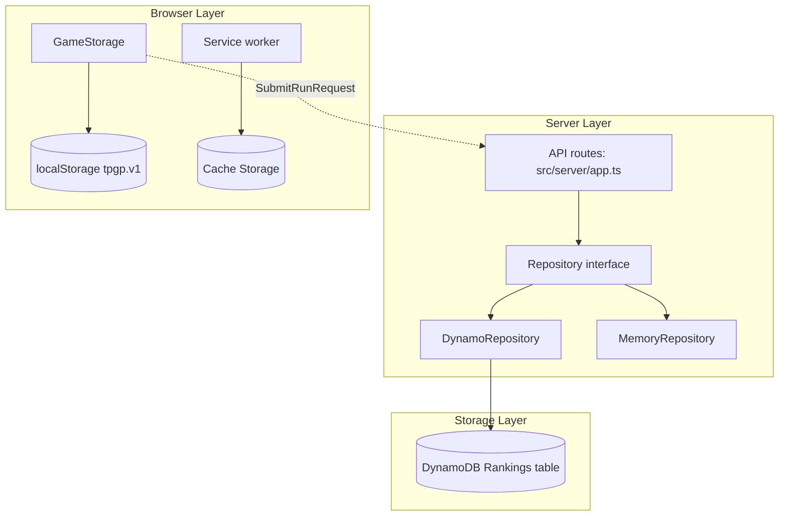
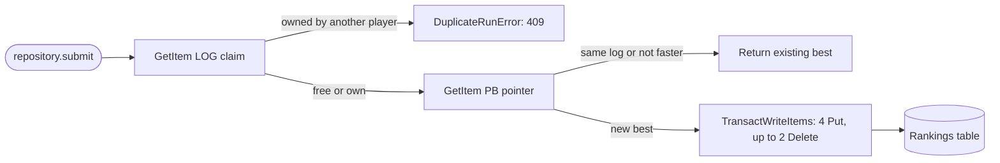

# Data / 데이터 구성 상세

<a href="#english"></a>
<a href="#korean"></a>

---

<a id="english"></a>

## English

### 1. Overview

The data layer holds the time-trial leaderboard: verified runs, each player's best per board, the ghost input logs and the record of who first registered each input sequence. In production everything lives in one DynamoDB table (`Rankings`) that the server reaches only through the `Repository` interface; development and tests use an in-memory implementation with the same rules. Everything else a player owns (settings, personal bests, trophies, the anonymous player id, runs waiting to be submitted) stays in the browser.



### 2. Components

| Component | Path | Purpose |
|---|---|---|
| Rankings table | `infra/lib/data.ts` | DynamoDB table definition (keys, billing, encryption, PITR, deletion protection, retention) |
| Table access policy | `infra/lib/service.ts` | Task role statement `RankingsTable`: `GetItem`, `PutItem`, `DeleteItem`, `Query` on the table ARN |
| Repository contract | `src/server/repository.ts` | `Repository`, `VerifiedRun`, `SubmitOutcome`, `DuplicateRunError`, key builders, `toEntry()`, `toGhost()` |
| DynamoDB repository | `src/server/dynamo-repository.ts` | Single-table implementation with `TransactWriteItems`, `StorageError`, `createDocumentClient()` |
| In-memory repository | `src/server/memory-repository.ts` | Process-local implementation for development, tests and single-task demos |
| Run identity | `src/server/validation.ts` | `newRunId()` (time-ordered id), `logDigest()` (input-sequence hash) |
| Input log codec | `src/sim/input-log.ts` | `InputRecorder`, `decodeLog()`, input word layout |
| Browser storage | `src/client/storage.ts` | `GameStorage`: versioned `localStorage` keys with an in-memory fallback |
| Repository tests | `test/server/repository.test.ts` | `repositoryContract` run against both implementations (DynamoDB Local optional) |

#### Table definition

| Property | Value |
|---|---|
| Partition key | `pk` (String) |
| Sort key | `sk` (String) |
| Billing | `PAY_PER_REQUEST` (on-demand) |
| Encryption | `AWS_MANAGED` (AWS managed KMS key) |
| Point-in-time recovery | Enabled (default 35-day window) |
| Deletion protection | Enabled |
| Removal policy | `RETAIN`: `cdk destroy` leaves the table in place |
| Secondary indexes | None |
| TTL, streams | None |
| Deployed name | `TableName` stack output, currently `TurboPalsStack-DataRankings44FBEC0A-8XKR8FW8LSOE` |

#### Item types

| Item | `pk` | `sk` | Attributes | Lifetime |
|---|---|---|---|---|
| Ranking row | `LB#<track>#<cc>` | `<ticks, 9 digits>#<runId>` | `id`, `name`, `charId`, `trackId`, `cc`, `ticks`, `lapTicks`, `createdAt`, `playerId`, `version` | Deleted when the player sets a faster time |
| Best pointer | `PB#<track>#<cc>#<playerId>` | `PB` | `id`, `rankSk`, `ticks`, `logHash`, `updatedAt` | Overwritten on every new best |
| Ghost | `GHOST#<runId>` | `GHOST` | `id`, `trackId`, `cc`, `charId`, `name`, `ticks`, `log`, `createdAt` | Deleted together with its ranking row |
| Log claim | `LOG#<logHash>` | `LOG` | `playerId`, `id`, `createdAt` | Permanent |

Example keys for the run in [../api-reference.md](../api-reference.md): `LB#sunny-meadow#150` with sort key `000005608#0mvdlxfk73c9e1a7b52d04f86`, and `GHOST#0mvdlxfk73c9e1a7b52d04f86` with sort key `GHOST`.

- The 9-digit zero-padded tick count makes string order equal time order; the run id after it breaks ties by creation time, because a run id starts with 9 base36 characters of the creation time in milliseconds (followed by 16 random hex characters).
- Ranking rows never contain the log, so the top-50 Query reads only small items. Ghost logs (up to 200,000 characters) live in their own partition, well below DynamoDB's 400 KB item limit.
- `logHash` is `logDigest(log)`: SHA-256 (base64url) over the decoded input words re-encoded canonically, prefixed with `ticks\0`. Two logs that encode the same inputs (runs split or merged, different base64 padding bits, an out-of-range steer value) hash identically. A log that does not decode falls back to a hash of the raw text (prefix `raw\0`).

#### Access patterns

| Operation | DynamoDB call | Notes |
|---|---|---|
| Leaderboard | `Query` on `pk = LB#<track>#<cc>`, `ScanIndexForward: true`, `ConsistentRead: true`, `Limit: 50` | Projection excludes `playerId` and `version`; malformed rows are skipped |
| Rank of a run | `Query` on `pk = :board AND sk < :rankSk`, `FilterExpression: playerId <> :me`, `Select: COUNT`, `Limit: 51` | Rank = count + 1 when below 50, otherwise `null`; counts other players only |
| Ghost download | `GetItem` on `GHOST#<runId>` / `GHOST`, `ConsistentRead: true` | A malformed item raises `StorageError('MalformedGhostItem')` |
| Submit | `GetItem` claim and pointer (`ConsistentRead: true`), then one `TransactWriteItems` | See below |

There is no `Scan`, no `UpdateItem` and no index; the task role allows exactly `GetItem`, `PutItem`, `DeleteItem` and `Query` on the table ARN (`TransactWriteItems` is authorized per contained Put and Delete). A new access pattern that needs another action or an index ARN must also change `infra/lib/service.ts`.

#### Submit transaction



1. Read the log claim. If another player owns it, throw `DuplicateRunError` (409 `DUPLICATE_RUN`).
2. Read the best pointer. If it holds the same `logHash` (a retry) or a time no slower than the new run, return the existing best without writing; `personalBest` is `true` only for the retry.
3. Otherwise write one transaction:
   - Put pointer, conditioned on `#id = :previous` (existing pointer) or `attribute_not_exists(pk)` (first run).
   - Put the new ranking row and the new ghost, each with `attribute_not_exists(pk)`.
   - Put the log claim with `attribute_not_exists(pk) OR playerId = :player`.
   - When replacing a best, Delete the previous ranking row and the previous ghost.
4. On `TransactionCanceledException`, `TransactionConflictException` or `TransactionInProgressException`, re-read and decide again, up to 5 attempts with a backoff of `20 * 2^attempt` ms plus 0 to 19 ms of jitter. After the last attempt the call fails with `StorageError('TransactionRetriesExhausted')`.
5. Any other error becomes `StorageError(<error name>)`; the API answers 503 `SERVICE_UNAVAILABLE` and logs only the reason.

The pointer condition guarantees one row per player and board even when the same player submits twice at once. The SDK client uses `maxAttempts: 3`, a 2 s connection timeout, a 5 s request timeout and `removeUndefinedValues: true`.

#### In-memory repository

- Selected when `TABLE_NAME` is empty; `npm run dev` always runs this way. In production the server logs the `memory_repository` warning.
- Sorted arrays per board with binary search. Every mutation runs synchronously (no `await` between read and write), so concurrent requests see the same rules as the DynamoDB implementation.
- Capacity: 5,000 stored runs. When it is full, a submission that would add a new row (the player has no best on that board yet) gets 503 `SERVICE_UNAVAILABLE`; replacing an existing best still works.
- Log claims are capped at 50,000 (ten times the capacity) and the oldest claim is forgotten first. DynamoDB keeps claims forever.
- Data is lost on restart and is not shared between tasks, so never run more than one task without `TABLE_NAME`.

#### Limits

| Limit | Value | Source |
|---|---|---|
| Log length | 1 to 200,000 base64 characters | `API_LIMITS.logMax` in `src/shared/api.ts` |
| Request body | 262,144 bytes | `BODY_LIMIT` in `src/server/validation.ts` |
| Verifiable log | 43,380 input words (180 countdown ticks plus 43,200 race ticks) | `MAX_TT_TICKS` in `src/sim/replay.ts` |
| Claimed ticks | 1 to 108,000 | `MAX_RUN_TICKS` |
| Laps | 1 to 9 entries | `MAX_LAPS` |
| Name | 1 to 12 characters after normalization | `API_LIMITS.nameMax` |
| Board size returned | 50 rows | `API_LIMITS.leaderboardSize` |

For scale: a 5608-tick bot run on `sunny-meadow` at 150cc encodes to a 10,312-character log. The log format is a version byte `1`, a zero byte, then pairs of little-endian 16-bit (input word, repeat count), all in standard base64. Input word bits 0 to 6 hold steer + 63; bits 7 to 11 are throttle, brake, drift, item and back.

#### Browser storage

| Store | Key | Content |
|---|---|---|
| `localStorage` | `tpgp.v1.meta` | `{ v: 1 }` storage version |
| `localStorage` | `tpgp.v1.settings` | Settings, sanitized field by field on load |
| `localStorage` | `tpgp.v1.playerId` | UUID v4 sent as `playerId` |
| `localStorage` | `tpgp.v1.best.<track>.<cc>` | Personal best including the ghost log; when the quota is exceeded the time is kept without the log |
| `localStorage` | `tpgp.v1.trophies` | Grand Prix trophies keyed `<cup>.<cc>` |
| `localStorage` | `tpgp.v1.stats` | `races`, `wins`, `podiums`, `grandPrix`, `timeTrials` |
| `localStorage` | `tpgp.v1.pending` | Time trials recorded offline, one per track and speed class, waiting for submission |
| `sessionStorage` | `tpgp.v1.reload` | Setup memory carried across an update reload (used only within 5 minutes) |
| Cache Storage | `turbo-pals-<version>-<build>`, `turbo-pals.sw-state` | Service worker precache and state |

- When `localStorage` is unavailable (private mode, disabled storage) `GameStorage` falls back to memory for the session.
- Clearing site data creates a new `playerId`. The server cannot link the old leaderboard rows to it, and logs claimed under the old id now count as another player's (`DUPLICATE_RUN`).
- Pending runs whose semver core differs from the running build are dropped at startup, because the server would reject them with `VERSION_MISMATCH`.

#### Testing against DynamoDB Local

```bash
docker run -d --rm --name ddb -p 127.0.0.1:18765:8000 amazon/dynamodb-local -jar DynamoDBLocal.jar -inMemory
DYNAMODB_TEST_ENDPOINT=http://127.0.0.1:18765 npx vitest run test/server/repository.test.ts
docker stop ddb
```

The test creates and deletes a temporary table `turbo-pals-test-<uuid>` and refuses any endpoint that is not loopback (`127.0.0.1`, `localhost`, `[::1]`).

### 3. Key Decisions

- One on-demand DynamoDB table with string `pk` and `sk`, no indexes, PITR, deletion protection and `RETAIN`: player rankings outlive the stack and cost nothing when idle. See [ADR-004](../decisions/ADR-004-dynamodb-on-demand-leaderboard.md).
- Ghost logs live outside the board partition and a personal-best replacement is a single conditional transaction, so the top-50 read stays small and concurrent submissions can never leave two rows for one player. See [ADR-004](../decisions/ADR-004-dynamodb-on-demand-leaderboard.md).
- Ghosts are public and runs are verified only by replay, so the first player to register an input sequence owns it forever (`LOG#<logHash>`), keyed by the decoded inputs rather than the log text. See [ADR-001](../decisions/ADR-001-deterministic-simulation-server-verification.md).
- Player-owned data stays in the browser, including the offline submission queue; the server stores only verified runs. See [ADR-006](../decisions/ADR-006-offline-first-pwa-race-safe-updates.md).

### 4. Code Pointers

- `src/server/repository.ts`: `Repository` contract, `VerifiedRun`, key builders
- `src/server/dynamo-repository.ts`: transaction, retries, leaderboard and rank queries
- `src/server/memory-repository.ts`: in-memory implementation and its capacity limits
- `infra/lib/data.ts`: table definition
- `src/client/storage.ts`: browser keys, sanitizing, pending queue
- `test/server/repository.test.ts`: shared contract tests and DynamoDB-only checks

### 5. Cross-references

- Related modules: [src/server/CLAUDE.md](../../src/server/CLAUDE.md), [infra/CLAUDE.md](../../infra/CLAUDE.md), [src/client/CLAUDE.md](../../src/client/CLAUDE.md)
- Related ADRs: [ADR-004](../decisions/ADR-004-dynamodb-on-demand-leaderboard.md), [ADR-001](../decisions/ADR-001-deterministic-simulation-server-verification.md), [ADR-006](../decisions/ADR-006-offline-first-pwa-race-safe-updates.md)
- Related runbooks: [rollback-production](../runbooks/rollback-production.md), [teardown](../runbooks/teardown.md), [incident-response](../runbooks/incident-response.md)
- Related references: [api.md](api.md), [security.md](security.md), [infrastructure and operations guide](../infra.md)

---

<a id="korean"></a>

## 한국어

### 1. 개요

데이터 계층은 타임 어택 랭킹을 보관합니다. 검증된 기록, 보드별 플레이어 최고 기록, 고스트 입력 로그, 각 입력 시퀀스를 처음 등록한 플레이어 정보가 여기에 들어갑니다. 프로덕션에서는 모두 DynamoDB 테이블 하나(`Rankings`)에 저장하고, 서버는 `Repository` 인터페이스를 통해서만 접근합니다. 개발과 테스트에서는 같은 규칙을 따르는 메모리 구현을 씁니다. 그 밖에 플레이어 소유 데이터(설정, 개인 최고 기록, 트로피, 익명 플레이어 ID, 제출 대기 중인 기록)는 브라우저에 남습니다.


### 2. 구성요소

| 구성요소 | 경로 | 목적 |
|---|---|---|
| Rankings 테이블 | `infra/lib/data.ts` | DynamoDB 테이블 정의(키, 과금, 암호화, PITR, 삭제 보호, 보존) |
| 테이블 접근 정책 | `infra/lib/service.ts` | 태스크 역할 statement `RankingsTable`: 테이블 ARN에 대한 `GetItem`, `PutItem`, `DeleteItem`, `Query` |
| 저장소 계약 | `src/server/repository.ts` | `Repository`, `VerifiedRun`, `SubmitOutcome`, `DuplicateRunError`, 키 생성 함수, `toEntry()`, `toGhost()` |
| DynamoDB 저장소 | `src/server/dynamo-repository.ts` | `TransactWriteItems`를 쓰는 단일 테이블 구현, `StorageError`, `createDocumentClient()` |
| 메모리 저장소 | `src/server/memory-repository.ts` | 개발, 테스트, 단일 태스크 데모용 프로세스 내부 구현 |
| 기록 식별자 | `src/server/validation.ts` | `newRunId()`(시간 순서 ID), `logDigest()`(입력 시퀀스 해시) |
| 입력 로그 코덱 | `src/sim/input-log.ts` | `InputRecorder`, `decodeLog()`, 입력 word 구조 |
| 브라우저 저장소 | `src/client/storage.ts` | `GameStorage`: 버전이 붙은 `localStorage` 키와 메모리 대체 저장소 |
| 저장소 테스트 | `test/server/repository.test.ts` | 두 구현에 같은 `repositoryContract`를 실행(DynamoDB Local은 선택) |

#### 테이블 정의

| 속성 | 값 |
|---|---|
| 파티션 키 | `pk`(String) |
| 정렬 키 | `sk`(String) |
| 과금 | `PAY_PER_REQUEST`(온디맨드) |
| 암호화 | `AWS_MANAGED`(AWS 관리형 KMS 키) |
| 특정 시점 복구(PITR) | 켜짐(기본 35일) |
| 삭제 보호 | 켜짐 |
| 제거 정책 | `RETAIN`: `cdk destroy` 후에도 테이블이 남음 |
| 보조 인덱스 | 없음 |
| TTL, 스트림 | 없음 |
| 배포된 이름 | 스택 출력 `TableName`, 현재 `TurboPalsStack-DataRankings44FBEC0A-8XKR8FW8LSOE` |

#### 항목 종류

| 항목 | `pk` | `sk` | 속성 | 수명 |
|---|---|---|---|---|
| 순위 행 | `LB#<track>#<cc>` | `<ticks, 9 digits>#<runId>` | `id`, `name`, `charId`, `trackId`, `cc`, `ticks`, `lapTicks`, `createdAt`, `playerId`, `version` | 플레이어가 더 빠른 기록을 세우면 삭제 |
| 최고 기록 포인터 | `PB#<track>#<cc>#<playerId>` | `PB` | `id`, `rankSk`, `ticks`, `logHash`, `updatedAt` | 새 최고 기록마다 덮어씀 |
| 고스트 | `GHOST#<runId>` | `GHOST` | `id`, `trackId`, `cc`, `charId`, `name`, `ticks`, `log`, `createdAt` | 순위 행과 함께 삭제 |
| 로그 소유권 | `LOG#<logHash>` | `LOG` | `playerId`, `id`, `createdAt` | 영구 보존 |

[../api-reference.md](../api-reference.md)의 예시 기록이라면 키는 `LB#sunny-meadow#150`(정렬 키 `000005608#0mvdlxfk73c9e1a7b52d04f86`)과 `GHOST#0mvdlxfk73c9e1a7b52d04f86`(정렬 키 `GHOST`)입니다.

- tick 수를 9자리로 0 채움 하므로 문자열 순서가 곧 시간 순서입니다. 동률이면 뒤에 붙은 기록 ID가 생성 시각 순서를 정합니다. 기록 ID가 생성 시각(밀리초)을 base36으로 적은 9자로 시작하고, 그 뒤에 무작위 hex 16자가 붙기 때문입니다.
- 순위 행에는 로그를 넣지 않으므로 상위 50위 Query는 작은 항목만 읽습니다. 고스트 로그(최대 200,000자)는 별도 파티션에 두며, DynamoDB 항목 크기 한도 400 KB보다 훨씬 작습니다.
- `logHash`는 `logDigest(log)`입니다. 디코딩한 입력 word를 표준 형태로 다시 인코딩하고 앞에 `ticks\0`을 붙여 SHA-256(base64url)을 구합니다. 같은 입력을 다르게 인코딩한 로그(run을 쪼개거나 합침, base64 패딩 비트 변경, 범위를 벗어난 steer 값)는 같은 해시가 됩니다. 디코딩되지 않는 로그는 원문 텍스트의 해시(접두어 `raw\0`)를 씁니다.

#### 접근 패턴

| 작업 | DynamoDB 호출 | 비고 |
|---|---|---|
| 랭킹 조회 | `pk = LB#<track>#<cc>` `Query`, `ScanIndexForward: true`, `ConsistentRead: true`, `Limit: 50` | projection에서 `playerId`와 `version` 제외. 형식이 깨진 행은 건너뜀 |
| 기록 순위 | `pk = :board AND sk < :rankSk` `Query`, `FilterExpression: playerId <> :me`, `Select: COUNT`, `Limit: 51` | 개수가 50 미만이면 순위 = 개수 + 1, 아니면 `null`. 다른 플레이어만 셈 |
| 고스트 다운로드 | `GHOST#<runId>` / `GHOST` `GetItem`, `ConsistentRead: true` | 형식이 깨진 항목은 `StorageError('MalformedGhostItem')` |
| 기록 제출 | 소유권과 포인터 `GetItem`(`ConsistentRead: true`) 뒤 `TransactWriteItems` 한 번 | 아래 참고 |

`Scan`, `UpdateItem`, 인덱스는 쓰지 않습니다. 태스크 역할은 테이블 ARN에 대해 `GetItem`, `PutItem`, `DeleteItem`, `Query`만 허용합니다(`TransactWriteItems`는 안에 든 Put과 Delete 단위로 인가됩니다). 다른 action이나 인덱스 ARN이 필요한 접근 패턴을 추가하면 `infra/lib/service.ts`도 함께 고쳐야 합니다.

#### 기록 제출 트랜잭션


1. 로그 소유권을 읽습니다. 다른 플레이어가 소유하고 있으면 `DuplicateRunError`(409 `DUPLICATE_RUN`)를 던집니다.
2. 최고 기록 포인터를 읽습니다. 같은 `logHash`(재시도)이거나 새 기록보다 느리지 않은 시간이 이미 있으면 쓰지 않고 기존 최고 기록을 돌려줍니다. `personalBest`는 재시도일 때만 `true`입니다.
3. 그렇지 않으면 트랜잭션 하나로 씁니다.
   - 포인터 Put. 기존 포인터가 있으면 `#id = :previous`, 첫 기록이면 `attribute_not_exists(pk)` 조건.
   - 새 순위 행과 새 고스트 Put. 각각 `attribute_not_exists(pk)` 조건.
   - 로그 소유권 Put. `attribute_not_exists(pk) OR playerId = :player` 조건.
   - 최고 기록을 바꾸는 경우 이전 순위 행과 이전 고스트를 Delete.
4. `TransactionCanceledException`, `TransactionConflictException`, `TransactionInProgressException`이 나면 다시 읽고 다시 판단합니다. 최대 5회 시도하며, 대기 시간은 `20 * 2^attempt` ms에 0~19 ms의 무작위 값을 더합니다. 마지막 시도까지 실패하면 `StorageError('TransactionRetriesExhausted')`가 됩니다.
5. 그 밖의 오류는 `StorageError(<error name>)`가 되고, API는 503 `SERVICE_UNAVAILABLE`로 답하며 사유만 로그에 남깁니다.

포인터 조건 덕분에 같은 플레이어가 동시에 두 번 제출해도 보드마다 플레이어당 한 행만 남습니다. SDK 클라이언트 설정은 `maxAttempts: 3`, 연결 타임아웃 2초, 요청 타임아웃 5초, `removeUndefinedValues: true`입니다.

#### 메모리 저장소

- `TABLE_NAME`이 비어 있으면 선택되며, `npm run dev`는 항상 이 방식으로 실행됩니다. 프로덕션에서 이렇게 시작하면 서버가 `memory_repository` 경고를 남깁니다.
- 보드마다 정렬된 배열을 두고 이진 탐색을 씁니다. 모든 변경은 읽기와 쓰기 사이에 `await` 없이 동기로 실행되므로, 동시 요청도 DynamoDB 구현과 같은 규칙을 따릅니다.
- 용량: 저장 기록 5,000건. 가득 차면 새 행을 추가해야 하는 제출(그 보드에 아직 최고 기록이 없는 플레이어)은 503 `SERVICE_UNAVAILABLE`을 받습니다. 기존 최고 기록을 바꾸는 제출은 계속 됩니다.
- 로그 소유권은 최대 50,000건(용량의 10배)까지 두고, 넘치면 가장 오래된 것부터 잊습니다. DynamoDB는 소유권을 영구히 보관합니다.
- 재시작하면 데이터가 사라지고 태스크끼리 공유되지도 않습니다. `TABLE_NAME` 없이 태스크를 두 개 이상 실행하지 마십시오.

#### 한도

| 한도 | 값 | 출처 |
|---|---|---|
| 로그 길이 | base64 1~200,000자 | `src/shared/api.ts`의 `API_LIMITS.logMax` |
| 요청 본문 | 262,144바이트 | `src/server/validation.ts`의 `BODY_LIMIT` |
| 검증 가능한 로그 | 입력 word 43,380개(카운트다운 180 tick + 주행 43,200 tick) | `src/sim/replay.ts`의 `MAX_TT_TICKS` |
| 주장하는 tick | 1~108,000 | `MAX_RUN_TICKS` |
| 랩 | 1~9개 | `MAX_LAPS` |
| 이름 | 정규화 후 1~12자 | `API_LIMITS.nameMax` |
| 랭킹 응답 크기 | 50행 | `API_LIMITS.leaderboardSize` |

규모를 가늠하자면, `sunny-meadow` 150cc에서 5608 tick을 달린 봇 기록의 로그는 10,312자입니다. 로그 포맷은 버전 바이트 `1`, 0 바이트, 그 뒤에 리틀 엔디언 16비트 쌍(입력 word, 반복 횟수)이 이어지며 전체를 표준 base64로 인코딩합니다. 입력 word의 0~6비트는 steer + 63이고, 7~11비트는 throttle, brake, drift, item, back입니다.

#### 브라우저 저장소

| 저장소 | 키 | 내용 |
|---|---|---|
| `localStorage` | `tpgp.v1.meta` | 저장소 버전 `{ v: 1 }` |
| `localStorage` | `tpgp.v1.settings` | 설정. 불러올 때 필드별로 검증 |
| `localStorage` | `tpgp.v1.playerId` | `playerId`로 보내는 UUID v4 |
| `localStorage` | `tpgp.v1.best.<track>.<cc>` | 고스트 로그를 포함한 개인 최고 기록. 용량을 넘으면 로그 없이 시간만 보관 |
| `localStorage` | `tpgp.v1.trophies` | `<cup>.<cc>` 키의 그랑프리 트로피 |
| `localStorage` | `tpgp.v1.stats` | `races`, `wins`, `podiums`, `grandPrix`, `timeTrials` |
| `localStorage` | `tpgp.v1.pending` | 오프라인에서 기록한 타임 어택. 트랙·속도 클래스마다 1건, 제출 대기 |
| `sessionStorage` | `tpgp.v1.reload` | 업데이트 새로고침 전후로 이어지는 설정 기억(5분 이내만 사용) |
| Cache Storage | `turbo-pals-<version>-<build>`, `turbo-pals.sw-state` | 서비스 워커 프리캐시와 상태 |

- `localStorage`를 쓸 수 없으면(사생활 보호 모드, 저장소 비활성화) `GameStorage`는 그 세션 동안 메모리를 대신 씁니다.
- 사이트 데이터를 지우면 새 `playerId`가 만들어집니다. 서버는 이전 랭킹 행을 새 ID와 연결할 수 없고, 이전 ID로 등록한 로그는 다른 플레이어의 것으로 취급됩니다(`DUPLICATE_RUN`).
- 실행 중인 빌드와 semver core가 다른 대기 기록은 시작할 때 지웁니다. 서버가 어차피 `VERSION_MISMATCH`로 거부할 기록이기 때문입니다.

#### DynamoDB Local로 테스트하기

```bash
docker run -d --rm --name ddb -p 127.0.0.1:18765:8000 amazon/dynamodb-local -jar DynamoDBLocal.jar -inMemory
DYNAMODB_TEST_ENDPOINT=http://127.0.0.1:18765 npx vitest run test/server/repository.test.ts
docker stop ddb
```

테스트는 임시 테이블 `turbo-pals-test-<uuid>`를 만들었다가 지우며, loopback(`127.0.0.1`, `localhost`, `[::1]`)이 아닌 엔드포인트는 거부합니다.

### 3. 주요 결정

- 문자열 `pk`, `sk`를 쓰는 온디맨드 DynamoDB 테이블 하나에 인덱스 없이 PITR, 삭제 보호, `RETAIN`을 적용합니다. 플레이어 랭킹은 스택보다 오래 남고, 쓰지 않을 때는 비용이 들지 않습니다. [ADR-004](../decisions/ADR-004-dynamodb-on-demand-leaderboard.md) 참고.
- 고스트 로그는 보드 파티션 밖에 두고, 개인 최고 기록 교체는 조건부 트랜잭션 한 번으로 처리합니다. 그래서 상위 50위 조회는 가볍게 유지되고, 동시 제출이 있어도 한 플레이어의 행이 둘로 남지 않습니다. [ADR-004](../decisions/ADR-004-dynamodb-on-demand-leaderboard.md) 참고.
- 고스트는 공개되고 기록 검증은 리플레이로만 하므로, 입력 시퀀스를 처음 등록한 플레이어가 그 시퀀스를 영구히 소유합니다(`LOG#<logHash>`). 소유권 키는 로그 문자열이 아니라 디코딩한 입력에서 만듭니다. [ADR-001](../decisions/ADR-001-deterministic-simulation-server-verification.md) 참고.
- 오프라인 제출 대기열을 포함해 플레이어 소유 데이터는 브라우저에 두고, 서버는 검증된 기록만 저장합니다. [ADR-006](../decisions/ADR-006-offline-first-pwa-race-safe-updates.md) 참고.

### 4. 코드 포인터

- `src/server/repository.ts`: `Repository` 계약, `VerifiedRun`, 키 생성 함수
- `src/server/dynamo-repository.ts`: 트랜잭션, 재시도, 랭킹·순위 Query
- `src/server/memory-repository.ts`: 메모리 구현과 용량 한도
- `infra/lib/data.ts`: 테이블 정의
- `src/client/storage.ts`: 브라우저 키, 값 검증, 대기열
- `test/server/repository.test.ts`: 공통 계약 테스트와 DynamoDB 전용 검사

### 5. 상호 참조

- 관련 모듈: [src/server/CLAUDE.md](../../src/server/CLAUDE.md), [infra/CLAUDE.md](../../infra/CLAUDE.md), [src/client/CLAUDE.md](../../src/client/CLAUDE.md)
- 관련 ADR: [ADR-004](../decisions/ADR-004-dynamodb-on-demand-leaderboard.md), [ADR-001](../decisions/ADR-001-deterministic-simulation-server-verification.md), [ADR-006](../decisions/ADR-006-offline-first-pwa-race-safe-updates.md)
- 관련 런북: [rollback-production](../runbooks/rollback-production.md), [teardown](../runbooks/teardown.md), [incident-response](../runbooks/incident-response.md)
- 관련 레퍼런스: [api.md](api.md), [security.md](security.md), [인프라·운영 가이드](../infra.md)
