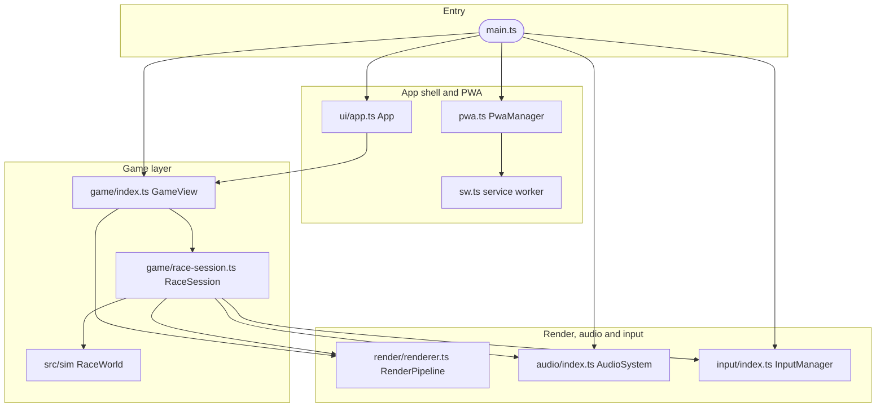

# Frontend / Frontend 구현 상세

<a href="#english"></a>
<a href="#korean"></a>

---

<a id="english"></a>

## English

### 1. Overview

The frontend is a framework-free TypeScript browser app built with Vite and three.js 0.186.0. `src/client/main.ts` wires the layers together through the interfaces in `src/client/contracts.ts`: input, procedural audio, the 3D game view (game glue plus render pipeline) and the DOM app shell described in [ui.md](ui.md). The game view runs the shared deterministic simulation from `src/sim` in the browser. The production build (`tools/build.mjs`) emits a static client into `dist/client` with content-hashed assets and a service worker that precaches the whole game for offline play; the same container serves it next to the API.


- **Boot order** (`src/client/main.ts`): create `PwaManager` first so an early `beforeinstallprompt` is not missed; probe WebGL (`webgl2`, then `webgl`) and release the probe context; create the input manager and wrap `input.rumble` so it does nothing when Settings turns vibration off; create the audio system and the game view and mount it on `#view`; start the app shell on `#ui`; let the PWA ask `view.inRace || app.raceActive` before an update; register the service worker after the title screen is ready; install the QA hook when `__DEBUG_HOOK__` is true. A missing WebGL or a renderer failure shows a Korean fatal screen with a reload button.
- **Game view** (`src/client/game/`): `GameView` owns the rAF loop (frame dt clamped to 0.1 s), the menu showroom and the race lifecycle. `startRace` yields one frame, builds a `RaceSession` and compiles its shaders before the first frame (`pipeline.warmUp`, capped at 8 s, never rejecting). `RaceSession` steps `RaceWorld` at a fixed 60 Hz (at most 5 steps per frame), interpolates poses, drives the ghost one step per world tick, records P1 inputs in time trials and maps sim events to particles, camera shake, rumble and audio. `HudModel` turns events and world state into the `HudSnapshot` the UI draws.
- **Render** (`src/client/render/`): one three.js `WebGLRenderer` shared by the menu showroom and races, single or split-screen views, optional bloom, texel-snapped shadows, instance culling and scene optimisation, eight procedural themes. **Audio** (`src/client/audio/`): pure WebAudio synthesis (mixer, sequencer, 14 songs, spatialised SFX); without WebAudio it returns `SilentAudioSystem`, so callers never guard. **Input** (`src/client/input/`): keyboard (`KeyboardEvent.code`), gamepad and multi-touch controls into `KartInput` and menu actions.
- **Build** (`tools/build.mjs`): (1) `vite build` into `dist/client` (`es2022`, assets under `assets/`, no source maps); (2) esbuild bundles `src/server/index.ts` and `src/server/verify-worker.ts` into `dist/server` as node22 ESM with every dependency inlined; (3) hashes the client files (except `sw.js` and `build.json`) plus the `sw.ts` and `sw-policy.ts` sources into a 16-hex client build id, stamps `<meta name="turbo-pals-build">` into `index.html` and writes `dist/client/build.json`; (4) bundles `src/client/sw.ts` into `dist/client/sw.js` with the precache list (shell files plus `/build.json`, minus `/dev/` and `.woff`), build id and version; (5) writes `dist/build.json` with `version`, `id` and `builtAt`. Only `src/client/index.html` is a build input, so the dev pages and the UI preview never ship.
- **PWA** (`src/client/pwa.ts`, `src/client/sw.ts`, `src/client/sw-policy.ts`): the worker is registered only in production builds (`import.meta.env.PROD`) as `/sw.js` with `updateViaCache: 'none'`. Updates are checked at start, when the app becomes visible, when it comes online and every 15 minutes, skipped while racing or within 5 minutes of the last check. The cache is named `turbo-pals-<version>-<build>`; once it is complete, every navigation is answered from the cached `index.html`, so a page always matches the worker that serves it. `/assets/*`, `/icons/*`, the manifest, the two SVG icons and `/build.json` are cache-first; `/api`, `/healthz`, `/sw.js`, non-GET and cross-origin requests go to the network. Applying an update is refused mid-race; before `skipWaiting()` the worker asks every window with `QUERY_RACE_STATUS` and treats no answer within 2 s as busy. On activation it keeps the current and the last good cache and deletes other `turbo-pals-*` caches.
- **QA debug hook**: `__DEBUG_HOOK__` is true for `TURBO_DEBUG_HOOK=1` builds, for `vite serve` (`npm run dev`) and always in `tools/vite-qa.config.mjs`; release builds compile the hook out. With `?debug` the page exposes `window.__turbo` with `view`, `app`, `ready`, `startRace(config, { autopilotHuman, ghost })` and `state()`. `?debug&quality=auto|low|medium|high` overrides the renderer quality for that page only and is not saved. Runs driven by the autopilot are flagged `assisted` and never become time-trial records.
- **Performance governor** (`src/client/render/renderer.ts`): presets low, medium and high (`QUALITY_PRESETS` in `src/client/render/contracts.ts`) differ in shadows, shadow-map size, maximum pixel ratio, bloom, antialiasing and particle, scenery and draw-distance multipliers. In `auto` mode a ladder of up to 11 rungs (tier plus pixel ratio; each ratio is capped by the device pixel ratio and the tier's maximum, and duplicates collapse) starts at the high rung nearest to pixel ratio `min(1.5, devicePixelRatio)`. Over 1 s windows it drops one rung below 55 fps (two below 38 fps) and climbs one rung after sustained 58.5 fps, waiting 4 s at first and doubling the wait up to 64 s when a climb fails within 6 s. While a race is on screen (`setRaceActive(true)`) only the pixel ratio changes; tier changes that would compile new shader programs wait for pause, results, menus or the next race build.

```bash
npm run dev                                                         # Vite :8200 with HMR, API :8201 with in-memory rankings
npm run build                                                       # production client, server bundle, sw.js, build.json
TURBO_DEBUG_HOOK=1 node tools/build.mjs                             # QA build with the ?debug hook (never deploy)
npx vite --config tools/vite-qa.config.mjs --port 8250 --strictPort # QA dev server: no HMR, hook always on
npm run qa:screens                                                  # Playwright screenshots through window.__turbo
```

### 2. Components

| Component | Path | Purpose |
|---|---|---|
| Vite config | `vite.config.ts` | Root `src/client`, `publicDir` `public`, defines `__APP_VERSION__` and `__DEBUG_HOOK__`, build into `dist/client`, dev server on 0.0.0.0:8200 proxying `/api` and `/healthz` to 127.0.0.1:8201 |
| Production build | `tools/build.mjs` | Vite client build, esbuild server bundle, client build id, service worker bundle, `build.json` files |
| Dev runner | `tools/dev.mjs` | Starts Vite and `tsx watch src/server/index.ts` together (empty `TABLE_NAME`, so rankings live in memory) |
| QA dev server | `tools/vite-qa.config.mjs` | Same app without HMR or file watching; hook always on; proxy keeps the browser's Origin |
| HTML shell | `src/client/index.html` | `lang="ko"`, `#view` (canvas host) and `#ui` (splash), manifest and icon links, `/main.ts` |
| Entry | `src/client/main.ts` | WebGL probe, layer wiring, vibration gate, PWA hooks, QA hook |
| Client contracts | `src/client/contracts.ts` | `Settings` and `DEFAULT_SETTINGS`, `InputManager`, `AudioSystem`, `GameView`, `HudSnapshot`, `GhostData`, `RaceSummary` |
| Game glue | `src/client/game/` | `GameView`, `RaceSession`, `HudModel` |
| Render | `src/client/render/` | three.js pipeline, quality governor, camera rig, karts and drivers, track mesh, themes, particles, showroom |
| Audio | `src/client/audio/` | WebAudio mixer, sequencer, songs, SFX, engine loops, silent fallback |
| Input | `src/client/input/` | Key bindings, gamepad polling, steering shaping, touch controls |
| API client | `src/client/api.ts` | `/api/*` fetch with an 8 s timeout, error kinds, Korean messages for server rejection codes |
| Local storage | `src/client/storage.ts` | `tpgp.v1.*` keys: settings, player id, personal bests, trophies, stats, pending time-trial runs |
| PWA | `src/client/pwa.ts`, `src/client/sw.ts`, `src/client/sw-policy.ts` | Registration and update flow, offline-first worker, pure routing and cache-cleanup policy |
| Static files | `public/` | `manifest.webmanifest`, `favicon.svg`, `icon-maskable.svg`, PNG icons in `public/icons/` (generated by `tools/gen-icons.ts`) |
| Dev pages | `src/client/dev/` | Render QA pages (`fx`, `karts`, `scenery-a`, `scenery-b`, `track`) served by `npm run dev` at `/dev/<page>.html` |

### 3. Key Decisions

- **The browser runs the same deterministic simulation the server re-runs.** `RaceSession` steps `RaceWorld` at 60 Hz and records one input word per tick in time trials; the server replays that log to verify the time. Adding a `KartInput` field changes the input-log protocol shared with the server. See [ADR-001](../decisions/ADR-001-deterministic-simulation-server-verification.md).
- **All content is procedural and original.** Textures, meshes, themes, music and SFX are generated in code; the only shipped binary assets are the app icons and two self-hosted web fonts (`@fontsource` Black Han Sans and Jua). See [ADR-005](../decisions/ADR-005-procedural-original-content.md).
- **Offline-first PWA with race-safe updates.** The worker precaches the whole client, serves its own app shell and swaps versions only after every open window reports that no race is running. See [ADR-006](../decisions/ADR-006-offline-first-pwa-race-safe-updates.md).
- **Same-origin static hosting behind CloudFront.** The Fastify server serves `dist/client`; CloudFront caches only the content-hashed `/assets/*` for a year, and the CSP names no remote host (`default-src 'self'`, `script-src 'self' blob:`), so no third-party CDN or font host is involved. See [ADR-002](../decisions/ADR-002-cloudfront-only-origin-access.md).

### 4. Code Pointers

- `src/client/main.ts`: boot order, vibration gate and the `window.__turbo` QA hook.
- `tools/build.mjs`: build steps, client build id and precache list.
- `vite.config.ts`: compile-time defines and the dev proxy.
- `src/client/sw.ts`: install, activate, idle check and fetch routing of the service worker.
- `src/client/pwa.ts`: registration, update checks and the mid-race refusal.
- `src/client/game/index.ts`: render loop, race lifecycle, shader warm-up and the governor flag.
- `src/client/render/renderer.ts`: quality ladder, governor and `warmUp`.

### 5. Cross-references

- Related modules: [src/client/CLAUDE.md](../../src/client/CLAUDE.md), [src/client/game/CLAUDE.md](../../src/client/game/CLAUDE.md), [src/client/render/CLAUDE.md](../../src/client/render/CLAUDE.md), [src/client/audio/CLAUDE.md](../../src/client/audio/CLAUDE.md), [src/client/input/CLAUDE.md](../../src/client/input/CLAUDE.md), [src/client/dev/CLAUDE.md](../../src/client/dev/CLAUDE.md), [tools/CLAUDE.md](../../tools/CLAUDE.md)
- Related ADRs: [ADR-001](../decisions/ADR-001-deterministic-simulation-server-verification.md), [ADR-002](../decisions/ADR-002-cloudfront-only-origin-access.md), [ADR-005](../decisions/ADR-005-procedural-original-content.md), [ADR-006](../decisions/ADR-006-offline-first-pwa-race-safe-updates.md)
- Related runbooks: [deploy-production](../runbooks/deploy-production.md), [rollback-production](../runbooks/rollback-production.md), [incident-response](../runbooks/incident-response.md)
- Related docs: [ui.md](ui.md), [api.md](api.md), [security.md](security.md), [architecture.md](../architecture.md), [onboarding.md](../onboarding.md)

---

<a id="korean"></a>

## 한국어

### 1. 개요

프론트엔드는 프레임워크 없이 TypeScript로 작성한 브라우저 앱이며 Vite와 three.js 0.186.0으로 빌드합니다. `src/client/main.ts`가 `src/client/contracts.ts`의 인터페이스를 통해 각 계층을 연결합니다. 입력, 절차적 오디오, 3D 게임 뷰(게임 접착층과 렌더 파이프라인), 그리고 [ui.md](ui.md)에서 설명하는 DOM 앱 셸입니다. 게임 뷰는 `src/sim`의 결정론적 시뮬레이션을 브라우저에서 그대로 돌립니다. 프로덕션 빌드(`tools/build.mjs`)는 콘텐츠 해시가 붙은 에셋과, 오프라인 플레이를 위해 게임 전체를 프리캐시하는 서비스 워커를 `dist/client`에 정적 파일로 만들고, 같은 컨테이너가 API와 함께 이 파일을 서빙합니다.



- **부트 순서** (`src/client/main.ts`): 이른 `beforeinstallprompt`를 놓치지 않도록 `PwaManager`를 가장 먼저 만듭니다. WebGL(`webgl2`, 없으면 `webgl`)을 확인한 뒤 확인용 컨텍스트를 바로 반납합니다. 입력 매니저를 만들고, 설정에서 진동을 끄면 아무 일도 하지 않도록 `input.rumble`을 감쌉니다. 오디오 시스템과 게임 뷰를 만들어 `#view`에 마운트하고, 앱 셸을 `#ui`에서 시작합니다. 업데이트 전에 PWA가 `view.inRace || app.raceActive`를 물어볼 수 있게 연결하고, 타이틀 화면이 준비된 뒤 서비스 워커를 등록하며, `__DEBUG_HOOK__`가 true면 QA 훅을 붙입니다. WebGL이 없거나 렌더러 초기화가 실패하면 새로고침 버튼이 있는 한국어 오류 화면을 띄웁니다.
- **게임 뷰** (`src/client/game/`): `GameView`가 rAF 루프(프레임 dt는 0.1초로 제한), 메뉴 쇼룸, 레이스 수명 주기를 맡습니다. `startRace`는 한 프레임을 양보한 뒤 `RaceSession`을 만들고, 첫 프레임 전에 셰이더를 컴파일합니다(`pipeline.warmUp`, 상한 8초, reject하지 않음). `RaceSession`은 `RaceWorld`를 60 Hz 고정 스텝(프레임당 최대 5스텝)으로 진행하면서 포즈를 보간하고, 월드 틱마다 고스트를 한 스텝씩 돌리며, 타임 어택에서는 P1 입력을 기록하고, 시뮬레이션 이벤트를 파티클, 카메라 흔들림, 진동, 오디오로 바꿉니다. `HudModel`은 이벤트와 월드 상태를 UI가 그리는 `HudSnapshot`으로 변환합니다.
- **렌더** (`src/client/render/`): 메뉴 쇼룸과 레이스가 함께 쓰는 three.js `WebGLRenderer` 하나, 단일 또는 분할 화면, 선택적 bloom, texel 단위로 맞춘 그림자, 인스턴스 컬링과 씬 최적화, 절차적으로 만든 테마 8개로 구성됩니다. **오디오** (`src/client/audio/`): 순수 WebAudio 합성(믹서, 시퀀서, 곡 14개, 공간화된 효과음)이며, WebAudio가 없으면 `SilentAudioSystem`을 돌려주므로 호출하는 쪽에서 따로 확인할 필요가 없습니다. **입력** (`src/client/input/`): 키보드(`KeyboardEvent.code`), 게임패드, 멀티터치 조작을 `KartInput`과 메뉴 액션으로 바꿉니다.
- **빌드** (`tools/build.mjs`): (1) `vite build`로 `dist/client`를 만듭니다(`es2022`, 에셋은 `assets/` 아래, 소스맵 없음). (2) esbuild가 `src/server/index.ts`와 `src/server/verify-worker.ts`를 의존성을 모두 인라인한 node22 ESM으로 `dist/server`에 번들합니다. (3) 클라이언트 파일(`sw.js`, `build.json` 제외)과 `sw.ts`, `sw-policy.ts` 소스를 해시해 16자리 hex 클라이언트 빌드 id를 만들고, `index.html`에 `<meta name="turbo-pals-build">`를 넣은 뒤 `dist/client/build.json`을 씁니다. (4) 프리캐시 목록(셸 파일과 `/build.json`, 단 `/dev/`와 `.woff` 제외), 빌드 id, 버전을 넣어 `src/client/sw.ts`를 `dist/client/sw.js`로 번들합니다. (5) `version`, `id`, `builtAt`이 담긴 `dist/build.json`을 씁니다. 빌드 입력은 `src/client/index.html` 하나뿐이라 dev 페이지와 UI 미리보기는 배포물에 들어가지 않습니다.
- **PWA** (`src/client/pwa.ts`, `src/client/sw.ts`, `src/client/sw-policy.ts`): 워커는 프로덕션 빌드(`import.meta.env.PROD`)에서만 `/sw.js`로 등록하며 `updateViaCache: 'none'`을 씁니다. 업데이트는 시작할 때, 앱이 다시 보일 때, 온라인이 될 때, 그리고 15분마다 확인하고, 레이스 중이거나 마지막 확인 후 5분이 안 지났으면 건너뜁니다. 캐시 이름은 `turbo-pals-<version>-<build>`입니다. 캐시가 완성되면 모든 네비게이션을 캐시된 `index.html`로 응답하므로, 페이지는 항상 자신을 서빙한 워커와 같은 버전입니다. `/assets/*`, `/icons/*`, manifest, SVG 아이콘 2개, `/build.json`은 캐시를 먼저 보고, `/api`, `/healthz`, `/sw.js`, GET이 아닌 요청, 다른 origin 요청은 네트워크로 보냅니다. 레이스 중에는 업데이트 적용을 거부합니다. 워커는 `skipWaiting()` 전에 모든 창에 `QUERY_RACE_STATUS`를 보내고, 2초 안에 답이 없으면 레이스 중으로 간주합니다. 활성화할 때는 현재 캐시와 마지막으로 정상 동작한 캐시만 남기고 나머지 `turbo-pals-*` 캐시를 지웁니다.
- **QA 디버그 훅**: `__DEBUG_HOOK__`는 `TURBO_DEBUG_HOOK=1` 빌드와 `vite serve`(`npm run dev`)에서 true이고, `tools/vite-qa.config.mjs`에서는 항상 true입니다. 릴리스 빌드에서는 훅 코드가 제거됩니다. URL에 `?debug`가 있으면 페이지가 `view`, `app`, `ready`, `startRace(config, { autopilotHuman, ghost })`, `state()`를 가진 `window.__turbo`를 노출합니다. `?debug&quality=auto|low|medium|high`는 그 페이지의 렌더러 품질만 바꾸며 저장하지 않습니다. 자동 주행으로 달린 기록은 `assisted`로 표시되어 타임 어택 기록이 되지 않습니다.
- **성능 거버너** (`src/client/render/renderer.ts`): low, medium, high 프리셋(`src/client/render/contracts.ts`의 `QUALITY_PRESETS`)은 그림자, 그림자 맵 크기, 최대 pixel ratio, bloom, 안티앨리어싱, 파티클·배경·시야 거리 배율이 다릅니다. `auto` 모드에서는 tier와 pixel ratio를 묶은 최대 11단계 사다리를 씁니다. 각 pixel ratio는 기기 pixel ratio와 tier 최댓값을 넘지 않도록 잘리고, 겹치는 단계는 하나로 합쳐집니다. 시작점은 pixel ratio `min(1.5, devicePixelRatio)`에 가장 가까운 high 단계입니다. 1초 구간 평균이 55 fps 미만이면 한 단계(38 fps 미만이면 두 단계) 내리고, 58.5 fps 이상이 이어지면 한 단계 올립니다. 올리기 전 대기 시간은 처음 4초이고, 올린 뒤 6초 안에 다시 내려가면 최대 64초까지 두 배로 늘립니다. 레이스가 화면에 있는 동안(`setRaceActive(true)`)에는 pixel ratio만 바꾸고, 새 셰이더 프로그램을 컴파일해야 하는 tier 변경은 일시정지, 결과 화면, 메뉴, 다음 레이스 빌드 때까지 미룹니다.

```bash
npm run dev                                                         # Vite :8200 with HMR, API :8201 with in-memory rankings
npm run build                                                       # production client, server bundle, sw.js, build.json
TURBO_DEBUG_HOOK=1 node tools/build.mjs                             # QA build with the ?debug hook (never deploy)
npx vite --config tools/vite-qa.config.mjs --port 8250 --strictPort # QA dev server: no HMR, hook always on
npm run qa:screens                                                  # Playwright screenshots through window.__turbo
```

### 2. 구성요소

| 구성요소 | 경로 | 목적 |
|---|---|---|
| Vite 설정 | `vite.config.ts` | root `src/client`, `publicDir` `public`, `__APP_VERSION__`과 `__DEBUG_HOOK__` 정의, `dist/client`로 빌드, 0.0.0.0:8200 dev 서버가 `/api`와 `/healthz`를 127.0.0.1:8201로 프록시 |
| 프로덕션 빌드 | `tools/build.mjs` | Vite 클라이언트 빌드, esbuild 서버 번들, 클라이언트 빌드 id, 서비스 워커 번들, `build.json` 파일 |
| 개발 실행기 | `tools/dev.mjs` | Vite와 `tsx watch src/server/index.ts`를 함께 띄웁니다(`TABLE_NAME`이 비어 있어 랭킹은 메모리에 둡니다) |
| QA 개발 서버 | `tools/vite-qa.config.mjs` | HMR과 파일 감시 없이 같은 앱을 띄웁니다. 훅은 항상 켜져 있고 프록시는 브라우저 Origin을 유지합니다 |
| HTML 셸 | `src/client/index.html` | `lang="ko"`, `#view`(캔버스 자리)와 `#ui`(스플래시), manifest와 아이콘 링크, `/main.ts` |
| 진입점 | `src/client/main.ts` | WebGL 확인, 계층 연결, 진동 설정 반영, PWA 연결, QA 훅 |
| 클라이언트 계약 | `src/client/contracts.ts` | `Settings`와 `DEFAULT_SETTINGS`, `InputManager`, `AudioSystem`, `GameView`, `HudSnapshot`, `GhostData`, `RaceSummary` |
| 게임 접착층 | `src/client/game/` | `GameView`, `RaceSession`, `HudModel` |
| 렌더 | `src/client/render/` | three.js 파이프라인, 품질 거버너, 카메라 리그, 카트와 드라이버, 트랙 메시, 테마, 파티클, 쇼룸 |
| 오디오 | `src/client/audio/` | WebAudio 믹서, 시퀀서, 곡, 효과음, 엔진 루프, 무음 대체 구현 |
| 입력 | `src/client/input/` | 키 바인딩, 게임패드 폴링, 조향 보정, 터치 조작 |
| API 클라이언트 | `src/client/api.ts` | 8초 타임아웃의 `/api/*` fetch, 오류 종류 분류, 서버 거절 코드의 한국어 메시지 |
| 로컬 저장소 | `src/client/storage.ts` | `tpgp.v1.*` 키: 설정, 플레이어 id, 개인 기록, 트로피, 통계, 대기 중인 타임 어택 기록 |
| PWA | `src/client/pwa.ts`, `src/client/sw.ts`, `src/client/sw-policy.ts` | 등록과 업데이트 흐름, 오프라인 우선 워커, 순수 함수로 된 라우팅과 캐시 정리 정책 |
| 정적 파일 | `public/` | `manifest.webmanifest`, `favicon.svg`, `icon-maskable.svg`, `public/icons/`의 PNG 아이콘(`tools/gen-icons.ts`로 생성) |
| dev 페이지 | `src/client/dev/` | 렌더 QA 페이지(`fx`, `karts`, `scenery-a`, `scenery-b`, `track`). `npm run dev`에서 `/dev/<page>.html`로 엽니다 |

### 3. 주요 결정

- **서버가 다시 돌리는 결정론적 시뮬레이션을 브라우저도 그대로 돌립니다.** `RaceSession`은 `RaceWorld`를 60 Hz로 진행하고 타임 어택에서는 틱마다 입력 word 하나를 기록하며, 서버는 이 로그를 재생해 기록을 검증합니다. `KartInput`에 필드를 추가하면 서버와 공유하는 입력 로그 프로토콜이 바뀝니다. [ADR-001](../decisions/ADR-001-deterministic-simulation-server-verification.md)을 참고합니다.
- **모든 콘텐츠는 절차적으로 만든 오리지널입니다.** 텍스처, 메시, 테마, 음악, 효과음은 코드로 생성합니다. 배포에 들어가는 바이너리 에셋은 앱 아이콘과 직접 호스팅하는 웹 폰트 2종(`@fontsource` Black Han Sans, Jua)뿐입니다. [ADR-005](../decisions/ADR-005-procedural-original-content.md)를 참고합니다.
- **레이스를 방해하지 않는 오프라인 우선 PWA.** 워커는 클라이언트 전체를 프리캐시하고 자기 앱 셸을 서빙하며, 열린 창 모두가 레이스 중이 아니라고 답할 때만 버전을 교체합니다. [ADR-006](../decisions/ADR-006-offline-first-pwa-race-safe-updates.md)을 참고합니다.
- **CloudFront 뒤의 같은 origin에서 정적 파일을 서빙합니다.** Fastify 서버가 `dist/client`를 서빙하고, CloudFront는 콘텐츠 해시가 붙은 `/assets/*`만 1년 동안 캐시합니다. CSP에는 외부 호스트가 하나도 없으므로(`default-src 'self'`, `script-src 'self' blob:`) 외부 CDN이나 폰트 호스트를 쓰지 않습니다. [ADR-002](../decisions/ADR-002-cloudfront-only-origin-access.md)를 참고합니다.

### 4. 코드 포인터

- `src/client/main.ts`: 부트 순서, 진동 설정 반영, `window.__turbo` QA 훅.
- `tools/build.mjs`: 빌드 단계, 클라이언트 빌드 id, 프리캐시 목록.
- `vite.config.ts`: 컴파일 타임 define과 dev 프록시.
- `src/client/sw.ts`: 서비스 워커의 install, activate, idle 확인, fetch 라우팅.
- `src/client/pwa.ts`: 등록, 업데이트 확인, 레이스 중 적용 거부.
- `src/client/game/index.ts`: 렌더 루프, 레이스 수명 주기, 셰이더 warm-up, 거버너 플래그.
- `src/client/render/renderer.ts`: 품질 사다리, 거버너, `warmUp`.

### 5. 상호 참조

- 관련 모듈: [src/client/CLAUDE.md](../../src/client/CLAUDE.md), [src/client/game/CLAUDE.md](../../src/client/game/CLAUDE.md), [src/client/render/CLAUDE.md](../../src/client/render/CLAUDE.md), [src/client/audio/CLAUDE.md](../../src/client/audio/CLAUDE.md), [src/client/input/CLAUDE.md](../../src/client/input/CLAUDE.md), [src/client/dev/CLAUDE.md](../../src/client/dev/CLAUDE.md), [tools/CLAUDE.md](../../tools/CLAUDE.md)
- 관련 ADR: [ADR-001](../decisions/ADR-001-deterministic-simulation-server-verification.md), [ADR-002](../decisions/ADR-002-cloudfront-only-origin-access.md), [ADR-005](../decisions/ADR-005-procedural-original-content.md), [ADR-006](../decisions/ADR-006-offline-first-pwa-race-safe-updates.md)
- 관련 런북: [deploy-production](../runbooks/deploy-production.md), [rollback-production](../runbooks/rollback-production.md), [incident-response](../runbooks/incident-response.md)
- 관련 문서: [ui.md](ui.md), [api.md](api.md), [security.md](security.md), [architecture.md](../architecture.md), [onboarding.md](../onboarding.md)
