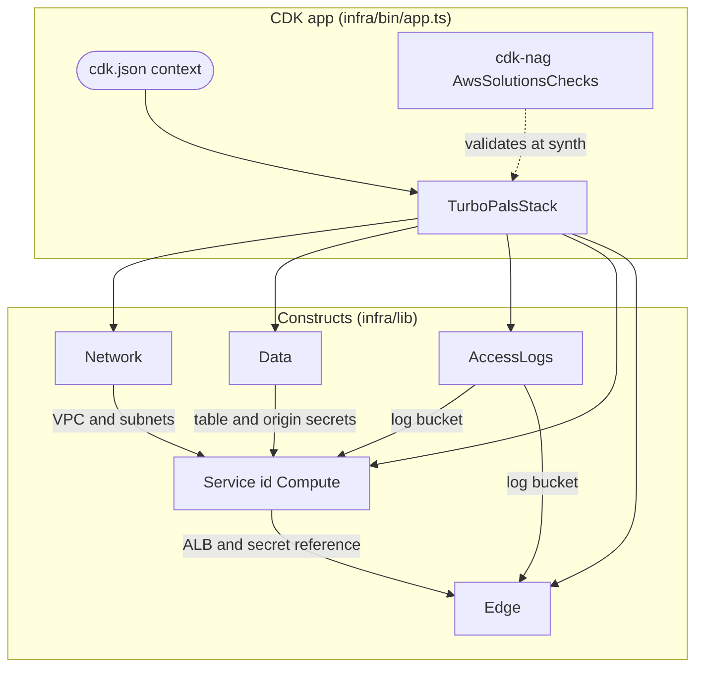

# Infrastructure as Code / IaC 구현 상세

<a href="#english"></a>
<a href="#korean"></a>

---

<a id="english"></a>

## English

### 1. Overview

The IaC layer is one AWS CDK v2 TypeScript app (`aws-cdk-lib` 2.270.0, CLI `aws-cdk` 2.1142.0, `cdk-nag` 3.0.2) that synthesizes the single stack `TurboPalsStack`. `cdk.json` runs it as `node --import tsx infra/bin/app.ts`, so there is no compile step. The app is locked to one verified environment: the stack constructor refuses any other target, cdk-nag AWS Solutions checks run on every synth, and Vitest template tests pin the security-relevant shape of the template. A synth at origin-secret generation 1 produces 30 CloudFormation resources (not counting CDK metadata). The runtime result of these resources is described in [infrastructure.md](infrastructure.md).


- **Entry** (`infra/bin/app.ts`): reads the context keys `account`, `region`, `vpcId`, `cloudfrontPrefixListId`, `originSecretGeneration`, `domainName` and `certificateArn`. A missing or blank `account`, `region`, `vpcId` or `cloudfrontPrefixListId` falls back to `infra/lib/settings.ts`; a blank `domainName` or `certificateArn` counts as unset (no custom domain); `originSecretGeneration` is converted with `Number()` and defaults to 1. It then registers `AwsSolutionsChecks` (`verbose`, `writeSuppressionsToCloudFormation`) through `cdk.Validations.of(app).addPlugins(...)`, so a violation fails `cdk synth`.
- **Stack guards** (`infra/lib/stack.ts`): the constructor throws unless account is `061525506239`, region is `ap-northeast-2`, VPC is `vpc-0dfa5610180dfa628` and prefix list is `pl-22a6434b`. `domainName` and `certificateArn` must be set together, the domain must be `my-kart.whchoi.net`, and the certificate ARN must start with `arn:aws:acm:us-east-1:061525506239:certificate/`. Every resource is tagged `Project=turbo-pals`.
- **Assembly**: `Network` → `Data` → `AccessLogs` → `Service` (construct id `Compute`) → `Edge`. The certificate is imported with `Certificate.fromCertificateArn`, never created. The distribution depends on the listener rule (`originRule`) so a rotated secret is accepted by the ALB before CloudFront sends it. `PUBLIC_ORIGIN` (and, with a custom domain, `ALLOWED_ORIGINS`) is added to the container afterwards with `addEnvironment`; the distribution references the ALB but never the task definition, which avoids a dependency cycle.
- **Outputs**: `SiteUrl`, `NativeSiteUrl`, `DistributionId`, `AlbDnsName`, `ClusterName`, `ServiceName`, `TableName`. `npm run deploy` writes them to the git-ignored `cdk-outputs.json`.

```bash
npm run typecheck                    # tsc for src/, test/ and tools/, then for infra/ (infra/tsconfig.json includes test/infra)
npx vitest run test/infra            # 33 template and cdk-nag tests
npm run synth                        # cdk synth --quiet; cdk-nag runs here
npx cdk diff TurboPalsStack
npx cdk deploy TurboPalsStack --outputs-file cdk-outputs.json
npx cdk deploy TurboPalsStack -c originSecretGeneration=2 --outputs-file cdk-outputs.json
```

### 2. Components

| Component | Path | Purpose |
|---|---|---|
| CDK app entry | `infra/bin/app.ts` | Context parsing with settings fallbacks, `TurboPalsStack` creation, cdk-nag registration |
| Deployment constants | `infra/lib/settings.ts` | Target account, region, VPC, prefix list, AZs and subnet IDs, stack name, tag, port, origin header name, task size, scaling bounds and targets, custom domain |
| Stack | `infra/lib/stack.ts` | `TurboPalsStackProps`, safety guards, construct assembly, distribution dependency on the origin rule, origin env vars, 7 outputs |
| Network construct | `infra/lib/network.ts` | `Vpc.fromLookup`; PUBLIC and PRIVATE_WITH_EGRESS selections (one per AZ); throws if the resolved subnets differ from settings |
| Data construct | `infra/lib/data.ts` | `Rankings` table; origin-verify secret `OriginVerify` (generation 1) or `OriginVerifyG<N>`, plus generation N-1 while rotating; generation must be an integer 1-999 |
| AccessLogs construct | `infra/lib/logs.ts` | Private, TLS-only, 30-day log bucket (retained) |
| Service construct | `infra/lib/service.ts` | Security groups, ALB, listener, `FromCloudFront` rule, target group, linux/arm64 `DockerImageAsset`, cluster, log group, task definition, Fargate service, scaling; exports `IMAGE_CONTEXT_EXCLUDE` |
| Edge construct | `infra/lib/edge.ts` | `ViewerIp` function, `SecurityHeaders` policy, `ImmutableAssets` cache policy, `AssetOriginRequest` policy, distribution; exports `VIEWER_IP_FUNCTION_CODE` |
| CDK config | `cdk.json` | `app` command, `watch` globs, context: target environment, 13 feature flags, `domainName`, `certificateArn` |
| Lookup cache | `cdk.context.json` | Checked-in result of the VPC lookup (CIDR `10.100.0.0/16`) |
| TypeScript config | `infra/tsconfig.json` | NodeNext, strict, `noEmit`; includes `infra/bin`, `infra/lib` and `test/infra` |
| Template tests | `test/infra/stack.test.ts` | 31 tests: network ownership, security-group rules, origin authentication, secret rotation, compute, data, edge, outputs, tags and guards |
| cdk-nag tests | `test/infra/nag.test.ts` | 2 tests: clean synth with only the justified acknowledgements; a deliberately non-compliant bucket fails with `AwsSolutions-S10` |
| Test image context | `test/infra/fixtures/Dockerfile` | Tiny build context passed as `imageDirectory`, so tests never stage the real project |

Change rules:

- Add a CloudFront behavior inside `additionalBehaviors` and spread `...common`, which carries the viewer-request function and the security-headers policy; the edge tests assert both on every behavior.
- Change security header values only in `src/shared/csp.ts`; CloudFront and the origin server import the same constants.
- Never rename the generation-1 secret's logical id `OriginVerify` (CloudFormation would replace the secret). After a rotation deploy, record `"originSecretGeneration": 2` (or the new value) in the `cdk.json` context so the next plain deploy does not roll it back.
- To serve only the default `*.cloudfront.net` hostname, pass both `-c domainName=` and `-c certificateArn=`; clearing only one trips the "configured together" guard because `cdk.json` sets both.
- `VIEWER_CERTIFICATE_ARN` in `infra/lib/settings.ts` is exported but unused; the ARN that reaches the stack comes from the `certificateArn` context.
- Refresh `cdk.context.json` (`cdk context --clear`) only after verifying the VPC routes; `network.ts` rejects a lookup whose subnets differ from settings.
- A new output must also be added to the sorted output list in `test/infra/stack.test.ts`. New security-group rules break the three security-group tests and live checks 4 and 11 of `tools/verify-live.ts`.
- `IMAGE_CONTEXT_EXCLUDE` and `.dockerignore` must list the same patterns in the same order. The excludes decide the image asset hash, which appears in `APP_VERSION` after the `+`; `tools/*` is excluded except `tools/build.mjs`, so other tooling changes do not rebuild the image.

### 3. Key Decisions

- **One hard-locked target.** Account, region, VPC, prefix list, domain and certificate region are constants with throwing guards, tested by "refuses any other account, region, VPC or prefix list" and "rejects unauthorised domains and half-configured certificates". Supporting another environment means changing `infra/lib/settings.ts`, the `cdk.json` context and the test constants together. See [ADR-003](../decisions/ADR-003-fargate-arm64-in-existing-vpc.md).
- **Import the network, never create it.** `Vpc.fromLookup` reads the checked-in cache; the tests assert zero VPC, subnet, route, route table, NAT gateway, internet gateway, EIP, VPC endpoint, transit gateway attachment and flow log resources and exactly two security groups. See [ADR-003](../decisions/ADR-003-fargate-arm64-in-existing-vpc.md).
- **Origin secret rotation by generation.** The secret value is a CloudFormation dynamic reference (`{{resolve:secretsmanager:...}}`) that appears only in the CloudFront origin header and the listener rule, never in the task, IAM policies or outputs. Bumping `originSecretGeneration` creates a new secret while the rule still accepts the previous one; generation N+1 retires N-1. See [ADR-002](../decisions/ADR-002-cloudfront-only-origin-access.md).
- **cdk-nag is a synth gate, with reasons in code.** Eight acknowledgements carry a written reason through `cdk.Validations.of(construct).acknowledge(...)`: `AwsSolutions-CFR1`, `CFR2` (no WAF), `CFR4`, `CFR5` (HTTP origin) in `edge.ts`, `SMG4` in `data.ts`, `S1` in `logs.ts`, `ECS2` and `IAM5[Resource::*]` in `service.ts`. CFR2 and CFR5 record the trade-offs accepted in [ADR-002](../decisions/ADR-002-cloudfront-only-origin-access.md).
- **Docker context mirror is checked by the harness.** `test/harness/structure/check-docs.mjs` (run by `npm run test:harness`) compares `IMAGE_CONTEXT_EXCLUDE` with `.dockerignore` and requires `.claude`, `scripts`, `.mcp.json`, `.editorconfig`, `LICENSE` and `**/*.md` to be excluded; the Vitest suite does not check this. See [ADR-007](../decisions/ADR-007-claude-code-harness-adaptations.md).

### 4. Code Pointers

- `infra/bin/app.ts`: context parsing and cdk-nag registration.
- `infra/lib/stack.ts`: guards, construct assembly, origin env vars and outputs.
- `infra/lib/service.ts`: `IMAGE_CONTEXT_EXCLUDE`, image asset and the compute resources.
- `infra/lib/data.ts`: secret generations and their logical ids.
- `infra/lib/edge.ts`: behaviors, shared `common` settings and the CloudFront acknowledgements.
- `test/infra/stack.test.ts`: the template contract.
- `test/harness/structure/check-docs.mjs`: the `.dockerignore` mirror check.

### 5. Cross-references

- Related modules: [infra/CLAUDE.md](../../infra/CLAUDE.md), [test/CLAUDE.md](../../test/CLAUDE.md), [tools/CLAUDE.md](../../tools/CLAUDE.md), [src/shared/CLAUDE.md](../../src/shared/CLAUDE.md)
- Related ADRs: [ADR-002](../decisions/ADR-002-cloudfront-only-origin-access.md), [ADR-003](../decisions/ADR-003-fargate-arm64-in-existing-vpc.md), [ADR-007](../decisions/ADR-007-claude-code-harness-adaptations.md)
- Related runbooks: [deploy-production](../runbooks/deploy-production.md), [rollback-production](../runbooks/rollback-production.md), [rotate-origin-secret](../runbooks/rotate-origin-secret.md), [custom-domain](../runbooks/custom-domain.md), [teardown](../runbooks/teardown.md)
- Related docs: [infrastructure.md](infrastructure.md), [security.md](security.md), [data.md](data.md), [infra.md](../infra.md) (operations guide, Korean)

---

<a id="korean"></a>

## 한국어

### 1. 개요

IaC 계층은 AWS CDK v2 TypeScript 앱 하나(`aws-cdk-lib` 2.270.0, CLI `aws-cdk` 2.1142.0, `cdk-nag` 3.0.2)이며 스택 `TurboPalsStack` 하나를 합성합니다. `cdk.json`이 `node --import tsx infra/bin/app.ts`로 앱을 실행하므로 별도 컴파일 단계가 없습니다. 이 앱은 검증된 환경 하나에만 배포되도록 묶여 있습니다. 스택 생성자는 다른 대상을 거부하고, synth할 때마다 cdk-nag AWS Solutions 검사가 돌며, Vitest 템플릿 테스트가 보안에 중요한 템플릿 구조를 고정합니다. 오리진 시크릿 세대 1로 synth하면 CDK 메타데이터를 빼고 CloudFormation 리소스 30개가 나옵니다. 이 리소스들이 런타임에서 어떻게 동작하는지는 [infrastructure.md](infrastructure.md)에서 설명합니다.



- **진입점** (`infra/bin/app.ts`): context 키 `account`, `region`, `vpcId`, `cloudfrontPrefixListId`, `originSecretGeneration`, `domainName`, `certificateArn`을 읽습니다. `account`, `region`, `vpcId`, `cloudfrontPrefixListId`가 없거나 빈 문자열이면 `infra/lib/settings.ts`의 상수를 씁니다. `domainName`이나 `certificateArn`이 빈 문자열이면 값이 없는 것으로 보고 커스텀 도메인을 붙이지 않습니다. `originSecretGeneration`은 `Number()`로 변환하며 기본값은 1입니다. 그다음 `cdk.Validations.of(app).addPlugins(...)`로 `AwsSolutionsChecks`(`verbose`, `writeSuppressionsToCloudFormation`)를 등록하므로, 위반이 있으면 `cdk synth`가 실패합니다.
- **스택 가드** (`infra/lib/stack.ts`): 계정이 `061525506239`, 리전이 `ap-northeast-2`, VPC가 `vpc-0dfa5610180dfa628`, prefix list가 `pl-22a6434b`가 아니면 생성자가 예외를 던집니다. `domainName`과 `certificateArn`은 함께 설정해야 하고, 도메인은 `my-kart.whchoi.net`이어야 하며, 인증서 ARN은 `arn:aws:acm:us-east-1:061525506239:certificate/`로 시작해야 합니다. 모든 리소스에는 `Project=turbo-pals` 태그가 붙습니다.
- **조립 순서**: `Network` → `Data` → `AccessLogs` → `Service`(construct id `Compute`) → `Edge`. 인증서는 `Certificate.fromCertificateArn`으로 가져오기만 하고 새로 만들지 않습니다. 배포(distribution)는 리스너 규칙(`originRule`)에 의존하므로, 시크릿을 회전하면 CloudFront가 새 값을 보내기 전에 ALB가 먼저 그 값을 받아들입니다. `PUBLIC_ORIGIN`(커스텀 도메인이 있으면 `ALLOWED_ORIGINS`도)은 나중에 `addEnvironment`로 컨테이너에 넣습니다. 배포는 ALB만 참조하고 태스크 정의는 참조하지 않으므로 의존성 순환이 생기지 않습니다.
- **출력값**: `SiteUrl`, `NativeSiteUrl`, `DistributionId`, `AlbDnsName`, `ClusterName`, `ServiceName`, `TableName`. `npm run deploy`는 이 값을 git에서 제외된 `cdk-outputs.json`에 씁니다.

```bash
npm run typecheck                    # tsc for src/, test/ and tools/, then for infra/ (infra/tsconfig.json includes test/infra)
npx vitest run test/infra            # 33 template and cdk-nag tests
npm run synth                        # cdk synth --quiet; cdk-nag runs here
npx cdk diff TurboPalsStack
npx cdk deploy TurboPalsStack --outputs-file cdk-outputs.json
npx cdk deploy TurboPalsStack -c originSecretGeneration=2 --outputs-file cdk-outputs.json
```

### 2. 구성요소

| 구성요소 | 경로 | 목적 |
|---|---|---|
| CDK 앱 진입점 | `infra/bin/app.ts` | context 파싱과 settings 대체값, `TurboPalsStack` 생성, cdk-nag 등록 |
| 배포 상수 | `infra/lib/settings.ts` | 대상 계정, 리전, VPC, prefix list, AZ와 서브넷 ID, 스택 이름, 태그, 포트, 오리진 헤더 이름, 태스크 크기, 스케일링 범위와 목표값, 커스텀 도메인 |
| 스택 | `infra/lib/stack.ts` | `TurboPalsStackProps`, 안전 가드, construct 조립, 오리진 규칙에 대한 배포 의존성, 오리진 env, 출력값 7개 |
| Network construct | `infra/lib/network.ts` | `Vpc.fromLookup`, AZ마다 하나씩 고르는 PUBLIC과 PRIVATE_WITH_EGRESS 선택. 고른 서브넷이 settings와 다르면 예외를 던집니다 |
| Data construct | `infra/lib/data.ts` | `Rankings` 테이블. 오리진 검증 시크릿은 세대 1이면 `OriginVerify`, 그 뒤로는 `OriginVerifyG<N>`이고 회전 중에는 N-1 세대도 둡니다. 세대는 1~999 정수여야 합니다 |
| AccessLogs construct | `infra/lib/logs.ts` | 비공개, TLS 전용, 30일 보존 로그 버킷(삭제 시 유지) |
| Service construct | `infra/lib/service.ts` | 보안 그룹, ALB, 리스너, `FromCloudFront` 규칙, 타깃 그룹, linux/arm64 `DockerImageAsset`, 클러스터, 로그 그룹, 태스크 정의, Fargate 서비스, 스케일링. `IMAGE_CONTEXT_EXCLUDE`를 export합니다 |
| Edge construct | `infra/lib/edge.ts` | `ViewerIp` 함수, `SecurityHeaders` 정책, `ImmutableAssets` 캐시 정책, `AssetOriginRequest` 정책, 배포. `VIEWER_IP_FUNCTION_CODE`를 export합니다 |
| CDK 설정 | `cdk.json` | `app` 명령, `watch` 패턴, context(대상 환경, feature flag 13개, `domainName`, `certificateArn`) |
| lookup 캐시 | `cdk.context.json` | 체크인된 VPC lookup 결과(CIDR `10.100.0.0/16`) |
| TypeScript 설정 | `infra/tsconfig.json` | NodeNext, strict, `noEmit`. `infra/bin`, `infra/lib`, `test/infra`를 포함합니다 |
| 템플릿 테스트 | `test/infra/stack.test.ts` | 테스트 31개. 네트워크 소유 여부, 보안 그룹 규칙, 오리진 인증, 시크릿 회전, 컴퓨트, 데이터, 엣지, 출력값, 태그, 가드를 검사합니다 |
| cdk-nag 테스트 | `test/infra/nag.test.ts` | 테스트 2개. 정당한 acknowledgement만으로 synth가 통과하는지, 일부러 규칙을 어긴 버킷이 `AwsSolutions-S10`으로 실패하는지 확인합니다 |
| 테스트용 이미지 컨텍스트 | `test/infra/fixtures/Dockerfile` | `imageDirectory`로 넘기는 작은 빌드 컨텍스트. 테스트가 실제 프로젝트를 스테이징하지 않게 합니다 |

변경 규칙:

- CloudFront behavior는 `additionalBehaviors` 안에 추가하고 `...common`을 펼쳐 넣습니다. `common`에 viewer-request 함수와 보안 헤더 정책이 들어 있고, 엣지 테스트가 모든 behavior에 둘 다 있는지 확인합니다.
- 보안 헤더 값은 `src/shared/csp.ts`에서만 바꿉니다. CloudFront와 오리진 서버가 같은 상수를 import합니다.
- 세대 1 시크릿의 logical id `OriginVerify`는 절대 바꾸지 않습니다(바꾸면 CloudFormation이 시크릿을 교체합니다). 회전 배포가 끝나면 `cdk.json` context에 `"originSecretGeneration": 2`(또는 새 값)를 기록해야 다음 일반 배포가 회전을 되돌리지 않습니다.
- 기본 `*.cloudfront.net` 호스트명만 서빙하려면 `-c domainName=`과 `-c certificateArn=`을 함께 넘깁니다. `cdk.json`에 둘 다 들어 있으므로 하나만 비우면 "configured together" 가드에 걸립니다.
- `infra/lib/settings.ts`의 `VIEWER_CERTIFICATE_ARN`은 export만 되고 쓰이지 않습니다. 스택에 실제로 들어가는 ARN은 `certificateArn` context 값입니다.
- `cdk.context.json`은 VPC 라우트를 확인한 뒤에만 갱신합니다(`cdk context --clear`). `network.ts`는 서브넷이 settings와 다른 lookup 결과를 거부합니다.
- 출력값을 새로 만들면 `test/infra/stack.test.ts`의 정렬된 출력 목록도 고칩니다. 보안 그룹 규칙을 추가하면 보안 그룹 테스트 3개와 `tools/verify-live.ts`의 라이브 체크 4, 11이 깨집니다.
- `IMAGE_CONTEXT_EXCLUDE`와 `.dockerignore`는 같은 패턴을 같은 순서로 나열해야 합니다. 제외 목록이 이미지 asset 해시를 결정하고, 이 해시가 `APP_VERSION`의 `+` 뒤에 붙습니다. `tools/*`는 `tools/build.mjs`만 빼고 제외되므로 다른 도구를 바꿔도 이미지는 다시 빌드되지 않습니다.

### 3. 주요 결정

- **배포 대상은 하나로 고정합니다.** 계정, 리전, VPC, prefix list, 도메인, 인증서 리전은 상수이고 어긋나면 가드가 예외를 던집니다. "refuses any other account, region, VPC or prefix list"와 "rejects unauthorised domains and half-configured certificates" 테스트가 이를 지킵니다. 다른 환경을 지원하려면 `infra/lib/settings.ts`, `cdk.json` context, 테스트 상수를 함께 바꿔야 합니다. [ADR-003](../decisions/ADR-003-fargate-arm64-in-existing-vpc.md)을 참고합니다.
- **네트워크는 가져오기만 하고 만들지 않습니다.** `Vpc.fromLookup`은 체크인된 캐시를 읽습니다. 테스트는 VPC, 서브넷, 라우트, 라우트 테이블, NAT 게이트웨이, 인터넷 게이트웨이, EIP, VPC 엔드포인트, Transit Gateway attachment, Flow Log 리소스가 0개이고 보안 그룹이 정확히 2개인지 확인합니다. [ADR-003](../decisions/ADR-003-fargate-arm64-in-existing-vpc.md)을 참고합니다.
- **오리진 시크릿은 세대 단위로 회전합니다.** 시크릿 값은 CloudFormation 동적 참조(`{{resolve:secretsmanager:...}}`)이며 CloudFront 오리진 헤더와 리스너 규칙에만 나타나고, 태스크, IAM 정책, 출력값에는 나오지 않습니다. `originSecretGeneration`을 올리면 새 시크릿이 생기고 규칙은 직전 시크릿도 계속 받아들입니다. N+1 세대로 넘어가면 N-1 세대가 사라집니다. [ADR-002](../decisions/ADR-002-cloudfront-only-origin-access.md)를 참고합니다.
- **cdk-nag는 synth 관문이며 예외 사유는 코드에 남깁니다.** acknowledgement 8건이 `cdk.Validations.of(construct).acknowledge(...)`로 사유와 함께 등록되어 있습니다. `edge.ts`의 `AwsSolutions-CFR1`, `CFR2`(WAF 없음), `CFR4`, `CFR5`(HTTP 오리진), `data.ts`의 `SMG4`, `logs.ts`의 `S1`, `service.ts`의 `ECS2`와 `IAM5[Resource::*]`입니다. CFR2와 CFR5는 [ADR-002](../decisions/ADR-002-cloudfront-only-origin-access.md)에서 받아들인 절충을 기록합니다.
- **Docker 컨텍스트 미러는 하네스가 검사합니다.** `test/harness/structure/check-docs.mjs`(`npm run test:harness`로 실행)가 `IMAGE_CONTEXT_EXCLUDE`와 `.dockerignore`를 비교하고, `.claude`, `scripts`, `.mcp.json`, `.editorconfig`, `LICENSE`, `**/*.md`가 제외되는지 확인합니다. Vitest 테스트는 이 부분을 보지 않습니다. [ADR-007](../decisions/ADR-007-claude-code-harness-adaptations.md)을 참고합니다.

### 4. 코드 포인터

- `infra/bin/app.ts`: context 파싱과 cdk-nag 등록.
- `infra/lib/stack.ts`: 가드, construct 조립, 오리진 env, 출력값.
- `infra/lib/service.ts`: `IMAGE_CONTEXT_EXCLUDE`, 이미지 asset, 컴퓨트 리소스.
- `infra/lib/data.ts`: 시크릿 세대와 logical id.
- `infra/lib/edge.ts`: behavior, 공통 `common` 설정, CloudFront acknowledgement.
- `test/infra/stack.test.ts`: 템플릿 계약.
- `test/harness/structure/check-docs.mjs`: `.dockerignore` 미러 검사.

### 5. 상호 참조

- 관련 모듈: [infra/CLAUDE.md](../../infra/CLAUDE.md), [test/CLAUDE.md](../../test/CLAUDE.md), [tools/CLAUDE.md](../../tools/CLAUDE.md), [src/shared/CLAUDE.md](../../src/shared/CLAUDE.md)
- 관련 ADR: [ADR-002](../decisions/ADR-002-cloudfront-only-origin-access.md), [ADR-003](../decisions/ADR-003-fargate-arm64-in-existing-vpc.md), [ADR-007](../decisions/ADR-007-claude-code-harness-adaptations.md)
- 관련 런북: [deploy-production](../runbooks/deploy-production.md), [rollback-production](../runbooks/rollback-production.md), [rotate-origin-secret](../runbooks/rotate-origin-secret.md), [custom-domain](../runbooks/custom-domain.md), [teardown](../runbooks/teardown.md)
- 관련 문서: [infrastructure.md](infrastructure.md), [security.md](security.md), [data.md](data.md), [infra.md](../infra.md)(한국어 운영 가이드)
