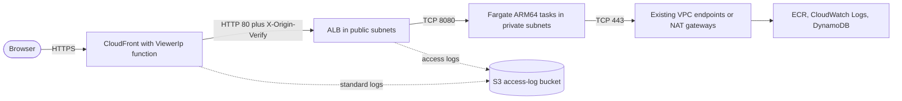

# Infrastructure / 인프라 구현 상세

---

## English

### 1. Overview

The runtime infrastructure serves the game client, the leaderboard API and the time-trial verifier from one container image. CloudFront (HTTPS) is the only public entry. It forwards over HTTP to an internet-facing ALB that admits only CloudFront's origin-facing prefix list and forwards only requests that carry the `X-Origin-Verify` secret. Two to six ARM64 Fargate tasks run in the existing VPC's private subnets and reach ECR, CloudWatch Logs and DynamoDB over TCP 443 through the VPC's existing egress: VPC endpoints owned by other stacks where they exist, otherwise the default route through the existing NAT gateways. Everything belongs to the single CDK stack `TurboPalsStack` in account `061525506239`, region `ap-northeast-2`; the CDK code itself is described in [iac.md](iac.md).

- **Image** (`Dockerfile`): both stages start from `node:24-alpine@sha256:ebfe2f90462722a7a4de65e91990e97fe0d401c70e0e762c5b53302f905ec1c1`. The `build` stage runs `npm ci` on `package.json` and `package-lock.json`, copies the context filtered by `.dockerignore`, runs `npm run build` and fails unless `dist/client/index.html`, `dist/server/index.js`, `dist/server/verify-worker.js` and `dist/build.json` exist. The `runtime` stage sets `NODE_ENV=production`, `HOST=0.0.0.0`, `PORT=8080`, `STATIC_DIR=/app/dist/client`, deletes npm, npx, corepack and yarn, copies only `dist/` (root-owned), switches to `USER 1000:1000` (the image's `node` user), exposes 8080, stops on `SIGTERM` and runs `node dist/server/index.js`. Its `HEALTHCHECK` (every 20 s) is for local `docker run`; ECS uses the task definition's own check.
- **Tasks**: container `turbo-pals` in a 1024 CPU unit / 2048 MiB ARM64 Linux task on Fargate platform `1.4.0`, with a read-only root filesystem, user `1000:1000`, `privileged: false`, an init process, every Linux capability dropped, a 30 s stop timeout and ECS Exec disabled. The container health check fetches `http://127.0.0.1:8080/healthz` every 30 s (timeout 5 s, 3 retries, 20 s start period).
- **Service**: desired count 2 in the private subnets of `ap-northeast-2a` and `ap-northeast-2b`, no public IP, AZ rebalancing, deployment circuit breaker with rollback, 100/200 % healthy during deployments, 60 s health-check grace. Auto scaling keeps 2 to 6 tasks on 60 % average CPU and 600 ALB requests per target (scale-in cooldown 180 s, scale-out 60 s).
- **Environment**: `NODE_ENV`, `HOST`, `PORT`, `STATIC_DIR`, `TABLE_NAME`, `AWS_REGION` and `APP_VERSION` (`<package.json version>+<first 12 characters of the image asset hash>`), plus `PUBLIC_ORIGIN` and, when the custom domain is configured, `ALLOWED_ORIGINS` (the native `*.cloudfront.net` origin). No secret is passed to the task; its role may only `GetItem`, `PutItem`, `DeleteItem` and `Query` on the rankings table.
- **ALB**: internet-facing, IPv4, in the two public subnets, idle timeout 60 s, invalid header fields dropped, desync mitigation `strictest`, HTTP/2 on. Its security group admits only prefix list `pl-22a6434b` on TCP 80 and egresses only to the task security group on TCP 8080. Listener :80 answers a fixed `403 Forbidden`; rule priority 10 forwards to the IP target group only when `X-Origin-Verify` equals the current secret (or the previous one during a rotation). Target group: HTTP 8080, `/healthz` expecting 200 every 15 s, timeout 5 s, healthy 2, unhealthy 3, deregistration delay 20 s.
- **CloudFront**: the origin is the ALB DNS name over HTTP-only port 80 with the `X-Origin-Verify` custom header, read timeout 30 s, keep-alive 30 s. A viewer-request function (`cloudfront-js-2.0`) overwrites `x-turbo-client-ip` with the viewer IP on every behavior. The default behavior (GET/HEAD) and `/api/*` (all methods) use the managed CachingDisabled and AllViewerExceptHostHeader policies; `/assets/*` uses a 365-day cache policy with gzip and Brotli and forwards only `x-turbo-client-ip` on misses. Every behavior redirects HTTP to HTTPS and attaches the security-headers policy built from `src/shared/csp.ts`. Error responses 400, 403, 404, 405, 414, 416, 500, 501, 502, 503 and 504 are cached for 0 s. HTTP/2 and HTTP/3, IPv6 and price class 200 are enabled. The custom domain `my-kart.whchoi.net` uses an existing us-east-1 ACM certificate with `TLSv1.2_2021` and SNI; its DNS CNAME is managed outside this account.
- **Egress**: the task security group allows only TCP 443 to `0.0.0.0/0`, and the private subnets' default routes point at the VPC's existing NAT gateways (live check 13 of `tools/verify-live.ts`). The stack creates no VPC, subnet, route, NAT gateway, internet gateway, EIP or VPC endpoint. Endpoints that other stacks own in the same VPC take precedence over that default route: a read-only check on 2026-10-18 found S3 and DynamoDB gateway endpoints on both private route tables, and `ecr.api`, `ecr.dkr` and `logs` interface endpoints with private DNS whose security groups admit `10.100.0.0/16` on TCP 443, so image pulls, log writes and DynamoDB calls normally bypass the NAT gateways.
- **Observability**: Container Insights is enabled on the cluster. Application logs go to the `AppLogs` log group (one month retention, stream prefix `app`, non-blocking awslogs driver with an 8 MiB buffer). The access-log bucket blocks all public access, uses SSE-S3, enforces TLS, uses `BucketOwnerPreferred` object ownership (CloudFront standard logs are delivered through ACLs), expires objects after 30 days, aborts incomplete multipart uploads after 1 day and is retained when the stack is deleted.
- **Keep-alive order**: server `keepAliveTimeout` 65 s (`src/server/app.ts`) > ALB idle timeout 60 s > CloudFront origin keep-alive 30 s, so no hop reuses a connection the next hop already closed.

### 2. Components

| Component | Path | Purpose |
|---|---|---|
| Container image | `Dockerfile` | Two-stage, digest-pinned `node:24-alpine` build; the runtime stage holds only the self-contained `dist/` bundle |
| Build context filter | `.dockerignore` | Keeps docs, tests, infra, tooling (except `tools/build.mjs`), env files and keys out of the image context; mirrored by `IMAGE_CONTEXT_EXCLUDE` |
| Existing network | `infra/lib/network.ts` | Imports `vpc-0dfa5610180dfa628`, selects two public subnets (ALB) and two private subnets (tasks) in `ap-northeast-2a`/`2b`, creates nothing |
| Load balancer and compute | `infra/lib/service.ts` | Two security groups, ALB, listener and origin rule, target group, ECS cluster, Fargate task definition and service, auto scaling, `AppLogs` log group |
| Edge | `infra/lib/edge.ts` | CloudFront distribution, `ViewerIp` function, `SecurityHeaders` response-headers policy, `ImmutableAssets` cache policy, `AssetOriginRequest` policy |
| Access logs | `infra/lib/logs.ts` | S3 bucket for CloudFront standard logs (`cloudfront/`) and ALB access logs (`alb/`) |
| Rankings table and origin secret | `infra/lib/data.ts` | DynamoDB `Rankings` table and the Secrets Manager value behind `X-Origin-Verify` (see [data.md](data.md) and [security.md](security.md)) |
| Sizing and placement constants | `infra/lib/settings.ts` | Account, region, VPC, prefix list, subnet IDs, port, task size, scaling bounds and targets, custom domain |
| Shared header values | `src/shared/csp.ts` | CSP, Permissions-Policy, HSTS max-age (1 year), COOP/CORP and the client-IP header name, used by CloudFront and the origin server |
| Live acceptance check | `tools/verify-live.ts` | 35 checks against the deployed stack: network placement, edge headers, PWA files, direct-ALB block, end-to-end verified run (`npm run verify:live`) |

### 3. Key Decisions

- **CloudFront is the only way in.** The ALB is internet-facing, but its security group admits only `pl-22a6434b` and its listener forwards only requests with the generated `X-Origin-Verify` value; a direct request times out or gets 403. See [ADR-002](../decisions/ADR-002-cloudfront-only-origin-access.md).
- **ARM64 Fargate inside the existing VPC.** Tasks run on Graviton in private subnets and leave through the network team's existing egress (NAT gateways and VPC endpoints); the stack owns no network resources. See [ADR-003](../decisions/ADR-003-fargate-arm64-in-existing-vpc.md).
- **Minimal, immutable runtime.** A digest-pinned base image, a server bundle with every dependency inlined (no `node_modules`, no package managers), a non-root user, a read-only root filesystem and no Linux capabilities. See [ADR-003](../decisions/ADR-003-fargate-arm64-in-existing-vpc.md).
- **Cache split instead of invalidations.** Pages, `sw.js` and the API are never cached at the edge, content-hashed `/assets/*` are cached for a year, and error responses have TTL 0, so a deploy needs no CloudFront invalidation and the service worker always sees the new build. See [ADR-006](../decisions/ADR-006-offline-first-pwa-race-safe-updates.md).
- **Durable data outlives the stack.** The DynamoDB table (deletion protection, point-in-time recovery) and the access-log bucket are retained on `cdk destroy`; only the log group is deleted. See [ADR-004](../decisions/ADR-004-dynamodb-on-demand-leaderboard.md).

### 4. Code Pointers

- `Dockerfile`: build and runtime stages, base image digest, non-root user, `HEALTHCHECK`.
- `infra/lib/service.ts`: security groups, ALB, listener rule, target group, task definition, container settings, service and auto scaling.
- `infra/lib/edge.ts`: origin settings, viewer-request function, behaviors, error-response TTLs, custom-domain certificate.
- `infra/lib/network.ts`: VPC lookup and the subnet-ID placement check.
- `infra/lib/logs.ts`: access-log bucket policy and lifecycle.
- `infra/lib/settings.ts`: task size, scaling bounds and targets, subnet IDs.
- `tools/verify-live.ts`: live checks that confirm the deployed topology.

### 5. Cross-references

- Related modules: [infra/CLAUDE.md](../../infra/CLAUDE.md), [src/server/CLAUDE.md](../../src/server/CLAUDE.md), [src/shared/CLAUDE.md](../../src/shared/CLAUDE.md), [tools/CLAUDE.md](../../tools/CLAUDE.md)
- Related ADRs: [ADR-002](../decisions/ADR-002-cloudfront-only-origin-access.md), [ADR-003](../decisions/ADR-003-fargate-arm64-in-existing-vpc.md), [ADR-004](../decisions/ADR-004-dynamodb-on-demand-leaderboard.md), [ADR-006](../decisions/ADR-006-offline-first-pwa-race-safe-updates.md)
- Related runbooks: [deploy-production](../runbooks/deploy-production.md), [rollback-production](../runbooks/rollback-production.md), [rotate-origin-secret](../runbooks/rotate-origin-secret.md), [custom-domain](../runbooks/custom-domain.md), [teardown](../runbooks/teardown.md), [incident-response](../runbooks/incident-response.md)
- Related docs: [iac.md](iac.md), [security.md](security.md), [data.md](data.md), [api.md](api.md), [architecture.md](../architecture.md), [infra.md](../infra.md) (operations guide, Korean)

---

## 한국어

### 1. 개요

런타임 인프라는 컨테이너 이미지 하나로 게임 클라이언트, 리더보드 API, 타임 어택 검증기를 함께 서빙합니다. 외부에서 들어오는 길은 CloudFront(HTTPS) 하나뿐입니다. CloudFront는 HTTP로 internet-facing ALB에 요청을 넘기고, ALB는 CloudFront origin-facing prefix list에서 온 연결만 받으며 `X-Origin-Verify` 시크릿이 붙은 요청만 전달합니다. ARM64 Fargate 태스크 2~6개가 기존 VPC의 프라이빗 서브넷에서 돌고, VPC에 이미 있는 이그레스 경로로 TCP 443을 통해 ECR, CloudWatch Logs, DynamoDB에 접근합니다. 다른 스택이 소유한 VPC 엔드포인트가 있으면 그쪽을 타고, 없으면 기존 NAT 게이트웨이로 향하는 기본 경로를 탑니다. 모든 리소스는 계정 `061525506239`, 리전 `ap-northeast-2`의 CDK 스택 `TurboPalsStack` 하나에 속하며, CDK 코드 자체는 [iac.md](iac.md)에서 설명합니다.

- **이미지** (`Dockerfile`): 두 스테이지 모두 `node:24-alpine@sha256:ebfe2f90462722a7a4de65e91990e97fe0d401c70e0e762c5b53302f905ec1c1`에서 시작합니다. `build` 스테이지는 `package.json`과 `package-lock.json`으로 `npm ci`를 실행하고, `.dockerignore`로 걸러진 컨텍스트를 복사한 뒤 `npm run build`를 돌립니다. 이때 `dist/client/index.html`, `dist/server/index.js`, `dist/server/verify-worker.js`, `dist/build.json` 중 하나라도 없으면 빌드가 실패합니다. `runtime` 스테이지는 `NODE_ENV=production`, `HOST=0.0.0.0`, `PORT=8080`, `STATIC_DIR=/app/dist/client`를 설정하고 npm, npx, corepack, yarn을 지운 다음 `dist/`만 root 소유로 복사합니다. 이어서 `USER 1000:1000`(이미지의 `node` 사용자)으로 전환하고 8080을 노출하며, `SIGTERM`으로 종료하고 `node dist/server/index.js`를 실행합니다. 이미지의 `HEALTHCHECK`(20초 간격)는 로컬 `docker run`용이고, ECS는 태스크 정의에 있는 헬스 체크를 씁니다.
- **태스크**: 컨테이너 `turbo-pals`는 Fargate 플랫폼 `1.4.0`의 1024 CPU 유닛 / 2048 MiB ARM64 Linux 태스크에서 돕니다. 루트 파일 시스템은 읽기 전용이고 사용자는 `1000:1000`, `privileged: false`이며 init 프로세스를 켜고 Linux capability를 모두 제거합니다. 종료 대기 시간은 30초이고 ECS Exec는 꺼져 있습니다. 컨테이너 헬스 체크는 30초마다 `http://127.0.0.1:8080/healthz`를 호출합니다(타임아웃 5초, 재시도 3회, 시작 유예 20초).
- **서비스**: `ap-northeast-2a`와 `ap-northeast-2b`의 프라이빗 서브넷에 태스크 2개를 유지하며 퍼블릭 IP는 붙이지 않습니다. AZ 재균형, 롤백을 포함한 배포 서킷 브레이커, 배포 중 정상 비율 100/200 %, 헬스 체크 유예 60초를 씁니다. 오토스케일링은 평균 CPU 60 %와 타깃당 ALB 요청 600을 기준으로 태스크를 2~6개로 조절합니다(scale-in 쿨다운 180초, scale-out 60초).
- **환경 변수**: `NODE_ENV`, `HOST`, `PORT`, `STATIC_DIR`, `TABLE_NAME`, `AWS_REGION`, `APP_VERSION`(`<package.json 버전>+<이미지 asset 해시 앞 12자>`)을 넣고, 스택에서 `PUBLIC_ORIGIN`을, 커스텀 도메인이 있을 때는 `ALLOWED_ORIGINS`(기본 `*.cloudfront.net` origin)를 추가합니다. 태스크에는 시크릿을 넘기지 않으며, 태스크 역할은 랭킹 테이블에 대한 `GetItem`, `PutItem`, `DeleteItem`, `Query`만 허용합니다.
- **ALB**: internet-facing IPv4로 두 퍼블릭 서브넷에 배치합니다. idle 타임아웃 60초, 잘못된 헤더 필드 제거, desync 완화 `strictest`, HTTP/2를 켭니다. 보안 그룹은 prefix list `pl-22a6434b`의 TCP 80만 받고, 나가는 트래픽은 태스크 보안 그룹의 TCP 8080으로만 보냅니다. 리스너 :80은 고정 응답 `403 Forbidden`을 돌려주고, 우선순위 10 규칙은 `X-Origin-Verify`가 현재 시크릿(회전 중에는 직전 시크릿도)과 같을 때만 IP 타깃 그룹으로 전달합니다. 타깃 그룹은 HTTP 8080이며 15초마다 `/healthz`에서 200을 기대하고(타임아웃 5초, healthy 2, unhealthy 3), 등록 해제 지연은 20초입니다.
- **CloudFront**: 오리진은 ALB DNS 이름이며 HTTP 전용 포트 80, 커스텀 헤더 `X-Origin-Verify`, 읽기 타임아웃 30초, keep-alive 30초로 연결합니다. viewer-request 함수(`cloudfront-js-2.0`)가 모든 behavior에서 `x-turbo-client-ip`를 viewer IP로 덮어씁니다. 기본 behavior(GET/HEAD)와 `/api/*`(모든 메서드)는 관리형 CachingDisabled, AllViewerExceptHostHeader 정책을 쓰고, `/assets/*`는 gzip과 Brotli를 켠 365일 캐시 정책을 쓰며 캐시 미스 때 `x-turbo-client-ip`만 오리진에 넘깁니다. 모든 behavior는 HTTP를 HTTPS로 리다이렉트하고, `src/shared/csp.ts`에서 만든 보안 헤더 정책을 붙입니다. 에러 응답 400, 403, 404, 405, 414, 416, 500, 501, 502, 503, 504는 0초 동안만 캐시합니다. HTTP/2와 HTTP/3, IPv6, price class 200을 사용합니다. 커스텀 도메인 `my-kart.whchoi.net`은 us-east-1에 있는 기존 ACM 인증서와 `TLSv1.2_2021`, SNI를 쓰며, DNS CNAME은 이 계정 밖에서 관리합니다.
- **아웃바운드**: 태스크 보안 그룹은 `0.0.0.0/0`으로 나가는 TCP 443만 허용하고, 프라이빗 서브넷의 기본 경로는 VPC에 원래 있던 NAT 게이트웨이를 가리킵니다(`tools/verify-live.ts`의 라이브 체크 13). 스택은 VPC, 서브넷, 라우트, NAT 게이트웨이, 인터넷 게이트웨이, EIP, VPC 엔드포인트를 하나도 만들지 않습니다. 같은 VPC에 다른 스택이 소유한 엔드포인트가 있으면 이 기본 경로보다 먼저 쓰입니다. 2026-10-18 읽기 전용 조회에서는 두 프라이빗 라우트 테이블에 S3와 DynamoDB 게이트웨이 엔드포인트가 붙어 있었고, private DNS를 켠 `ecr.api`, `ecr.dkr`, `logs` 인터페이스 엔드포인트의 보안 그룹이 `10.100.0.0/16`의 TCP 443을 허용하고 있었습니다. 그래서 이미지 pull, 로그 쓰기, DynamoDB 호출은 보통 NAT 게이트웨이를 거치지 않습니다.
- **관측성**: 클러스터에는 Container Insights를 켭니다. 애플리케이션 로그는 `AppLogs` 로그 그룹에 쌓이며 보존 기간은 1개월, 스트림 접두사는 `app`, awslogs 드라이버는 8 MiB 버퍼의 non-blocking 모드입니다. 액세스 로그 버킷은 퍼블릭 액세스를 모두 막고 SSE-S3와 TLS 강제를 적용합니다. CloudFront 표준 로그가 ACL로 전달되므로 객체 소유권은 `BucketOwnerPreferred`입니다. 객체는 30일 뒤 만료되고, 끝나지 않은 멀티파트 업로드는 1일 뒤 중단되며, 스택을 삭제해도 버킷은 남습니다.
- **keep-alive 순서**: 서버 `keepAliveTimeout` 65초(`src/server/app.ts`) > ALB idle 타임아웃 60초 > CloudFront 오리진 keep-alive 30초 순서를 지켜, 다음 구간이 이미 닫은 연결을 앞 구간이 재사용하지 않게 합니다.

### 2. 구성요소

| 구성요소 | 경로 | 목적 |
|---|---|---|
| 컨테이너 이미지 | `Dockerfile` | digest로 고정한 `node:24-alpine` 기반 2단계 빌드. runtime 스테이지에는 자체 완결형 `dist/` 번들만 남깁니다 |
| 빌드 컨텍스트 필터 | `.dockerignore` | 문서, 테스트, 인프라, 도구(`tools/build.mjs` 제외), env 파일, 키를 이미지 컨텍스트에서 뺍니다. `IMAGE_CONTEXT_EXCLUDE`와 같은 목록입니다 |
| 기존 네트워크 | `infra/lib/network.ts` | `vpc-0dfa5610180dfa628`을 가져와 `ap-northeast-2a`/`2b`의 퍼블릭 서브넷 2개(ALB)와 프라이빗 서브넷 2개(태스크)를 고릅니다. 새로 만드는 리소스는 없습니다 |
| 로드 밸런서와 컴퓨트 | `infra/lib/service.ts` | 보안 그룹 2개, ALB, 리스너와 오리진 규칙, 타깃 그룹, ECS 클러스터, Fargate 태스크 정의와 서비스, 오토스케일링, `AppLogs` 로그 그룹 |
| 엣지 | `infra/lib/edge.ts` | CloudFront 배포, `ViewerIp` 함수, `SecurityHeaders` 응답 헤더 정책, `ImmutableAssets` 캐시 정책, `AssetOriginRequest` 정책 |
| 액세스 로그 | `infra/lib/logs.ts` | CloudFront 표준 로그(`cloudfront/`)와 ALB 액세스 로그(`alb/`)를 받는 S3 버킷 |
| 랭킹 테이블과 오리진 시크릿 | `infra/lib/data.ts` | DynamoDB `Rankings` 테이블과 `X-Origin-Verify` 값을 담은 Secrets Manager 시크릿([data.md](data.md), [security.md](security.md) 참고) |
| 규모와 배치 상수 | `infra/lib/settings.ts` | 계정, 리전, VPC, prefix list, 서브넷 ID, 포트, 태스크 크기, 스케일링 범위와 목표값, 커스텀 도메인 |
| 공유 헤더 값 | `src/shared/csp.ts` | CSP, Permissions-Policy, HSTS max-age(1년), COOP/CORP, 클라이언트 IP 헤더 이름. CloudFront와 오리진 서버가 함께 씁니다 |
| 라이브 인수 검사 | `tools/verify-live.ts` | 배포된 스택을 35개 항목으로 검사합니다. 네트워크 배치, 엣지 헤더, PWA 파일, ALB 직접 접근 차단, 검증된 기록의 end-to-end 흐름(`npm run verify:live`) |

### 3. 주요 결정

- **들어오는 길은 CloudFront뿐입니다.** ALB는 internet-facing이지만 보안 그룹이 `pl-22a6434b`만 받고, 리스너는 생성된 `X-Origin-Verify` 값이 있는 요청만 전달합니다. ALB에 직접 보낸 요청은 타임아웃되거나 403을 받습니다. [ADR-002](../decisions/ADR-002-cloudfront-only-origin-access.md)를 참고합니다.
- **기존 VPC 안의 ARM64 Fargate.** 태스크는 프라이빗 서브넷의 Graviton에서 돌고 네트워크 팀이 이미 갖춘 이그레스 경로(NAT 게이트웨이와 VPC 엔드포인트)로 나갑니다. 스택이 소유하는 네트워크 리소스는 없습니다. [ADR-003](../decisions/ADR-003-fargate-arm64-in-existing-vpc.md)을 참고합니다.
- **최소한의 불변 런타임.** digest로 고정한 베이스 이미지, 의존성을 모두 인라인한 서버 번들(`node_modules`와 패키지 매니저 없음), non-root 사용자, 읽기 전용 루트 파일 시스템, Linux capability 제거를 적용합니다. [ADR-003](../decisions/ADR-003-fargate-arm64-in-existing-vpc.md)을 참고합니다.
- **무효화 대신 캐시 분리.** 페이지, `sw.js`, API는 엣지에서 캐시하지 않고, 콘텐츠 해시가 붙은 `/assets/*`는 1년 동안 캐시하며, 에러 응답의 TTL은 0입니다. 그래서 배포할 때 CloudFront 무효화가 필요 없고 서비스 워커는 항상 새 빌드를 봅니다. [ADR-006](../decisions/ADR-006-offline-first-pwa-race-safe-updates.md)을 참고합니다.
- **오래 남아야 할 데이터는 스택보다 오래 갑니다.** DynamoDB 테이블(삭제 보호, PITR)과 액세스 로그 버킷은 `cdk destroy` 뒤에도 남고, 로그 그룹만 삭제됩니다. [ADR-004](../decisions/ADR-004-dynamodb-on-demand-leaderboard.md)를 참고합니다.

### 4. 코드 포인터

- `Dockerfile`: build와 runtime 스테이지, 베이스 이미지 digest, non-root 사용자, `HEALTHCHECK`.
- `infra/lib/service.ts`: 보안 그룹, ALB, 리스너 규칙, 타깃 그룹, 태스크 정의, 컨테이너 설정, 서비스와 오토스케일링.
- `infra/lib/edge.ts`: 오리진 설정, viewer-request 함수, behavior, 에러 응답 TTL, 커스텀 도메인 인증서.
- `infra/lib/network.ts`: VPC lookup과 서브넷 ID 배치 검사.
- `infra/lib/logs.ts`: 액세스 로그 버킷 정책과 수명 주기.
- `infra/lib/settings.ts`: 태스크 크기, 스케일링 범위와 목표값, 서브넷 ID.
- `tools/verify-live.ts`: 배포된 토폴로지를 확인하는 라이브 검사.

### 5. 상호 참조

- 관련 모듈: [infra/CLAUDE.md](../../infra/CLAUDE.md), [src/server/CLAUDE.md](../../src/server/CLAUDE.md), [src/shared/CLAUDE.md](../../src/shared/CLAUDE.md), [tools/CLAUDE.md](../../tools/CLAUDE.md)
- 관련 ADR: [ADR-002](../decisions/ADR-002-cloudfront-only-origin-access.md), [ADR-003](../decisions/ADR-003-fargate-arm64-in-existing-vpc.md), [ADR-004](../decisions/ADR-004-dynamodb-on-demand-leaderboard.md), [ADR-006](../decisions/ADR-006-offline-first-pwa-race-safe-updates.md)
- 관련 런북: [deploy-production](../runbooks/deploy-production.md), [rollback-production](../runbooks/rollback-production.md), [rotate-origin-secret](../runbooks/rotate-origin-secret.md), [custom-domain](../runbooks/custom-domain.md), [teardown](../runbooks/teardown.md), [incident-response](../runbooks/incident-response.md)
- 관련 문서: [iac.md](iac.md), [security.md](security.md), [data.md](data.md), [api.md](api.md), [architecture.md](../architecture.md), [infra.md](../infra.md)(한국어 운영 가이드)
