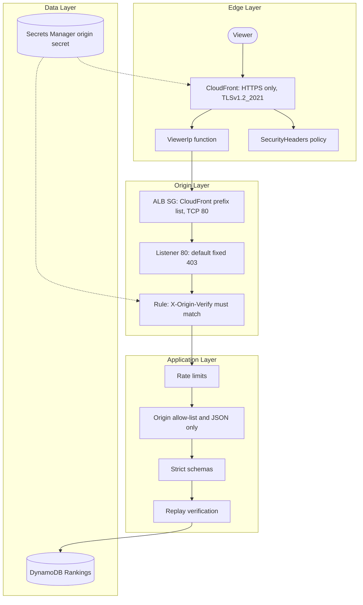

# Security / 보안 구현 상세

<a href="#english"></a>
<a href="#korean"></a>

---

<a id="english"></a>

## English

### 1. Overview

TURBO PALS GRAND PRIX is a public, anonymous game, so security focuses on four risks: forged leaderboard times, stolen ghosts, request floods, and anyone reaching the origin without going through CloudFront. The controls are layered: CloudFront terminates TLS and stamps the browser security headers, the ALB admits only CloudFront and only with a shared secret header, the application validates strictly and re-simulates every submitted run, and the container, IAM role and repository are locked down around it. Every infrastructure resource passes cdk-nag AWS Solutions checks at synth time.



### 2. Components

| Component | Path | Purpose |
|---|---|---|
| Policy source | `src/shared/csp.ts` | CSP directives, `PERMISSIONS_POLICY`, referrer, frame, COOP and CORP values, `HSTS_MAX_AGE_SECONDS`, `CLIENT_IP_HEADER`; single source for edge and origin |
| Edge | `infra/lib/edge.ts` | Response headers policy `SecurityHeaders`, viewer-request function `ViewerIp`, HTTPS redirect, TLS policy, origin custom header |
| Origin protection | `infra/lib/service.ts` | ALB and task security groups, listener default 403, `FromCloudFront` rule, container hardening, task role |
| Origin secret | `infra/lib/data.ts` | Secrets Manager values for generation N (and N-1 during a rotation) |
| Stack guards and policy checks | `infra/lib/stack.ts`, `infra/bin/app.ts` | Account, region, VPC, prefix list and domain guards; cdk-nag `AwsSolutionsChecks` |
| Access logs | `infra/lib/logs.ts` | S3 bucket for CloudFront and ALB logs: public access blocked, SSE-S3, TLS-only, 30-day expiry |
| Origin headers and guards | `src/server/security.ts` | `SECURITY_HEADERS`, `clientKey()`, `isOriginAllowed()`, `isJsonContentType()` |
| Request pipeline | `src/server/app.ts` | Hook order, rate limits, error handler, log hygiene |
| Input validation | `src/server/validation.ts` | Strict schemas, response allow-lists, `normalizeName()`, `logDigest()` |
| Anti-cheat | `src/server/verifier.ts`, `src/sim/replay.ts` | Worker-thread re-simulation with CPU and memory budgets |
| Container image | `Dockerfile` | Pinned base image, runtime without package managers, non-root user |
| Secret scanning | `.claude/hooks/secret-scan.sh` | Blocks `git commit` from Claude Code when staged content looks like a secret |
| Tests | `test/infra/stack.test.ts`, `test/infra/nag.test.ts`, `test/server/http.test.ts`, `test/harness/hooks/test-secret-patterns.sh` | Assert the controls above |

#### Edge (CloudFront)

- Every behavior uses `REDIRECT_TO_HTTPS` (plain HTTP gets 301) and the same response headers policy and viewer-request function. The distribution serves HTTP/2 and HTTP/3 over IPv4 and IPv6.
- TLS: the custom domain `my-kart.whchoi.net` uses an existing us-east-1 ACM certificate (imported by ARN, never created by the stack) with minimum protocol `TLSv1.2_2021` and SNI. The native `*.cloudfront.net` hostname still works with the CloudFront default certificate, whose viewer TLS policy cannot be pinned (cdk-nag `AwsSolutions-CFR4` acknowledged).
- The response headers policy `SecurityHeaders` sets these headers with `override: true`, replacing whatever the origin sent:

| Header | Value |
|---|---|
| `Content-Security-Policy` | `CONTENT_SECURITY_POLICY` (directives below plus `upgrade-insecure-requests`) |
| `Strict-Transport-Security` | `max-age=31536000; includeSubDomains` (no preload) |
| `X-Content-Type-Options` | `nosniff` |
| `X-Frame-Options` | `DENY` |
| `Referrer-Policy` | `no-referrer` |
| `Permissions-Policy` | `PERMISSIONS_POLICY`: only `autoplay`, `fullscreen`, `gamepad` and `screen-wake-lock` allowed, for this origin only |
| `Cross-Origin-Opener-Policy` | `same-origin` |
| `Cross-Origin-Resource-Policy` | `same-origin` |

- The CSP served at the edge:

```text
default-src 'self'; script-src 'self' blob:; style-src 'self' 'unsafe-inline'; img-src 'self' data: blob:; font-src 'self' data:; media-src 'self' data: blob:; connect-src 'self' data: blob:; worker-src 'self' blob:; manifest-src 'self'; object-src 'none'; base-uri 'none'; form-action 'none'; frame-ancestors 'none'; upgrade-insecure-requests
```

- Deliberate relaxations: `style-src 'unsafe-inline'` because `src/client/index.html` carries the splash and fatal-error CSS inline so it paints before the bundle loads; `blob:` and `data:` for canvas-generated textures, synthesized audio and audio worklets. There is no `'unsafe-eval'`, no remote host and no inline script.
- The origin sends the same headers itself (`SECURITY_HEADERS`) without HSTS and without `upgrade-insecure-requests`, because it also runs over plain HTTP locally and in `docker run`. `test/server/http.test.ts` asserts that the origin CSP contains no `http:` or `https:` source, no `'unsafe-eval'`, no `*` and no `upgrade-insecure-requests`.
- The viewer-request function `ViewerIp` overwrites (never appends to) `x-turbo-client-ip` with `event.viewer.ip`, including spoofed multi-value headers. It is the only trusted copy of the viewer IP.
- Error responses are cached for 0 s, and only `/assets/*` is cached at all, so no personalized or error response sticks at the edge.

#### Origin protection

- ALB security group: one ingress rule, the managed prefix list `pl-22a6434b` (`com.amazonaws.global.cloudfront.origin-facing`) on TCP 80; one egress rule, the task security group on TCP 8080. A request from any other IP address times out.
- Task security group: ingress only from the ALB security group on TCP 8080; egress only TCP 443 to `0.0.0.0/0` (ECR, CloudWatch Logs and DynamoDB through the VPC's existing NAT gateways or the VPC endpoints other stacks own there). Tasks run in private subnets without public IP addresses.
- Listener on port 80: the default action is a fixed `403 Forbidden` (`text/plain`). Rule `FromCloudFront` (priority 10) forwards to the target group only when `X-Origin-Verify` equals the current secret, or the previous one during a rotation. This also stops other CloudFront distributions, which pass the prefix list.
- CloudFront adds `X-Origin-Verify` as an origin custom header on every origin request; a viewer-supplied header of the same name is replaced.
- The ALB drops invalid header fields and uses desync mitigation mode `strictest`.
- The server keeps `trustProxy: false`. It may rely on `x-turbo-client-ip` as a rate-limit key only because the ALB forwards nothing but CloudFront traffic carrying the secret.
- `tools/verify-live.ts` checks these controls on the live stack, including that direct ALB access from outside CloudFront is blocked.

#### Origin secret and rotation

- Secrets Manager generates the value: 48 characters, no punctuation, no spaces. CloudFront and the listener rule receive it only through CloudFormation dynamic references (`{{resolve:secretsmanager:...}}`), so the synthesized template holds no plaintext.
- The secret is never given to the task (environment, ECS secrets), any IAM policy or any stack output; `test/infra/stack.test.ts` asserts this. The application neither checks nor logs the header.
- Rotation bumps the context value `originSecretGeneration` (an integer from 1 to 999). Generation N creates secret N and keeps N-1; the rule accepts both, the distribution depends on the rule so the rule updates first, and CloudFront switches to N without a 403 window. Moving to N+1 deletes N-1. Steps: [rotate-origin-secret](../runbooks/rotate-origin-secret.md).
- Secrets Manager's own rotation cannot propagate a dynamic reference, so `AwsSolutions-SMG4` is acknowledged with that reason.

#### Application controls

| Control | Implementation | Effect |
|---|---|---|
| Origin allow-list | `isOriginAllowed()` on `POST /api/runs` | A present `Origin` must exactly equal a configured origin (at most 256 characters; `null` and suffix tricks fail). Without configuration only same-host origins pass. No `Origin` is allowed and relies on replay verification |
| JSON only, no CORS | `isJsonContentType()`, no `Access-Control-*` headers, `OPTIONS` answers 404 | HTML forms cannot submit, and cross-origin `fetch` fails its preflight |
| Rate limits | `@fastify/rate-limit`, per client key | 12 submissions, 120 reads, 600 pages per 60 s; charged before validation |
| Size limits | `BODY_LIMIT` 256 KiB, `logMax` 200,000, route parameters at most 100 characters | Oversized input is rejected before any work |
| Strict parsing | Ajv without coercion, `additionalProperties: false`, prototype and constructor poisoning rejected | Unknown or ill-typed input returns 400 |
| Name hygiene | `normalizeName()` | NFC, 1 to 12 characters of an allow-listed alphabet; U+3164 HANGUL FILLER blocked against invisible names. The client renders names with `textContent` |
| Response allow-lists | Response schemas with `additionalProperties: false` | `playerId`, `version` and `logHash` never leave the server |
| Replay verification | `WorkerVerifier` running `verifyTimeTrial()` | A run is stored only when the deterministic re-simulation reproduces its exact `ticks` and `lapTicks`; tampered times get 422 |
| Ghost ownership | `logDigest()` and `LOG#<logHash>` claims | Re-submitting another player's ghost, as-is or re-encoded, gets 409 |
| Worker budget | 8 s per run, 256 MB old-generation and 32 MB young-generation heap limits, pool of `min(2, CPUs)`, queue of 32 with a 6 s wait | A hostile log cannot block the event loop or exhaust memory; overload returns 503 |
| Error hygiene | Error factories in `src/server/errors.ts` | Only stable codes and fixed Korean messages reach clients; unexpected errors become 503 |
| Log hygiene | `onResponse` and `request_failed` logging | Method, route template, status and duration (plus an error name and stable code on failures); no query strings, bodies, names, IP addresses or player ids |
| Static file safety | `@fastify/static` with `dotfiles: 'ignore'`, `list: false` | `/.env` returns 404 and a path-traversal attempt never reads outside the build directory (404, or the SPA shell for an extension-less path); missing assets are never answered with HTML |

Known limitations:

- Rate-limit counters are kept per task in memory, so a client spread over N tasks can reach up to N times the limits. WAF is out of scope for this release (`AwsSolutions-CFR2` acknowledged).
- `logDigest()` normalizes encoding, not meaning. A copied ghost with deliberately flipped input bits that do not change the outcome hashes differently, re-simulates to the same time and can be registered as a tie.
- `playerId` is an unauthenticated client identifier. It is never returned by the API, so it cannot be harvested from responses, but anyone who reads it from a player's browser storage could submit verified runs under it.

#### Container hardening

- Base image `node:24-alpine` pinned by digest in `Dockerfile`; two-stage build.
- The runtime stage contains Node.js and the self-contained `dist/` bundle only. `npm`, `npx`, `corepack` and `yarn` are deleted, and the copied files stay root-owned.
- The process runs as `1000:1000` (the image's `node` user), set both by `USER` in the Dockerfile and by `user` in the task definition.
- ECS task definition: `readonlyRootFilesystem: true`, `privileged: false`, all Linux capabilities dropped, `initProcessEnabled: true`, ECS Exec disabled, no public IP, logs through `awslogs` in non-blocking mode.
- Verifier workers start with empty `execArgv` and no stdout or stderr.
- The Docker build context (`IMAGE_CONTEXT_EXCLUDE` in `infra/lib/service.ts`, mirrored by `.dockerignore`) excludes `.git`, `.claude`, `.env` and `.env.*`, `*.pem`, `*.key`, `.npmrc`, logs, docs, tests and infrastructure code. `test/harness/structure/check-docs.mjs` checks that both lists are identical.
- Run the image locally with the same restrictions:

```bash
docker build --platform linux/arm64 -t turbo-pals:local .
docker run --rm --read-only --cap-drop ALL -p 18080:8080 turbo-pals:local
```

#### IAM and cdk-nag

- Task role: one statement `RankingsTable` allowing `dynamodb:GetItem`, `dynamodb:PutItem`, `dynamodb:DeleteItem` and `dynamodb:Query` on the table ARN only. No `Scan`, no `UpdateItem`, no index ARN, no wildcard resource (asserted by `test/infra/stack.test.ts`). The application gets AWS credentials from this role; it holds no keys.
- Execution role: generated by CDK for image pulls and log writes. Its only `Resource: *` is `ecr:GetAuthorizationToken`, which supports no resource-level permissions.
- `infra/bin/app.ts` registers cdk-nag `AwsSolutionsChecks` through `cdk.Validations.of(app).addPlugins()`. Any unacknowledged finding fails `cdk synth`, and `test/infra/nag.test.ts` proves the checks are live by expecting a deliberately non-compliant resource to fail.
- Every exception is an acknowledgement in code, next to the resource, with its reason:

| Rule | Where | Reason |
|---|---|---|
| `AwsSolutions-CFR1` | `infra/lib/edge.ts` | Offered worldwide; no geographic restriction |
| `AwsSolutions-CFR2` | `infra/lib/edge.ts` | WAF out of scope; prefix list, origin secret and app rate limits protect the origin |
| `AwsSolutions-CFR4` | `infra/lib/edge.ts` | The default `*.cloudfront.net` certificate's TLS policy cannot be pinned |
| `AwsSolutions-CFR5` | `infra/lib/edge.ts` | Required HTTP/80 origin, reachable only from CloudFront and only with the secret |
| `AwsSolutions-SMG4` | `infra/lib/data.ts` | Dynamic-reference secret rotated by generation bump |
| `AwsSolutions-S1` | `infra/lib/logs.ts` | The log bucket is itself the access-log destination |
| `AwsSolutions-ECS2` | `infra/lib/service.ts` | Environment holds only non-secret configuration |
| `AwsSolutions-IAM5[Resource::*]` | `infra/lib/service.ts` | `ecr:GetAuthorizationToken` |

- Stack guards in `infra/lib/stack.ts` refuse any other account, region, VPC, prefix list, domain or certificate region at synth time.

#### Secrets handling

- The only secret in the system is the origin-verify value, held in Secrets Manager. The application has no passwords, keys or tokens.
- Nothing loads `.env` automatically; the server reads plain environment variables. `.env.example` documents them and contains no secrets.
- `.gitignore` excludes `.env`, `.env.*` and `cdk-outputs.json`; the Docker context excludes `.env`, `.env.*`, keys and `.npmrc`; `.claude/settings.json` denies Claude Code `Read(./.env)` and `Read(./.env.local)`.
- Messages written before the logger exists (`emit()` in `src/server/index.ts`) carry an event name and at most an error code or a configuration error; such an error may quote an invalid `PORT` or origin value, never a secret.
- CloudFront access logs exclude cookies, and the application sets none.

#### Repository hygiene

- `.claude/hooks/secret-scan.sh` runs as a Claude Code `PreToolUse` hook on `git commit`. It scans the staged content for 15 patterns (AWS access keys and secret keys, OpenAI, Anthropic, GitHub, Slack, Stripe and Google tokens, Azure connection strings, private key blocks, hard-coded passwords, secrets and API keys) and blocks the commit with exit code 2. It prints file names and pattern labels, never the matched values.
- Run it by hand and test its patterns:

```bash
bash .claude/hooks/secret-scan.sh --staged
bash .claude/hooks/secret-scan.sh --all
bash test/harness/run-all.sh secret
```

- The GitHub repository is public. Account id `061525506239`, VPC, subnet, NAT and security group ids, the prefix list, the distribution id and the certificate ARN appear in code and docs; this exposure is accepted because they are identifiers, not credentials, and access is governed by IAM. Never commit credentials, the origin secret value or `cdk-outputs.json`.

### 3. Key Decisions

- Make the origin reachable only through CloudFront with two independent checks, a CloudFront-only prefix list and a generated `X-Origin-Verify` secret, instead of a WAF in this release. See [ADR-002](../decisions/ADR-002-cloudfront-only-origin-access.md).
- Treat the browser as untrusted for results: every stored time is reproduced by a deterministic server-side re-simulation, which also removes the need for player accounts. See [ADR-001](../decisions/ADR-001-deterministic-simulation-server-verification.md).
- Run tasks in private subnets of the existing VPC with HTTPS-only egress through its existing NAT gateways and VPC endpoints, and no stack-owned network resources. See [ADR-003](../decisions/ADR-003-fargate-arm64-in-existing-vpc.md).
- Keep a self-only CSP with no remote hosts, possible because all game content is original and generated in code. See [ADR-005](../decisions/ADR-005-procedural-original-content.md).
- Guard the repository with a commit-time secret scan in the Claude Code harness. See [ADR-007](../decisions/ADR-007-claude-code-harness-adaptations.md).

### 4. Code Pointers

- `src/shared/csp.ts`: CSP and security header values shared by edge and origin
- `infra/lib/edge.ts`: response headers policy, viewer IP function, TLS settings
- `infra/lib/service.ts`: security groups, listener rule, container hardening, task role
- `src/server/security.ts`: origin headers, client key, origin allow-list
- `src/server/verifier.ts`: CPU and memory budget for replay verification
- `.claude/hooks/secret-scan.sh`: commit-time secret scan
- `test/infra/stack.test.ts`: assertions for network, origin authentication, secrets and IAM

### 5. Cross-references

- Related modules: [infra/CLAUDE.md](../../infra/CLAUDE.md), [src/server/CLAUDE.md](../../src/server/CLAUDE.md), [src/shared/CLAUDE.md](../../src/shared/CLAUDE.md)
- Related ADRs: [ADR-002](../decisions/ADR-002-cloudfront-only-origin-access.md), [ADR-001](../decisions/ADR-001-deterministic-simulation-server-verification.md), [ADR-003](../decisions/ADR-003-fargate-arm64-in-existing-vpc.md), [ADR-005](../decisions/ADR-005-procedural-original-content.md), [ADR-007](../decisions/ADR-007-claude-code-harness-adaptations.md)
- Related runbooks: [rotate-origin-secret](../runbooks/rotate-origin-secret.md), [custom-domain](../runbooks/custom-domain.md), [incident-response](../runbooks/incident-response.md)
- Related references: [api.md](api.md), [data.md](data.md), [infrastructure.md](infrastructure.md), [API reference](../api-reference.md)

---

<a id="korean"></a>

## 한국어

### 1. 개요

TURBO PALS GRAND PRIX는 누구나 익명으로 즐기는 공개 게임이므로, 보안은 네 가지 위험에 집중합니다. 랭킹 기록 위조, 고스트 도용, 요청 폭주, 그리고 CloudFront를 거치지 않고 origin에 직접 접근하는 것입니다. 통제는 여러 겹으로 쌓여 있습니다. CloudFront가 TLS를 종료하고 브라우저 보안 헤더를 붙이고, ALB는 CloudFront에서 온 요청 중 공유 비밀 헤더가 맞는 것만 받으며, 애플리케이션은 입력을 엄격하게 검증하고 제출된 기록을 모두 다시 시뮬레이션합니다. 그 주위를 컨테이너, IAM 역할, 저장소 위생이 단단히 감쌉니다. 모든 인프라 리소스는 synth 단계에서 cdk-nag AWS Solutions 검사를 통과해야 합니다.


### 2. 구성요소

| 구성요소 | 경로 | 목적 |
|---|---|---|
| 정책 원본 | `src/shared/csp.ts` | CSP 지시어, `PERMISSIONS_POLICY`, referrer·frame·COOP·CORP 값, `HSTS_MAX_AGE_SECONDS`, `CLIENT_IP_HEADER`. 엣지와 origin이 함께 쓰는 단일 원본 |
| 엣지 | `infra/lib/edge.ts` | 응답 헤더 정책 `SecurityHeaders`, viewer-request 함수 `ViewerIp`, HTTPS 리디렉션, TLS 정책, origin 커스텀 헤더 |
| origin 보호 | `infra/lib/service.ts` | ALB·태스크 보안 그룹, 리스너 기본 403, `FromCloudFront` 규칙, 컨테이너 하드닝, 태스크 역할 |
| origin 시크릿 | `infra/lib/data.ts` | 세대 N(회전 중에는 N-1도)의 Secrets Manager 값 |
| 스택 가드와 정책 검사 | `infra/lib/stack.ts`, `infra/bin/app.ts` | 계정·리전·VPC·prefix list·도메인 가드, cdk-nag `AwsSolutionsChecks` |
| 접근 로그 | `infra/lib/logs.ts` | CloudFront·ALB 로그용 S3 버킷. 퍼블릭 접근 차단, SSE-S3, TLS 전용, 30일 만료 |
| origin 헤더와 가드 | `src/server/security.ts` | `SECURITY_HEADERS`, `clientKey()`, `isOriginAllowed()`, `isJsonContentType()` |
| 요청 파이프라인 | `src/server/app.ts` | hook 순서, 요청 한도, 오류 핸들러, 로그 위생 |
| 입력 검증 | `src/server/validation.ts` | 엄격한 스키마, 응답 허용 목록, `normalizeName()`, `logDigest()` |
| 치팅 방지 | `src/server/verifier.ts`, `src/sim/replay.ts` | CPU·메모리 예산을 둔 worker thread 재시뮬레이션 |
| 컨테이너 이미지 | `Dockerfile` | digest로 고정한 베이스 이미지, 패키지 관리자 없는 런타임, non-root 사용자 |
| 시크릿 스캔 | `.claude/hooks/secret-scan.sh` | 스테이징된 내용이 시크릿처럼 보이면 Claude Code의 `git commit`을 차단 |
| 테스트 | `test/infra/stack.test.ts`, `test/infra/nag.test.ts`, `test/server/http.test.ts`, `test/harness/hooks/test-secret-patterns.sh` | 위 통제를 검증 |

#### 엣지(CloudFront)

- 모든 behavior가 `REDIRECT_TO_HTTPS`(평문 HTTP는 301)를 쓰고, 같은 응답 헤더 정책과 viewer-request 함수를 공유합니다. 배포는 IPv4·IPv6에서 HTTP/2와 HTTP/3을 제공합니다.
- TLS: 커스텀 도메인 `my-kart.whchoi.net`은 us-east-1에 이미 있는 ACM 인증서(ARN으로 가져오며 스택이 만들지 않음)를 쓰고, 최소 프로토콜 `TLSv1.2_2021`과 SNI를 적용합니다. 기본 `*.cloudfront.net` 호스트 이름도 CloudFront 기본 인증서로 계속 동작하는데, 이 인증서의 뷰어 TLS 정책은 고정할 수 없습니다(cdk-nag `AwsSolutions-CFR4` 예외 처리).
- 응답 헤더 정책 `SecurityHeaders`는 아래 헤더를 `override: true`로 설정해 origin이 보낸 값을 덮어씁니다.

| 헤더 | 값 |
|---|---|
| `Content-Security-Policy` | `CONTENT_SECURITY_POLICY`(아래 지시어 + `upgrade-insecure-requests`) |
| `Strict-Transport-Security` | `max-age=31536000; includeSubDomains`(preload 없음) |
| `X-Content-Type-Options` | `nosniff` |
| `X-Frame-Options` | `DENY` |
| `Referrer-Policy` | `no-referrer` |
| `Permissions-Policy` | `PERMISSIONS_POLICY`: `autoplay`, `fullscreen`, `gamepad`, `screen-wake-lock`만 이 origin에 허용 |
| `Cross-Origin-Opener-Policy` | `same-origin` |
| `Cross-Origin-Resource-Policy` | `same-origin` |

- 엣지가 보내는 CSP 전문:

```text
default-src 'self'; script-src 'self' blob:; style-src 'self' 'unsafe-inline'; img-src 'self' data: blob:; font-src 'self' data:; media-src 'self' data: blob:; connect-src 'self' data: blob:; worker-src 'self' blob:; manifest-src 'self'; object-src 'none'; base-uri 'none'; form-action 'none'; frame-ancestors 'none'; upgrade-insecure-requests
```

- 의도적으로 완화한 부분: `src/client/index.html`이 번들 로드 전에 그려야 하는 스플래시·치명 오류 CSS를 인라인으로 갖고 있어 `style-src 'unsafe-inline'`을 허용합니다. 캔버스로 만든 텍스처, 합성 오디오, 오디오 worklet 때문에 `blob:`과 `data:`도 허용합니다. `'unsafe-eval'`, 외부 호스트, 인라인 스크립트는 없습니다.
- origin도 같은 헤더(`SECURITY_HEADERS`)를 직접 보내지만 HSTS와 `upgrade-insecure-requests`는 뺍니다. 로컬과 `docker run`에서는 평문 HTTP로도 돌기 때문입니다. `test/server/http.test.ts`는 origin CSP에 `http:`·`https:` 소스, `'unsafe-eval'`, `*`, `upgrade-insecure-requests`가 없는지 검사합니다.
- viewer-request 함수 `ViewerIp`는 `x-turbo-client-ip`를 `event.viewer.ip`로 덮어씁니다(덧붙이지 않음). 위조된 다중 값 헤더도 마찬가지이며, 신뢰할 수 있는 뷰어 IP는 이 값뿐입니다.
- 오류 응답의 캐시 시간은 0초이고 캐시하는 경로는 `/assets/*`뿐이므로, 개인화된 응답이나 오류 응답이 엣지에 남지 않습니다.

#### origin 보호

- ALB 보안 그룹: 인바운드 규칙은 관리형 prefix list `pl-22a6434b`(`com.amazonaws.global.cloudfront.origin-facing`)의 TCP 80 하나, 아웃바운드 규칙은 태스크 보안 그룹의 TCP 8080 하나입니다. 다른 IP 주소에서 접속하면 타임아웃됩니다.
- 태스크 보안 그룹: 인바운드는 ALB 보안 그룹의 TCP 8080만, 아웃바운드는 `0.0.0.0/0` TCP 443만 허용합니다(VPC의 기존 NAT 게이트웨이나 다른 스택이 그 VPC에 둔 VPC 엔드포인트를 거쳐 ECR, CloudWatch Logs, DynamoDB 접근). 태스크는 퍼블릭 IP 없이 프라이빗 서브넷에서 실행됩니다.
- 80번 포트 리스너의 기본 동작은 고정 `403 Forbidden`(`text/plain`)입니다. 규칙 `FromCloudFront`(우선순위 10)는 `X-Origin-Verify`가 현재 시크릿(회전 중에는 이전 시크릿도)과 같을 때만 대상 그룹으로 전달합니다. prefix list를 통과하는 다른 CloudFront 배포도 이 단계에서 막힙니다.
- CloudFront는 모든 origin 요청에 origin 커스텀 헤더로 `X-Origin-Verify`를 붙이며, 뷰어가 같은 이름의 헤더를 보내도 덮어씁니다.
- ALB는 잘못된 헤더 필드를 버리고 desync 완화 모드 `strictest`를 씁니다.
- 서버는 `trustProxy: false`를 유지합니다. `x-turbo-client-ip`를 요청 한도 키로 믿을 수 있는 것은 ALB가 시크릿을 가진 CloudFront 트래픽만 넘겨주기 때문입니다.
- `tools/verify-live.ts`가 운영 중인 스택에서 이 통제들을 확인하며, CloudFront 밖에서 ALB로 직접 접근이 막히는지도 검사합니다.

#### origin 시크릿과 회전

- 값은 Secrets Manager가 생성합니다. 48자이고 문장 부호와 공백이 없습니다. CloudFront와 리스너 규칙은 CloudFormation 동적 참조(`{{resolve:secretsmanager:...}}`)로만 값을 받으므로, 합성된 템플릿에는 평문이 없습니다.
- 시크릿은 태스크(환경 변수, ECS secrets), IAM 정책, 스택 출력 어디에도 전달하지 않으며 `test/infra/stack.test.ts`가 이를 검사합니다. 애플리케이션은 이 헤더를 확인하지도, 로그에 남기지도 않습니다.
- 회전은 context 값 `originSecretGeneration`(1~999 정수)을 올려 진행합니다. 세대 N은 시크릿 N을 만들고 N-1을 유지합니다. 규칙은 둘 다 받아들이고, 배포가 규칙에 의존하므로 규칙이 먼저 갱신되며, CloudFront는 403 공백 없이 N으로 넘어갑니다. N+1로 올리면 N-1이 삭제됩니다. 절차는 [rotate-origin-secret](../runbooks/rotate-origin-secret.md)을 따릅니다.
- Secrets Manager 자체 회전으로는 동적 참조 값을 전파할 수 없어, 그 이유를 적어 `AwsSolutions-SMG4`를 예외 처리했습니다.

#### 애플리케이션 통제

| 통제 | 구현 | 효과 |
|---|---|---|
| Origin 허용 목록 | `POST /api/runs`의 `isOriginAllowed()` | `Origin`이 있으면 설정된 origin과 정확히 같아야 함(최대 256자, `null`이나 접미어 속임수는 실패). 설정이 없으면 같은 호스트만 통과. `Origin`이 없으면 허용하고 재시뮬레이션 검증에 맡김 |
| JSON 전용, CORS 없음 | `isJsonContentType()`, `Access-Control-*` 헤더 없음, `OPTIONS`는 404 | HTML 폼으로 제출할 수 없고, 다른 origin의 `fetch`는 preflight에서 실패 |
| 요청 한도 | 클라이언트 키별 `@fastify/rate-limit` | 60초마다 제출 12회, 조회 120회, 페이지 600회. 검증보다 먼저 차감 |
| 크기 한도 | `BODY_LIMIT` 256 KiB, `logMax` 200,000, 경로 파라미터 최대 100자 | 큰 입력은 아무 작업도 하기 전에 거부 |
| 엄격한 파싱 | 타입 변환 없는 Ajv, `additionalProperties: false`, prototype·constructor poisoning 거부 | 모르는 입력이나 타입이 틀린 입력은 400 |
| 이름 위생 | `normalizeName()` | NFC, 허용 문자 1~12자. 보이지 않는 이름을 막으려고 U+3164 HANGUL FILLER 차단. 클라이언트는 이름을 `textContent`로 렌더링 |
| 응답 허용 목록 | `additionalProperties: false` 응답 스키마 | `playerId`, `version`, `logHash`는 서버 밖으로 나가지 않음 |
| 재시뮬레이션 검증 | `verifyTimeTrial()`을 실행하는 `WorkerVerifier` | 결정론적 재시뮬레이션이 `ticks`와 `lapTicks`를 정확히 재현할 때만 저장. 조작한 시간은 422 |
| 고스트 소유권 | `logDigest()`와 `LOG#<logHash>` 소유권 | 다른 플레이어의 고스트를 그대로 또는 재인코딩해 제출하면 409 |
| worker 예산 | 기록당 8초, old-generation heap 256 MB·young-generation heap 32 MB, pool `min(2, CPUs)`, 대기열 32건·대기 6초 | 악의적인 로그가 이벤트 루프를 막거나 메모리를 소진할 수 없음. 과부하면 503 |
| 오류 위생 | `src/server/errors.ts`의 오류 팩토리 | 고정 코드와 정해진 한국어 메시지만 전달. 예상하지 못한 오류는 503 |
| 로그 위생 | `onResponse`와 `request_failed` 로그 | 메서드, 라우트 템플릿, 상태, 소요 시간만 기록(실패 시 오류 이름과 고정 코드 추가). 쿼리 문자열, 본문, 이름, IP 주소, 플레이어 ID는 남기지 않음 |
| 정적 파일 안전 | `dotfiles: 'ignore'`, `list: false`인 `@fastify/static` | `/.env`는 404이고, 경로 조작 시도는 빌드 디렉터리 밖을 읽지 못함(404, 확장자 없는 경로는 SPA 셸). 없는 asset에 HTML로 답하지 않음 |

알려진 한계:

- 요청 한도 카운터는 태스크마다 메모리에 따로 있으므로, 요청이 태스크 N개로 나뉘는 클라이언트는 최대 N배까지 한도를 쓸 수 있습니다. 이번 릴리스에서 WAF는 범위 밖입니다(`AwsSolutions-CFR2` 예외 처리).
- `logDigest()`는 인코딩을 정규화할 뿐 의미까지 정규화하지는 않습니다. 결과에 영향이 없는 입력 비트를 일부러 바꾼 고스트 복사본은 해시가 달라지고, 같은 시간으로 재시뮬레이션되므로 동률 기록으로 등록될 수 있습니다.
- `playerId`는 인증되지 않은 클라이언트 식별자입니다. API가 돌려주지 않으므로 응답에서 수집할 수는 없지만, 플레이어 브라우저 저장소에서 이 값을 읽은 사람은 그 ID로 검증된 기록을 제출할 수 있습니다.

#### 컨테이너 하드닝

- `Dockerfile`의 베이스 이미지 `node:24-alpine`은 digest로 고정했고, 2단계 빌드를 씁니다.
- 런타임 단계에는 Node.js와 의존성을 모두 담은 `dist/` 번들만 있습니다. `npm`, `npx`, `corepack`, `yarn`은 지우고, 복사한 파일은 root 소유로 둡니다.
- 프로세스는 `1000:1000`(이미지의 `node` 사용자)으로 실행되며, Dockerfile의 `USER`와 태스크 정의의 `user` 양쪽에서 지정합니다.
- ECS 태스크 정의: `readonlyRootFilesystem: true`, `privileged: false`, 모든 Linux capability 제거, `initProcessEnabled: true`, ECS Exec 비활성화, 퍼블릭 IP 없음, 로그는 non-blocking 모드의 `awslogs`.
- 검증 worker는 빈 `execArgv`로 시작하고 stdout·stderr를 쓰지 않습니다.
- Docker 빌드 컨텍스트(`infra/lib/service.ts`의 `IMAGE_CONTEXT_EXCLUDE`, `.dockerignore`와 동일)는 `.git`, `.claude`, `.env`와 `.env.*`, `*.pem`, `*.key`, `.npmrc`, 로그, 문서, 테스트, 인프라 코드를 제외합니다. 두 목록이 같은지는 `test/harness/structure/check-docs.mjs`가 확인합니다.
- 로컬에서도 같은 제약으로 이미지를 실행할 수 있습니다.

```bash
docker build --platform linux/arm64 -t turbo-pals:local .
docker run --rm --read-only --cap-drop ALL -p 18080:8080 turbo-pals:local
```

#### IAM과 cdk-nag

- 태스크 역할: statement `RankingsTable` 하나가 테이블 ARN에 대해서만 `dynamodb:GetItem`, `dynamodb:PutItem`, `dynamodb:DeleteItem`, `dynamodb:Query`를 허용합니다. `Scan`, `UpdateItem`, 인덱스 ARN, 와일드카드 리소스는 없습니다(`test/infra/stack.test.ts`가 검사). 애플리케이션은 이 역할에서 AWS 자격 증명을 얻으며 키를 갖고 있지 않습니다.
- 실행 역할: 이미지 pull과 로그 쓰기를 위해 CDK가 생성합니다. `Resource: *`는 리소스 수준 권한을 지원하지 않는 `ecr:GetAuthorizationToken` 하나뿐입니다.
- `infra/bin/app.ts`가 `cdk.Validations.of(app).addPlugins()`로 cdk-nag `AwsSolutionsChecks`를 등록합니다. 예외 처리되지 않은 지적이 하나라도 있으면 `cdk synth`가 실패하며, `test/infra/nag.test.ts`는 일부러 규칙을 어긴 리소스가 실패하는지 확인해 검사가 실제로 동작함을 증명합니다.
- 모든 예외는 해당 리소스 옆 코드에 사유와 함께 적혀 있습니다.

| 규칙 | 위치 | 사유 |
|---|---|---|
| `AwsSolutions-CFR1` | `infra/lib/edge.ts` | 전 세계 대상 서비스, 지역 제한 없음 |
| `AwsSolutions-CFR2` | `infra/lib/edge.ts` | WAF는 범위 밖. prefix list, origin 시크릿, 앱 요청 한도로 origin 보호 |
| `AwsSolutions-CFR4` | `infra/lib/edge.ts` | 기본 `*.cloudfront.net` 인증서의 TLS 정책은 고정 불가 |
| `AwsSolutions-CFR5` | `infra/lib/edge.ts` | 요구된 HTTP/80 origin. CloudFront에서만, 시크릿이 있을 때만 접근 가능 |
| `AwsSolutions-SMG4` | `infra/lib/data.ts` | 동적 참조 시크릿은 세대 교체로 회전 |
| `AwsSolutions-S1` | `infra/lib/logs.ts` | 로그 버킷 자체가 접근 로그 대상 |
| `AwsSolutions-ECS2` | `infra/lib/service.ts` | 환경 변수에는 비밀이 아닌 설정만 있음 |
| `AwsSolutions-IAM5[Resource::*]` | `infra/lib/service.ts` | `ecr:GetAuthorizationToken` |

- `infra/lib/stack.ts`의 스택 가드는 다른 계정, 리전, VPC, prefix list, 도메인, 인증서 리전으로 synth하면 거부합니다.

#### 시크릿 관리

- 시스템에 있는 시크릿은 Secrets Manager에 보관한 origin 검증 값 하나뿐입니다. 애플리케이션에는 비밀번호, 키, 토큰이 없습니다.
- `.env`를 자동으로 읽는 곳은 없으며, 서버는 일반 환경 변수를 읽습니다. `.env.example`은 변수를 설명할 뿐 시크릿을 담지 않습니다.
- `.gitignore`는 `.env`, `.env.*`, `cdk-outputs.json`을 제외하고, Docker 컨텍스트는 `.env`, `.env.*`, 키 파일, `.npmrc`를 제외합니다. `.claude/settings.json`은 Claude Code의 `Read(./.env)`와 `Read(./.env.local)`을 거부합니다.
- 로거가 준비되기 전에 쓰는 메시지(`src/server/index.ts`의 `emit()`)에는 이벤트 이름과, 있더라도 오류 코드나 설정 오류만 들어갑니다. 설정 오류는 잘못된 `PORT`나 origin 값을 인용할 수 있지만 시크릿은 담지 않습니다.
- CloudFront 접근 로그는 쿠키를 기록하지 않으며, 애플리케이션은 쿠키를 설정하지 않습니다.

#### 저장소 위생

- `.claude/hooks/secret-scan.sh`는 `git commit`에 걸린 Claude Code `PreToolUse` hook입니다. 스테이징된 내용을 15개 패턴(AWS 액세스 키와 시크릿 키, OpenAI·Anthropic·GitHub·Slack·Stripe·Google 토큰, Azure 연결 문자열, 개인 키 블록, 하드코딩된 비밀번호·시크릿·API 키)으로 검사하고, 걸리면 exit code 2로 커밋을 막습니다. 출력에는 파일 이름과 패턴 이름만 있고 일치한 값은 보여 주지 않습니다.
- 직접 실행하거나 패턴을 테스트하려면 다음 명령을 씁니다.

```bash
bash .claude/hooks/secret-scan.sh --staged
bash .claude/hooks/secret-scan.sh --all
bash test/harness/run-all.sh secret
```

- GitHub 저장소는 공개되어 있습니다. 계정 ID `061525506239`, VPC·서브넷·NAT·보안 그룹 ID, prefix list, 배포 ID, 인증서 ARN이 코드와 문서에 나옵니다. 이들은 자격 증명이 아니라 식별자이고 접근은 IAM이 통제하므로 노출을 감수하기로 했습니다. 자격 증명, origin 시크릿 값, `cdk-outputs.json`은 절대 커밋하지 마십시오.

### 3. 주요 결정

- 이번 릴리스에서는 WAF 대신 서로 독립된 두 검사, 즉 CloudFront 전용 prefix list와 생성된 `X-Origin-Verify` 시크릿으로 origin을 CloudFront 경유로만 열어 둡니다. [ADR-002](../decisions/ADR-002-cloudfront-only-origin-access.md) 참고.
- 기록에 관해서는 브라우저를 믿지 않습니다. 저장하는 모든 시간은 서버의 결정론적 재시뮬레이션으로 재현하며, 덕분에 플레이어 계정도 필요 없습니다. [ADR-001](../decisions/ADR-001-deterministic-simulation-server-verification.md) 참고.
- 태스크는 기존 VPC의 프라이빗 서브넷에서 실행하고, 이그레스는 기존 NAT 게이트웨이와 VPC 엔드포인트를 거치는 HTTPS만 허용하며, 스택은 네트워크 리소스를 만들지 않습니다. [ADR-003](../decisions/ADR-003-fargate-arm64-in-existing-vpc.md) 참고.
- 외부 호스트 없는 self 전용 CSP를 유지합니다. 게임 콘텐츠가 모두 직접 만들고 코드로 생성한 것이라 가능합니다. [ADR-005](../decisions/ADR-005-procedural-original-content.md) 참고.
- Claude Code 하네스에 커밋 시점 시크릿 스캔을 두어 저장소를 지킵니다. [ADR-007](../decisions/ADR-007-claude-code-harness-adaptations.md) 참고.

### 4. 코드 포인터

- `src/shared/csp.ts`: 엣지와 origin이 공유하는 CSP와 보안 헤더 값
- `infra/lib/edge.ts`: 응답 헤더 정책, 뷰어 IP 함수, TLS 설정
- `infra/lib/service.ts`: 보안 그룹, 리스너 규칙, 컨테이너 하드닝, 태스크 역할
- `src/server/security.ts`: origin 헤더, 클라이언트 키, origin 허용 목록
- `src/server/verifier.ts`: 재시뮬레이션 검증의 CPU·메모리 예산
- `.claude/hooks/secret-scan.sh`: 커밋 시점 시크릿 스캔
- `test/infra/stack.test.ts`: 네트워크, origin 인증, 시크릿, IAM 검사

### 5. 상호 참조

- 관련 모듈: [infra/CLAUDE.md](../../infra/CLAUDE.md), [src/server/CLAUDE.md](../../src/server/CLAUDE.md), [src/shared/CLAUDE.md](../../src/shared/CLAUDE.md)
- 관련 ADR: [ADR-002](../decisions/ADR-002-cloudfront-only-origin-access.md), [ADR-001](../decisions/ADR-001-deterministic-simulation-server-verification.md), [ADR-003](../decisions/ADR-003-fargate-arm64-in-existing-vpc.md), [ADR-005](../decisions/ADR-005-procedural-original-content.md), [ADR-007](../decisions/ADR-007-claude-code-harness-adaptations.md)
- 관련 런북: [rotate-origin-secret](../runbooks/rotate-origin-secret.md), [custom-domain](../runbooks/custom-domain.md), [incident-response](../runbooks/incident-response.md)
- 관련 레퍼런스: [api.md](api.md), [data.md](data.md), [infrastructure.md](infrastructure.md), [API 레퍼런스](../api-reference.md)
