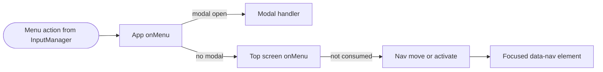
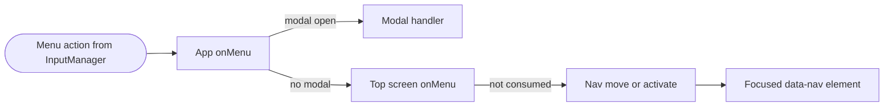

# UI / UI 구현 상세

---

## English

### 1. Overview

The UI layer is a framework-free DOM app shell in `src/client/ui/` that sits over the 3D canvas (`#ui` above `#view`). `App` in `src/client/ui/app.ts` owns a screen stack, routes keyboard, gamepad and touch menu actions to the top screen, and provides modals, toasts, a button-hint bar, music and backdrop cues, settings and an app-wide event bus. Screens build their DOM with small helpers and widgets, draw every image from code and show every player-facing string in Korean. The 3D view, audio and input it drives are described in [frontend.md](frontend.md).

- **App shell**: four layers (`.tp-screens`, `footer.hintbar`, `.tp-modals`, `.tp-notify`). Screens move with `push`, `replace`, `back`, `popTo`, `toMainMenu`, `toTitle` and `resetTo`; the leaving screen animates out for 260 ms and becomes `inert`, the entering one animates in for 420 ms, and a screen that left the stack is disposed 450 ms later (the main menu is reused, never disposed). On top, each screen declares its `music`, `backdrop`, `inputMode` (`single` or `duo`), `touchControls`, `immersive` flag and `hints`, and the shell applies them.
- **Boot**: the boot screen (`엔진 예열 중…`) waits for the web fonts (at least 650 ms, at most 3000 ms), shows the title backdrop and then the title screen; after an update reload it toasts the new version. `persistForReload()` stores the setup memory in sessionStorage `tpgp.v1.reload`, which is restored only when it is under 5 minutes old.
- **Shell services**: `updateSettings(patch)` saves and applies settings; `setViewOverride(patch)` applies to the view only and is never saved (the `?debug&quality=` hook uses it). `app.on('pwa' | 'net' | 'pending' | 'race', fn)` lets screens follow PWA status, connectivity (online/offline events plus a 2.5 s poll), queued runs and race state. `notify(text, tone, ms = 3200)` keeps at most three toasts. `modal`, `confirm` and `busy` cover dialogs and cancellable waits.
- **Menu routing**: an open modal gets the action first (back and pause close it only when it is dismissable). Otherwise the top screen's `onMenu` may consume it; if not, directions go to `Nav.handle`, confirm to `Nav.activate`, back to `onBack` or `app.back()`, and `tabPrev`/`tabNext` to `onTab`. The shell ignores pause; the race screen handles it.
- **Korean-first copy**: `index.html` and the web manifest declare `lang` `ko`, and all player-facing text is Korean. English appears only as decorative labels such as `GO!`, `FINISH!`, `FINAL LAP`, `NEW RECORD`, `LAP`, `BEST` and `km/h`. Server rejection codes are mapped to Korean messages in `CODE_MESSAGES` in `src/client/api.ts`, so a new server code needs a message there. Nicknames and other user text always go through `textContent`; `svg()` and `innerHTML` take only trusted static markup generated by `src/client/ui/art/`.
- **Input hold**: `InputHold` ignores `confirm`, `back` and `pause` for 500 ms on result screens and 1500 ms on the podium, because Space is both drift and confirm and a player still mashing would skip the screen; movement is never held. The title screen also ignores input for its first 250 ms.
- **Accessibility**: modals use `role="dialog"` and `aria-modal`; toasts use `role="status"` in an `aria-live="polite"` layer; widgets keep `aria-pressed`, `aria-checked`, `aria-valuenow`, `aria-selected` and `aria-disabled` in sync; decorative SVG, the HUD, the minimap and the track-card thumbnails are `aria-hidden`. `Nav` moves focus spatially between `[data-nav]` elements and skips hidden ones, those inside `inert`, and unrendered ones (no layout box). `animate()`, `countUp()`, screen transitions and `hud.css` honour `prefers-reduced-motion`. The last input kind is written to `document.documentElement.dataset.input` (`keyboard`, `gamepad`, `touch`, `mouse`) so CSS can swap button glyphs, and `vp-portrait`, `vp-short` (height under 500 px) and `vp-narrow` (width under 640 px) classes adapt the layout. During a race, `beforeunload` asks before the tab closes, and left Ctrl is deliberately unbound because Ctrl+W cannot be intercepted.
- **HUD**: `Hud` writes to the DOM only when a value changes and animates with the Web Animations API; `Minimap` draws the track outline once to an offscreen canvas and then only karts, projectiles and the ghost each frame. `hud.css` is sized in `em` relative to `.hud`, so the two halves of a duo race scale as a unit.
- **Art**: `src/client/ui/art/` generates the 24×24 `currentColor` icon set, trophies, item icons and character portraits as inline SVG, the logo as styled text, and track outlines (map projection screen x = −x, screen y = −z) as canvas drawings; there are no image files.
- **UI preview**: with `npm run dev` running, open `http://localhost:8200/ui-preview.html?mockapi&speed=4`. It runs the real app shell on `createMockGameView()` (a 2D canvas backdrop and a scripted fake race), `createMockAudio()` (UI sounds only) and, with `?mockapi`, `installMockApi()` (350 ms latency, an empty board for `starlight-road`, 24 entries elsewhere, every submission accepted). `?speed` scales fake race time (clamped to 0.25-20). There is no `PwaManager`, so the offline chip, install button and update banner stay hidden; `window.__preview` exposes `{ view, audio, input }`. The page is not part of the production build.

### 2. Components

| Component | Path | Purpose |
|---|---|---|
| App shell | `src/client/ui/app.ts` | `startApp`, `currentApp`, `App`: screen stack, transitions, menu routing, modals, toasts, hint bar, music and backdrop, settings, event bus, reload persistence, CSS and font imports |
| Screen contract | `src/client/ui/screen.ts` | `Screen` interface, `BaseScreen` (`own()` registers cleanups), `frame()` header (back button, kicker, title ribbon, steps), `DEFAULT_HINTS` |
| DOM helpers | `src/client/ui/dom.ts` | `h`, `append`, `svg`, `clear`, `setText`, `prefersReducedMotion`, `animate`, `wait`, `countUp` |
| Focus navigation | `src/client/ui/nav.ts` | Spatial focus across `[data-nav]`, `setAdjust` for widgets that consume left/right, `.is-focus`, mouse-hover focus |
| Widgets | `src/client/ui/widgets.ts` | `button`, `choice`, `toggle`, `slider`, `stepper`, `textRow`, `tabs`, `statBars`, `portrait`, `icon` with ARIA state |
| Mode flows | `src/client/ui/flows.ts` | Setup chains and sessions for Grand Prix, VS, duo and time trial; `challengeGhost`; `runDebugRace` |
| Screens | `src/client/ui/screens/` | One module per screen (table below) |
| HUD | `src/client/ui/hud.ts`, `src/client/ui/hud-minimap.ts` | `HudSnapshot` to DOM, minimap |
| Input hold | `src/client/ui/input-hold.ts` | Swallows confirm, back and pause for a set time after a screen appears |
| Pure helpers | `src/client/ui/format.ts`, `src/client/ui/gp.ts`, `src/client/ui/grid.ts`, `src/client/ui/memory.ts` | Time and name formatting, GP points and trophies, grids and seeds, setup-memory restore (DOM-free, unit tested) |
| Track thumbnails | `src/client/ui/thumb.ts` | Canvas track thumbnails with cached outlines and a seeded placeholder when a track cannot be built |
| PWA widgets | `src/client/ui/pwa-ui.ts`, `src/client/ui/pwa-state.ts` | Offline chip, install button and iOS guide, update banner, queued-run notice and batch submit |
| Art | `src/client/ui/art/` | `icons.ts`, `item-icons.ts`, `logo.ts`, `portraits.ts`, `track-draw.ts` |
| Styles | `src/client/styles.css`, `src/client/ui/ui.css`, `src/client/ui/screens-menu.css`, `src/client/ui/screens-extra.css`, `src/client/ui/hud.css`, `src/client/ui/pwa.css` | Global tokens (`--ink`, `--p1`, `--p2`, `--font-display` Black Han Sans, `--font-body` Jua), shell, menus and setup flows, race overlay and results, HUD, PWA widgets |
| UI preview | `src/client/ui-preview.html`, `src/client/ui-preview.ts`, `src/client/ui/mock-view.ts`, `src/client/ui/mock-audio.ts`, `src/client/ui/mock-api.ts` | Real shell on mock view, audio and API |

| File | Export | Shows |
|---|---|---|
| `boot.ts` | `createBootScreen` | Logo, progress bar, `엔진 예열 중…` |
| `title.ts` | `createTitleScreen`, `APP_VERSION` | `아무 키나 누르세요` (`화면을 터치하세요` on touch devices), offline chip, install, update banner, version |
| `main-menu.ts` | `createMainMenu` | Modes `그랑프리`, `VS 레이스`, `타임 어택`, `2인 대전`; `랭킹`, `설정`, `조작 안내`, `크레딧`; profile with trophies and unlocks |
| `class-select.ts` | `createClassScreen` | 50/100/150/200cc cards (200cc and mirror unlock through 150cc gold trophies), CPU level, mirror toggle |
| `char-select.ts` | `createCharSelect`, `createDuoCharSelect` | Character grid with stat bars and weight class; duo with separate P1/P2 cursors |
| `course-select.ts` | `createCupSelect`, `createTrackSelect` | Cup cards with earned trophies; track cards with thumbnails and, in time trial, personal bests |
| `options.ts` | `createVersusOptions`, `createTimeTrialOptions` | Items and CPU count; ghost choice (none, personal best, world record) |
| `race.ts` | `RaceScreen` | Loading card with tips, HUD loop, intro skip, pause menu, leave confirmation |
| `results.ts` | `createVersusResults`, `createGrandPrixResults`, `createPodium`, `createTimeTrialResults` | VS and duo results, GP standings, podium, time-trial record with nickname and submit or queue |
| `leaderboard.ts` | `createLeaderboardScreen` | Track tabs, class selector, own record, queued-run notice, ghost challenge |
| `settings.ts` | `createSettingsScreen` | Sound, display, controls, profile and app sections (also opened from the pause menu) |
| `controls.ts` | `createControlsScreen` | Keyboard 1P and 2P, gamepad and touch guides with racing tips (bindings written by hand) |
| `credits.ts` | `createCreditsScreen` | Credits and licences: three.js and Fastify (MIT), Black Han Sans and Jua (OFL 1.1) |

### 3. Key Decisions

- **No framework, no image files.** The shell is plain DOM with tiny helpers, and every icon, portrait, trophy, logo and track outline is generated by code in `src/client/ui/art/`; fonts are self-hosted through `@fontsource`. See [ADR-005](../decisions/ADR-005-procedural-original-content.md).
- **Updates are offered only between races.** `RaceScreen` registers itself as a race owner from `run()` until `leaveRace()` or `dispose()`, so the race stays active until the player leaves the results screen; the update banner is hidden while `app.raceActive` is true. See [ADR-006](../decisions/ADR-006-offline-first-pwa-race-safe-updates.md).
- **Offline time-trial runs are queued, not lost.** The results screen queues a run when it first appears offline or when a submission fails for lack of a connection (one per track and class), the main menu and leaderboard offer to submit queued runs later, and runs from another app version core are dropped at boot because the server would reject them. See [ADR-006](../decisions/ADR-006-offline-first-pwa-race-safe-updates.md) and [ADR-001](../decisions/ADR-001-deterministic-simulation-server-verification.md).
- **Only verified human driving becomes a record.** A run the debug autopilot helped drive shows the `자동 주행 기록` card and is neither saved as a personal best nor submitted; submitted runs are re-simulated by the server. See [ADR-001](../decisions/ADR-001-deterministic-simulation-server-verification.md).

### 4. Code Pointers

- `src/client/ui/app.ts`: screen stack, transitions, menu routing and the shell services.
- `src/client/ui/screen.ts`: the `Screen` contract and `BaseScreen` to extend for a new screen.
- `src/client/ui/nav.ts`: spatial focus rules.
- `src/client/ui/widgets.ts`: reusable controls and their ARIA attributes.
- `src/client/ui/screens/race.ts`: race ownership, HUD loop and pause menu.
- `src/client/ui/input-hold.ts`: the confirm/back/pause hold.
- `src/client/ui-preview.ts`: mock-backed preview entry.

### 5. Cross-references

- Related modules: [src/client/ui/CLAUDE.md](../../src/client/ui/CLAUDE.md), [src/client/ui/screens/CLAUDE.md](../../src/client/ui/screens/CLAUDE.md), [src/client/ui/art/CLAUDE.md](../../src/client/ui/art/CLAUDE.md), [src/client/input/CLAUDE.md](../../src/client/input/CLAUDE.md), [src/client/CLAUDE.md](../../src/client/CLAUDE.md)
- Related ADRs: [ADR-001](../decisions/ADR-001-deterministic-simulation-server-verification.md), [ADR-005](../decisions/ADR-005-procedural-original-content.md), [ADR-006](../decisions/ADR-006-offline-first-pwa-race-safe-updates.md)
- Related runbooks: [deploy-production](../runbooks/deploy-production.md), [incident-response](../runbooks/incident-response.md)
- Related docs: [frontend.md](frontend.md), [api.md](api.md), [architecture.md](../architecture.md), [design.md](../design.md) (game design, Korean)

---

## 한국어

### 1. 개요

UI 계층은 `src/client/ui/`에 있는 프레임워크 없는 DOM 앱 셸이며 3D 캔버스 위에 겹쳐 그립니다(`#view` 위의 `#ui`). `src/client/ui/app.ts`의 `App`이 화면 스택을 관리하고, 키보드·게임패드·터치 메뉴 액션을 최상단 화면으로 보내며, 모달, 토스트, 버튼 힌트 바, 음악과 배경 전환, 설정, 앱 전역 이벤트 버스를 제공합니다. 각 화면은 작은 헬퍼와 위젯으로 DOM을 만들고, 모든 그림을 코드로 그리며, 플레이어에게 보이는 문구는 전부 한국어로 보여 줍니다. UI가 제어하는 3D 뷰, 오디오, 입력은 [frontend.md](frontend.md)에서 설명합니다.

- **앱 셸**: 레이어는 `.tp-screens`, `footer.hintbar`, `.tp-modals`, `.tp-notify` 네 개입니다. 화면은 `push`, `replace`, `back`, `popTo`, `toMainMenu`, `toTitle`, `resetTo`로 이동합니다. 떠나는 화면은 260 ms 동안 애니메이션되며 `inert`가 되고, 들어오는 화면은 420 ms 동안 애니메이션되며, 스택에서 빠진 화면은 450 ms 뒤에 dispose합니다(메인 메뉴는 재사용하므로 dispose하지 않습니다). 최상단에 올라온 화면이 `music`, `backdrop`, `inputMode`(`single` 또는 `duo`), `touchControls`, `immersive`, `hints`를 선언하면 셸이 이를 적용합니다.
- **부팅**: boot 화면(`엔진 예열 중…`)이 웹 폰트를 기다린 뒤(최소 650 ms, 최대 3000 ms) 타이틀 배경을 띄우고 타이틀 화면으로 넘어갑니다. 업데이트 리로드 직후라면 새 버전을 토스트로 알립니다. `persistForReload()`는 설정 흐름 기억값을 sessionStorage `tpgp.v1.reload`에 저장하고, 저장한 지 5분이 안 된 값만 복원합니다.
- **셸 서비스**: `updateSettings(patch)`는 설정을 저장하고 적용합니다. `setViewOverride(patch)`는 뷰에만 적용하고 저장하지 않습니다(`?debug&quality=` 훅이 사용). 화면은 `app.on('pwa' | 'net' | 'pending' | 'race', fn)`으로 PWA 상태, 연결 상태(online/offline 이벤트와 2.5초 폴링), 대기 중인 기록, 레이스 상태를 구독합니다. `notify(text, tone, ms = 3200)`는 토스트를 최대 3개까지 유지합니다. 대화 상자와 취소 가능한 대기는 `modal`, `confirm`, `busy`가 맡습니다.
- **메뉴 라우팅**: 모달이 열려 있으면 모달이 액션을 먼저 받습니다(back과 pause는 닫을 수 있는 모달일 때만 닫습니다). 모달이 없으면 최상단 화면의 `onMenu`가 액션을 처리할 수 있고, 처리하지 않으면 방향은 `Nav.handle`, confirm은 `Nav.activate`, back은 `onBack` 또는 `app.back()`, `tabPrev`/`tabNext`는 `onTab`으로 갑니다. pause는 셸이 무시하고 레이스 화면이 처리합니다.
- **한국어 우선 문구**: `index.html`과 웹 manifest가 `lang`을 `ko`로 선언하고, 플레이어에게 보이는 텍스트는 모두 한국어입니다. 영어는 `GO!`, `FINISH!`, `FINAL LAP`, `NEW RECORD`, `LAP`, `BEST`, `km/h` 같은 장식 라벨에만 씁니다. 서버 거절 코드는 `src/client/api.ts`의 `CODE_MESSAGES`에서 한국어 메시지로 바뀌므로, 서버에 코드가 새로 생기면 여기에도 메시지를 넣어야 합니다. 닉네임 같은 사용자 입력은 반드시 `textContent`로 넣고, `svg()`와 `innerHTML`에는 `src/client/ui/art/`가 만든 신뢰할 수 있는 정적 마크업만 넣습니다.
- **입력 홀드**: `InputHold`는 결과 화면에서 500 ms, 포디움에서 1500 ms 동안 `confirm`, `back`, `pause`를 무시합니다. Space가 드리프트이면서 확인 키라서, 버튼을 계속 누르던 플레이어가 화면을 건너뛰지 않게 하려는 것입니다. 방향 이동은 막지 않습니다. 타이틀 화면도 처음 250 ms 동안 입력을 무시합니다.
- **접근성**: 모달은 `role="dialog"`와 `aria-modal`을, 토스트는 `aria-live="polite"` 레이어 안에서 `role="status"`를 씁니다. 위젯은 `aria-pressed`, `aria-checked`, `aria-valuenow`, `aria-selected`, `aria-disabled`를 상태와 맞춰 갱신하고, 장식용 SVG, HUD, 미니맵, 트랙 카드 썸네일은 `aria-hidden`입니다. `Nav`는 `[data-nav]` 요소 사이에서 공간 기준으로 포커스를 옮기며, 숨겨진 요소, `inert` 안의 요소, 렌더링되지 않은 요소(레이아웃 박스가 없는 요소)는 건너뜁니다. `animate()`, `countUp()`, 화면 전환, `hud.css`는 `prefers-reduced-motion`을 따릅니다. 마지막 입력 종류는 `document.documentElement.dataset.input`(`keyboard`, `gamepad`, `touch`, `mouse`)에 기록되어 CSS가 버튼 표시를 바꿀 수 있고, `vp-portrait`, `vp-short`(높이 500 px 미만), `vp-narrow`(너비 640 px 미만) 클래스로 레이아웃을 조정합니다. 레이스 중에는 `beforeunload`로 탭을 닫기 전에 확인을 받고, Ctrl+W는 페이지가 막을 수 없으므로 왼쪽 Ctrl은 일부러 바인딩하지 않습니다.
- **HUD**: `Hud`는 값이 바뀔 때만 DOM에 쓰고 Web Animations API로 애니메이션합니다. `Minimap`은 트랙 외곽선을 오프스크린 캔버스에 한 번만 그리고, 매 프레임에는 카트, 투사체, 고스트만 그립니다. `hud.css`는 `.hud` 기준 `em` 단위라서 2인 대전의 두 화면이 한 덩어리로 함께 크기가 바뀝니다.
- **아트**: `src/client/ui/art/`가 24×24 `currentColor` 아이콘 세트, 트로피, 아이템 아이콘, 캐릭터 초상화는 인라인 SVG로, 로고는 스타일을 입힌 텍스트로, 트랙 외곽선(지도 투영은 화면 x = −x, 화면 y = −z)은 캔버스 그림으로 만듭니다. 이미지 파일은 없습니다.
- **UI 미리보기**: `npm run dev`를 띄운 상태에서 `http://localhost:8200/ui-preview.html?mockapi&speed=4`를 엽니다. 실제 앱 셸이 `createMockGameView()`(2D 캔버스 배경과 스크립트로 움직이는 가짜 레이스), `createMockAudio()`(UI 효과음만), 그리고 `?mockapi`가 있으면 `installMockApi()`(응답 지연 350 ms, `starlight-road`는 빈 순위표, 나머지는 24개 항목, 제출은 항상 수락) 위에서 돕니다. `?speed`는 가짜 레이스 시간 배율이며 0.25~20으로 제한됩니다. `PwaManager`가 없으므로 오프라인 칩, 설치 버튼, 업데이트 배너는 숨겨지고, `window.__preview`로 `{ view, audio, input }`에 접근할 수 있습니다. 이 페이지는 프로덕션 빌드에 들어가지 않습니다.

### 2. 구성요소

| 구성요소 | 경로 | 목적 |
|---|---|---|
| 앱 셸 | `src/client/ui/app.ts` | `startApp`, `currentApp`, `App`: 화면 스택, 전환, 메뉴 라우팅, 모달, 토스트, 힌트 바, 음악과 배경, 설정, 이벤트 버스, 리로드 상태 보존, CSS와 폰트 import |
| 화면 계약 | `src/client/ui/screen.ts` | `Screen` 인터페이스, `BaseScreen`(`own()`으로 정리 작업 등록), `frame()` 헤더(뒤로 버튼, kicker, 제목 리본, 단계 표시), `DEFAULT_HINTS` |
| DOM 헬퍼 | `src/client/ui/dom.ts` | `h`, `append`, `svg`, `clear`, `setText`, `prefersReducedMotion`, `animate`, `wait`, `countUp` |
| 포커스 이동 | `src/client/ui/nav.ts` | `[data-nav]` 사이의 공간 포커스 이동, 좌우 입력을 쓰는 위젯용 `setAdjust`, `.is-focus`, 마우스 hover 포커스 |
| 위젯 | `src/client/ui/widgets.ts` | ARIA 상태를 갖춘 `button`, `choice`, `toggle`, `slider`, `stepper`, `textRow`, `tabs`, `statBars`, `portrait`, `icon` |
| 모드 흐름 | `src/client/ui/flows.ts` | 그랑프리, VS, 2인 대전, 타임 어택의 설정 화면 체인과 세션, `challengeGhost`, `runDebugRace` |
| 화면 | `src/client/ui/screens/` | 화면마다 모듈 하나(아래 표 참고) |
| HUD | `src/client/ui/hud.ts`, `src/client/ui/hud-minimap.ts` | `HudSnapshot`을 DOM에 반영, 미니맵 |
| 입력 홀드 | `src/client/ui/input-hold.ts` | 화면이 나타난 뒤 일정 시간 confirm, back, pause를 무시 |
| 순수 헬퍼 | `src/client/ui/format.ts`, `src/client/ui/gp.ts`, `src/client/ui/grid.ts`, `src/client/ui/memory.ts` | 시간과 이름 포맷, GP 포인트와 트로피, 그리드와 seed, 설정 기억값 복원(DOM 없음, 단위 테스트 대상) |
| 트랙 썸네일 | `src/client/ui/thumb.ts` | 외곽선을 캐시하는 캔버스 트랙 썸네일, 트랙을 만들 수 없을 때는 seed 기반 대체 그림 |
| PWA 위젯 | `src/client/ui/pwa-ui.ts`, `src/client/ui/pwa-state.ts` | 오프라인 칩, 설치 버튼과 iOS 안내, 업데이트 배너, 대기 기록 알림과 일괄 제출 |
| 아트 | `src/client/ui/art/` | `icons.ts`, `item-icons.ts`, `logo.ts`, `portraits.ts`, `track-draw.ts` |
| 스타일 | `src/client/styles.css`, `src/client/ui/ui.css`, `src/client/ui/screens-menu.css`, `src/client/ui/screens-extra.css`, `src/client/ui/hud.css`, `src/client/ui/pwa.css` | 전역 토큰(`--ink`, `--p1`, `--p2`, `--font-display` Black Han Sans, `--font-body` Jua), 셸, 메뉴와 설정 흐름, 레이스 오버레이와 결과, HUD, PWA 위젯 |
| UI 미리보기 | `src/client/ui-preview.html`, `src/client/ui-preview.ts`, `src/client/ui/mock-view.ts`, `src/client/ui/mock-audio.ts`, `src/client/ui/mock-api.ts` | 목 뷰, 목 오디오, 목 API 위에서 실제 셸 실행 |

| 파일 | Export | 보여 주는 내용 |
|---|---|---|
| `boot.ts` | `createBootScreen` | 로고, 진행 바, `엔진 예열 중…` |
| `title.ts` | `createTitleScreen`, `APP_VERSION` | `아무 키나 누르세요`(터치 기기는 `화면을 터치하세요`), 오프라인 칩, 설치, 업데이트 배너, 버전 |
| `main-menu.ts` | `createMainMenu` | 모드 `그랑프리`, `VS 레이스`, `타임 어택`, `2인 대전`과 `랭킹`, `설정`, `조작 안내`, `크레딧`, 트로피와 해금 정보가 담긴 프로필 |
| `class-select.ts` | `createClassScreen` | 50/100/150/200cc 카드(200cc와 미러는 150cc 금 트로피로 해금), CPU 난이도, 미러 토글 |
| `char-select.ts` | `createCharSelect`, `createDuoCharSelect` | 능력치 바와 체급이 있는 캐릭터 그리드, 2인 대전은 P1/P2 커서를 따로 둠 |
| `course-select.ts` | `createCupSelect`, `createTrackSelect` | 획득한 트로피가 표시된 컵 카드, 썸네일이 있는 트랙 카드(타임 어택은 개인 기록 표시) |
| `options.ts` | `createVersusOptions`, `createTimeTrialOptions` | 아이템과 CPU 수, 고스트 선택(없음, 개인 기록, 세계 1위) |
| `race.ts` | `RaceScreen` | 팁이 있는 로딩 카드, HUD 루프, 인트로 건너뛰기, 일시정지 메뉴, 나가기 확인 |
| `results.ts` | `createVersusResults`, `createGrandPrixResults`, `createPodium`, `createTimeTrialResults` | VS와 2인 대전 결과, GP 종합 순위, 포디움, 닉네임 입력과 제출 또는 대기열 보관이 있는 타임 어택 기록 |
| `leaderboard.ts` | `createLeaderboardScreen` | 트랙 탭, 클래스 선택, 내 기록, 대기 기록 알림, 고스트 대결 |
| `settings.ts` | `createSettingsScreen` | 사운드, 화면, 조작, 프로필, 앱 섹션(일시정지 메뉴에서도 열림) |
| `controls.ts` | `createControlsScreen` | 키보드 1인·2인, 게임패드, 터치 안내와 레이싱 팁(바인딩 표기는 손으로 작성) |
| `credits.ts` | `createCreditsScreen` | 크레딧과 라이선스: three.js와 Fastify(MIT), Black Han Sans와 Jua(OFL 1.1) |

### 3. 주요 결정

- **프레임워크도 이미지 파일도 쓰지 않습니다.** 셸은 작은 헬퍼를 얹은 순수 DOM이고, 아이콘, 초상화, 트로피, 로고, 트랙 외곽선은 모두 `src/client/ui/art/`의 코드가 만듭니다. 폰트는 `@fontsource`로 직접 호스팅합니다. [ADR-005](../decisions/ADR-005-procedural-original-content.md)를 참고합니다.
- **업데이트는 레이스 사이에만 제안합니다.** `RaceScreen`은 `run()`부터 `leaveRace()` 또는 `dispose()`까지 레이스 owner로 등록되므로, 플레이어가 결과 화면을 떠날 때까지 레이스가 진행 중인 것으로 취급됩니다. `app.raceActive`가 true인 동안 업데이트 배너는 숨겨집니다. [ADR-006](../decisions/ADR-006-offline-first-pwa-race-safe-updates.md)을 참고합니다.
- **오프라인 타임 어택 기록은 버리지 않고 대기열에 둡니다.** 결과 화면이 오프라인 상태로 처음 나타나거나 연결 문제로 제출에 실패하면 기록을 대기열에 넣고(트랙과 클래스 조합마다 1건), 메인 메뉴와 랭킹 화면이 나중에 제출을 제안합니다. 앱 버전의 core가 다른 기록은 서버가 거절할 것이므로 부팅할 때 지웁니다. [ADR-006](../decisions/ADR-006-offline-first-pwa-race-safe-updates.md)과 [ADR-001](../decisions/ADR-001-deterministic-simulation-server-verification.md)을 참고합니다.
- **사람이 직접 달린, 검증 가능한 주행만 기록이 됩니다.** 디버그 자동 주행이 도운 기록은 `자동 주행 기록` 카드로 표시되며 개인 기록으로 저장되지도, 제출되지도 않습니다. 제출된 기록은 서버가 다시 시뮬레이션합니다. [ADR-001](../decisions/ADR-001-deterministic-simulation-server-verification.md)을 참고합니다.

### 4. 코드 포인터

- `src/client/ui/app.ts`: 화면 스택, 전환, 메뉴 라우팅, 셸 서비스.
- `src/client/ui/screen.ts`: 새 화면을 만들 때 상속하는 `Screen` 계약과 `BaseScreen`.
- `src/client/ui/nav.ts`: 공간 포커스 규칙.
- `src/client/ui/widgets.ts`: 재사용 컨트롤과 ARIA 속성.
- `src/client/ui/screens/race.ts`: 레이스 owner 등록, HUD 루프, 일시정지 메뉴.
- `src/client/ui/input-hold.ts`: confirm/back/pause 홀드.
- `src/client/ui-preview.ts`: 목 객체를 쓰는 미리보기 진입점.

### 5. 상호 참조

- 관련 모듈: [src/client/ui/CLAUDE.md](../../src/client/ui/CLAUDE.md), [src/client/ui/screens/CLAUDE.md](../../src/client/ui/screens/CLAUDE.md), [src/client/ui/art/CLAUDE.md](../../src/client/ui/art/CLAUDE.md), [src/client/input/CLAUDE.md](../../src/client/input/CLAUDE.md), [src/client/CLAUDE.md](../../src/client/CLAUDE.md)
- 관련 ADR: [ADR-001](../decisions/ADR-001-deterministic-simulation-server-verification.md), [ADR-005](../decisions/ADR-005-procedural-original-content.md), [ADR-006](../decisions/ADR-006-offline-first-pwa-race-safe-updates.md)
- 관련 런북: [deploy-production](../runbooks/deploy-production.md), [incident-response](../runbooks/incident-response.md)
- 관련 문서: [frontend.md](frontend.md), [api.md](api.md), [architecture.md](../architecture.md), [design.md](../design.md)(한국어 게임 디자인 문서)
