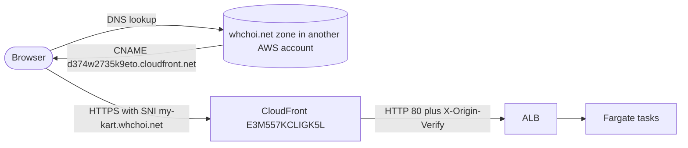

# Runbook: Custom Domain

<a href="#english"></a>
<a href="#korean"></a>

---

<a id="english"></a>

# English

## Overview

Players use `https://my-kart.whchoi.net/`. It is an alternate domain name of the CloudFront distribution `E3M557KCLIGK5L`, whose native hostname `https://d374w2735k9eto.cloudfront.net/` keeps working. The stack attaches the name and the certificate; it creates no DNS record and no certificate.

| Piece | Where | Value |
| --- | --- | --- |
| CDK context `domainName` | `cdk.json` | `my-kart.whchoi.net` |
| CDK context `certificateArn` | `cdk.json` | `arn:aws:acm:us-east-1:061525506239:certificate/7d53182a-2a2a-4225-a319-4f94030561b7` |
| Only authorised domain | `infra/lib/settings.ts` `CUSTOM_DOMAIN` | `my-kart.whchoi.net` |
| Guards (synth fails otherwise) | `infra/lib/stack.ts` | both values or neither; domain equals `CUSTOM_DOMAIN`; ARN starts with `arn:aws:acm:us-east-1:061525506239:certificate/` |
| Viewer TLS | `infra/lib/edge.ts` | alias, imported ACM certificate, `TLSv1.2_2021`, SNI (`sni-only`) |
| API origin allow-list | `infra/lib/stack.ts` (container env) | `PUBLIC_ORIGIN=https://my-kart.whchoi.net`, `ALLOWED_ORIGINS=https://d374w2735k9eto.cloudfront.net` |
| Public DNS | `whchoi.net` zone in another AWS account | `my-kart.whchoi.net CNAME d374w2735k9eto.cloudfront.net` |

- `infra/bin/app.ts` reads `domainName` and `certificateArn` from the CDK context; an empty value counts as unset. The stack imports the certificate with `acm.Certificate.fromCertificateArn` and never creates or deletes it.
- `VIEWER_CERTIFICATE_ARN` in `infra/lib/settings.ts` holds the same ARN, but no code reads it: the deployed value comes from `cdk.json`. Keep the two in sync when the certificate changes.
- `ALLOWED_ORIGINS` is the distribution's own domain name (a CloudFormation reference), so POST `/api/runs` works from both hostnames. Without a custom domain, `PUBLIC_ORIGIN` is the native hostname and `ALLOWED_ORIGINS` is not set.
- The certificate covers `*.whchoi.net` only: one label under `whchoi.net` (for example `kart.whchoi.net`), not `whchoi.net` itself and not `a.b.whchoi.net`. A read-only check on 2026-10-18 showed `ISSUED`, DNS validation, expiry `2027-02-24T23:59:59Z`, renewal eligibility `ELIGIBLE`.
- The authoritative `whchoi.net` zone lives in another AWS account (public name servers `ns-18.awsdns-02.com`, `ns-654.awsdns-17.net`, `ns-1237.awsdns-26.org`, `ns-1864.awsdns-41.co.uk`). Account `061525506239` also has a public hosted zone `whchoi.net.` (`Z08705193VYKYT9SGOSSX`), but it is not delegated: records there have no effect.



## When to Use

- Confirm that the custom domain is attached and healthy (after a deploy, or when players report that the site does not open).
- The distribution was replaced and has a new `*.cloudfront.net` hostname: the CNAME must follow.
- Change or remove the custom domain.
- Check that the certificate can renew before its renewal window.

## Prerequisites

- Read access to account `061525506239` (CloudFront, ECS, CloudFormation, and ACM in `us-east-1`); for changes, the full deploy prerequisites in [deploy-production.md](./deploy-production.md).
- For any DNS change: access to the AWS account that hosts the authoritative `whchoi.net` zone, or its owner. This account cannot change public DNS for `whchoi.net`.
- `dig`, `curl`, `jq`. Run commands from the project root; `cdk-outputs.json` is written by the deploy and is git-ignored.

## Procedure

### 1. Check the attachment

```bash
DIST_ID=$(jq -r .TurboPalsStack.DistributionId cdk-outputs.json)
aws cloudfront get-distribution --id "$DIST_ID" \
  --query 'Distribution.{status:Status,domain:DomainName,aliases:DistributionConfig.Aliases.Items,cert:DistributionConfig.ViewerCertificate.ACMCertificateArn,tls:DistributionConfig.ViewerCertificate.MinimumProtocolVersion,sni:DistributionConfig.ViewerCertificate.SSLSupportMethod}'
CLUSTER=$(jq -r .TurboPalsStack.ClusterName cdk-outputs.json)
SERVICE=$(jq -r .TurboPalsStack.ServiceName cdk-outputs.json)
TD=$(aws ecs describe-services --cluster "$CLUSTER" --services "$SERVICE" --region ap-northeast-2 --query 'services[0].taskDefinition' --output text)
aws ecs describe-task-definition --task-definition "$TD" --region ap-northeast-2 \
  --query "taskDefinition.containerDefinitions[0].environment[?name=='PUBLIC_ORIGIN' || name=='ALLOWED_ORIGINS']"
```

Expected: `aliases` is `["my-kart.whchoi.net"]`, `tls` is `TLSv1.2_2021`, `sni` is `sni-only`, `domain` is `d374w2735k9eto.cloudfront.net`, and the task environment has `PUBLIC_ORIGIN` `https://my-kart.whchoi.net` and `ALLOWED_ORIGINS` `https://d374w2735k9eto.cloudfront.net`.

### 2. Check DNS, then bypass it

```bash
dig +short my-kart.whchoi.net @8.8.8.8
dig +short NS whchoi.net @8.8.8.8
aws route53 get-hosted-zone --id Z08705193VYKYT9SGOSSX --query 'DelegationSet.NameServers'
NATIVE_HOST=$(aws cloudfront get-distribution --id "$DIST_ID" --query 'Distribution.DomainName' --output text)
EDGE_IP=$(dig +short A "$NATIVE_HOST" | grep -E '^[0-9.]+$' | head -n 1)
curl -sI --resolve "my-kart.whchoi.net:443:$EDGE_IP" https://my-kart.whchoi.net/
curl -sv --resolve "my-kart.whchoi.net:443:$EDGE_IP" -o /dev/null https://my-kart.whchoi.net/ 2>&1 | grep -E 'subject:|SSL certificate verify'
```

- The first command must print `d374w2735k9eto.cloudfront.net.` followed by edge IP addresses.
- The second prints the four `ns-18`/`ns-654`/`ns-1237`/`ns-1864` name servers of the other account. The third prints this account's zone name servers (`ns-286`, `ns-787`, `ns-1118`, `ns-1636` on 2026-10-18); because they differ, this account's zone is not authoritative.
- The two `--resolve` requests pin the name to one CloudFront edge IP of the distribution (`DIST_ID` from step 1) and skip DNS entirely. `HTTP/2 200` and `subject: CN=*.whchoi.net` prove that the alias and the certificate are in place, even while DNS is wrong: curl fails the request when the certificate does not verify. Some curl versions also print `SSL certificate verify ok`; curl 8.17 does not.

### 3. Run the live checks through the custom domain

```bash
npm run verify:live -- --custom --out docs/quality/live-verify-custom.json
```

`--custom` sends the HTTP and E2E checks to `SiteUrl` instead of `NativeSiteUrl`. The check "Custom domain my-kart.whchoi.net is served by CloudFront with a valid certificate (DNS-independent)" uses `dig` and `curl --resolve` like step 2. The public DNS lookup (`dig @8.8.8.8`) only prints an advisory console line and is not counted as a check. The E2E part writes four QA rows to the production table and deletes them; add `--no-e2e` to skip it. Then run the browser check (needs Playwright Chromium, see `bash scripts/setup.sh --with-browsers`):

```bash
node tools/verify-live-pwa.mjs https://my-kart.whchoi.net
```

### 4. Change the domain

1. Make sure a certificate covers the new name. `*.whchoi.net` covers one label under `whchoi.net`. For any other name, request a certificate in `us-east-1` in account `061525506239` (the stack guard rejects other regions and accounts), add its DNS validation record to the authoritative zone, and wait for `ISSUED`:

    ```bash
    NEW_DOMAIN=kart.whchoi.net
    aws acm request-certificate --domain-name "$NEW_DOMAIN" --validation-method DNS --region us-east-1
    ```

2. Set the new name in `infra/lib/settings.ts` (`CUSTOM_DOMAIN`) and `cdk.json` (`domainName`). If the certificate changes, update `certificateArn` in `cdk.json` and `VIEWER_CERTIFICATE_ARN` in `infra/lib/settings.ts`.
3. Update the tests that hard-code `my-kart.whchoi.net` in `test/infra/stack.test.ts` ("serves the custom domain with the us-east-1 certificate and TLS 1.2_2021", "rejects unauthorised domains and half-configured certificates"), then run `npx vitest run test/infra`.
4. Review `npx cdk diff TurboPalsStack` (expect the distribution aliases and the task definition `PUBLIC_ORIGIN` to change) and deploy through [deploy-production.md](./deploy-production.md). The new task definition revision rolls out like any deploy.
5. After the deploy has finished, create `<new name> CNAME d374w2735k9eto.cloudfront.net` in the authoritative zone, then delete the old CNAME. A CNAME that points at the distribution before the alias exists gets a CloudFront 403. The old hostname stops working when the deploy completes, because the stack configures exactly one alias.
6. Repeat steps 1 to 3 with the new name (`node tools/verify-live-pwa.mjs` defaults to `https://my-kart.whchoi.net`, so pass the new URL). Update the documents that mention the URL.

### 5. Remove the domain

1. Delete both context keys from `cdk.json` and check the diff. Passing only `-c domainName=` fails synth with "domainName and certificateArn must be configured together." because `certificateArn` still comes from `cdk.json` (the comment in `infra/bin/app.ts` suggests otherwise). For a one-off deploy without editing the file, pass both: `-c domainName= -c certificateArn=`.

    ```bash
    node -e "const fs=require('fs');const c=JSON.parse(fs.readFileSync('cdk.json','utf8'));delete c.context.domainName;delete c.context.certificateArn;fs.writeFileSync('cdk.json',JSON.stringify(c,null,2)+'\n')"
    npx cdk diff TurboPalsStack
    ```

    Expect the distribution to lose its alias and viewer certificate (it falls back to the CloudFront default certificate), `PUBLIC_ORIGIN` to become `https://d374w2735k9eto.cloudfront.net`, `ALLOWED_ORIGINS` to disappear, and the `SiteUrl` output to equal `NativeSiteUrl`.
2. Deploy through [deploy-production.md](./deploy-production.md).
3. Ask the owner of the other account to delete the `my-kart.whchoi.net` CNAME.
4. The ACM certificate stays in `us-east-1`; delete it separately only if nothing else uses it. The unit tests need no change (they pass `domainName` and `certificateArn` to the stack as props, never from the `cdk.json` context), and later live checks run without `--custom`.

### 6. Check that the certificate can renew

```bash
CERT_ARN=$(node -p "require('./cdk.json').context.certificateArn")
aws acm describe-certificate --certificate-arn "$CERT_ARN" --region us-east-1 \
  --query 'Certificate.{status:Status,notAfter:NotAfter,renewal:RenewalEligibility,inUseBy:InUseBy,record:DomainValidationOptions[0].ResourceRecord}'
VALIDATION_NAME=$(aws acm describe-certificate --certificate-arn "$CERT_ARN" --region us-east-1 \
  --query 'Certificate.DomainValidationOptions[0].ResourceRecord.Name' --output text)
dig +short CNAME "$VALIDATION_NAME" @8.8.8.8
```

ACM renews a DNS-validated certificate automatically only while its validation CNAME resolves in public DNS, so the record must stay in the other account's authoritative zone; a copy in this account's undelegated zone does not count. The `dig` output must equal `record.Value` from the first command. If it prints nothing, add the record (`record.Name` CNAME `record.Value`) to the authoritative zone. ACM checks the renewal criteria (the certificate is in use by an AWS service and every validation CNAME resolves publicly) 45 days before expiry for a 198-day certificate such as this one (valid from 2026-08-11 to 2027-02-24; certificates with the older 395-day validity renew 60 days before expiry), so check again before `2027-01-10`. A renewed certificate keeps its ARN, and CloudFront picks it up without a deploy.

## Verification

- [ ] Step 1 shows the alias, `TLSv1.2_2021`, `sni-only` and both origins in the task environment.
- [ ] Step 2: public DNS returns the CNAME, and the `--resolve` request returns `HTTP/2 200` with `subject: CN=*.whchoi.net`.
- [ ] Step 3: `verify:live -- --custom` passes every check (the last recorded run, `docs/quality/live-verify.json` of 2026-09-24, passed 35/35) and `tools/verify-live-pwa.mjs` passes 8/8.
- [ ] Step 6: the certificate is `ISSUED` and its validation CNAME resolves publicly.

## Rollback

- A failed deploy rolls back automatically through CloudFormation.
- To undo a domain change or removal, revert the commit that changed `cdk.json` and `infra/lib/settings.ts`, deploy it (see [rollback-production.md](./rollback-production.md)), then restore the previous CNAME in the other account.
- DNS mistakes are fixed in the other account only. Players may keep a cached negative answer for a while; see the "site unreachable" procedure in [incident-response.md](./incident-response.md).

## Notes

- If a change ever replaces the CloudFront distribution, it gets a new `*.cloudfront.net` hostname: update the CNAME in the other account. `ALLOWED_ORIGINS` and the `NativeSiteUrl` output follow automatically.
- Browser data is per origin: settings, personal bests, trophies, offline time-trial records and the installed app on `my-kart.whchoi.net` are not visible on the native hostname or on a new domain.
- Code pointers: `infra/bin/app.ts`, `infra/lib/settings.ts`, `infra/lib/stack.ts`, `infra/lib/edge.ts`, `tools/verify-live.ts` (`customDomain()`), `test/infra/stack.test.ts` ("stack contract").
- [docs/infra.md](../infra.md) section 9 still describes the default `*.cloudfront.net` hostname; this runbook and the code are current.
- Last verified: 2026-10-18 (checked against the code and `cdk.json`; DNS, name servers and certificate state from read-only lookups on 2026-10-18).

---

<a id="korean"></a>

# 한국어

## 개요

플레이어는 `https://my-kart.whchoi.net/`으로 접속합니다. 이 이름은 CloudFront 배포 `E3M557KCLIGK5L`의 대체 도메인 이름이며, 배포의 기본 호스트 이름 `https://d374w2735k9eto.cloudfront.net/`도 계속 동작합니다. 스택은 도메인 이름과 인증서를 배포에 연결할 뿐이고, DNS 레코드나 인증서를 만들지는 않습니다.

| 구성 요소 | 위치 | 값 |
| --- | --- | --- |
| CDK context `domainName` | `cdk.json` | `my-kart.whchoi.net` |
| CDK context `certificateArn` | `cdk.json` | `arn:aws:acm:us-east-1:061525506239:certificate/7d53182a-2a2a-4225-a319-4f94030561b7` |
| 허용된 유일한 도메인 | `infra/lib/settings.ts` `CUSTOM_DOMAIN` | `my-kart.whchoi.net` |
| 가드(어기면 synth 실패) | `infra/lib/stack.ts` | 두 값을 함께 쓰거나 둘 다 비움, 도메인은 `CUSTOM_DOMAIN`과 같아야 함, ARN은 `arn:aws:acm:us-east-1:061525506239:certificate/`로 시작 |
| 뷰어 TLS | `infra/lib/edge.ts` | 대체 도메인, 가져온 ACM 인증서, `TLSv1.2_2021`, SNI(`sni-only`) |
| API origin 허용 목록 | `infra/lib/stack.ts`(컨테이너 환경 변수) | `PUBLIC_ORIGIN=https://my-kart.whchoi.net`, `ALLOWED_ORIGINS=https://d374w2735k9eto.cloudfront.net` |
| 공개 DNS | 다른 AWS 계정의 `whchoi.net` 존 | `my-kart.whchoi.net CNAME d374w2735k9eto.cloudfront.net` |

- `infra/bin/app.ts`는 CDK context에서 `domainName`과 `certificateArn`을 읽으며, 빈 값은 설정하지 않은 것으로 봅니다. 스택은 `acm.Certificate.fromCertificateArn`으로 인증서를 가져오기만 하고, 만들거나 지우지 않습니다.
- `infra/lib/settings.ts`의 `VIEWER_CERTIFICATE_ARN`에도 같은 ARN이 있지만 이 값을 읽는 코드는 없습니다. 실제 배포 값은 `cdk.json`에서 옵니다. 인증서를 바꿀 때는 두 곳을 함께 맞춥니다.
- `ALLOWED_ORIGINS`는 배포 자신의 도메인 이름(CloudFormation 참조)이라서 두 호스트 이름 모두에서 POST `/api/runs`가 동작합니다. 커스텀 도메인이 없으면 `PUBLIC_ORIGIN`은 기본 호스트 이름이 되고 `ALLOWED_ORIGINS`는 설정되지 않습니다.
- 인증서는 `*.whchoi.net`만 포함합니다. `whchoi.net` 바로 아래 한 단계 이름(예: `kart.whchoi.net`)만 해당하며, `whchoi.net` 자체나 `a.b.whchoi.net`은 포함하지 않습니다. 2026-10-18 읽기 전용 조회 결과는 `ISSUED`, DNS 검증, 만료 `2027-02-24T23:59:59Z`, 갱신 자격 `ELIGIBLE`이었습니다.
- 권한 있는 `whchoi.net` 존은 다른 AWS 계정에 있습니다(공개 네임서버 `ns-18.awsdns-02.com`, `ns-654.awsdns-17.net`, `ns-1237.awsdns-26.org`, `ns-1864.awsdns-41.co.uk`). 계정 `061525506239`에도 공개 호스팅 존 `whchoi.net.`(`Z08705193VYKYT9SGOSSX`)이 있지만 위임되지 않은 존이라 여기에 넣은 레코드는 아무 효과가 없습니다.


## 사용 시점

- 커스텀 도메인이 제대로 연결되어 있는지 확인할 때(배포 후, 또는 사이트가 열리지 않는다는 제보가 있을 때).
- 배포(distribution)가 교체되어 `*.cloudfront.net` 호스트 이름이 바뀌었을 때. CNAME도 따라 바꿔야 합니다.
- 커스텀 도메인을 바꾸거나 없앨 때.
- 인증서 갱신 기간이 오기 전에 갱신이 가능한 상태인지 확인할 때.

## 사전 요구 사항

- 계정 `061525506239`의 읽기 권한(CloudFront, ECS, CloudFormation, `us-east-1`의 ACM). 변경 작업에는 [deploy-production.md](./deploy-production.md)의 배포 사전 요구 사항 전체가 필요합니다.
- DNS를 바꾸려면 권한 있는 `whchoi.net` 존이 있는 AWS 계정에 대한 접근 권한이나 그 계정 소유자의 협조가 필요합니다. 이 계정에서는 `whchoi.net`의 공개 DNS를 바꿀 수 없습니다.
- `dig`, `curl`, `jq`. 명령은 프로젝트 루트에서 실행합니다. `cdk-outputs.json`은 배포가 만드는 파일이며 git이 무시합니다.

## 절차

### 1. 연결 상태 확인

```bash
DIST_ID=$(jq -r .TurboPalsStack.DistributionId cdk-outputs.json)
aws cloudfront get-distribution --id "$DIST_ID" \
  --query 'Distribution.{status:Status,domain:DomainName,aliases:DistributionConfig.Aliases.Items,cert:DistributionConfig.ViewerCertificate.ACMCertificateArn,tls:DistributionConfig.ViewerCertificate.MinimumProtocolVersion,sni:DistributionConfig.ViewerCertificate.SSLSupportMethod}'
CLUSTER=$(jq -r .TurboPalsStack.ClusterName cdk-outputs.json)
SERVICE=$(jq -r .TurboPalsStack.ServiceName cdk-outputs.json)
TD=$(aws ecs describe-services --cluster "$CLUSTER" --services "$SERVICE" --region ap-northeast-2 --query 'services[0].taskDefinition' --output text)
aws ecs describe-task-definition --task-definition "$TD" --region ap-northeast-2 \
  --query "taskDefinition.containerDefinitions[0].environment[?name=='PUBLIC_ORIGIN' || name=='ALLOWED_ORIGINS']"
```

기대값: `aliases`는 `["my-kart.whchoi.net"]`, `tls`는 `TLSv1.2_2021`, `sni`는 `sni-only`, `domain`은 `d374w2735k9eto.cloudfront.net`이고, 태스크 환경 변수에는 `PUBLIC_ORIGIN` `https://my-kart.whchoi.net`과 `ALLOWED_ORIGINS` `https://d374w2735k9eto.cloudfront.net`이 있어야 합니다.

### 2. DNS 확인 후 DNS를 우회한 확인

```bash
dig +short my-kart.whchoi.net @8.8.8.8
dig +short NS whchoi.net @8.8.8.8
aws route53 get-hosted-zone --id Z08705193VYKYT9SGOSSX --query 'DelegationSet.NameServers'
NATIVE_HOST=$(aws cloudfront get-distribution --id "$DIST_ID" --query 'Distribution.DomainName' --output text)
EDGE_IP=$(dig +short A "$NATIVE_HOST" | grep -E '^[0-9.]+$' | head -n 1)
curl -sI --resolve "my-kart.whchoi.net:443:$EDGE_IP" https://my-kart.whchoi.net/
curl -sv --resolve "my-kart.whchoi.net:443:$EDGE_IP" -o /dev/null https://my-kart.whchoi.net/ 2>&1 | grep -E 'subject:|SSL certificate verify'
```

- 첫 번째 명령은 `d374w2735k9eto.cloudfront.net.`과 그 뒤에 엣지 IP 주소들을 출력해야 합니다.
- 두 번째 명령은 다른 계정의 네임서버 `ns-18`/`ns-654`/`ns-1237`/`ns-1864` 네 개를 출력합니다. 세 번째 명령은 이 계정 존의 네임서버(2026-10-18 기준 `ns-286`, `ns-787`, `ns-1118`, `ns-1636`)를 출력합니다. 둘이 다르므로 이 계정의 존은 권한 있는 존이 아닙니다.
- 두 `--resolve` 요청은 이름을 배포(1단계의 `DIST_ID`)의 CloudFront 엣지 IP 하나에 고정해 DNS를 아예 거치지 않습니다. `HTTP/2 200`과 `subject: CN=*.whchoi.net`이 나오면 DNS가 잘못되어 있더라도 대체 도메인과 인증서는 제대로 붙어 있는 것입니다. 인증서 검증에 실패하면 curl이 요청 자체를 실패시키기 때문입니다. curl 버전에 따라 `SSL certificate verify ok`도 출력되지만 curl 8.17은 출력하지 않습니다.

### 3. 커스텀 도메인으로 라이브 검사 실행

```bash
npm run verify:live -- --custom --out docs/quality/live-verify-custom.json
```

`--custom`을 주면 HTTP와 E2E 검사를 `NativeSiteUrl` 대신 `SiteUrl`로 보냅니다. "Custom domain my-kart.whchoi.net is served by CloudFront with a valid certificate (DNS-independent)" 검사는 2단계처럼 `dig`와 `curl --resolve`를 씁니다. 공개 DNS 조회(`dig @8.8.8.8`)는 콘솔에 참고용 한 줄만 출력하고 검사 개수에는 들어가지 않습니다. E2E 단계는 운영 테이블에 QA 행 4개를 썼다가 지우며, 건너뛰려면 `--no-e2e`를 붙입니다. 이어서 브라우저 검사를 실행합니다(Playwright Chromium 필요, `bash scripts/setup.sh --with-browsers` 참고).

```bash
node tools/verify-live-pwa.mjs https://my-kart.whchoi.net
```

### 4. 도메인 변경

1. 새 이름을 포함하는 인증서가 있는지 확인합니다. `*.whchoi.net`은 `whchoi.net` 아래 한 단계 이름만 포함합니다. 그 밖의 이름이면 계정 `061525506239`의 `us-east-1`에서 인증서를 요청하고(스택 가드가 다른 리전과 계정을 거부합니다), DNS 검증 레코드를 권한 있는 존에 넣은 뒤 `ISSUED`가 될 때까지 기다립니다.

    ```bash
    NEW_DOMAIN=kart.whchoi.net
    aws acm request-certificate --domain-name "$NEW_DOMAIN" --validation-method DNS --region us-east-1
    ```

2. 새 이름을 `infra/lib/settings.ts`(`CUSTOM_DOMAIN`)와 `cdk.json`(`domainName`)에 넣습니다. 인증서가 바뀌면 `cdk.json`의 `certificateArn`과 `infra/lib/settings.ts`의 `VIEWER_CERTIFICATE_ARN`도 고칩니다.
3. `test/infra/stack.test.ts`에서 `my-kart.whchoi.net`을 하드코딩한 테스트("serves the custom domain with the us-east-1 certificate and TLS 1.2_2021", "rejects unauthorised domains and half-configured certificates")를 고치고 `npx vitest run test/infra`를 실행합니다.
4. `npx cdk diff TurboPalsStack`을 검토하고(배포의 대체 도메인과 태스크 정의의 `PUBLIC_ORIGIN`이 바뀌어야 합니다) [deploy-production.md](./deploy-production.md)로 배포합니다. 새 태스크 정의 리비전은 일반 배포처럼 순차 교체됩니다.
5. 배포가 끝난 뒤 권한 있는 존에 `<new name> CNAME d374w2735k9eto.cloudfront.net`을 만들고 이전 CNAME을 지웁니다. 대체 도메인이 배포에 붙기 전에 CNAME이 배포를 가리키면 CloudFront가 403을 돌려줍니다. 스택은 대체 도메인을 정확히 하나만 설정하므로, 배포가 끝나는 순간 이전 호스트 이름은 동작하지 않습니다.
6. 새 이름으로 1~3단계를 반복합니다(`node tools/verify-live-pwa.mjs`의 기본값은 `https://my-kart.whchoi.net`이므로 새 URL을 인자로 넘깁니다). URL을 언급하는 문서도 갱신합니다.

### 5. 도메인 제거

1. `cdk.json`에서 context 키 두 개를 모두 지우고 diff를 확인합니다. `-c domainName=`만 넘기면 `certificateArn`이 여전히 `cdk.json`에서 들어오므로 synth가 "domainName and certificateArn must be configured together."로 실패합니다(`infra/bin/app.ts` 주석은 다르게 설명하지만 실제 동작은 이렇습니다). 파일을 고치지 않고 한 번만 배포하려면 둘 다 넘깁니다: `-c domainName= -c certificateArn=`.

    ```bash
    node -e "const fs=require('fs');const c=JSON.parse(fs.readFileSync('cdk.json','utf8'));delete c.context.domainName;delete c.context.certificateArn;fs.writeFileSync('cdk.json',JSON.stringify(c,null,2)+'\n')"
    npx cdk diff TurboPalsStack
    ```

    배포에서 대체 도메인과 뷰어 인증서가 빠지고(CloudFront 기본 인증서로 돌아감), `PUBLIC_ORIGIN`이 `https://d374w2735k9eto.cloudfront.net`이 되며, `ALLOWED_ORIGINS`가 사라지고, `SiteUrl` 출력이 `NativeSiteUrl`과 같아져야 합니다.
2. [deploy-production.md](./deploy-production.md)로 배포합니다.
3. 다른 계정의 소유자에게 `my-kart.whchoi.net` CNAME 삭제를 요청합니다.
4. ACM 인증서는 `us-east-1`에 그대로 남습니다. 다른 곳에서 쓰지 않을 때만 따로 지웁니다. 단위 테스트는 고칠 필요가 없고(테스트는 `domainName`과 `certificateArn`을 `cdk.json` context가 아니라 스택 props로 넘깁니다), 이후 라이브 검사는 `--custom` 없이 실행합니다.

### 6. 인증서 갱신 가능 여부 확인

```bash
CERT_ARN=$(node -p "require('./cdk.json').context.certificateArn")
aws acm describe-certificate --certificate-arn "$CERT_ARN" --region us-east-1 \
  --query 'Certificate.{status:Status,notAfter:NotAfter,renewal:RenewalEligibility,inUseBy:InUseBy,record:DomainValidationOptions[0].ResourceRecord}'
VALIDATION_NAME=$(aws acm describe-certificate --certificate-arn "$CERT_ARN" --region us-east-1 \
  --query 'Certificate.DomainValidationOptions[0].ResourceRecord.Name' --output text)
dig +short CNAME "$VALIDATION_NAME" @8.8.8.8
```

ACM은 DNS 검증 인증서의 검증 CNAME이 공개 DNS에서 조회될 때만 자동으로 갱신합니다. 따라서 이 레코드는 다른 계정의 권한 있는 존에 남아 있어야 하며, 이 계정의 위임되지 않은 존에 있는 사본은 소용이 없습니다. `dig` 출력은 첫 번째 명령의 `record.Value`와 같아야 합니다. 아무것도 출력되지 않으면 권한 있는 존에 레코드(`record.Name` CNAME `record.Value`)를 추가합니다. ACM은 이 인증서처럼 유효 기간이 198일인 인증서(2026-08-11부터 2027-02-24까지)에 대해 만료 45일 전에 갱신 조건(AWS 서비스에서 사용 중이고 모든 검증 CNAME이 공개 DNS에서 조회됨)을 확인합니다. 예전 395일짜리 인증서는 만료 60일 전에 갱신됩니다. 따라서 지금 인증서는 `2027-01-10` 전에 다시 확인합니다. 갱신된 인증서는 ARN이 그대로라서 CloudFront가 재배포 없이 새 인증서를 사용합니다.

## 검증

- [ ] 1단계에서 대체 도메인, `TLSv1.2_2021`, `sni-only`, 태스크 환경 변수의 두 origin이 보입니다.
- [ ] 2단계에서 공개 DNS가 CNAME을 돌려주고, `--resolve` 요청이 `subject: CN=*.whchoi.net`과 함께 `HTTP/2 200`을 돌려줍니다.
- [ ] 3단계에서 `verify:live -- --custom`의 모든 검사가 통과하고(마지막 기록인 2026-09-24의 `docs/quality/live-verify.json`은 35/35 통과), `tools/verify-live-pwa.mjs`가 8/8 통과합니다.
- [ ] 6단계에서 인증서가 `ISSUED`이고 검증 CNAME이 공개 DNS에서 조회됩니다.

## 롤백

- 배포가 실패하면 CloudFormation이 자동으로 롤백합니다.
- 도메인 변경이나 제거를 되돌리려면 `cdk.json`과 `infra/lib/settings.ts`를 바꾼 커밋을 되돌려 배포하고([rollback-production.md](./rollback-production.md) 참고), 다른 계정에서 이전 CNAME을 복구합니다.
- DNS 실수는 다른 계정에서만 고칠 수 있습니다. 플레이어 쪽에 실패한 조회 결과가 한동안 캐시되어 남을 수 있으니 [incident-response.md](./incident-response.md)의 "사이트 접속 불가" 절차를 참고합니다.

## 참고

- 어떤 변경으로 CloudFront 배포가 교체되면 새 `*.cloudfront.net` 호스트 이름이 생기므로 다른 계정의 CNAME을 고쳐야 합니다. `ALLOWED_ORIGINS`와 `NativeSiteUrl` 출력은 자동으로 따라갑니다.
- 브라우저 데이터는 origin 단위로 저장됩니다. `my-kart.whchoi.net`의 설정, 개인 기록, 트로피, 오프라인 타임 어택 기록, 설치한 앱은 기본 호스트 이름이나 새 도메인에서 보이지 않습니다.
- 코드 위치: `infra/bin/app.ts`, `infra/lib/settings.ts`, `infra/lib/stack.ts`, `infra/lib/edge.ts`, `tools/verify-live.ts`(`customDomain()`), `test/infra/stack.test.ts`("stack contract").
- [docs/infra.md](../infra.md) 9절은 아직 기본 `*.cloudfront.net` 호스트 이름을 쓴다고 설명합니다. 이 런북과 코드가 최신 내용입니다.
- 최종 검증일: 2026-10-18 (코드와 `cdk.json`으로 확인했고, DNS, 네임서버, 인증서 상태는 2026-10-18 읽기 전용 조회 결과입니다.)
