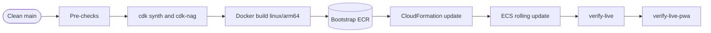

# Runbook: Deploy to Production

<a href="#english"></a>
<a href="#korean"></a>

---

<a id="english"></a>

# English

## Overview

Deploy the `TurboPalsStack` CDK stack (CloudFront, a CloudFront-only ALB, an ARM64 Fargate service in the existing VPC, the DynamoDB rankings table) to account `061525506239` in `ap-northeast-2`, then prove the live site with the scripted acceptance checks. There is no CI/CD pipeline: releases are deployed from a workstation with `npm run deploy`, which runs `cdk deploy --require-approval never --outputs-file cdk-outputs.json`.

`cdk deploy` builds the container image on the deploy host (`DockerImageAsset`, platform `linux/arm64`, the project root as the build context, `infra/lib/service.ts`), pushes it to the CDK bootstrap repository and updates the stack through CloudFormation. ECS replaces the tasks with a rolling update: the 2 running tasks keep serving (`minHealthyPercent 100`, `maxHealthyPercent 200`), and the deployment circuit breaker rolls the service back if the new tasks never become healthy.


## When to Use

- Ship a release: a new `package.json` version with its [CHANGELOG](../../CHANGELOG.md) entry.
- Apply infrastructure changes under `infra/`, `Dockerfile`, `.dockerignore` or `cdk.json`.
- Re-sync the server with the code you are about to verify (version skew, see Notes).
- Use another runbook for origin-secret rotation ([rotate-origin-secret.md](rotate-origin-secret.md)), custom-domain changes ([custom-domain.md](custom-domain.md)) or returning to an earlier release ([rollback-production.md](rollback-production.md)).

## Prerequisites

| Requirement | How to check | Why |
| --- | --- | --- |
| AWS credentials for account `061525506239` | `aws sts get-caller-identity --query Account --output text` prints `061525506239` | The stack refuses any other account, region, VPC or prefix list at synth time (`infra/lib/stack.ts`) |
| Region `ap-northeast-2` | Pinned in the `cdk.json` context; nothing to set | `verify-live` passes `--region ap-northeast-2` itself |
| CDK bootstrap (qualifier `hnb659fds`) in `ap-northeast-2` | `aws ssm get-parameter --name /cdk-bootstrap/hnb659fds/version --region ap-northeast-2 --query Parameter.Value --output text` prints a version | Assets go to `cdk-hnb659fds-assets-061525506239-ap-northeast-2` and `cdk-hnb659fds-container-assets-061525506239-ap-northeast-2`. No `us-east-1` bootstrap is needed: the viewer certificate is imported, not created |
| Node.js `>=22.12.0` | `node --version` | `package.json` engines; `scripts/setup.sh` enforces it |
| Docker running and able to build `linux/arm64` | `docker info --format '{{.Architecture}}'` | CDK runs the Docker build itself. It is native on an arm64 host (the 1.0.0 deploy host is `aarch64`); an x86 host needs buildx with QEMU emulation. The Dockerfile build stage runs `npm ci` and `npm run build`, so the image does not use a local `dist/` |
| AWS CLI v2, `jq`, `dig`, `curl`, `bash` | `command -v aws jq dig curl bash` | `verify-live` calls `aws`, `dig`, `curl` and `bash`; this runbook uses `jq` |
| Playwright Chromium | `npx playwright install chromium` (or `bash scripts/setup.sh --with-browsers`) | `tools/verify-live-pwa.mjs` drives a headless Chromium |
| Write access to the rankings table | Same credentials | The E2E checks submit one QA run (name `QA봇`) and then delete its four items (`LB`, `PB`, `GHOST`, `LOG`) |

## Procedure

### 1. Prepare the release commit

Run every command from the repository root.

```bash
git switch main
git pull --ff-only
git status --porcelain
git log --oneline -n 1
```

`git status --porcelain` must print nothing. The image is built from the working tree, not from the commit, so any uncommitted file in the Docker context (`src/`, `public/`, build configuration) would ship.

### 2. Apply the simulation version rule

The server accepts a time-trial run only if re-simulating its input log reproduces the claimed result ([ADR-001](../decisions/ADR-001-deterministic-simulation-server-verification.md)). Players keep running the build their service worker cached until they apply an update between races, so for a while after every deploy the server verifies runs recorded by older clients.

```bash
curl -s https://my-kart.whchoi.net/healthz
npm pkg get version
git diff --stat 23080fe HEAD -- src/sim
```

Replace `23080fe` (the 1.0.0 commit) with the commit of the last deployed release. If existing code under `src/sim/` or the geometry of an existing track changed in a way that can alter a trajectory (physics, track geometry, items, RNG order: the list the `[sim-version]` hook prints), the deployed core version (the part of `/healthz` `version` before `+`) must differ from the new `package.json` version. If they are equal, bump the version, add a CHANGELOG entry, commit both, and repeat step 1:

```bash
npm version minor --no-git-tag-version
```

Use `patch` or `major` instead of `minor` as the release calls for. The reason: the server compares versions only when a replay fails. It then answers `VERSION_MISMATCH` (reload and race again) when the semver cores differ, but `REPLAY_INVALID` (the log is not a finished run or is corrupted) when they are equal. A bump also makes updated clients discard the time-trial runs they queued offline on the old version, because the new server could not verify them; the main menu tells the player why. A brand-new track changes no existing replay, so on its own it does not force a bump; if you bump anyway, those queued runs are still discarded.

### 3. Run the pre-checks

```bash
npm ci
npm run typecheck
npm test
npm run test:harness
npm run synth
```

- `npm test` runs every vitest suite, including the CDK template tests in `test/infra/` (network guard, security groups, origin secret, compute, edge, cdk-nag).
- `npm run test:harness` runs the shell suite in `test/harness/` (hooks, secret patterns, documentation contracts, `.dockerignore` parity with `IMAGE_CONTEXT_EXCLUDE`).
- `npm run synth` is optional because the deploy synthesizes again; it fails on any new cdk-nag AwsSolutions finding and reads the VPC lookup cached in `cdk.context.json`.
- If the DynamoDB repository changed (`src/server/*repository*.ts`), also run the DynamoDB Local suite:

```bash
docker run -d --rm --name ddb -p 127.0.0.1:18765:8000 amazon/dynamodb-local -jar DynamoDBLocal.jar -inMemory
DYNAMODB_TEST_ENDPOINT=http://127.0.0.1:18765 npx vitest run test/server/repository.test.ts
docker stop ddb
```

### 4. Review the infrastructure diff

`npm run deploy` never asks for approval, so review the change set first. The diff is read-only.

```bash
npx cdk diff TurboPalsStack
```

Stop and investigate if the diff:

- changes security groups, IAM statements or the listener rule (the tests and the live checks assert the exact rules);
- replaces `AWS::CloudFront::Distribution`: the new distribution gets a new `*.cloudfront.net` name, and the CNAME for `my-kart.whchoi.net` in the other account must follow ([custom-domain.md](custom-domain.md));
- replaces `AWS::DynamoDB::Table`: the old table is retained (`RETAIN`) and the service would start on a new, empty leaderboard.

### 5. Deploy

```bash
npm run deploy
```

This is the same as `npx cdk deploy TurboPalsStack --require-approval never --outputs-file cdk-outputs.json`. It synthesizes (cdk-nag included), builds and pushes the image when the Docker context changed, updates the stack, waits for the ECS service to stabilize and writes the seven stack outputs to the git-ignored `cdk-outputs.json`.

The 1.0.0 deploy took 246.54 s in total: synthesis 3.02 s, CloudFormation deployment 221.99 s (the ECS service update alone took 3 min 24 s), the rest for the image build and push. A first deploy that creates the CloudFront distribution takes several minutes longer. Files excluded from the Docker context (docs, tests, `infra/`, most of `tools/`) do not change the image asset hash, so infrastructure-only or documentation-only changes do not rebuild the image. Everything left in the context does, including `package.json` and `.dockerignore`.

```bash
jq . cdk-outputs.json
```

No CloudFront invalidation is needed (see Notes).

### 6. Verify the live site

Run the checks from the commit you just deployed. The E2E check records a bot time trial with the local simulation and expects the server to accept it, so a local `src/sim/` that differs from the deployed one fails it (Incident 1 in Notes).

```bash
npm run verify:live
npm run verify:live -- --custom --out docs/quality/live-verify-custom.json
node tools/verify-live-pwa.mjs https://my-kart.whchoi.net
```

- `npm run verify:live` (`tsx tools/verify-live.ts`) runs 35 checks through the native hostname (`NativeSiteUrl`) and writes `docs/quality/live-verify.json`.
- `--custom` runs the HTTP and E2E checks through `https://my-kart.whchoi.net`. Without `--out` it would overwrite `docs/quality/live-verify.json`.
- `--no-e2e` skips the five E2E checks (no writes to the table) when you only need the read-only checks.

| Area | What `verify-live` checks |
| --- | --- |
| Stack and network (1-14) | Stack status ends in `_COMPLETE` without `ROLLBACK`; ALB in the existing VPC and its public subnets; ALB SG admits only `pl-22a6434b` on TCP 80; the listener default is a fixed 403 and every rule requires `X-Origin-Verify`; at least 2 running ARM64 tasks with a read-only root and a non-root user, in the private subnets, without public IPs, spread over both AZs and routed through the existing NAT gateways; the stack owns no VPC, subnet, NAT, route, IGW or endpoint |
| Targets (15) | Every ALB target is healthy |
| Edge and API (16-24) | `GET /` returns HTML; CSP `script-src` is self-only; HSTS, nosniff, frame `DENY` and a referrer policy are set; `index.html` is not cached long; a hashed asset is immutable and a CloudFront cache hit; `/healthz` returns `{ok:true}`; HTTP redirects to HTTPS; `GET /api/leaderboard` returns JSON; an invalid `POST /api/runs` returns 400 |
| PWA files (25-28) | `sw.js` is served fresh; the manifest and its 192, 512 and maskable icons resolve; the shell build id matches `build.json` and `sw.js`; the 180 px Apple touch icon is served |
| Origin protection (29) | A direct request to the ALB is unreachable or answered with 403 |
| Custom domain (30) | `my-kart.whchoi.net` answers 200 with the `*.whchoi.net` certificate when pinned to a CloudFront edge IP; this does not depend on public DNS, which is only printed as an advisory line |
| E2E (31-35) | A tampered time is rejected with 422; the honest bot run is accepted, appears on the leaderboard and its ghost downloads; the four QA items are deleted afterwards |

`tools/verify-live-pwa.mjs` opens the site in headless Chromium (1280x720) and runs 8 checks: valid HTTPS; no `?debug` hook in the release build; the service worker precached more than 150 entries (it waits up to 240 s); the page is controlled by the worker after a reload; the `오프라인 플레이` readiness chip appears; an offline cold reload still shows the title and the 3D canvas; the main menu (`VS 레이스`, `타임 어택`, `2인 대전`) works offline; no unexpected console errors. Screenshots go to `test-results/live-pwa/`.

### 7. Record the release

Both reports in `docs/quality/` are tracked files. Commit the refreshed reports and tag the release so [rollback-production.md](rollback-production.md) can find it:

```bash
VERSION=$(node -p "require('./package.json').version")
git add docs/quality/live-verify.json docs/quality/live-verify-custom.json
git commit -m "chore: record live verification for $VERSION"
git tag -a "v$VERSION" -m "Deployed $VERSION"
git push origin main "v$VERSION"
```

## Verification

- [ ] `npm run deploy` finished with the `TurboPalsStack` outputs, and `cdk-outputs.json` holds all 7 (`SiteUrl`, `NativeSiteUrl`, `DistributionId`, `AlbDnsName`, `ClusterName`, `ServiceName`, `TableName`).
- [ ] `curl -s https://my-kart.whchoi.net/healthz` returns `{"ok":true,"version":"..."}` with the new `package.json` version before the `+`.
- [ ] `npm run verify:live` reports 35/35.
- [ ] `npm run verify:live -- --custom --out docs/quality/live-verify-custom.json` reports 35/35.
- [ ] `node tools/verify-live-pwa.mjs https://my-kart.whchoi.net` reports 8/8.
- [ ] The release tag is pushed.

When the scripts cannot run, this manual smoke check (from [docs/infra.md](../infra.md)) covers the basics. The last command must print `000` (a timeout), because only CloudFront can reach the ALB.

```bash
SITE=$(jq -r .TurboPalsStack.SiteUrl cdk-outputs.json)
ALB=$(jq -r .TurboPalsStack.AlbDnsName cdk-outputs.json)
curl -s "${SITE}healthz"
curl -sI "$SITE" | grep -iE 'content-security-policy|strict-transport-security|x-frame-options'
curl -s -o /dev/null -w '%{http_code}\n' --max-time 5 "http://$ALB/"
```

## Rollback

- During the deploy: if the new tasks never pass their health checks, the ECS deployment circuit breaker returns the service to the last completed deployment and CloudFormation rolls the stack back (`UPDATE_ROLLBACK_COMPLETE`). Fix the cause and deploy again.
- After a completed deploy: `/healthz` is a liveness probe only (it touches neither DynamoDB nor the verifier), so a release that breaks the API can pass every health check. If `verify-live` fails, follow [rollback-production.md](rollback-production.md).

## Notes

- Last verified: 2026-09-24. The 1.0.0 release was deployed with this procedure: `npm run deploy` (246.54 s), `npm run verify:live -- --custom` 35/35, `node tools/verify-live-pwa.mjs https://my-kart.whchoi.net` 8/8. Live `APP_VERSION` `1.0.0+bc87c1a48e07`, client build id `0e18641074f0a351`.
- No CloudFront invalidation after a deploy. HTML and the PWA control files are never cached at the edge, and `/assets/*` file names carry a content hash:

| Path | CloudFront | Origin `cache-control` |
| --- | --- | --- |
| `/assets/*` | Cached up to 365 days, compressed | `public, max-age=31536000, immutable` |
| `/`, `/sw.js`, `/build.json`, `/manifest.webmanifest`, `/icons/*` | Not cached (`CachingDisabled`) | `no-cache` |
| `/api/*`, `/healthz` | Not cached (`CachingDisabled`) | `no-store` (a successful `/api/ghost/:id`: `private, max-age=3600, immutable`) |
| Error responses (11 status codes) | TTL 0 | `no-store` |

- Players do not switch builds the moment a deploy finishes. The service worker looks for a new `sw.js` at launch, when the app returns to the foreground, when the device comes online and every 15 minutes; the new build downloads in the background and applies only between races (`업데이트` on the title screen or the main menu, or after every game window is closed). Pages that are already open keep using their own precached assets. See [ADR-006](../decisions/ADR-006-offline-first-pwa-race-safe-updates.md).
- Incident 1 (first live verification of 1.0.0): the honest-run E2E check was rejected because the local `src/sim/` had trajectory-changing edits that were not deployed yet. Redeploying so that server and client ran the same build fixed it. Run `verify-live` only against the build you just deployed.
- Node: the 1.0.0 deploy ran on Node v20.20.1, below the `>=22.12.0` engines range, and the AWS SDK printed a `NodeVersionSupportWarning`. Use Node 22.12 or later.
- `npm run deploy` passes extra CDK flags after `--`, for example `npm run deploy -- -c originSecretGeneration=2` ([rotate-origin-secret.md](rotate-origin-secret.md)).
- Background: [docs/infra.md](../infra.md) (sections 5 and 6) and [docs/architecture.md](../architecture.md).

---

<a id="korean"></a>

# 한국어

## 개요

`TurboPalsStack` CDK 스택(CloudFront, CloudFront만 받는 ALB, 기존 VPC 안의 ARM64 Fargate 서비스, DynamoDB 랭킹 테이블)을 계정 `061525506239`의 `ap-northeast-2`에 배포하고, 스크립트로 된 인수 검사로 라이브 사이트를 확인합니다. CI/CD 파이프라인은 없습니다. 릴리스는 작업 머신에서 `npm run deploy`로 배포하며, 이 스크립트는 `cdk deploy --require-approval never --outputs-file cdk-outputs.json`을 실행합니다.

`cdk deploy`는 배포 머신에서 컨테이너 이미지를 빌드하고(`DockerImageAsset`, 플랫폼 `linux/arm64`, 빌드 컨텍스트는 프로젝트 루트, `infra/lib/service.ts`), CDK 부트스트랩 저장소에 푸시한 뒤 CloudFormation으로 스택을 갱신합니다. ECS는 롤링 업데이트로 태스크를 교체합니다. 기존 태스크 2개가 계속 요청을 받고(`minHealthyPercent 100`, `maxHealthyPercent 200`), 새 태스크가 끝내 정상 상태가 되지 않으면 배포 서킷 브레이커가 서비스를 되돌립니다.



## 사용 시점

- 릴리스를 내보낼 때: `package.json`의 새 버전과 그에 맞는 [CHANGELOG](../../CHANGELOG.md) 항목이 준비된 경우입니다.
- `infra/`, `Dockerfile`, `.dockerignore`, `cdk.json`의 인프라 변경을 반영할 때입니다.
- 검증하려는 코드와 서버를 다시 맞출 때입니다(버전 불일치, 참고 절 참조).
- 오리진 시크릿 회전은 [rotate-origin-secret.md](rotate-origin-secret.md), 커스텀 도메인 변경은 [custom-domain.md](custom-domain.md), 이전 릴리스로 되돌리기는 [rollback-production.md](rollback-production.md)를 따릅니다.

## 사전 요구 사항

| 요구 사항 | 확인 방법 | 이유 |
| --- | --- | --- |
| 계정 `061525506239`의 AWS 자격 증명 | `aws sts get-caller-identity --query Account --output text`가 `061525506239`를 출력 | 스택은 다른 계정, 리전, VPC, prefix list로는 synth 단계에서 거부합니다(`infra/lib/stack.ts`) |
| 리전 `ap-northeast-2` | `cdk.json` context에 고정되어 있어 따로 설정할 것이 없음 | `verify-live`도 `--region ap-northeast-2`를 직접 넘깁니다 |
| `ap-northeast-2`의 CDK 부트스트랩(qualifier `hnb659fds`) | `aws ssm get-parameter --name /cdk-bootstrap/hnb659fds/version --region ap-northeast-2 --query Parameter.Value --output text`가 버전을 출력 | 에셋은 `cdk-hnb659fds-assets-061525506239-ap-northeast-2`와 `cdk-hnb659fds-container-assets-061525506239-ap-northeast-2`로 올라갑니다. 뷰어 인증서는 새로 만들지 않고 가져오기만 하므로 `us-east-1` 부트스트랩은 필요 없습니다 |
| Node.js `>=22.12.0` | `node --version` | `package.json` engines 값이며 `scripts/setup.sh`가 검사합니다 |
| 실행 중이고 `linux/arm64`를 빌드할 수 있는 Docker | `docker info --format '{{.Architecture}}'` | Docker 빌드는 CDK가 직접 실행합니다. arm64 호스트에서는 네이티브로 빌드되며(1.0.0을 배포한 호스트는 `aarch64`), x86 호스트에는 QEMU 에뮬레이션을 갖춘 buildx가 필요합니다. Dockerfile의 build 단계가 `npm ci`와 `npm run build`를 실행하므로 이미지는 로컬 `dist/`를 쓰지 않습니다 |
| AWS CLI v2, `jq`, `dig`, `curl`, `bash` | `command -v aws jq dig curl bash` | `verify-live`가 `aws`, `dig`, `curl`, `bash`를 호출하고, 이 런북은 `jq`를 씁니다 |
| Playwright Chromium | `npx playwright install chromium`(또는 `bash scripts/setup.sh --with-browsers`) | `tools/verify-live-pwa.mjs`가 헤드리스 Chromium을 구동합니다 |
| 랭킹 테이블 쓰기 권한 | 같은 자격 증명 | E2E 검사가 QA 기록 1건(이름 `QA봇`)을 제출한 뒤 항목 4개(`LB`, `PB`, `GHOST`, `LOG`)를 지웁니다 |

## 절차

### 1. 릴리스 커밋 준비

모든 명령은 저장소 루트에서 실행합니다.

```bash
git switch main
git pull --ff-only
git status --porcelain
git log --oneline -n 1
```

`git status --porcelain`은 아무것도 출력하지 않아야 합니다. 이미지는 커밋이 아니라 작업 트리에서 빌드되므로, Docker 컨텍스트(`src/`, `public/`, 빌드 설정)에 커밋하지 않은 파일이 있으면 그대로 배포됩니다.

### 2. 시뮬레이션 버전 규칙 적용

서버는 입력 로그를 다시 시뮬레이션해 제출된 결과가 그대로 나올 때만 타임 어택 기록을 받습니다([ADR-001](../decisions/ADR-001-deterministic-simulation-server-verification.md)). 플레이어는 레이스 사이에 업데이트를 적용하기 전까지 서비스 워커가 캐시한 빌드를 계속 쓰므로, 배포 직후 한동안 서버는 이전 클라이언트가 기록한 주행을 검증하게 됩니다.

```bash
curl -s https://my-kart.whchoi.net/healthz
npm pkg get version
git diff --stat 23080fe HEAD -- src/sim
```

`23080fe`(1.0.0 커밋)는 마지막으로 배포한 릴리스의 커밋으로 바꿔 넣습니다. `src/sim/`의 기존 코드나 기존 트랙의 지오메트리에 궤적을 바꿀 수 있는 변경(물리, 트랙 지오메트리, 아이템, RNG 순서 등 `[sim-version]` 훅이 안내하는 항목)이 있다면, 배포된 코어 버전(`/healthz` `version`에서 `+` 앞부분)과 새 `package.json` 버전이 달라야 합니다. 둘이 같다면 버전을 올리고 CHANGELOG 항목을 추가해 함께 커밋한 다음 1단계를 다시 진행합니다.

```bash
npm version minor --no-git-tag-version
```

릴리스 성격에 따라 `minor` 대신 `patch`나 `major`를 씁니다. 이유는 이렇습니다. 서버는 재시뮬레이션이 실패했을 때만 버전을 비교하며, semver 코어가 다르면 `VERSION_MISMATCH`(새로고침 후 다시 달려 달라는 안내)를, 같으면 `REPLAY_INVALID`(완주 기록이 아니거나 손상된 기록이라는 안내)를 돌려줍니다. 버전을 올리면 업데이트한 클라이언트가 이전 버전에서 오프라인으로 보관해 둔 타임 어택 기록도 지웁니다. 새 서버가 검증할 수 없는 기록이기 때문이며, 그 이유는 메인 메뉴에서 플레이어에게 안내됩니다. 새 트랙을 추가하는 것만으로는 기존 재시뮬레이션 결과가 바뀌지 않으므로 버전을 꼭 올릴 필요는 없습니다. 그래도 버전을 올리면 보관된 기록은 마찬가지로 지워집니다.

### 3. 사전 점검 실행

```bash
npm ci
npm run typecheck
npm test
npm run test:harness
npm run synth
```

- `npm test`는 `test/infra/`의 CDK 템플릿 테스트(네트워크 가드, 보안 그룹, 오리진 시크릿, 컴퓨트, 엣지, cdk-nag)를 포함한 모든 vitest 스위트를 실행합니다.
- `npm run test:harness`는 `test/harness/`의 셸 스위트(훅, 시크릿 패턴, 문서 규약, `.dockerignore`와 `IMAGE_CONTEXT_EXCLUDE` 일치)를 실행합니다.
- `npm run synth`는 배포 때 다시 합성하므로 선택 사항입니다. 새 cdk-nag AwsSolutions 위반이 있으면 실패하며, VPC 조회 결과는 `cdk.context.json`의 캐시를 씁니다.
- DynamoDB 저장소(`src/server/*repository*.ts`)를 바꿨다면 DynamoDB Local 스위트도 실행합니다.

```bash
docker run -d --rm --name ddb -p 127.0.0.1:18765:8000 amazon/dynamodb-local -jar DynamoDBLocal.jar -inMemory
DYNAMODB_TEST_ENDPOINT=http://127.0.0.1:18765 npx vitest run test/server/repository.test.ts
docker stop ddb
```

### 4. 인프라 변경 사항 검토

`npm run deploy`는 승인을 묻지 않으므로 변경 내용을 먼저 확인합니다. diff는 읽기 전용입니다.

```bash
npx cdk diff TurboPalsStack
```

diff가 다음에 해당하면 배포를 멈추고 원인을 확인합니다.

- 보안 그룹, IAM 문, 리스너 규칙이 바뀌는 경우입니다(테스트와 라이브 검사가 규칙을 정확히 단언합니다).
- `AWS::CloudFront::Distribution`이 교체되는 경우입니다. 새 배포는 새 `*.cloudfront.net` 이름을 받으므로 다른 계정에 있는 `my-kart.whchoi.net` CNAME도 따라 바꿔야 합니다([custom-domain.md](custom-domain.md)).
- `AWS::DynamoDB::Table`이 교체되는 경우입니다. 기존 테이블은 남고(`RETAIN`) 서비스는 비어 있는 새 리더보드로 시작합니다.

### 5. 배포

```bash
npm run deploy
```

`npx cdk deploy TurboPalsStack --require-approval never --outputs-file cdk-outputs.json`과 같습니다. 합성(cdk-nag 포함), Docker 컨텍스트가 바뀐 경우의 이미지 빌드와 푸시, 스택 갱신, ECS 서비스 안정화 대기를 차례로 거친 뒤 스택 출력값 7개를 git이 무시하는 `cdk-outputs.json`에 씁니다.

1.0.0 배포는 모두 246.54초가 걸렸습니다. 합성 3.02초, CloudFormation 배포 221.99초(그중 ECS 서비스 갱신만 3분 24초)이고 나머지는 이미지 빌드와 푸시입니다. CloudFront 배포를 처음 만드는 최초 배포는 몇 분 더 걸립니다. Docker 컨텍스트에서 제외된 파일(문서, 테스트, `infra/`, `tools/` 대부분)은 이미지 에셋 해시를 바꾸지 않으므로, 인프라나 문서만 바꾼 배포에서는 이미지를 다시 빌드하지 않습니다. 반대로 `package.json`, `.dockerignore`를 포함해 컨텍스트에 남는 파일이 바뀌면 다시 빌드합니다.

```bash
jq . cdk-outputs.json
```

CloudFront 캐시 무효화는 필요 없습니다(참고 절 참조).

### 6. 라이브 사이트 검증

검사는 방금 배포한 커밋에서 실행합니다. E2E 검사는 로컬 시뮬레이션으로 봇 타임 어택을 기록한 뒤 서버가 받아 주기를 기대하므로, 로컬 `src/sim/`이 배포된 것과 다르면 실패합니다(참고 절의 사고 1).

```bash
npm run verify:live
npm run verify:live -- --custom --out docs/quality/live-verify-custom.json
node tools/verify-live-pwa.mjs https://my-kart.whchoi.net
```

- `npm run verify:live`(`tsx tools/verify-live.ts`)는 기본 호스트 이름(`NativeSiteUrl`)으로 검사 35개를 실행하고 `docs/quality/live-verify.json`에 결과를 씁니다.
- `--custom`은 HTTP와 E2E 검사를 `https://my-kart.whchoi.net`으로 실행합니다. `--out`을 빼면 `docs/quality/live-verify.json`을 덮어씁니다.
- 읽기 전용 검사만 필요하면 `--no-e2e`로 E2E 검사 5개를 건너뜁니다(테이블에 쓰지 않음).

| 영역 | `verify-live`가 확인하는 것 |
| --- | --- |
| 스택과 네트워크(1-14) | 스택 상태가 `ROLLBACK` 없이 `_COMPLETE`로 끝남, ALB가 기존 VPC의 퍼블릭 서브넷에 있음, ALB SG가 TCP 80에서 `pl-22a6434b`만 허용함, 리스너 기본 동작이 고정 403이고 모든 규칙이 `X-Origin-Verify`를 요구함, ARM64 태스크가 2개 이상 실행 중이며 루트 파일 시스템이 읽기 전용이고 non-root 사용자로 실행됨, 태스크가 프라이빗 서브넷에서 퍼블릭 IP 없이 두 AZ에 분산되고 기존 NAT 게이트웨이로 나감, 스택이 VPC·서브넷·NAT·라우트·IGW·엔드포인트를 소유하지 않음 |
| 타깃(15) | ALB 타깃이 모두 healthy임 |
| 엣지와 API(16-24) | `GET /`가 HTML을 돌려줌, CSP `script-src`가 self 전용임, HSTS·nosniff·frame `DENY`·referrer policy가 있음, `index.html`을 오래 캐시하지 않음, 해시가 붙은 에셋이 immutable이고 CloudFront 캐시에서 응답됨, `/healthz`가 `{ok:true}`를 돌려줌, HTTP가 HTTPS로 리디렉션됨, `GET /api/leaderboard`가 JSON을 돌려줌, 잘못된 `POST /api/runs`에 400을 돌려줌 |
| PWA 파일(25-28) | `sw.js`를 캐시 없이 제공함, manifest와 192·512·maskable 아이콘에 접근됨, 셸 build id가 `build.json`·`sw.js`와 같음, 180px Apple touch 아이콘을 제공함 |
| 오리진 보호(29) | ALB로 직접 보낸 요청이 연결되지 않거나 403을 받음 |
| 커스텀 도메인(30) | CloudFront 엣지 IP에 고정해 요청하면 `my-kart.whchoi.net`이 `*.whchoi.net` 인증서로 200을 돌려줌. 공개 DNS와 무관하며, 공개 DNS 조회는 참고용 한 줄로만 출력됨 |
| E2E(31-35) | 조작한 시간은 422로 거부됨, 정상 봇 기록은 접수되어 리더보드에 나타나고 고스트를 내려받을 수 있음, 이후 QA 항목 4개가 삭제됨 |

`tools/verify-live-pwa.mjs`는 헤드리스 Chromium(1280x720)으로 사이트를 열어 검사 8개를 실행합니다. 유효한 HTTPS, 릴리스 빌드에 `?debug` 훅이 없음, 서비스 워커가 150개가 넘는 항목을 프리캐시함(최대 240초 대기), 새로고침 후 워커가 페이지를 제어함, `오프라인 플레이` 준비 칩이 표시됨, 오프라인 콜드 리로드에서도 타이틀과 3D 캔버스가 나타남, 메인 메뉴(`VS 레이스`, `타임 어택`, `2인 대전`)가 오프라인에서 동작함, 예상하지 못한 콘솔 오류가 없음을 확인합니다. 스크린샷은 `test-results/live-pwa/`에 저장됩니다.

### 7. 릴리스 기록

`docs/quality/`의 두 리포트는 git이 추적하는 파일입니다. 갱신된 리포트를 커밋하고, [rollback-production.md](rollback-production.md)에서 찾을 수 있도록 릴리스 태그를 붙입니다.

```bash
VERSION=$(node -p "require('./package.json').version")
git add docs/quality/live-verify.json docs/quality/live-verify-custom.json
git commit -m "chore: record live verification for $VERSION"
git tag -a "v$VERSION" -m "Deployed $VERSION"
git push origin main "v$VERSION"
```

## 검증

- [ ] `npm run deploy`가 `TurboPalsStack` 출력값을 표시하며 끝났고, `cdk-outputs.json`에 7개(`SiteUrl`, `NativeSiteUrl`, `DistributionId`, `AlbDnsName`, `ClusterName`, `ServiceName`, `TableName`)가 모두 있습니다.
- [ ] `curl -s https://my-kart.whchoi.net/healthz`가 `{"ok":true,"version":"..."}`를 돌려주고, `+` 앞이 새 `package.json` 버전입니다.
- [ ] `npm run verify:live` 결과가 35/35입니다.
- [ ] `npm run verify:live -- --custom --out docs/quality/live-verify-custom.json` 결과가 35/35입니다.
- [ ] `node tools/verify-live-pwa.mjs https://my-kart.whchoi.net` 결과가 8/8입니다.
- [ ] 릴리스 태그를 푸시했습니다.

스크립트를 실행할 수 없을 때는 아래 수동 점검([docs/infra.md](../infra.md)에서 가져옴)으로 기본 사항을 확인합니다. ALB에는 CloudFront만 접근할 수 있으므로 마지막 명령은 `000`(타임아웃)을 출력해야 합니다.

```bash
SITE=$(jq -r .TurboPalsStack.SiteUrl cdk-outputs.json)
ALB=$(jq -r .TurboPalsStack.AlbDnsName cdk-outputs.json)
curl -s "${SITE}healthz"
curl -sI "$SITE" | grep -iE 'content-security-policy|strict-transport-security|x-frame-options'
curl -s -o /dev/null -w '%{http_code}\n' --max-time 5 "http://$ALB/"
```

## 롤백

- 배포 도중: 새 태스크가 헬스 체크를 끝내 통과하지 못하면 ECS 배포 서킷 브레이커가 서비스를 마지막으로 완료된 배포로 되돌리고, CloudFormation이 스택을 롤백합니다(`UPDATE_ROLLBACK_COMPLETE`). 원인을 고친 뒤 다시 배포합니다.
- 배포가 끝난 뒤: `/healthz`는 생존 여부만 확인하며 DynamoDB나 검증기를 건드리지 않습니다. 따라서 API가 고장 난 릴리스도 헬스 체크는 모두 통과할 수 있습니다. `verify-live`가 실패하면 [rollback-production.md](rollback-production.md)를 따릅니다.

## 참고

- 최종 검증일: 2026-09-24. 1.0.0 릴리스를 이 절차로 배포했습니다. `npm run deploy`(246.54초), `npm run verify:live -- --custom` 35/35, `node tools/verify-live-pwa.mjs https://my-kart.whchoi.net` 8/8이었고, 라이브 `APP_VERSION`은 `1.0.0+bc87c1a48e07`, 클라이언트 build id는 `0e18641074f0a351`이었습니다.
- 배포 후 CloudFront 캐시 무효화는 필요 없습니다. HTML과 PWA 제어 파일은 엣지에서 캐시하지 않고, `/assets/*` 파일 이름에는 내용 해시가 붙습니다.

| 경로 | CloudFront | 오리진 `cache-control` |
| --- | --- | --- |
| `/assets/*` | 최대 365일 캐시, 압축 | `public, max-age=31536000, immutable` |
| `/`, `/sw.js`, `/build.json`, `/manifest.webmanifest`, `/icons/*` | 캐시하지 않음(`CachingDisabled`) | `no-cache` |
| `/api/*`, `/healthz` | 캐시하지 않음(`CachingDisabled`) | `no-store`(성공한 `/api/ghost/:id`는 `private, max-age=3600, immutable`) |
| 오류 응답(상태 코드 11개) | TTL 0 | `no-store` |

- 배포가 끝나도 플레이어의 빌드가 곧바로 바뀌지는 않습니다. 서비스 워커는 실행할 때, 앱이 다시 화면에 나타날 때, 기기가 온라인이 될 때, 그리고 15분마다 새 `sw.js`를 확인합니다. 새 빌드는 뒤에서 내려받아 두었다가 레이스 사이에만 적용합니다(타이틀 화면이나 메인 메뉴의 `업데이트`, 또는 게임 창을 모두 닫은 뒤). 이미 열려 있는 페이지는 자신이 프리캐시한 에셋을 계속 씁니다. [ADR-006](../decisions/ADR-006-offline-first-pwa-race-safe-updates.md)을 참고합니다.
- 사고 1(1.0.0 첫 라이브 검증): 로컬 `src/sim/`에 아직 배포하지 않은, 궤적을 바꾸는 수정이 있어 정상 기록 E2E 검사가 거부되었습니다. 서버와 클라이언트가 같은 빌드를 쓰도록 다시 배포해 해결했습니다. `verify-live`는 방금 배포한 빌드를 대상으로만 실행합니다.
- Node: 1.0.0 배포는 engines 범위(`>=22.12.0`)보다 낮은 Node v20.20.1에서 실행되었고, AWS SDK가 `NodeVersionSupportWarning`을 출력했습니다. Node 22.12 이상을 씁니다.
- `npm run deploy`는 `--` 뒤의 CDK 플래그를 그대로 넘깁니다. 예: `npm run deploy -- -c originSecretGeneration=2`([rotate-origin-secret.md](rotate-origin-secret.md)).
- 배경 자료: [docs/infra.md](../infra.md)(5절과 6절), [docs/architecture.md](../architecture.md).
