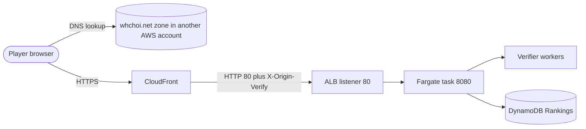

# Runbook: Incident Response

<a href="#english"></a>
<a href="#korean"></a>

---

<a id="english"></a>

# English

## Overview

`TurboPalsStack` defines no CloudWatch alarms, SNS topics or dashboards, so nothing pages anyone. What exists:

- ECS Container Insights metrics (cluster setting) and the ECS deployment circuit breaker, which rolls back a deployment whose tasks fail their health checks.
- Application logs in CloudWatch Logs (30-day retention, stream prefix `app`), one JSON line per event.
- CloudFront and ALB access logs in the access-log S3 bucket (prefixes `cloudfront/` and `alb/`, expire after 30 days).
- No WAF and no geographic restriction on the distribution.

Incidents surface through player reports or a failing `npm run verify:live`, so this runbook starts from the symptom. Every command here is read-only. Changes go through [deploy-production.md](./deploy-production.md), [rollback-production.md](./rollback-production.md), [rotate-origin-secret.md](./rotate-origin-secret.md) or [custom-domain.md](./custom-domain.md).


Find out first who produced an error response:

| Who answered | How to recognise it | Typical statuses |
| --- | --- | --- |
| Local resolver or browser | No HTTP response at all; the browser shows `사이트에 연결할 수 없음` or a DNS error | none |
| CloudFront | HTML page `ERROR: The request could not be satisfied` | 403 (hostname not attached), 502, 504 |
| ALB | Body is exactly `Forbidden` (`text/plain`) for a missing or wrong `X-Origin-Verify`; other ALB errors are not JSON | 403, 502, 503, 504 |
| Application | JSON body `{"error":"<CODE>","message":"<Korean text>"}` | 400 to 429, 503 |

## When to Use

- Players report that the site does not open, shows an error page, or rejects time-trial records.
- `npm run verify:live` fails after a deploy.
- Players stay on an old version after a release.

## Prerequisites

- Read-only AWS access to account `061525506239` (CloudFormation, ECS, ELBv2, CloudFront, CloudWatch Logs, Application Auto Scaling).
- `aws`, `jq`, `curl`, `dig`, and a checkout of the repository: run the commands from the project root (some read `cdk.json` or `cdk.out/`).
- Set these shell variables once per shell. They come from the stack outputs, so they work on any machine (`cdk-outputs.json` exists only where the last deploy ran). The app log group has a CloudFormation-generated name; the stack owns exactly one `AWS::Logs::LogGroup`, so it is looked up by type.

```bash
out() { aws cloudformation describe-stacks --stack-name TurboPalsStack --region ap-northeast-2 \
  --query "Stacks[0].Outputs[?OutputKey=='$1'].OutputValue" --output text; }
SITE=$(out SiteUrl); NATIVE=$(out NativeSiteUrl); DIST_ID=$(out DistributionId); ALB=$(out AlbDnsName)
CLUSTER=$(out ClusterName); SERVICE=$(out ServiceName)
LOG_GROUP=$(aws cloudformation describe-stack-resources --stack-name TurboPalsStack --region ap-northeast-2 \
  --query "StackResources[?ResourceType=='AWS::Logs::LogGroup'].PhysicalResourceId" --output text)
```

`SITE` and `NATIVE` end with `/` (`https://my-kart.whchoi.net/`, `https://d374w2735k9eto.cloudfront.net/`).

## Procedure

### 1. Triage by symptom

| Symptom | Likely cause | Check | Fix |
| --- | --- | --- | --- |
| `사이트에 연결할 수 없음` or a DNS error for `my-kart.whchoi.net`; the native hostname works | CNAME missing in the other account's zone, or a stale negative DNS cache on the player's machine | Step 2 | Flush the local DNS cache, or have the other account restore the CNAME |
| CloudFront 403 HTML on the custom domain only | The distribution does not list `my-kart.whchoi.net` as an alternate domain name | Step 3 | [custom-domain.md](./custom-domain.md) |
| `Forbidden` (`text/plain`) through CloudFront on every URL | The ALB rule does not accept the header value CloudFront sends (generation lowered, manual change) | Step 3 | Deploy the deployed or a higher generation: [rotate-origin-secret.md](./rotate-origin-secret.md) |
| `http://<ALB DNS name>/` times out or returns 403 | Expected: only CloudFront may reach the ALB | none | none |
| POST `/api/runs` returns 403 `FORBIDDEN_ORIGIN` | The page origin is not in `PUBLIC_ORIGIN` or `ALLOWED_ORIGINS` | Step 3 | [custom-domain.md](./custom-domain.md) |
| 502, 503 or 504 that is not JSON, or `/healthz` fails | No healthy targets: tasks crash, fail health checks, or a deployment is rolling back | Step 4 | [rollback-production.md](./rollback-production.md) or a fixed deploy via [deploy-production.md](./deploy-production.md) |
| 503 JSON `SERVICE_UNAVAILABLE` while `/healthz` returns 200 | DynamoDB errors or verifier worker failures; `/healthz` does not check dependencies | Step 4 | Depends on the logged `error` and `reason` |
| 422 `VERSION_MISMATCH` | The player runs an older client after a version bump | Step 5 | The player updates (step 8) |
| Many 422 `REPLAY_INVALID`, `TIME_MISMATCH` or `LAP_MISMATCH` after a deploy, or verify-live "Honest run is verified and accepted" fails | Client and server simulate differently without a version bump (version skew) | Step 5 | Bump the version and deploy, or roll back |
| 429 `RATE_LIMITED` | A viewer exceeded a per-minute budget, often many players behind one NAT address | Step 6 | Wait for `retry-after`; limits change only in code |
| 503 `VERIFIER_BUSY` or slow submissions | Verifier queue full or waiting longer than 6 s | Step 7 | Autoscaling; raise capacity through a deploy |
| Players keep an old version or never see `업데이트` | Service worker update rules (no updates during races, 15-minute checks) | Step 8 | Player presses `업데이트` between races or closes all game windows |

### 2. Site unreachable (DNS)

```bash
dig +short my-kart.whchoi.net @8.8.8.8
dig +short my-kart.whchoi.net
NATIVE_HOST=${NATIVE#https://}; NATIVE_HOST=${NATIVE_HOST%/}
EDGE_IP=$(dig +short A "$NATIVE_HOST" | grep -E '^[0-9.]+$' | head -n 1)
curl -sI --resolve "my-kart.whchoi.net:443:$EDGE_IP" https://my-kart.whchoi.net/
```

- Google DNS answers with `d374w2735k9eto.cloudfront.net.` and IP addresses, and the `--resolve` request returns `HTTP/2 200`: the stack is fine. If the player's own resolver (second command, run on the player's machine) has no answer, the machine holds a negative cache entry from before the record existed. This happened right after the CNAME was first added. Flush the cache and restart the browser:

```bash
sudo dscacheutil -flushcache; sudo killall -HUP mDNSResponder   # macOS
ipconfig /flushdns                                              # Windows, administrator prompt
resolvectl flush-caches                                         # Linux with systemd-resolved
```

- Google DNS has no answer: the CNAME `my-kart.whchoi.net -> d374w2735k9eto.cloudfront.net` is missing from the authoritative `whchoi.net` zone, which lives in another AWS account. Ask its owner to restore it. Records in this account's hosted zone `Z08705193VYKYT9SGOSSX` have no effect because that zone is not delegated.
- As a workaround, players can use `https://d374w2735k9eto.cloudfront.net/`. It is a separate origin, so their local settings and records do not appear there.
- Nothing on the edge blocks viewers: there is no WAF and no geographic restriction.

### 3. HTTP 403

```bash
curl -s -i "$SITE" | head -n 20
curl -s -i "$NATIVE" | head -n 20
aws cloudfront get-distribution --id "$DIST_ID" --query 'Distribution.{status:Status,aliases:DistributionConfig.Aliases.Items}'
```

- **CloudFront 403 on the custom domain, native hostname returns 200.** The CNAME points at the distribution, but the distribution does not claim the hostname (`aliases` lacks `my-kart.whchoi.net`). This happened when the CNAME was created before the alias was configured; a browser may first report a certificate name mismatch. Attach the domain with [custom-domain.md](./custom-domain.md).
- **ALB 403 `Forbidden` on both hostnames.** The listener rule does not accept the `X-Origin-Verify` value that CloudFront sends. Compare the generations:

```bash
node -p "require('./cdk.json').context.originSecretGeneration ?? 1"
aws cloudformation describe-stack-resources --stack-name TurboPalsStack --region ap-northeast-2 \
  --query "StackResources[?ResourceType=='AWS::SecretsManager::Secret'].LogicalResourceId" --output text
aws cloudformation describe-stack-events --stack-name TurboPalsStack --region ap-northeast-2 --max-items 15 \
  --query 'StackEvents[].[Timestamp,LogicalResourceId,ResourceStatus]' --output table
```

  A deploy that lowered `originSecretGeneration` updates the listener rule first and the distribution second, so 403s last at least until the distribution status is `Deployed` again. A manual edit of the rule or of the origin header breaks the match permanently. Never edit either by hand; deploy the deployed generation or a higher one ([rotate-origin-secret.md](./rotate-origin-secret.md)).
- **Direct ALB requests.** `curl -s -o /dev/null -w '%{http_code}\n' --max-time 5 "http://$ALB/"` prints `000` (timeout) because the security group admits only the CloudFront prefix list `pl-22a6434b`. This is by design.
- **Application 403 `FORBIDDEN_ORIGIN`** (JSON, POST `/api/runs` only). The browser's `Origin` is not allowed. Requests without an `Origin` header are allowed. Check the task environment:

```bash
TD=$(aws ecs describe-services --cluster "$CLUSTER" --services "$SERVICE" --region ap-northeast-2 --query 'services[0].taskDefinition' --output text)
aws ecs describe-task-definition --task-definition "$TD" --region ap-northeast-2 \
  --query "taskDefinition.containerDefinitions[0].environment[?name=='PUBLIC_ORIGIN' || name=='ALLOWED_ORIGINS']"
```

  Expected: `https://my-kart.whchoi.net` and `https://d374w2735k9eto.cloudfront.net`. Fix the values through [custom-domain.md](./custom-domain.md).

### 4. 5xx and unhealthy tasks

```bash
curl -s -i "${SITE}healthz" | head -n 20
aws ecs describe-services --cluster "$CLUSTER" --services "$SERVICE" --region ap-northeast-2 \
  --query 'services[0].{desired:desiredCount,running:runningCount,pending:pendingCount,deployments:deployments[].[status,rolloutState,runningCount,taskDefinition],events:events[:10].message}'
LB_ARN=$(aws elbv2 describe-load-balancers --region ap-northeast-2 --query "LoadBalancers[?DNSName=='$ALB'].LoadBalancerArn" --output text)
TG_ARN=$(aws elbv2 describe-target-groups --load-balancer-arn "$LB_ARN" --region ap-northeast-2 --query 'TargetGroups[0].TargetGroupArn' --output text)
aws elbv2 describe-target-health --target-group-arn "$TG_ARN" --region ap-northeast-2 \
  --query 'TargetHealthDescriptions[].[Target.Id,TargetHealth.State,TargetHealth.Reason]' --output table
STOPPED=$(aws ecs list-tasks --cluster "$CLUSTER" --service-name "$SERVICE" --desired-status STOPPED \
  --region ap-northeast-2 --query 'taskArns[0]' --output text)
aws ecs describe-tasks --cluster "$CLUSTER" --tasks "$STOPPED" --region ap-northeast-2 \
  --query 'tasks[0].{stoppedAt:stoppedAt,stopCode:stopCode,reason:stoppedReason,exit:containers[0].exitCode,containerReason:containers[0].reason}'
```

`/healthz` returns `{"ok":true,"version":"1.0.0+<12 hex>"}`. The service should run two or more tasks across both AZs, with every target `healthy`. If `STOPPED` is `None`, ECS has no recently stopped task to show. Then read the application logs:

```bash
aws logs tail "$LOG_GROUP" --since 30m --region ap-northeast-2
aws logs tail "$LOG_GROUP" --since 1h --region ap-northeast-2 \
  --filter-pattern '{ ($.event = "request_failed") || ($.event = "startup_failed") || ($.event = "config_invalid") || ($.event = "listen_failed") }'
```

| Log event | Meaning |
| --- | --- |
| `request_failed`, `error` `StorageError` | A DynamoDB call failed (`reason` is the AWS error name, for example `TransactionRetriesExhausted`). The API answers 503 `SERVICE_UNAVAILABLE`, while `/healthz` stays 200. |
| `request_failed`, `error` `VerifierUnavailableError` | A verifier worker crashed, failed to load or returned garbage. POST `/api/runs` answers 503. |
| `config_invalid`, `startup_failed`, `listen_failed` | The task exits during startup; health checks fail and the circuit breaker rolls the deployment back. |
| `shutdown`, `stopped` | Normal drain after SIGTERM (deploy or scale-in). |
| `shutdown_timeout` | Draining took longer than 25 s and the process exited forcibly. |
| `memory_repository` | `TABLE_NAME` is empty in production, so rankings live in memory only: a configuration defect. |

- A deployment shows `rolloutState` `IN_PROGRESS` or `FAILED`: the circuit breaker restores the previous task definition on its own. Wait for it, then fix forward ([deploy-production.md](./deploy-production.md)) or roll back ([rollback-production.md](./rollback-production.md)).
- `stoppedReason` mentions image pulls or log delivery: tasks reach ECR, CloudWatch Logs and DynamoDB only over TCP 443 through the VPC's existing NAT gateways, which this stack does not own. Check them with `aws ec2 describe-nat-gateways --nat-gateway-ids nat-00b8a70dc184a4d0c nat-08379e076e2e6e234 --region ap-northeast-2 --query 'NatGateways[].[NatGatewayId,State]' --output table`.
- 502 after a timeout change: the keep-alive order must stay server 65 s > ALB idle 60 s > CloudFront origin keep-alive 30 s. 504: CloudFront's origin read timeout and the server's request timeout are both 30 s.
- CloudFront caches no error response (error caching TTL 0 for 400, 403, 404, 405, 414, 416 and 500 to 504), so recovery is visible at once and no invalidation is needed.

### 5. Time-trial submissions rejected (422)

The server re-simulates every submitted input log in a worker thread (`compareResult` in `src/server/app.ts`) and checks the codes in this order:

| Code | Server decision | Message the player sees | Usual cause |
| --- | --- | --- | --- |
| `VERSION_MISMATCH` | Replay failed and the client version core differs from the server's | `게임 버전이 달라요. 새로고침한 뒤 다시 도전해 주세요.` | Old client after a version bump; expected right after a release |
| `REPLAY_INVALID` | Replay failed, same version core | `기록 검증에 실패했어요. 주행 기록이 완주 기록이 아니거나 손상되었어요.` | Corrupted or forged log, the 8 s time limit exceeded (`detail` `verification timed out`), or version skew |
| `TIME_MISMATCH` | Replay finished with different ticks | `기록 검증에 실패했어요. 서버 재생 결과와 완주 시간이 달라요.` | Forged time (the verify-live tamper check produces exactly this), or version skew |
| `LAP_MISMATCH` | Replay finished with different lap ticks | `기록 검증에 실패했어요. 서버 재생 결과와 랩 기록이 달라요.` | Forged laps, or version skew |

The server's version is `APP_VERSION` (`package.json` version plus 12 characters of the image asset hash, `1.0.0+bc87c1a48e07` today); the client sends the plain `package.json` version. Only the core (`1.0.0`) is compared, and only when the replay fails: a run that replays correctly is accepted even across versions. A duplicate input log owned by another player is a 409 `DUPLICATE_RUN`, not a 422.

```bash
curl -s "${SITE}healthz"
aws logs tail "$LOG_GROUP" --since 1h --region ap-northeast-2 --filter-pattern '{ $.event = "run_rejected" }'
```

`run_rejected` lines carry `trackId`, `cc`, `charId`, `verifyMs`, `code` and `detail` (the replay reason, at most 200 characters).

**Version skew.** Many `REPLAY_INVALID`, `TIME_MISMATCH` or `LAP_MISMATCH` rejections across tracks right after a deploy, or verify-live failing "Honest run is verified and accepted" while "Tampered time is rejected by server re-simulation (422)" passes, mean that the run was recorded by a different simulation than the deployed one. During the first live verification the local checkout contained trajectory-changing simulation edits that were not deployed yet, so the honest bot run was rejected. Compare your checkout with the deployed image (`npm run synth` writes only the local `cdk.out/`):

```bash
npm run synth
node -e "const t=require('./cdk.out/TurboPalsStack.template.json');const td=Object.values(t.Resources).find(r=>r.Type==='AWS::ECS::TaskDefinition');console.log(td.Properties.ContainerDefinitions[0].Environment.find(e=>e.Name==='APP_VERSION').Value)"
curl -s "${SITE}healthz"
```

Different values mean that your Docker build context differs from the deployed image (any change in it, not only a simulation change, alters the hash). Fixes, all through the runbooks:

- verify-live: run it only against the build you just deployed, or from the deployed commit.
- Players: when the deployed simulation changed trajectories without a version bump, bump the `package.json` version, add a CHANGELOG entry and deploy ([deploy-production.md](./deploy-production.md)). Old clients then get the clear `VERSION_MISMATCH` message, and on start the client discards stored offline records of another version core with a notice. Alternatively roll back to the previous simulation ([rollback-production.md](./rollback-production.md)).

### 6. Rate limiting (429)

Budgets per client and 60-second window (`DEFAULT_RATE_LIMITS` in `src/server/app.ts`; not configurable through environment variables):

| Budget | Requests | Limit per 60 s |
| --- | --- | --- |
| submit | POST `/api/runs` | 12 |
| read | GET `/api/leaderboard`, GET `/api/ghost/:id`, unmatched `/api/*` | 120 |
| page | `/`, static files, SPA routes, other non-API 404s | 600 |

`/healthz` is exempt. The client key is `x-turbo-client-ip`, which the CloudFront viewer-request function overwrites with the viewer IP; IPv6 addresses are grouped per /64. Players behind one NAT address share a budget. The counters live in each task's memory (no shared store), so a viewer's effective limit can reach the task count times the budget (inferred from the code, not measured).

```bash
curl -s -o /dev/null -D - "${SITE}api/leaderboard?track=sunny-meadow&cc=150" | grep -i -E 'x-ratelimit|retry-after'
aws logs tail "$LOG_GROUP" --since 30m --region ap-northeast-2 --filter-pattern '{ ($.event = "request") && ($.status = 429) }'
```

The first command spends one request of the read budget. Transient 429s clear after `retry-after` seconds; when the client submits stored offline records it stops at a 429 and keeps the rest for later. Application logs never contain IP addresses; to identify a heavy client, use the CloudFront access logs (`cloudfront/` prefix in the access-log bucket). Changing a limit is a code change plus a deploy.

### 7. Verifier overload

- Each task runs a pool of `min(2, CPU count)` worker threads, at most 32 queued runs, and at most 6 s of queue wait. A full queue or a longer wait returns 503 `VERIFIER_BUSY` with `retry-after: 3`.
- Each run gets 8 s (wall-clock). When that is exceeded the worker is terminated and replaced, and the run is rejected with 422 `REPLAY_INVALID` (`detail` `verification timed out`), or `VERSION_MISMATCH` when the client has another version core.
- A crashed worker or a worker that fails to load yields 503 `SERVICE_UNAVAILABLE` and a `request_failed` line with `VerifierUnavailableError`.
- The browser gives up after 8 s, so a slow submission can still be stored after the player saw a timeout. Retrying is safe: the same input log returns the existing record.

```bash
aws logs tail "$LOG_GROUP" --since 30m --region ap-northeast-2 --filter-pattern '{ $.event = "run_accepted" }'
aws logs tail "$LOG_GROUP" --since 30m --region ap-northeast-2 --filter-pattern '{ ($.event = "request") && ($.route = "/api/runs") && ($.status = 503) }'
aws application-autoscaling describe-scaling-activities --service-namespace ecs \
  --resource-id "service/$CLUSTER/$SERVICE" --region ap-northeast-2 --max-items 5 \
  --query 'ScalingActivities[].[StartTime,StatusCode,Description]' --output table
```

`verifyMs` in `run_accepted` approaching 8000, or a stream of 503s on `/api/runs`, means saturation. Autoscaling adds tasks (2 to 6; target 60 % CPU or 600 requests per target per minute; scale-out cooldown 60 s). If the service sits at 6 tasks and still rejects, raise `MAX_TASKS` in `infra/lib/settings.ts` and deploy ([deploy-production.md](./deploy-production.md)). Because the pool never exceeds two workers per task, more tasks add verification capacity; larger tasks beyond 2 vCPU do not.

### 8. Players stuck on an old version

How updates reach a player (`src/client/pwa.ts`, `src/client/sw.ts`):

- After the first full download the service worker answers navigations with the cached app shell of its own version, including reloads and offline starts.
- The client checks for a new worker at launch, when the game becomes visible again, when the network comes back and every 15 minutes. It skips the check within 5 minutes of the previous one and during a race.
- A new version downloads in the background. The title screen and the main menu then show `새 버전이 준비됐어요` with an `업데이트` button. The banner is hidden during a race, and a race counts as active until the player leaves its results screen.
- On `업데이트` the worker asks every open game window whether it is racing (no answer within 2 s counts as racing) and activates only when none is; otherwise the player sees `다른 창에서 레이스가 진행 중이에요. 레이스를 마친 뒤 다시 시도해 주세요.`
- Closing every game window or tab (including the installed app) and reopening it also applies the update.
- Nothing needs purging on the server: `index.html`, `sw.js` and `build.json` are served `no-cache` and `/assets/*` file names are content-hashed, so no CloudFront invalidation is needed.

```bash
curl -s "${SITE}build.json"
curl -s "$SITE" | grep -o '<meta name="turbo-pals-build" content="[a-f0-9]*"'
```

Both show the deployed client build id. The title screen shows only the version (`v1.0.0`), so players on the same version but an older build cannot tell the difference. Tell affected players to finish the race, go back to the title screen or main menu and press `업데이트`, or to close all game windows and reopen the game.

## Verification

- [ ] The symptom is gone: `curl -s -i "$SITE"` returns 200 and `curl -s "${SITE}healthz"` returns `{"ok":true,...}`.
- [ ] Every target is `healthy` and the service runs its desired task count (step 4).
- [ ] No new `request_failed` lines in the last 15 minutes (`aws logs tail "$LOG_GROUP" --since 15m --filter-pattern '{ $.event = "request_failed" }' --region ap-northeast-2`).
- [ ] `npm run verify:live -- --custom --no-e2e --out test-results/live-verify-incident.json` passes every check (drop `--no-e2e` to also exercise a real submission, which writes four QA rows and deletes them).

## Rollback

This runbook changes nothing. Recover through the change runbooks:

- Bad release: [rollback-production.md](./rollback-production.md).
- Fixed release or capacity change: [deploy-production.md](./deploy-production.md).
- Origin header mismatch: [rotate-origin-secret.md](./rotate-origin-secret.md).
- Domain, certificate or allowed origins: [custom-domain.md](./custom-domain.md).

## Notes

- No alarms are configured, so watch Container Insights in the CloudWatch console during and after a deploy.
- `/healthz` is pure liveness: it returns 200 even when DynamoDB is failing. Use the API (`GET /api/leaderboard?track=sunny-meadow&cc=150`) or verify-live to test the whole path.
- The app logs never contain query strings, bodies, player names, IP addresses or player ids; successful `/healthz` probes are not logged.
- Background: [docs/infra.md](../infra.md) sections 6 and 9, [docs/api-reference.md](../api-reference.md), [ADR-001](../decisions/ADR-001-deterministic-simulation-server-verification.md), [ADR-006](../decisions/ADR-006-offline-first-pwa-race-safe-updates.md).
- Last verified: 2026-10-18 (checked against `infra/lib/*.ts`, `src/server/app.ts`, `src/server/verifier.ts`, `src/server/index.ts`, `src/client/pwa.ts` and `src/client/sw.ts`; the DNS and 403 procedures replay the incidents recorded during the 2026-09 launch).

---

<a id="korean"></a>

# 한국어

## 개요

`TurboPalsStack`에는 CloudWatch 경보, SNS 토픽, 대시보드가 없으므로 누구에게도 자동 알림이 가지 않습니다. 있는 것은 다음과 같습니다.

- ECS Container Insights 지표(클러스터 설정)와 ECS 배포 서킷 브레이커. 새 태스크가 헬스 체크를 통과하지 못하면 배포를 되돌립니다.
- CloudWatch Logs의 애플리케이션 로그(보관 30일, 스트림 접두사 `app`). 이벤트마다 JSON 한 줄입니다.
- 액세스 로그 S3 버킷의 CloudFront, ALB 액세스 로그(접두사 `cloudfront/`, `alb/`, 30일 후 만료).
- 배포(distribution)에는 WAF도 지역 제한도 없습니다.

장애는 플레이어 제보나 실패한 `npm run verify:live`로 드러나므로, 이 런북은 증상에서 출발합니다. 여기 나오는 명령은 모두 읽기 전용입니다. 변경은 [deploy-production.md](./deploy-production.md), [rollback-production.md](./rollback-production.md), [rotate-origin-secret.md](./rotate-origin-secret.md), [custom-domain.md](./custom-domain.md)를 거쳐서 합니다.



먼저 오류 응답을 누가 만들었는지 확인합니다.

| 응답 주체 | 구별 방법 | 주요 상태 코드 |
| --- | --- | --- |
| 로컬 리졸버 또는 브라우저 | HTTP 응답이 아예 없고 브라우저에 `사이트에 연결할 수 없음`이나 DNS 오류가 표시됨 | 없음 |
| CloudFront | `ERROR: The request could not be satisfied` HTML 페이지 | 403(호스트 이름 미연결), 502, 504 |
| ALB | `X-Origin-Verify`가 없거나 틀리면 본문이 정확히 `Forbidden`(`text/plain`). 그 밖의 ALB 오류도 JSON이 아님 | 403, 502, 503, 504 |
| 애플리케이션 | JSON 본문 `{"error":"<CODE>","message":"<Korean text>"}` | 400~429, 503 |

## 사용 시점

- 사이트가 열리지 않거나, 오류 페이지가 나오거나, 타임 어택 기록 등록이 거절된다는 제보가 있을 때.
- 배포 후 `npm run verify:live`가 실패할 때.
- 릴리스 후에도 플레이어가 예전 버전에 머물러 있을 때.

## 사전 요구 사항

- 계정 `061525506239`의 읽기 전용 AWS 권한(CloudFormation, ECS, ELBv2, CloudFront, CloudWatch Logs, Application Auto Scaling).
- `aws`, `jq`, `curl`, `dig`, 저장소 체크아웃. 일부 명령이 `cdk.json`이나 `cdk.out/`을 읽으므로 명령은 프로젝트 루트에서 실행합니다.
- 셸마다 한 번씩 아래 변수를 설정합니다. 스택 출력값에서 가져오므로 어느 컴퓨터에서나 동작합니다(`cdk-outputs.json`은 마지막으로 배포한 컴퓨터에만 있습니다). 앱 로그 그룹 이름은 CloudFormation이 생성합니다. 스택에는 `AWS::Logs::LogGroup`이 하나뿐이므로 리소스 유형으로 찾습니다.

```bash
out() { aws cloudformation describe-stacks --stack-name TurboPalsStack --region ap-northeast-2 \
  --query "Stacks[0].Outputs[?OutputKey=='$1'].OutputValue" --output text; }
SITE=$(out SiteUrl); NATIVE=$(out NativeSiteUrl); DIST_ID=$(out DistributionId); ALB=$(out AlbDnsName)
CLUSTER=$(out ClusterName); SERVICE=$(out ServiceName)
LOG_GROUP=$(aws cloudformation describe-stack-resources --stack-name TurboPalsStack --region ap-northeast-2 \
  --query "StackResources[?ResourceType=='AWS::Logs::LogGroup'].PhysicalResourceId" --output text)
```

`SITE`와 `NATIVE`는 `/`로 끝납니다(`https://my-kart.whchoi.net/`, `https://d374w2735k9eto.cloudfront.net/`).

## 절차

### 1. 증상별 분류

| 증상 | 유력한 원인 | 확인 | 조치 |
| --- | --- | --- | --- |
| `my-kart.whchoi.net`에서 `사이트에 연결할 수 없음`이나 DNS 오류, 기본 호스트 이름은 정상 | 다른 계정 존에 CNAME이 없거나, 플레이어 컴퓨터에 실패한 조회 결과가 캐시됨 | 2단계 | 로컬 DNS 캐시 비우기, 또는 다른 계정에서 CNAME 복구 |
| 커스텀 도메인에서만 CloudFront 403 HTML | 배포의 대체 도메인 이름에 `my-kart.whchoi.net`이 없음 | 3단계 | [custom-domain.md](./custom-domain.md) |
| 모든 URL에서 CloudFront를 거친 `Forbidden`(`text/plain`) | CloudFront가 보내는 헤더 값을 ALB 규칙이 받아들이지 않음(세대를 낮춤, 수동 변경) | 3단계 | 배포된 세대 이상으로 배포: [rotate-origin-secret.md](./rotate-origin-secret.md) |
| `http://<ALB DNS name>/`이 타임아웃되거나 403 | 정상 동작: ALB에는 CloudFront만 접근 가능 | 없음 | 없음 |
| POST `/api/runs`가 403 `FORBIDDEN_ORIGIN` | 페이지 origin이 `PUBLIC_ORIGIN`이나 `ALLOWED_ORIGINS`에 없음 | 3단계 | [custom-domain.md](./custom-domain.md) |
| JSON이 아닌 502, 503, 504, 또는 `/healthz` 실패 | 정상 타깃 없음: 태스크 비정상 종료, 헬스 체크 실패, 배포 롤백 중 | 4단계 | [rollback-production.md](./rollback-production.md) 또는 [deploy-production.md](./deploy-production.md)로 수정 배포 |
| `/healthz`는 200인데 503 JSON `SERVICE_UNAVAILABLE` | DynamoDB 오류나 검증 워커 장애. `/healthz`는 의존성을 확인하지 않음 | 4단계 | 로그의 `error`, `reason`에 따라 다름 |
| 422 `VERSION_MISMATCH` | 버전을 올린 뒤에도 플레이어가 예전 클라이언트를 씀 | 5단계 | 플레이어가 업데이트(8단계) |
| 배포 직후 422 `REPLAY_INVALID`, `TIME_MISMATCH`, `LAP_MISMATCH`가 급증하거나 verify-live "Honest run is verified and accepted" 실패 | 버전을 올리지 않은 채 클라이언트와 서버의 시뮬레이션이 달라짐(버전 불일치) | 5단계 | 버전을 올려 배포하거나 롤백 |
| 429 `RATE_LIMITED` | 뷰어가 분당 한도를 넘음. 하나의 NAT 주소 뒤에 플레이어가 많은 경우가 흔함 | 6단계 | `retry-after`만큼 대기. 한도는 코드로만 변경 |
| 503 `VERIFIER_BUSY` 또는 느린 등록 | 검증 대기열이 가득 찼거나 6초 넘게 기다림 | 7단계 | 오토스케일링, 배포로 용량 증설 |
| 플레이어가 예전 버전에 머물거나 `업데이트`가 보이지 않음 | 서비스 워커 업데이트 규칙(레이스 중 업데이트 없음, 15분 주기 확인) | 8단계 | 레이스 사이에 `업데이트`를 누르거나 게임 창을 모두 닫았다 열기 |

### 2. 사이트 접속 불가(DNS)

```bash
dig +short my-kart.whchoi.net @8.8.8.8
dig +short my-kart.whchoi.net
NATIVE_HOST=${NATIVE#https://}; NATIVE_HOST=${NATIVE_HOST%/}
EDGE_IP=$(dig +short A "$NATIVE_HOST" | grep -E '^[0-9.]+$' | head -n 1)
curl -sI --resolve "my-kart.whchoi.net:443:$EDGE_IP" https://my-kart.whchoi.net/
```

- Google DNS가 `d374w2735k9eto.cloudfront.net.`과 IP 주소를 돌려주고 `--resolve` 요청이 `HTTP/2 200`이면 스택은 정상입니다. 플레이어 컴퓨터에서 실행한 두 번째 명령에 응답이 없다면, 레코드가 생기기 전의 실패한 조회 결과가 그 컴퓨터에 캐시되어 있는 것입니다. CNAME을 처음 추가한 직후에 실제로 이런 일이 있었습니다. 캐시를 비우고 브라우저를 다시 시작합니다.

```bash
sudo dscacheutil -flushcache; sudo killall -HUP mDNSResponder   # macOS
ipconfig /flushdns                                              # Windows, administrator prompt
resolvectl flush-caches                                         # Linux with systemd-resolved
```

- Google DNS에도 응답이 없으면 권한 있는 `whchoi.net` 존(다른 AWS 계정)에 CNAME `my-kart.whchoi.net -> d374w2735k9eto.cloudfront.net`이 없는 것입니다. 그 계정 소유자에게 복구를 요청합니다. 이 계정의 호스팅 존 `Z08705193VYKYT9SGOSSX`는 위임되지 않았으므로 여기에 넣은 레코드는 효과가 없습니다.
- 임시로 플레이어에게 `https://d374w2735k9eto.cloudfront.net/`을 안내할 수 있습니다. 다른 origin이라서 로컬 설정과 기록은 그쪽에 보이지 않습니다.
- 엣지에서 뷰어를 막는 것은 없습니다. WAF도 지역 제한도 없습니다.

### 3. HTTP 403

```bash
curl -s -i "$SITE" | head -n 20
curl -s -i "$NATIVE" | head -n 20
aws cloudfront get-distribution --id "$DIST_ID" --query 'Distribution.{status:Status,aliases:DistributionConfig.Aliases.Items}'
```

- **커스텀 도메인은 CloudFront 403, 기본 호스트 이름은 200.** CNAME은 배포를 가리키지만 배포가 그 호스트 이름을 갖고 있지 않습니다(`aliases`에 `my-kart.whchoi.net`이 없음). 대체 도메인을 설정하기 전에 CNAME을 만들었을 때 실제로 이렇게 되었습니다. 브라우저는 먼저 인증서 이름 불일치를 표시할 수도 있습니다. [custom-domain.md](./custom-domain.md)로 도메인을 연결합니다.
- **두 호스트 이름 모두 ALB 403 `Forbidden`.** CloudFront가 보내는 `X-Origin-Verify` 값을 리스너 규칙이 받아들이지 않습니다. 세대를 비교합니다.

```bash
node -p "require('./cdk.json').context.originSecretGeneration ?? 1"
aws cloudformation describe-stack-resources --stack-name TurboPalsStack --region ap-northeast-2 \
  --query "StackResources[?ResourceType=='AWS::SecretsManager::Secret'].LogicalResourceId" --output text
aws cloudformation describe-stack-events --stack-name TurboPalsStack --region ap-northeast-2 --max-items 15 \
  --query 'StackEvents[].[Timestamp,LogicalResourceId,ResourceStatus]' --output table
```

  `originSecretGeneration`을 낮춘 배포는 리스너 규칙을 먼저, 배포(distribution)를 나중에 갱신하므로 적어도 배포 상태가 다시 `Deployed`가 될 때까지 403이 이어집니다. 규칙이나 오리진 헤더를 손으로 고쳤다면 불일치는 저절로 풀리지 않습니다. 둘 다 절대 손으로 고치지 말고, 배포된 세대 이상으로 배포합니다([rotate-origin-secret.md](./rotate-origin-secret.md)).
- **ALB 직접 요청.** `curl -s -o /dev/null -w '%{http_code}\n' --max-time 5 "http://$ALB/"`는 보안 그룹이 CloudFront prefix list `pl-22a6434b`만 허용하므로 `000`(타임아웃)을 출력합니다. 설계대로입니다.
- **애플리케이션 403 `FORBIDDEN_ORIGIN`**(JSON, POST `/api/runs`에서만). 브라우저의 `Origin`이 허용 목록에 없습니다. `Origin` 헤더가 없는 요청은 허용됩니다. 태스크 환경 변수를 확인합니다.

```bash
TD=$(aws ecs describe-services --cluster "$CLUSTER" --services "$SERVICE" --region ap-northeast-2 --query 'services[0].taskDefinition' --output text)
aws ecs describe-task-definition --task-definition "$TD" --region ap-northeast-2 \
  --query "taskDefinition.containerDefinitions[0].environment[?name=='PUBLIC_ORIGIN' || name=='ALLOWED_ORIGINS']"
```

  기대값은 `https://my-kart.whchoi.net`과 `https://d374w2735k9eto.cloudfront.net`입니다. 값은 [custom-domain.md](./custom-domain.md)로 고칩니다.

### 4. 5xx와 비정상 태스크

```bash
curl -s -i "${SITE}healthz" | head -n 20
aws ecs describe-services --cluster "$CLUSTER" --services "$SERVICE" --region ap-northeast-2 \
  --query 'services[0].{desired:desiredCount,running:runningCount,pending:pendingCount,deployments:deployments[].[status,rolloutState,runningCount,taskDefinition],events:events[:10].message}'
LB_ARN=$(aws elbv2 describe-load-balancers --region ap-northeast-2 --query "LoadBalancers[?DNSName=='$ALB'].LoadBalancerArn" --output text)
TG_ARN=$(aws elbv2 describe-target-groups --load-balancer-arn "$LB_ARN" --region ap-northeast-2 --query 'TargetGroups[0].TargetGroupArn' --output text)
aws elbv2 describe-target-health --target-group-arn "$TG_ARN" --region ap-northeast-2 \
  --query 'TargetHealthDescriptions[].[Target.Id,TargetHealth.State,TargetHealth.Reason]' --output table
STOPPED=$(aws ecs list-tasks --cluster "$CLUSTER" --service-name "$SERVICE" --desired-status STOPPED \
  --region ap-northeast-2 --query 'taskArns[0]' --output text)
aws ecs describe-tasks --cluster "$CLUSTER" --tasks "$STOPPED" --region ap-northeast-2 \
  --query 'tasks[0].{stoppedAt:stoppedAt,stopCode:stopCode,reason:stoppedReason,exit:containers[0].exitCode,containerReason:containers[0].reason}'
```

`/healthz`는 `{"ok":true,"version":"1.0.0+<12 hex>"}`를 돌려줍니다. 서비스는 두 AZ에 걸쳐 태스크 2개 이상을 실행하고, 모든 타깃이 `healthy`여야 합니다. `STOPPED`가 `None`이면 ECS가 보여 줄 최근 중지 태스크가 없는 것입니다. 이어서 애플리케이션 로그를 봅니다.

```bash
aws logs tail "$LOG_GROUP" --since 30m --region ap-northeast-2
aws logs tail "$LOG_GROUP" --since 1h --region ap-northeast-2 \
  --filter-pattern '{ ($.event = "request_failed") || ($.event = "startup_failed") || ($.event = "config_invalid") || ($.event = "listen_failed") }'
```

| 로그 이벤트 | 의미 |
| --- | --- |
| `request_failed`, `error` `StorageError` | DynamoDB 호출 실패(`reason`은 AWS 오류 이름, 예: `TransactionRetriesExhausted`). API는 503 `SERVICE_UNAVAILABLE`을 돌려주지만 `/healthz`는 계속 200입니다. |
| `request_failed`, `error` `VerifierUnavailableError` | 검증 워커가 비정상 종료했거나, 로드에 실패했거나, 잘못된 응답을 보냈습니다. POST `/api/runs`가 503을 돌려줍니다. |
| `config_invalid`, `startup_failed`, `listen_failed` | 태스크가 시작 중에 종료됩니다. 헬스 체크가 실패하고 서킷 브레이커가 배포를 되돌립니다. |
| `shutdown`, `stopped` | SIGTERM 이후의 정상 종료(배포 또는 scale-in). |
| `shutdown_timeout` | 종료 정리가 25초를 넘겨 프로세스가 강제로 끝났습니다. |
| `memory_repository` | 운영 환경인데 `TABLE_NAME`이 비어 순위가 메모리에만 저장됩니다. 설정 결함입니다. |

- 배포의 `rolloutState`가 `IN_PROGRESS`나 `FAILED`이면 서킷 브레이커가 이전 태스크 정의를 알아서 복구합니다. 끝나기를 기다린 뒤 수정 배포([deploy-production.md](./deploy-production.md))나 롤백([rollback-production.md](./rollback-production.md))을 진행합니다.
- `stoppedReason`이 이미지 pull이나 로그 전송을 언급하면, 태스크는 이 스택이 소유하지 않은 VPC의 기존 NAT 게이트웨이를 거쳐 TCP 443으로만 ECR, CloudWatch Logs, DynamoDB에 접근한다는 점을 떠올립니다. `aws ec2 describe-nat-gateways --nat-gateway-ids nat-00b8a70dc184a4d0c nat-08379e076e2e6e234 --region ap-northeast-2 --query 'NatGateways[].[NatGatewayId,State]' --output table`로 상태를 확인합니다.
- 타임아웃 값을 바꾼 뒤 502가 난다면 keep-alive 순서가 서버 65초 > ALB 유휴 60초 > CloudFront 오리진 keep-alive 30초로 유지되는지 봅니다. 504라면 CloudFront 오리진 읽기 타임아웃과 서버 요청 타임아웃이 둘 다 30초라는 점을 고려합니다.
- CloudFront는 오류 응답을 캐시하지 않으므로(400, 403, 404, 405, 414, 416, 500~504의 오류 캐시 TTL 0) 복구가 즉시 보이고 캐시 무효화도 필요 없습니다.

### 5. 타임 어택 기록 거절(422)

서버는 제출된 입력 로그를 워커 스레드에서 모두 다시 시뮬레이션하고(`src/server/app.ts`의 `compareResult`), 아래 순서로 코드를 정합니다.

| 코드 | 서버 판정 | 플레이어에게 보이는 문구 | 흔한 원인 |
| --- | --- | --- | --- |
| `VERSION_MISMATCH` | 재시뮬레이션 실패, 클라이언트 버전 코어가 서버와 다름 | `게임 버전이 달라요. 새로고침한 뒤 다시 도전해 주세요.` | 버전을 올린 뒤의 예전 클라이언트. 릴리스 직후에는 자연스러운 현상 |
| `REPLAY_INVALID` | 재시뮬레이션 실패, 버전 코어는 같음 | `기록 검증에 실패했어요. 주행 기록이 완주 기록이 아니거나 손상되었어요.` | 손상되거나 조작된 로그, 제한 시간 8초 초과(`detail` `verification timed out`), 또는 버전 불일치 |
| `TIME_MISMATCH` | 재시뮬레이션은 완주했지만 tick 수가 다름 | `기록 검증에 실패했어요. 서버 재생 결과와 완주 시간이 달라요.` | 조작된 시간(verify-live의 조작 검사에서 바로 이 코드가 나옴), 또는 버전 불일치 |
| `LAP_MISMATCH` | 재시뮬레이션은 완주했지만 랩 tick이 다름 | `기록 검증에 실패했어요. 서버 재생 결과와 랩 기록이 달라요.` | 조작된 랩 기록, 또는 버전 불일치 |

서버 버전은 `APP_VERSION`(`package.json` 버전 + 이미지 asset 해시 12자, 현재 `1.0.0+bc87c1a48e07`)이고, 클라이언트는 `package.json` 버전만 보냅니다. 비교하는 것은 코어(`1.0.0`)뿐이고, 그것도 재시뮬레이션이 실패했을 때만입니다. 재시뮬레이션이 맞으면 버전이 달라도 기록을 받아들입니다. 다른 플레이어가 이미 등록한 입력 로그는 422가 아니라 409 `DUPLICATE_RUN`입니다.

```bash
curl -s "${SITE}healthz"
aws logs tail "$LOG_GROUP" --since 1h --region ap-northeast-2 --filter-pattern '{ $.event = "run_rejected" }'
```

`run_rejected` 줄에는 `trackId`, `cc`, `charId`, `verifyMs`, `code`, `detail`(재시뮬레이션 사유, 최대 200자)이 들어 있습니다.

**버전 불일치.** 배포 직후 여러 트랙에서 `REPLAY_INVALID`, `TIME_MISMATCH`, `LAP_MISMATCH`가 쏟아지거나, verify-live에서 "Tampered time is rejected by server re-simulation (422)"는 통과하는데 "Honest run is verified and accepted"가 실패한다면, 기록을 만든 시뮬레이션이 배포된 시뮬레이션과 다른 것입니다. 첫 라이브 검증 때 로컬 체크아웃에 아직 배포하지 않은, 궤적을 바꾸는 시뮬레이션 수정이 들어 있어서 정직한 봇 기록이 거절된 적이 있습니다. 체크아웃과 배포된 이미지를 비교합니다(`npm run synth`는 로컬 `cdk.out/`만 씁니다).

```bash
npm run synth
node -e "const t=require('./cdk.out/TurboPalsStack.template.json');const td=Object.values(t.Resources).find(r=>r.Type==='AWS::ECS::TaskDefinition');console.log(td.Properties.ContainerDefinitions[0].Environment.find(e=>e.Name==='APP_VERSION').Value)"
curl -s "${SITE}healthz"
```

값이 다르면 로컬 Docker 빌드 컨텍스트가 배포된 이미지와 다른 것입니다(시뮬레이션뿐 아니라 컨텍스트의 어떤 변경도 해시를 바꿉니다). 조치는 모두 런북을 거칩니다.

- verify-live: 방금 배포한 빌드를 대상으로만 실행하거나, 배포된 커밋에서 실행합니다.
- 플레이어: 버전을 올리지 않은 채 배포된 시뮬레이션의 궤적이 바뀌었다면 `package.json` 버전을 올리고 CHANGELOG 항목을 추가해 배포합니다([deploy-production.md](./deploy-production.md)). 그러면 예전 클라이언트는 명확한 `VERSION_MISMATCH` 문구를 받고, 클라이언트는 시작할 때 버전 코어가 다른 오프라인 보관 기록을 안내와 함께 정리합니다. 또는 이전 시뮬레이션으로 롤백합니다([rollback-production.md](./rollback-production.md)).

### 6. 요청 한도 초과(429)

클라이언트별 60초 구간 한도입니다(`src/server/app.ts`의 `DEFAULT_RATE_LIMITS`, 환경 변수로는 바꿀 수 없음).

| 한도 | 대상 요청 | 60초당 한도 |
| --- | --- | --- |
| submit | POST `/api/runs` | 12 |
| read | GET `/api/leaderboard`, GET `/api/ghost/:id`, 매칭되지 않은 `/api/*` | 120 |
| page | `/`, 정적 파일, SPA 경로, 그 밖의 API 외 404 | 600 |

`/healthz`는 제외됩니다. 클라이언트 키는 `x-turbo-client-ip`이며, CloudFront viewer-request 함수가 이 값을 뷰어 IP로 덮어씁니다. IPv6 주소는 /64 단위로 묶습니다. 같은 NAT 주소 뒤의 플레이어들은 한도를 함께 씁니다. 카운터는 태스크마다 메모리에 따로 있으므로(공유 저장소 없음) 뷰어 한 명의 실제 한도는 태스크 수만큼 늘어날 수 있습니다(코드로 추론, 실측하지 않음).

```bash
curl -s -o /dev/null -D - "${SITE}api/leaderboard?track=sunny-meadow&cc=150" | grep -i -E 'x-ratelimit|retry-after'
aws logs tail "$LOG_GROUP" --since 30m --region ap-northeast-2 --filter-pattern '{ ($.event = "request") && ($.status = 429) }'
```

첫 번째 명령도 read 한도를 한 번 씁니다. 일시적인 429는 `retry-after`초가 지나면 풀립니다. 클라이언트가 오프라인 보관 기록을 일괄 등록하다가 429를 받으면 거기서 멈추고 나머지는 보관해 둡니다. 애플리케이션 로그에는 IP 주소가 남지 않으므로, 요청이 많은 클라이언트를 찾으려면 CloudFront 액세스 로그(액세스 로그 버킷의 `cloudfront/` 접두사)를 봅니다. 한도를 바꾸려면 코드를 고쳐 배포해야 합니다.

### 7. 검증기 과부하

- 태스크마다 `min(2, CPU 수)`개의 워커 스레드 풀이 있고, 대기열은 최대 32건, 대기 시간은 최대 6초입니다. 대기열이 가득 차거나 더 오래 기다리면 503 `VERIFIER_BUSY`와 `retry-after: 3`을 돌려줍니다.
- 기록 하나에 주어지는 시간은 8초(실제 경과 시간)입니다. 이를 넘기면 워커를 종료하고 새로 띄우며, 기록은 422 `REPLAY_INVALID`(`detail` `verification timed out`)로 거절됩니다. 클라이언트의 버전 코어가 다르면 `VERSION_MISMATCH`로 거절됩니다.
- 워커가 비정상 종료하거나 로드에 실패하면 503 `SERVICE_UNAVAILABLE`과 `VerifierUnavailableError`가 담긴 `request_failed` 로그가 남습니다.
- 브라우저는 8초 후에 포기하므로, 플레이어가 타임아웃을 본 뒤에도 느린 제출이 저장될 수 있습니다. 다시 제출해도 안전합니다. 같은 입력 로그는 기존 기록을 돌려줍니다.

```bash
aws logs tail "$LOG_GROUP" --since 30m --region ap-northeast-2 --filter-pattern '{ $.event = "run_accepted" }'
aws logs tail "$LOG_GROUP" --since 30m --region ap-northeast-2 --filter-pattern '{ ($.event = "request") && ($.route = "/api/runs") && ($.status = 503) }'
aws application-autoscaling describe-scaling-activities --service-namespace ecs \
  --resource-id "service/$CLUSTER/$SERVICE" --region ap-northeast-2 --max-items 5 \
  --query 'ScalingActivities[].[StartTime,StatusCode,Description]' --output table
```

`run_accepted`의 `verifyMs`가 8000에 가까워지거나 `/api/runs`에서 503이 이어지면 포화 상태입니다. 오토스케일링이 태스크를 늘립니다(2~6개, CPU 60% 또는 타깃당 분당 요청 600 목표, scale-out 쿨다운 60초). 태스크가 6개인데도 계속 거절된다면 `infra/lib/settings.ts`의 `MAX_TASKS`를 올려 배포합니다([deploy-production.md](./deploy-production.md)). 풀은 태스크당 워커 2개를 넘지 않으므로, 검증 용량은 태스크 수를 늘려야 커지고 2 vCPU를 넘는 큰 태스크로는 커지지 않습니다.

### 8. 예전 버전에 머무는 플레이어

업데이트가 플레이어에게 전달되는 방식입니다(`src/client/pwa.ts`, `src/client/sw.ts`).

- 처음 전체 다운로드가 끝나면 서비스 워커는 새로고침이나 오프라인 실행을 포함한 모든 페이지 이동에 자기 버전의 캐시된 앱 셸로 응답합니다.
- 클라이언트는 실행할 때, 게임이 다시 화면에 보일 때, 네트워크가 돌아왔을 때, 그리고 15분마다 새 워커가 있는지 확인합니다. 직전 확인 후 5분 이내이거나 레이스 중이면 건너뜁니다.
- 새 버전은 뒤에서 내려받습니다. 그다음 타이틀 화면과 메인 메뉴에 `새 버전이 준비됐어요`와 `업데이트` 버튼이 나타납니다. 레이스 중에는 배너를 숨기며, 결과 화면을 떠날 때까지 레이스가 진행 중인 것으로 봅니다.
- `업데이트`를 누르면 워커가 열린 모든 게임 창에 레이스 중인지 묻고(2초 안에 답이 없으면 레이스 중으로 간주), 아무 창도 레이스 중이 아닐 때만 활성화합니다. 그렇지 않으면 플레이어에게 `다른 창에서 레이스가 진행 중이에요. 레이스를 마친 뒤 다시 시도해 주세요.`가 표시됩니다.
- 설치한 앱을 포함해 모든 게임 창이나 탭을 닫았다가 다시 열어도 업데이트가 적용됩니다.
- 서버 쪽에서 지울 것은 없습니다. `index.html`, `sw.js`, `build.json`은 `no-cache`로 제공되고 `/assets/*` 파일 이름에는 내용 해시가 들어 있으므로 CloudFront 캐시 무효화가 필요 없습니다.

```bash
curl -s "${SITE}build.json"
curl -s "$SITE" | grep -o '<meta name="turbo-pals-build" content="[a-f0-9]*"'
```

두 명령 모두 배포된 클라이언트 빌드 ID를 보여 줍니다. 타이틀 화면에는 버전(`v1.0.0`)만 나오므로, 버전은 같고 빌드만 예전인 플레이어는 차이를 알 수 없습니다. 해당 플레이어에게는 레이스를 끝내고 타이틀 화면이나 메인 메뉴로 돌아가 `업데이트`를 누르거나, 게임 창을 모두 닫았다가 다시 열라고 안내합니다.

## 검증

- [ ] 증상이 사라졌습니다. `curl -s -i "$SITE"`가 200, `curl -s "${SITE}healthz"`가 `{"ok":true,...}`를 돌려줍니다.
- [ ] 모든 타깃이 `healthy`이고 서비스가 원하는 태스크 수를 실행합니다(4단계).
- [ ] 최근 15분 동안 새 `request_failed` 줄이 없습니다(`aws logs tail "$LOG_GROUP" --since 15m --filter-pattern '{ $.event = "request_failed" }' --region ap-northeast-2`).
- [ ] `npm run verify:live -- --custom --no-e2e --out test-results/live-verify-incident.json`의 모든 검사가 통과합니다(`--no-e2e`를 빼면 실제 등록까지 확인하며, 이때 QA 행 4개를 썼다가 지웁니다).

## 롤백

이 런북은 아무것도 바꾸지 않습니다. 복구는 변경용 런북으로 합니다.

- 잘못된 릴리스: [rollback-production.md](./rollback-production.md).
- 수정 릴리스나 용량 변경: [deploy-production.md](./deploy-production.md).
- 오리진 헤더 불일치: [rotate-origin-secret.md](./rotate-origin-secret.md).
- 도메인, 인증서, 허용 origin: [custom-domain.md](./custom-domain.md).

## 참고

- 경보가 없으므로 배포 중과 배포 직후에는 CloudWatch 콘솔의 Container Insights를 지켜봅니다.
- `/healthz`는 순수한 생존 확인이라 DynamoDB가 실패해도 200을 돌려줍니다. 전체 경로를 확인하려면 API(`GET /api/leaderboard?track=sunny-meadow&cc=150`)나 verify-live를 씁니다.
- 앱 로그에는 query string, 요청 본문, 플레이어 이름, IP 주소, player id가 남지 않으며, 성공한 `/healthz` 확인 요청도 기록하지 않습니다.
- 배경 설명: [docs/infra.md](../infra.md) 6절과 9절, [docs/api-reference.md](../api-reference.md), [ADR-001](../decisions/ADR-001-deterministic-simulation-server-verification.md), [ADR-006](../decisions/ADR-006-offline-first-pwa-race-safe-updates.md).
- 최종 검증일: 2026-10-18 (`infra/lib/*.ts`, `src/server/app.ts`, `src/server/verifier.ts`, `src/server/index.ts`, `src/client/pwa.ts`, `src/client/sw.ts`와 대조했습니다. DNS와 403 절차는 2026-09 출시 때 기록된 장애를 그대로 재현한 것입니다.)
