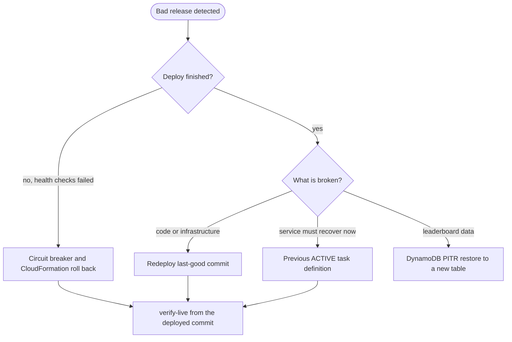

# Runbook: Roll Back Production

<a href="#english"></a>
<a href="#korean"></a>

---

<a id="english"></a>

# English

## Overview

Return `TurboPalsStack` (account `061525506239`, `ap-northeast-2`) to a known-good state after a bad release. The server, the API and the client files ship in one container image, so every option below moves all three together. Two things outlive any server-side rollback and need deliberate handling: the build each player's service worker has cached, and the simulation version that server-side verification depends on (step 3).

| Option | Use when | Effect |
| --- | --- | --- |
| Automatic: ECS circuit breaker and CloudFormation rollback | New tasks fail their health checks during `npm run deploy` | The service returns to the last completed deployment and the stack ends in `UPDATE_ROLLBACK_COMPLETE`. Nothing to run |
| Redeploy the last-good commit (recommended) | The deploy completed but the release is broken | Image, client files and infrastructure all return to that commit. Takes about one deploy (246.54 s for 1.0.0) |
| Previous task definition revision | Only when an earlier revision is still `ACTIVE` | Image and container environment only; the stack template keeps the new revision |
| DynamoDB point-in-time restore | Bad data reached the leaderboard | Restores into a new table; serving it needs a code change |



## When to Use

- `verify-live` fails after a deploy and a fix-forward is not quick.
- Players report a regression that started with the latest release.
- A deploy failed and you need to confirm that the automatic rollback finished.
- For incident triage before deciding to roll back, use [incident-response.md](incident-response.md).

## Prerequisites

- Everything in [deploy-production.md](deploy-production.md) (credentials for `061525506239`, Node `>=22.12.0`, Docker with `linux/arm64` builds, CDK bootstrap, `jq`, `dig`, `curl`, Playwright Chromium).
- The last-good release: a release tag (`git tag --list 'v*'`) or a commit hash. 1.0.0 is commit `23080fe`.
- A clean working tree: `git switch --detach` refuses to run over local changes that conflict.

## Procedure

### 1. Assess the current state

```bash
aws cloudformation describe-stacks --stack-name TurboPalsStack --region ap-northeast-2 \
  --query 'Stacks[0].StackStatus' --output text
aws cloudformation describe-stack-events --stack-name TurboPalsStack --region ap-northeast-2 --max-items 20 \
  --query 'StackEvents[].[Timestamp,LogicalResourceId,ResourceStatus,ResourceStatusReason]' --output table
CLUSTER=$(jq -r .TurboPalsStack.ClusterName cdk-outputs.json)
SERVICE=$(jq -r .TurboPalsStack.ServiceName cdk-outputs.json)
aws ecs describe-services --cluster "$CLUSTER" --services "$SERVICE" --region ap-northeast-2 \
  --query 'services[0].deployments[].[status,rolloutState,rolloutStateReason,taskDefinition]' --output table
curl -s https://my-kart.whchoi.net/healthz
```

- `UPDATE_ROLLBACK_COMPLETE`: the automatic rollback already restored the previous template and service. `verify-live` check 1 keeps failing while the status contains `ROLLBACK`; it clears with the next successful deploy. Fix the cause on `main` and deploy with [deploy-production.md](deploy-production.md).
- `UPDATE_ROLLBACK_FAILED`: see the Rollback section of this runbook.
- `UPDATE_COMPLETE` with a broken release: continue with step 2.

### 2. Choose the target commit

```bash
git fetch origin --tags
git tag --list 'v*'
git log --oneline -n 10
GOOD=23080fe
git diff --stat "$GOOD" HEAD -- src/sim package.json cdk.json
```

Set `GOOD` to the last-good tag or commit (`23080fe` is 1.0.0). Read the diff:

- `src/sim/` differs: apply step 3 before deploying.
- `cdk.json` differs in `domainName`, `certificateArn` or `originSecretGeneration`: keep the production values by passing them with `-c` in step 4. Otherwise the rollback also removes the custom domain, or moves the origin secret back one generation. In that case the ALB rule is updated before the distribution (`infra/lib/stack.ts`), so edges that still send the newer secret get 403 until CloudFront has propagated.

### 3. Apply the simulation version rule

Each semver core version must identify exactly one simulation of every existing track (adding a brand-new track changes no existing replay and does not by itself need a new version). When a replay fails, the server answers `VERSION_MISMATCH` only if the client's core version differs from its own; with equal versions it answers `REPLAY_INVALID`, which tells the player the run is corrupted (`compareResult` in `src/server/app.ts`). A trajectory change almost always fails the replay outright, because the log ends on the finish tick of the simulation that recorded it (`src/sim/replay.ts`); only a kart that happens to finish on the very same tick is judged on its ticks and laps instead.

| Situation | Clients still on the bad build | Action |
| --- | --- | --- |
| The bad release changed the simulation and bumped the version (for example to 1.1.0); you redeploy the previous tag (1.0.0) | Their runs fail replay and get `VERSION_MISMATCH` until they update; clients that never updated are accepted | None for this rollback. The next release must not reuse 1.1.0 with a different simulation; give it a new version |
| You revert the simulation change with a new commit on `main` and keep 1.1.0 | They get `REPLAY_INVALID`, and their offline queue keeps runs that can never verify | Bump the version in the revert (for example 1.1.1) and release it with [deploy-production.md](deploy-production.md) |
| The bad release changed the simulation without a version bump (both builds say 1.0.0) | Whichever build differs from the server gets `REPLAY_INVALID` | Release the good simulation under a new version (for example 1.0.1) from `main`: clients of the bad build then get `VERSION_MISMATCH`, while clients that never updated still pass because their simulation matches |

At boot every client also drops the time-trial runs it queued offline under a different core version (`dropStalePendingRuns` in `src/client/storage.ts`), so a version change discards those queued runs once players update.

### 4. Redeploy the last-good commit

```bash
git status --porcelain
git switch --detach "$GOOD"
npm ci
npx cdk diff TurboPalsStack
npm run deploy
```

`npm ci` matters: the lockfile and the CDK libraries can differ between commits. If step 2 showed `cdk.json` changes, pass the production values instead, for example `npm run deploy -- -c originSecretGeneration=2` when production runs secret generation 2.

### 5. Verify from the rolled-back checkout

Stay on `$GOOD`: the E2E check records a bot run with the local simulation, so it must match the simulation you just deployed. Write the reports to the git-ignored `test-results/` so the checkout stays clean.

```bash
npm run verify:live -- --out test-results/live-verify-rollback.json
npm run verify:live -- --custom --out test-results/live-verify-rollback-custom.json
node tools/verify-live-pwa.mjs https://my-kart.whchoi.net
```

### 6. Return to main

```bash
git switch main
npm ci
```

`main` still contains the bad change, and the next deploy from `main` ships it again. Revert or fix it on `main` first, applying step 3.

### 7. Alternative: switch the service to an earlier task definition

Use this only when an earlier revision is still `ACTIVE`. During the 1.0.0 deploy, CloudFormation deleted the replaced `AWS::ECS::TaskDefinition` in `UPDATE_COMPLETE_CLEANUP` (`deploy.log`), which deregisters that revision, and ECS cannot move a service to a deregistered (`INACTIVE`) revision. `list-task-definitions` shows only `ACTIVE` revisions, so check first:

```bash
CLUSTER=$(jq -r .TurboPalsStack.ClusterName cdk-outputs.json)
SERVICE=$(jq -r .TurboPalsStack.ServiceName cdk-outputs.json)
FAMILY=$(aws ecs describe-services --cluster "$CLUSTER" --services "$SERVICE" --region ap-northeast-2 \
  --query 'services[0].taskDefinition' --output text | sed -E 's#.*/([^:]+):[0-9]+$#\1#')
aws ecs list-task-definitions --family-prefix "$FAMILY" --sort DESC --region ap-northeast-2
PREVIOUS=$(aws ecs list-task-definitions --family-prefix "$FAMILY" --sort DESC --region ap-northeast-2 \
  --query 'taskDefinitionArns[1]' --output text)
echo "$PREVIOUS"
```

If `PREVIOUS` prints `None`, no earlier revision is available: use step 4. That was the case on 2026-10-18, when only the running revision was `ACTIVE` and all earlier ones were `INACTIVE`. Otherwise:

```bash
aws ecs update-service --cluster "$CLUSTER" --service "$SERVICE" --task-definition "$PREVIOUS" --region ap-northeast-2
aws ecs wait services-stable --cluster "$CLUSTER" --services "$SERVICE" --region ap-northeast-2
```

The client files and `APP_VERSION` come back with the image. CloudFormation does not notice: a deploy with an unchanged template leaves the service on this revision, and the next deploy that changes the task definition replaces it. Fix `main` before that deploy.

### 8. Alternative: restore leaderboard data

Point-in-time recovery is enabled on the rankings table (35 days). A restore always creates a new table:

```bash
TABLE=$(jq -r .TurboPalsStack.TableName cdk-outputs.json)
aws dynamodb restore-table-to-point-in-time --source-table-name "$TABLE" \
  --target-table-name "$TABLE-restore" --restore-date-time 2026-09-24T03:40:00Z --region ap-northeast-2
```

Set `--restore-date-time` to a moment just before the bad writes. The service keeps using the stack's own table: `TABLE_NAME` comes from that table (`infra/lib/service.ts`) and the task role may only access its ARN. Serving the restored table, or copying items back from it, is a planned code change; this repository has no tooling for it.

## Verification

- [ ] The stack status is `UPDATE_COMPLETE`, not `UPDATE_ROLLBACK_COMPLETE` or `UPDATE_ROLLBACK_FAILED`.
- [ ] The ECS service has one `PRIMARY` deployment with `rolloutState` `COMPLETED`.
- [ ] `curl -s https://my-kart.whchoi.net/healthz` shows the core version of the last-good release.
- [ ] Both `verify-live` runs from the rolled-back checkout report 35/35, and `verify-live-pwa` reports 8/8.
- [ ] `main` carries the revert or fix, with a version bump if step 3 called for one, before the next deploy.

## Rollback

- If the rollback deploy fails, CloudFormation rolls back to the bad release's template (`UPDATE_ROLLBACK_COMPLETE`); read the stack events from step 1 before trying again.
- If a rollback stops in `UPDATE_ROLLBACK_FAILED`, fix the cause the events name, then resume it:

```bash
aws cloudformation continue-update-rollback --stack-name TurboPalsStack --region ap-northeast-2
```

- To undo a rollback, deploy `main` again with [deploy-production.md](deploy-production.md).

## Notes

- Last verified: 2026-10-18. Desk check of every option against `infra/lib/service.ts` (circuit breaker `enable: true, rollback: true`, `minHealthyPercent 100`, `maxHealthyPercent 200`), `infra/lib/stack.ts`, `src/server/app.ts`, `src/sim/replay.ts`, `src/client/sw.ts` and the 1.0.0 `deploy.log`. No rollback has been executed against production; the redeploy path uses the same `npm run deploy` that shipped 1.0.0 on 2026-09-24.
- What players see after a rollback:
  - Players already on the bad build keep it, because navigations are served from its cached app shell, until their next update check finds the rolled-back build and they apply it between races (`업데이트` on the title screen or the main menu, or after closing every game window). The server cannot force this.
  - To the service worker the rolled-back build is simply the next version. On activation it keeps the current cache and the last-good one (the cache it served before) and deletes the other `turbo-pals-*` caches. If the rolled-back client files are byte-identical to that last-good cache (same build id in `turbo-pals-<version>-<build>`), the install finds the complete cache and downloads nothing.
  - A bad build whose precache cannot complete (missing asset, 5xx) never installs, so those players stay on their last complete version.
  - If the bad release broke the update path itself (`src/client/pwa.ts`, `src/client/sw.ts`), players leave it by closing every game window or clearing the site data.
- A rollback needs no CloudFront invalidation either: HTML, `sw.js` and `build.json` are never cached at the edge, hashed `/assets/*` names differ per build, and error responses have TTL 0.
- `/healthz` is liveness only, so the circuit breaker cannot catch a release that starts but breaks DynamoDB access or verification. `verify-live` is the check that does.
- [docs/infra.md](../infra.md) section 6 lists the same options. Its emergency task-definition path predates the observation above that CloudFormation deregisters replaced revisions.

---

<a id="korean"></a>

# 한국어

## 개요

문제가 있는 릴리스를 배포한 뒤 `TurboPalsStack`(계정 `061525506239`, `ap-northeast-2`)을 정상 상태로 되돌립니다. 서버, API, 클라이언트 파일이 하나의 컨테이너 이미지에 들어 있으므로 아래 방법은 모두 이 셋을 함께 옮깁니다. 다만 두 가지는 서버 쪽 롤백으로 끝나지 않아 따로 다뤄야 합니다. 플레이어마다 서비스 워커가 캐시한 빌드, 그리고 서버 검증이 의존하는 시뮬레이션 버전입니다(3단계).

| 방법 | 사용하는 경우 | 효과 |
| --- | --- | --- |
| 자동: ECS 서킷 브레이커와 CloudFormation 롤백 | `npm run deploy` 도중 새 태스크가 헬스 체크를 통과하지 못함 | 서비스가 마지막으로 완료된 배포로 돌아가고 스택은 `UPDATE_ROLLBACK_COMPLETE`로 끝납니다. 직접 실행할 것은 없습니다 |
| 마지막 정상 커밋 재배포(권장) | 배포는 끝났지만 릴리스에 문제가 있음 | 이미지, 클라이언트 파일, 인프라가 모두 그 커밋으로 돌아갑니다. 배포 한 번만큼 걸립니다(1.0.0은 246.54초) |
| 이전 태스크 정의 리비전 | 이전 리비전이 아직 `ACTIVE`일 때만 | 이미지와 컨테이너 환경 변수만 되돌립니다. 스택 템플릿에는 새 리비전이 그대로 남습니다 |
| DynamoDB 시점 복구 | 잘못된 데이터가 리더보드에 들어감 | 새 테이블로 복원합니다. 서비스에 연결하려면 코드 변경이 필요합니다 |


## 사용 시점

- 배포 후 `verify-live`가 실패했고, 바로 고쳐서 다시 배포하기 어려울 때입니다.
- 최신 릴리스 이후 시작된 문제를 플레이어가 보고할 때입니다.
- 배포가 실패해 자동 롤백이 끝났는지 확인해야 할 때입니다.
- 롤백 여부를 정하기 전의 장애 분류는 [incident-response.md](incident-response.md)를 따릅니다.

## 사전 요구 사항

- [deploy-production.md](deploy-production.md)의 요구 사항 전체(`061525506239` 자격 증명, Node `>=22.12.0`, `linux/arm64`를 빌드할 수 있는 Docker, CDK 부트스트랩, `jq`, `dig`, `curl`, Playwright Chromium)가 필요합니다.
- 마지막 정상 릴리스를 알아야 합니다. 릴리스 태그(`git tag --list 'v*'`)나 커밋 해시이며, 1.0.0은 커밋 `23080fe`입니다.
- 작업 트리가 깨끗해야 합니다. 로컬 변경과 충돌하면 `git switch --detach`가 실행되지 않습니다.

## 절차

### 1. 현재 상태 파악

```bash
aws cloudformation describe-stacks --stack-name TurboPalsStack --region ap-northeast-2 \
  --query 'Stacks[0].StackStatus' --output text
aws cloudformation describe-stack-events --stack-name TurboPalsStack --region ap-northeast-2 --max-items 20 \
  --query 'StackEvents[].[Timestamp,LogicalResourceId,ResourceStatus,ResourceStatusReason]' --output table
CLUSTER=$(jq -r .TurboPalsStack.ClusterName cdk-outputs.json)
SERVICE=$(jq -r .TurboPalsStack.ServiceName cdk-outputs.json)
aws ecs describe-services --cluster "$CLUSTER" --services "$SERVICE" --region ap-northeast-2 \
  --query 'services[0].deployments[].[status,rolloutState,rolloutStateReason,taskDefinition]' --output table
curl -s https://my-kart.whchoi.net/healthz
```

- `UPDATE_ROLLBACK_COMPLETE`: 자동 롤백이 이전 템플릿과 서비스를 이미 복원했습니다. 상태에 `ROLLBACK`이 들어 있는 동안 `verify-live` 1번 검사는 계속 실패하며, 다음 배포가 성공하면 해소됩니다. `main`에서 원인을 고친 뒤 [deploy-production.md](deploy-production.md)로 배포합니다.
- `UPDATE_ROLLBACK_FAILED`: 이 런북의 롤백 절을 봅니다.
- `UPDATE_COMPLETE`인데 릴리스에 문제가 있음: 2단계로 넘어갑니다.

### 2. 되돌릴 커밋 선택

```bash
git fetch origin --tags
git tag --list 'v*'
git log --oneline -n 10
GOOD=23080fe
git diff --stat "$GOOD" HEAD -- src/sim package.json cdk.json
```

`GOOD`에는 마지막 정상 태그나 커밋을 넣습니다(`23080fe`가 1.0.0입니다). diff는 이렇게 판단합니다.

- `src/sim/`이 다르면 배포 전에 3단계를 적용합니다.
- `cdk.json`의 `domainName`, `certificateArn`, `originSecretGeneration`이 다르면 4단계에서 `-c`로 운영 중인 값을 넘겨 유지합니다. 그러지 않으면 롤백과 함께 커스텀 도메인이 빠지거나 오리진 시크릿이 한 세대 뒤로 돌아갑니다. 이때 ALB 규칙이 배포(distribution)보다 먼저 갱신되므로(`infra/lib/stack.ts`), 새 시크릿을 아직 보내는 엣지는 CloudFront 전파가 끝날 때까지 403을 받습니다.

### 3. 시뮬레이션 버전 규칙 적용

semver 코어 버전 하나는 기존 트랙마다 정확히 하나의 시뮬레이션을 가리켜야 합니다(새 트랙을 추가하는 것만으로는 기존 재시뮬레이션 결과가 바뀌지 않으므로 새 버전이 필요하지 않습니다). 재시뮬레이션이 실패하면 서버는 클라이언트의 코어 버전이 자신과 다를 때만 `VERSION_MISMATCH`로 답하고, 같으면 기록이 손상되었다는 뜻의 `REPLAY_INVALID`로 답합니다(`src/server/app.ts`의 `compareResult`). 로그는 그것을 기록한 시뮬레이션의 완주 틱에서 끝나므로(`src/sim/replay.ts`), 궤적이 바뀌면 재시뮬레이션은 거의 항상 그대로 실패합니다. 카트가 우연히 같은 틱에 완주한 경우에만 틱과 랩 기록으로 판정합니다.

| 상황 | 문제 빌드에 머문 클라이언트 | 조치 |
| --- | --- | --- |
| 문제 릴리스가 시뮬레이션을 바꾸면서 버전도 올렸고(예: 1.1.0) 이전 태그(1.0.0)를 다시 배포함 | 업데이트하기 전까지 재시뮬레이션이 실패해 `VERSION_MISMATCH`를 받습니다. 업데이트하지 않았던 클라이언트의 기록은 접수됩니다 | 이번 롤백에서는 할 일이 없습니다. 다음 릴리스는 시뮬레이션이 다르다면 1.1.0을 다시 쓰지 말고 새 버전을 붙입니다 |
| `main`에 새 커밋으로 시뮬레이션 변경을 되돌리고 버전은 1.1.0으로 둠 | `REPLAY_INVALID`를 받고, 오프라인 보관함에는 끝내 검증될 수 없는 기록이 남습니다 | 되돌리는 커밋에서 버전을 올리고(예: 1.1.1) [deploy-production.md](deploy-production.md)로 릴리스합니다 |
| 문제 릴리스가 버전을 올리지 않고 시뮬레이션을 바꿈(두 빌드 모두 1.0.0) | 서버와 시뮬레이션이 다른 쪽 빌드가 `REPLAY_INVALID`를 받습니다 | 정상 시뮬레이션을 새 버전(예: 1.0.1)으로 `main`에서 릴리스합니다. 그러면 문제 빌드의 클라이언트는 `VERSION_MISMATCH`를 받고, 업데이트하지 않았던 클라이언트는 시뮬레이션이 같아 계속 통과합니다 |

클라이언트는 부팅할 때 코어 버전이 다른 상태에서 오프라인으로 보관한 타임 어택 기록을 지웁니다(`src/client/storage.ts`의 `dropStalePendingRuns`). 따라서 버전이 바뀌면 플레이어가 업데이트하는 시점에 그 기록은 사라집니다.

### 4. 마지막 정상 커밋 재배포

```bash
git status --porcelain
git switch --detach "$GOOD"
npm ci
npx cdk diff TurboPalsStack
npm run deploy
```

커밋마다 lockfile과 CDK 라이브러리 버전이 다를 수 있으므로 `npm ci`를 빼먹지 않습니다. 2단계에서 `cdk.json` 변경이 보였다면 운영 중인 값을 넘깁니다. 예를 들어 운영 환경이 시크릿 2세대라면 `npm run deploy -- -c originSecretGeneration=2`로 배포합니다.

### 5. 되돌린 체크아웃에서 검증

`$GOOD`에 머문 채로 실행합니다. E2E 검사는 로컬 시뮬레이션으로 봇 주행을 기록하므로 방금 배포한 시뮬레이션과 같아야 합니다. 체크아웃을 깨끗하게 유지하도록 리포트는 git이 무시하는 `test-results/`에 씁니다.

```bash
npm run verify:live -- --out test-results/live-verify-rollback.json
npm run verify:live -- --custom --out test-results/live-verify-rollback-custom.json
node tools/verify-live-pwa.mjs https://my-kart.whchoi.net
```

### 6. main으로 복귀

```bash
git switch main
npm ci
```

`main`에는 문제의 변경이 아직 남아 있어 다음에 `main`에서 배포하면 다시 나갑니다. 먼저 `main`에서 되돌리거나 고치고, 이때 3단계를 적용합니다.

### 7. 대안: 서비스를 이전 태스크 정의로 전환

이전 리비전이 아직 `ACTIVE`일 때만 씁니다. 1.0.0 배포 때 CloudFormation은 교체된 `AWS::ECS::TaskDefinition`을 `UPDATE_COMPLETE_CLEANUP` 단계에서 삭제해 그 리비전을 등록 해제했고(`deploy.log`), ECS는 등록 해제된(`INACTIVE`) 리비전으로 서비스를 옮길 수 없습니다. `list-task-definitions`는 `ACTIVE` 리비전만 보여 주므로 먼저 확인합니다.

```bash
CLUSTER=$(jq -r .TurboPalsStack.ClusterName cdk-outputs.json)
SERVICE=$(jq -r .TurboPalsStack.ServiceName cdk-outputs.json)
FAMILY=$(aws ecs describe-services --cluster "$CLUSTER" --services "$SERVICE" --region ap-northeast-2 \
  --query 'services[0].taskDefinition' --output text | sed -E 's#.*/([^:]+):[0-9]+$#\1#')
aws ecs list-task-definitions --family-prefix "$FAMILY" --sort DESC --region ap-northeast-2
PREVIOUS=$(aws ecs list-task-definitions --family-prefix "$FAMILY" --sort DESC --region ap-northeast-2 \
  --query 'taskDefinitionArns[1]' --output text)
echo "$PREVIOUS"
```

`PREVIOUS`가 `None`을 출력하면 쓸 수 있는 이전 리비전이 없으니 4단계를 따릅니다. 2026-10-18에도 실행 중인 리비전만 `ACTIVE`이고 이전 리비전은 모두 `INACTIVE`라서 이 경우에 해당했습니다. 리비전이 있으면 다음을 실행합니다.

```bash
aws ecs update-service --cluster "$CLUSTER" --service "$SERVICE" --task-definition "$PREVIOUS" --region ap-northeast-2
aws ecs wait services-stable --cluster "$CLUSTER" --services "$SERVICE" --region ap-northeast-2
```

클라이언트 파일과 `APP_VERSION`도 이미지와 함께 돌아옵니다. CloudFormation은 이 변경을 알지 못합니다. 템플릿이 바뀌지 않은 배포는 서비스를 이 리비전에 그대로 두고, 태스크 정의를 바꾸는 다음 배포가 이를 교체합니다. 그 배포 전에 `main`을 고쳐 둡니다.

### 8. 대안: 리더보드 데이터 복원

랭킹 테이블에는 시점 복구(35일)가 켜져 있습니다. 복원하면 항상 새 테이블이 만들어집니다.

```bash
TABLE=$(jq -r .TurboPalsStack.TableName cdk-outputs.json)
aws dynamodb restore-table-to-point-in-time --source-table-name "$TABLE" \
  --target-table-name "$TABLE-restore" --restore-date-time 2026-09-24T03:40:00Z --region ap-northeast-2
```

`--restore-date-time`은 잘못된 쓰기가 일어나기 직전 시각으로 바꿉니다. 서비스는 계속 스택이 만든 테이블을 씁니다. `TABLE_NAME`이 그 테이블에서 오고(`infra/lib/service.ts`) 태스크 역할도 그 ARN에만 접근할 수 있기 때문입니다. 복원한 테이블을 서비스에 연결하거나 항목을 다시 복사해 넣는 일은 계획된 코드 변경으로 다뤄야 하며, 이 저장소에는 그런 도구가 없습니다.

## 검증

- [ ] 스택 상태가 `UPDATE_ROLLBACK_COMPLETE`나 `UPDATE_ROLLBACK_FAILED`가 아닌 `UPDATE_COMPLETE`입니다.
- [ ] ECS 서비스의 배포가 `PRIMARY` 하나이고 `rolloutState`가 `COMPLETED`입니다.
- [ ] `curl -s https://my-kart.whchoi.net/healthz`가 마지막 정상 릴리스의 코어 버전을 보여 줍니다.
- [ ] 되돌린 체크아웃에서 실행한 `verify-live` 두 번이 모두 35/35이고 `verify-live-pwa`가 8/8입니다.
- [ ] 다음 배포 전에 `main`에 되돌리기나 수정이 들어갔고, 3단계에 따라 필요하면 버전도 올렸습니다.

## 롤백

- 롤백 배포가 실패하면 CloudFormation이 문제 릴리스의 템플릿으로 다시 롤백합니다(`UPDATE_ROLLBACK_COMPLETE`). 다시 시도하기 전에 1단계의 스택 이벤트를 읽습니다.
- 롤백이 `UPDATE_ROLLBACK_FAILED`에서 멈추면 이벤트가 가리키는 원인을 해결한 뒤 롤백을 이어서 진행합니다.

```bash
aws cloudformation continue-update-rollback --stack-name TurboPalsStack --region ap-northeast-2
```

- 롤백을 취소하려면 [deploy-production.md](deploy-production.md)로 `main`을 다시 배포합니다.

## 참고

- 최종 검증일: 2026-10-18. 모든 방법을 `infra/lib/service.ts`(서킷 브레이커 `enable: true, rollback: true`, `minHealthyPercent 100`, `maxHealthyPercent 200`), `infra/lib/stack.ts`, `src/server/app.ts`, `src/sim/replay.ts`, `src/client/sw.ts`, 1.0.0의 `deploy.log`와 대조해 검토했습니다. 운영 환경에서 롤백을 실행한 적은 없습니다. 재배포 경로는 2026-09-24에 1.0.0을 배포한 것과 같은 `npm run deploy`를 씁니다.
- 롤백 후 플레이어가 겪는 일:
  - 문제 빌드를 이미 쓰는 플레이어는 그 빌드를 계속 씁니다. 페이지 이동이 캐시된 앱 셸에서 응답되기 때문입니다. 다음 업데이트 확인에서 되돌린 빌드를 찾고 플레이어가 레이스 사이에 적용해야 바뀝니다(타이틀 화면이나 메인 메뉴의 `업데이트`, 또는 게임 창을 모두 닫은 뒤). 서버에서 강제할 수는 없습니다.
  - 서비스 워커 입장에서 되돌린 빌드는 그저 다음 버전입니다. 활성화될 때 현재 캐시와 last-good 캐시(직전에 응답하던 캐시)만 남기고 다른 `turbo-pals-*` 캐시는 지웁니다. 되돌린 클라이언트 파일이 그 last-good 캐시와 바이트 단위로 같다면(`turbo-pals-<version>-<build>`의 build id가 같음), 설치 단계에서 완성된 캐시를 찾아 아무것도 내려받지 않습니다.
  - 프리캐시를 끝내지 못하는 문제 빌드(에셋 누락, 5xx)는 설치되지 않으므로, 그런 플레이어는 마지막으로 완성된 버전에 머뭅니다.
  - 문제 릴리스가 업데이트 경로 자체(`src/client/pwa.ts`, `src/client/sw.ts`)를 망가뜨렸다면, 플레이어는 게임 창을 모두 닫거나 사이트 데이터를 지워야 빠져나올 수 있습니다.
- 롤백에도 CloudFront 캐시 무효화는 필요 없습니다. HTML, `sw.js`, `build.json`은 엣지에서 캐시하지 않고, 해시가 붙은 `/assets/*` 이름은 빌드마다 다르며, 오류 응답의 TTL은 0입니다.
- `/healthz`는 생존 여부만 보므로, 기동은 되지만 DynamoDB 접근이나 검증이 망가진 릴리스는 서킷 브레이커가 잡지 못합니다. 이런 문제는 `verify-live`가 잡습니다.
- [docs/infra.md](../infra.md) 6절에도 같은 방법이 있습니다. 다만 그 문서의 긴급 태스크 정의 경로는 CloudFormation이 교체된 리비전을 등록 해제한다는 위 관찰보다 먼저 작성되었습니다.
