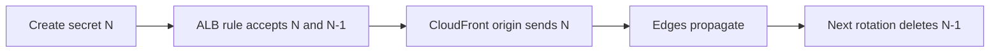

# Runbook: Rotate the Origin Secret

<a href="#english"></a>
<a href="#korean"></a>

---

<a id="english"></a>

# English

## Overview

CloudFront adds the header `X-Origin-Verify: <secret>` to every request it sends to the ALB. The ALB listener on port 80 answers everything with a fixed `403 Forbidden` (`text/plain`) unless the listener rule `FromCloudFront` (priority 10) matches an accepted header value, in which case it forwards to the Fargate tasks. The value is a 48-character Secrets Manager secret (no punctuation) that CloudFormation generates. The distribution origin and the listener rule read it through CloudFormation dynamic references; the value is never in the template, the task environment, IAM policies or stack outputs, and the task never sees it.

Secrets Manager rotation is not used (the dynamic references could not pick up a rotated value; cdk-nag `AwsSolutions-SMG4` is acknowledged in `infra/lib/data.ts`). Rotation is a redeploy with a higher CDK context value `originSecretGeneration` (integer 1 to 999, default 1, read in `infra/bin/app.ts`):

| Generation | Secrets in the stack (construct ids) | CloudFront sends | ALB rule accepts |
| --- | --- | --- | --- |
| 1 (deployed today) | `OriginVerify` | generation 1 | generation 1 |
| 2 | `OriginVerify`, `OriginVerifyG2` | generation 2 | generation 2 and 1 |
| 3 | `OriginVerifyG2`, `OriginVerifyG3` | generation 3 | generation 3 and 2 |
| N (N > 2) | `OriginVerifyG<N-1>`, `OriginVerifyG<N>` | generation N | generation N and N-1 |

The distribution has an explicit dependency on the listener rule (`infra/lib/stack.ts`), so CloudFormation updates the rule before the distribution. The ALB therefore accepts the new value before any edge sends it, and keeps accepting the old value while CloudFront propagates. No request gets a 403 during the switch.



The behaviour is pinned by the "origin secret rotation" tests in `test/infra/stack.test.ts` (generation 2 keeps generation 1 accepted, the rule is updated before the distribution, generation 3 retires generation 1, invalid generations are rejected).

## When to Use

- Scheduled rotation of the CloudFront-to-ALB shared secret.
- The current value may have leaked (logs, screenshots, a copied CloudFront configuration). A leaked value lets someone else's CloudFront distribution reach the ALB, because the security group admits the whole CloudFront origin-facing prefix list. Rotate twice to revoke it (step 6).
- The deployed generation and `cdk.json` disagree (for example after a rollback lowered the generation and the ALB started answering `403 Forbidden`): use step 1 to find the deployed generation, then deploy that generation or a higher one.

## Prerequisites

- AWS credentials for account `061525506239`: `aws sts get-caller-identity --query Account --output text` prints `061525506239`.
- The normal deploy toolchain (Node.js 22.12 or later, `npm ci` done, Docker running, CDK bootstrap); see [deploy-production.md](./deploy-production.md).
- A checkout of the deployed commit with no local changes, so that the deploy changes only the secrets, the listener rule and the distribution.
- `jq` and `curl`.
- Nobody else deploys `TurboPalsStack` until step 5 is committed.

## Procedure

### 1. Find the current generation

Run from the project root:

```bash
node -p "require('./cdk.json').context.originSecretGeneration ?? 1"
aws cloudformation describe-stack-resources --stack-name TurboPalsStack --region ap-northeast-2 \
  --query "StackResources[?ResourceType=='AWS::SecretsManager::Secret'].LogicalResourceId" --output text
```

The first command prints the generation that `cdk.json` deploys (no key means 1). The second lists the deployed secrets: `DataOriginVerify<hash>` is generation 1 and `DataOriginVerifyG<N><hash>` is generation N; the highest number is the deployed generation. On 2026-10-18 the output is `1` and `DataOriginVerify0E337E8C`.

If `cdk.json` is lower than the deployed generation, stop: set `cdk.json` to the deployed generation first (step 5 shows how). Deploying a lower generation causes 403s (see Rollback).

The next generation is the deployed generation plus 1. The commands below use `2`; replace it with your value everywhere.

### 2. Preview the change

```bash
npx cdk diff TurboPalsStack -c originSecretGeneration=2
```

Expect exactly three changes: a new `AWS::SecretsManager::Secret` (`Data/OriginVerifyG2`), a modified `AWS::ElasticLoadBalancingV2::ListenerRule` (`Compute/FromCloudFront`, now with two header values) and a modified `AWS::CloudFront::Distribution` (the origin custom header). From generation 3 on, the diff also removes the secret of generation N-2. If the diff shows the task definition, the service or anything else, your checkout differs from the deployed build: stop and ship that change separately through [deploy-production.md](./deploy-production.md).

### 3. Watch availability during the deploy

Start this loop in a second terminal and leave it running until step 4 has finished:

```bash
while true; do printf '%s %s\n' "$(date -u +%H:%M:%S)" "$(curl -s -o /dev/null -w '%{http_code}' https://my-kart.whchoi.net/healthz)"; sleep 5; done
```

Every line must show `200`. Stop it with Ctrl+C.

### 4. Deploy the new generation

```bash
npx cdk deploy TurboPalsStack -c originSecretGeneration=2 --outputs-file cdk-outputs.json
```

CloudFormation creates the new secret, updates the listener rule, then updates the distribution and waits until CloudFront has deployed it, which can take several minutes. The stack outputs do not change.

### 5. Persist the generation in cdk.json

Record the new generation immediately, so that the next deploy does not lower it again. The one-liner keeps the existing `cdk.json` formatting:

```bash
node -e "const fs=require('fs');const c=JSON.parse(fs.readFileSync('cdk.json','utf8'));c.context.originSecretGeneration=2;fs.writeFileSync('cdk.json',JSON.stringify(c,null,2)+'\n')"
git diff cdk.json
git add cdk.json
git commit -m "chore(infra): rotate origin secret to generation 2"
```

`git diff` shows the new last context line `"originSecretGeneration": 2` and a trailing comma added to the `certificateArn` line above it; nothing else may change. Merge the commit through the normal pull-request flow so every checkout deploys generation 2. Editing `cdk.json` before step 4 and deploying without `-c` is equivalent.

This step finishes the rotation. The previous generation stays accepted by the ALB until the next rotation: for N > 1 the code always accepts N and N-1, and there is no mode that accepts only N.

### 6. Revoke a leaked value (only if the old value leaked)

After step 5 the ALB still accepts the old value (N-1). To remove it, rotate once more: repeat steps 2 to 5 with N+1. Generation N+1 deletes the secret of generation N-1, and the remaining accepted values (N and N+1) were never exposed.

## Verification

Run the live checks. The report goes to a git-ignored path; the E2E part writes four QA rows to the production table and deletes them again:

```bash
npm run verify:live -- --custom --out test-results/live-verify-rotation.json
```

Check the listener rule and the distribution. These commands print a count and a status, never the secret values:

```bash
ALB=$(jq -r .TurboPalsStack.AlbDnsName cdk-outputs.json)
DIST_ID=$(jq -r .TurboPalsStack.DistributionId cdk-outputs.json)
LB_ARN=$(aws elbv2 describe-load-balancers --region ap-northeast-2 --query "LoadBalancers[?DNSName=='$ALB'].LoadBalancerArn" --output text)
LISTENER_ARN=$(aws elbv2 describe-listeners --load-balancer-arn "$LB_ARN" --region ap-northeast-2 --query 'Listeners[?Port==`80`].ListenerArn' --output text)
aws elbv2 describe-rules --listener-arn "$LISTENER_ARN" --region ap-northeast-2 \
  --query "Rules[?Priority=='10'].Conditions[0].HttpHeaderConfig.Values | [0] | length(@)"
aws cloudfront get-distribution --id "$DIST_ID" --query 'Distribution.Status' --output text
```

- [ ] The step 3 loop printed only `200` while the deploy ran.
- [ ] `verify:live` passes every check, in particular "Listener :80 default action is a fixed 403", "Every forwarding rule requires the X-Origin-Verify header", "GET / via CloudFront → 200 HTML", "Honest run is verified and accepted" and "Direct ALB access from outside CloudFront is blocked".
- [ ] The rule command prints `2` (it printed `1` at generation 1) and the distribution status is `Deployed`.
- [ ] The second command of step 1 lists two secrets: `DataOriginVerify0E337E8C` and `DataOriginVerifyG2<hash>` (for N > 2: generations N-1 and N).
- [ ] `npx cdk diff TurboPalsStack` without `-c` reports no differences, which proves that `cdk.json` now deploys the new generation.

## Rollback

- If the deploy in step 4 fails, CloudFormation rolls the stack back automatically. Run step 1 again to confirm which generation is deployed, fix the cause and repeat from step 2.
- Do not undo a finished rotation by deploying a lower generation, and do not deploy an older commit whose `cdk.json` has a lower generation or none. CloudFormation updates the listener rule before the distribution, so the rule would stop accepting the value that CloudFront edges still send, and every request would get `403 Forbidden` from the ALB until CloudFront finished propagating. Roll forward instead (N+1).
- When application code must be rolled back ([rollback-production.md](./rollback-production.md)), keep the deployed generation by passing it explicitly, for example `-c originSecretGeneration=2`, because the older commit's `cdk.json` may not contain it.
- If players see `403 Forbidden` through CloudFront, follow the ALB 403 procedure in [incident-response.md](./incident-response.md).

## Notes

- Each secret costs about USD 0.40 per month; from generation 2 on the stack holds two secrets ([docs/infra.md](../infra.md), section 8).
- Never rename the construct id `OriginVerify` in `infra/lib/data.ts`: CloudFormation would replace the generation 1 secret.
- Generation `0`, non-integers and `NaN` fail at synth with "originSecretGeneration must be an integer between 1 and 999."
- Background: [docs/infra.md](../infra.md) section 5.1 and [ADR-002](../decisions/ADR-002-cloudfront-only-origin-access.md).
- Last verified: 2026-10-18 (procedure checked against `infra/lib/data.ts`, `infra/lib/service.ts`, `infra/lib/stack.ts` and `test/infra/stack.test.ts`; production still runs generation 1, so no rotation has been executed live yet).

---

<a id="korean"></a>

# 한국어

## 개요

CloudFront는 ALB로 보내는 모든 요청에 `X-Origin-Verify: <secret>` 헤더를 붙입니다. ALB의 80번 포트 리스너는 기본적으로 모든 요청에 고정 응답 `403 Forbidden`(`text/plain`)을 돌려주고, 리스너 규칙 `FromCloudFront`(우선순위 10)가 허용된 헤더 값과 일치할 때만 Fargate 태스크로 전달합니다. 이 값은 CloudFormation이 생성하는 48자 Secrets Manager 시크릿(구두점 없음)입니다. 배포의 오리진 설정과 리스너 규칙은 CloudFormation 동적 참조로 값을 읽으며, 값 자체는 템플릿, 태스크 환경 변수, IAM 정책, 스택 출력 어디에도 나오지 않습니다. 태스크도 이 값을 알지 못합니다.

Secrets Manager의 자동 회전은 쓰지 않습니다. 동적 참조가 회전된 값을 다시 읽어 오지 못하기 때문이며, 이 사유로 cdk-nag `AwsSolutions-SMG4`를 `infra/lib/data.ts`에서 예외 처리했습니다. 회전은 CDK context 값 `originSecretGeneration`(1~999 정수, 기본값 1, `infra/bin/app.ts`에서 읽음)을 올려 재배포하는 방식입니다.

| 세대 | 스택의 시크릿(construct id) | CloudFront가 보내는 값 | ALB 규칙이 허용하는 값 |
| --- | --- | --- | --- |
| 1 (현재 배포) | `OriginVerify` | 세대 1 | 세대 1 |
| 2 | `OriginVerify`, `OriginVerifyG2` | 세대 2 | 세대 2, 1 |
| 3 | `OriginVerifyG2`, `OriginVerifyG3` | 세대 3 | 세대 3, 2 |
| N (N > 2) | `OriginVerifyG<N-1>`, `OriginVerifyG<N>` | 세대 N | 세대 N, N-1 |

배포(distribution)는 리스너 규칙에 명시적으로 의존하므로(`infra/lib/stack.ts`) CloudFormation은 규칙을 먼저 갱신하고 배포를 나중에 갱신합니다. 그래서 어느 엣지가 새 값을 보내기 전에 ALB가 먼저 새 값을 받아들이고, CloudFront가 전파되는 동안에도 이전 값을 계속 허용합니다. 전환 중에 403을 받는 요청은 없습니다.


이 동작은 `test/infra/stack.test.ts`의 "origin secret rotation" 테스트가 고정합니다. 세대 2에서 세대 1이 계속 허용되는지, 규칙이 배포보다 먼저 갱신되는지, 세대 3에서 세대 1이 제거되는지, 잘못된 세대 값을 거부하는지 검사합니다.

## 사용 시점

- CloudFront와 ALB 사이의 공유 시크릿을 정기적으로 교체할 때.
- 현재 값이 유출되었을 가능성이 있을 때(로그, 스크린샷, 복사된 CloudFront 설정 등). 보안 그룹이 CloudFront origin-facing prefix list 전체를 허용하므로, 값이 유출되면 다른 사람의 CloudFront 배포도 ALB에 도달할 수 있습니다. 이 경우 두 번 회전해 값을 무효화합니다(6단계).
- 배포된 세대와 `cdk.json`이 서로 다를 때(예: 롤백으로 세대가 낮아져 ALB가 `403 Forbidden`을 돌려주기 시작한 경우). 1단계로 배포된 세대를 확인한 뒤 그 세대 이상으로 배포합니다.

## 사전 요구 사항

- 계정 `061525506239`의 AWS 자격 증명: `aws sts get-caller-identity --query Account --output text`가 `061525506239`를 출력해야 합니다.
- 일반 배포와 같은 도구 환경(Node.js 22.12 이상, `npm ci` 완료, Docker 실행 중, CDK 부트스트랩). [deploy-production.md](./deploy-production.md)를 참고합니다.
- 로컬 변경이 없는, 배포된 커밋의 체크아웃. 그래야 배포가 시크릿, 리스너 규칙, 배포(distribution)만 바꿉니다.
- `jq`와 `curl`.
- 5단계를 커밋할 때까지 다른 사람이 `TurboPalsStack`을 배포하지 않아야 합니다.

## 절차

### 1. 현재 세대 확인

프로젝트 루트에서 실행합니다.

```bash
node -p "require('./cdk.json').context.originSecretGeneration ?? 1"
aws cloudformation describe-stack-resources --stack-name TurboPalsStack --region ap-northeast-2 \
  --query "StackResources[?ResourceType=='AWS::SecretsManager::Secret'].LogicalResourceId" --output text
```

첫 번째 명령은 `cdk.json`이 배포하는 세대를 출력합니다(키가 없으면 1). 두 번째 명령은 배포된 시크릿 목록을 보여 줍니다. `DataOriginVerify<hash>`는 세대 1, `DataOriginVerifyG<N><hash>`는 세대 N이며, 가장 큰 번호가 배포된 세대입니다. 2026-10-18 기준 출력은 `1`과 `DataOriginVerify0E337E8C`입니다.

`cdk.json`의 값이 배포된 세대보다 낮으면 여기서 멈추고, 먼저 `cdk.json`을 배포된 세대로 맞춥니다(방법은 5단계 참고). 더 낮은 세대를 배포하면 403이 발생합니다(롤백 참고).

다음 세대는 배포된 세대에 1을 더한 값입니다. 아래 명령은 `2`를 기준으로 썼으니 모든 곳에서 실제 값으로 바꿉니다.

### 2. 변경 내용 미리 보기

```bash
npx cdk diff TurboPalsStack -c originSecretGeneration=2
```

변경은 정확히 세 가지여야 합니다. 새 `AWS::SecretsManager::Secret`(`Data/OriginVerifyG2`), 헤더 값이 두 개가 된 `AWS::ElasticLoadBalancingV2::ListenerRule`(`Compute/FromCloudFront`), 오리진 사용자 지정 헤더가 바뀐 `AWS::CloudFront::Distribution`입니다. 세대 3부터는 세대 N-2의 시크릿 삭제도 함께 나옵니다. 태스크 정의, 서비스 등 다른 리소스가 보이면 체크아웃이 배포된 빌드와 다른 것입니다. 멈추고 그 변경은 [deploy-production.md](./deploy-production.md)로 따로 배포합니다.

### 3. 배포 중 가용성 감시

두 번째 터미널에서 아래 루프를 시작하고 4단계가 끝날 때까지 켜 둡니다.

```bash
while true; do printf '%s %s\n' "$(date -u +%H:%M:%S)" "$(curl -s -o /dev/null -w '%{http_code}' https://my-kart.whchoi.net/healthz)"; sleep 5; done
```

모든 줄이 `200`이어야 합니다. Ctrl+C로 멈춥니다.

### 4. 새 세대 배포

```bash
npx cdk deploy TurboPalsStack -c originSecretGeneration=2 --outputs-file cdk-outputs.json
```

CloudFormation이 새 시크릿을 만들고, 리스너 규칙을 갱신한 다음 배포(distribution)를 갱신하고, CloudFront 배포가 끝날 때까지 기다립니다. 몇 분 걸릴 수 있습니다. 스택 출력값은 바뀌지 않습니다.

### 5. cdk.json에 세대 기록

다음 배포가 세대를 다시 낮추지 않도록 바로 기록합니다. 아래 한 줄 명령은 기존 `cdk.json` 서식을 그대로 유지합니다.

```bash
node -e "const fs=require('fs');const c=JSON.parse(fs.readFileSync('cdk.json','utf8'));c.context.originSecretGeneration=2;fs.writeFileSync('cdk.json',JSON.stringify(c,null,2)+'\n')"
git diff cdk.json
git add cdk.json
git commit -m "chore(infra): rotate origin secret to generation 2"
```

`git diff`에는 context의 마지막 줄로 추가된 `"originSecretGeneration": 2`와, 그 위 `certificateArn` 줄 끝에 붙은 쉼표만 보여야 합니다. 그 밖에 바뀐 곳이 있으면 안 됩니다. 이 커밋을 일반 pull request 절차로 병합해 모든 체크아웃이 세대 2로 배포되게 합니다. 4단계 전에 `cdk.json`을 먼저 고치고 `-c` 없이 배포해도 결과는 같습니다.

이 단계로 회전이 끝납니다. 이전 세대는 다음 회전 때까지 ALB에서 계속 허용됩니다. N이 1보다 크면 코드는 항상 N과 N-1을 함께 허용하며, N만 허용하는 모드는 없습니다.

### 6. 유출된 값 무효화(이전 값이 유출된 경우에만)

5단계 이후에도 ALB는 이전 값(N-1)을 허용합니다. 이 값을 없애려면 한 번 더 회전합니다. N+1로 2~5단계를 반복하면 세대 N+1이 세대 N-1의 시크릿을 삭제하고, 남는 허용 값(N, N+1)은 한 번도 노출된 적이 없는 값입니다.

## 검증

라이브 검사를 실행합니다. 리포트는 git이 무시하는 경로에 쓰고, E2E 단계는 운영 테이블에 QA 행 4개를 썼다가 다시 지웁니다.

```bash
npm run verify:live -- --custom --out test-results/live-verify-rotation.json
```

리스너 규칙과 배포(distribution) 상태를 확인합니다. 아래 명령은 개수와 상태만 출력하며 시크릿 값은 출력하지 않습니다.

```bash
ALB=$(jq -r .TurboPalsStack.AlbDnsName cdk-outputs.json)
DIST_ID=$(jq -r .TurboPalsStack.DistributionId cdk-outputs.json)
LB_ARN=$(aws elbv2 describe-load-balancers --region ap-northeast-2 --query "LoadBalancers[?DNSName=='$ALB'].LoadBalancerArn" --output text)
LISTENER_ARN=$(aws elbv2 describe-listeners --load-balancer-arn "$LB_ARN" --region ap-northeast-2 --query 'Listeners[?Port==`80`].ListenerArn' --output text)
aws elbv2 describe-rules --listener-arn "$LISTENER_ARN" --region ap-northeast-2 \
  --query "Rules[?Priority=='10'].Conditions[0].HttpHeaderConfig.Values | [0] | length(@)"
aws cloudfront get-distribution --id "$DIST_ID" --query 'Distribution.Status' --output text
```

- [ ] 배포하는 동안 3단계 루프가 `200`만 출력했습니다.
- [ ] `verify:live`의 모든 검사가 통과합니다. 특히 "Listener :80 default action is a fixed 403", "Every forwarding rule requires the X-Origin-Verify header", "GET / via CloudFront → 200 HTML", "Honest run is verified and accepted", "Direct ALB access from outside CloudFront is blocked"를 확인합니다.
- [ ] 규칙 명령이 `2`를 출력하고(세대 1에서는 `1`), 배포 상태가 `Deployed`입니다.
- [ ] 1단계의 두 번째 명령이 시크릿 두 개를 보여 줍니다. `DataOriginVerify0E337E8C`와 `DataOriginVerifyG2<hash>`입니다(N이 2보다 크면 세대 N-1과 N).
- [ ] `-c` 없이 실행한 `npx cdk diff TurboPalsStack`이 차이가 없다고 보고합니다. `cdk.json`이 이제 새 세대를 배포한다는 뜻입니다.

## 롤백

- 4단계 배포가 실패하면 CloudFormation이 스택을 자동으로 롤백합니다. 1단계를 다시 실행해 배포된 세대를 확인하고, 원인을 고친 뒤 2단계부터 반복합니다.
- 끝난 회전을 더 낮은 세대로 배포해 되돌리지 않습니다. `cdk.json`에 세대가 더 낮거나 아예 없는 예전 커밋을 배포하는 것도 마찬가지입니다. CloudFormation은 리스너 규칙을 배포(distribution)보다 먼저 갱신하므로, CloudFront 엣지가 아직 보내는 값을 규칙이 먼저 거부하게 되고, CloudFront 전파가 끝날 때까지 모든 요청이 ALB의 `403 Forbidden`을 받습니다. 대신 앞으로 진행합니다(N+1).
- 애플리케이션 코드를 롤백해야 할 때([rollback-production.md](./rollback-production.md))는 예전 커밋의 `cdk.json`에 세대가 없을 수 있으므로, 배포된 세대를 `-c originSecretGeneration=2`처럼 명시해 유지합니다.
- 플레이어가 CloudFront를 통해 `403 Forbidden`을 받으면 [incident-response.md](./incident-response.md)의 ALB 403 절차를 따릅니다.

## 참고

- 시크릿 하나는 월 약 0.40달러이며, 세대 2부터는 시크릿이 두 개입니다([docs/infra.md](../infra.md) 8절).
- `infra/lib/data.ts`의 construct id `OriginVerify`는 절대 바꾸지 않습니다. 바꾸면 CloudFormation이 세대 1 시크릿을 교체합니다.
- 세대 `0`, 정수가 아닌 값, `NaN`은 synth 단계에서 "originSecretGeneration must be an integer between 1 and 999."로 실패합니다.
- 배경 설명: [docs/infra.md](../infra.md) 5.1절, [ADR-002](../decisions/ADR-002-cloudfront-only-origin-access.md).
- 최종 검증일: 2026-10-18 (`infra/lib/data.ts`, `infra/lib/service.ts`, `infra/lib/stack.ts`, `test/infra/stack.test.ts`와 절차를 대조했습니다. 운영 환경은 아직 세대 1이라 실제 회전은 아직 실행한 적이 없습니다.)
