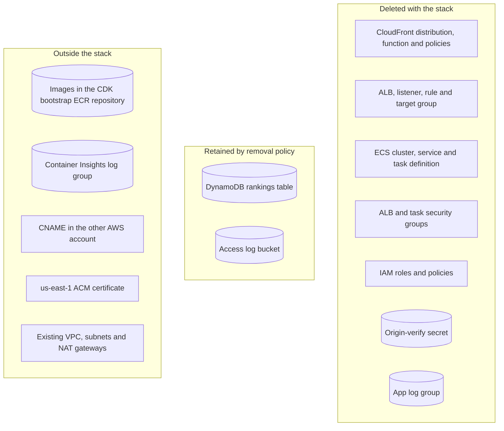

# Runbook: Tear Down the Production Stack

<a href="#english"></a>
<a href="#korean"></a>

---

<a id="english"></a>

# English

## Overview

> [!WARNING]
> This runbook destroys production. `https://my-kart.whchoi.net/` goes offline for every player, and the optional last phase permanently deletes the public leaderboard and every ghost. Run it only when the project owner has explicitly asked for the stack to be destroyed. Claude Code must never start it on its own initiative: the project settings (`.claude/settings.json`) deny `npx cdk destroy*`, `cdk destroy*`, `aws cloudformation delete-stack *`, `aws dynamodb delete-table *` and `aws secretsmanager delete-secret *`, and a human runs every destructive command below in their own terminal.

The runbook deletes `TurboPalsStack` (account `061525506239`, `ap-northeast-2`), removes the custom-domain CNAME in the other AWS account and, only if the owner also asks for it, deletes what the stack retains on purpose. The existing VPC, its subnets and NAT gateways are not owned by the stack and stay untouched.



| Resource | Removal | Source |
| --- | --- | --- |
| DynamoDB rankings table | Retained (`RETAIN`, deletion protection on) | `infra/lib/data.ts` |
| Access log bucket (CloudFront `cloudfront/`, ALB `alb/`) | Retained (`RETAIN`); its lifecycle rule keeps expiring objects after 30 days; the TLS-only bucket policy is a separate resource and is deleted | `infra/lib/logs.ts` |
| Origin-verify secret | Deleted; CloudFormation deletes secrets without a recovery window | `infra/lib/data.ts` |
| App log group (`AppLogs`, 1 month) | Deleted, with all application logs | `infra/lib/service.ts` |
| Container image | Stays in `cdk-hnb659fds-container-assets-061525506239-ap-northeast-2`, shared by every CDK app in this account and region | `infra/lib/service.ts` |
| Container Insights performance log group | Created by Container Insights, not by the stack, so it stays | `infra/lib/service.ts` (`containerInsightsV2`) |
| `*.whchoi.net` certificate in `us-east-1` | Imported, never owned; stays | `infra/lib/stack.ts` |

## When to Use

- Only on an explicit request from the project owner to decommission the game (for example to end the service or move it to another account).
- Not for a broken release: use [rollback-production.md](rollback-production.md).
- Not for replacing a resource: a deploy replaces resources as needed ([deploy-production.md](deploy-production.md)).

## Prerequisites

- The owner's explicit request, including a decision on the leaderboard: keep the retained table, or delete it in phase 5.
- AWS credentials for account `061525506239` with permission to delete the stack's resources.
- The repository with dependencies installed (`npm ci`): `cdk destroy` synthesizes the app first, including the account and region guards.
- Access to the `whchoi.net` DNS zone in the other AWS account. The zone `Z08705193VYKYT9SGOSSX` in this account is not delegated, so changes there have no effect.
- A human at the terminal for every destructive command. The deny rules are a guard rail, not a security boundary.

## Procedure

### 1. Confirm the target

```bash
aws sts get-caller-identity --query Account --output text
aws cloudformation describe-stacks --stack-name TurboPalsStack --region ap-northeast-2 \
  --query 'Stacks[0].[StackName,StackStatus]' --output text
curl -s https://my-kart.whchoi.net/healthz
```

The first command must print `061525506239`. Stop here unless the owner has confirmed the request for this stack.

### 2. Record names and back up what you want to keep

The stack outputs disappear with the stack, so record the names of the resources that remain:

```bash
mkdir -p test-results
TABLE=$(aws cloudformation describe-stacks --stack-name TurboPalsStack --region ap-northeast-2 \
  --query "Stacks[0].Outputs[?OutputKey=='TableName'].OutputValue" --output text)
CLUSTER=$(aws cloudformation describe-stacks --stack-name TurboPalsStack --region ap-northeast-2 \
  --query "Stacks[0].Outputs[?OutputKey=='ClusterName'].OutputValue" --output text)
BUCKET=$(aws cloudformation describe-stack-resources --stack-name TurboPalsStack --region ap-northeast-2 \
  --query "StackResources[?ResourceType=='AWS::S3::Bucket'].PhysicalResourceId" --output text)
IMAGE_PREFIX=$(curl -s https://my-kart.whchoi.net/healthz | jq -r '.version | split("+")[1]')
printf 'TABLE=%s\nCLUSTER=%s\nBUCKET=%s\nIMAGE_PREFIX=%s\n' "$TABLE" "$CLUSTER" "$BUCKET" "$IMAGE_PREFIX" \
  | tee test-results/teardown-names.txt
aws dynamodb create-backup --table-name "$TABLE" --backup-name turbo-pals-before-teardown --region ap-northeast-2
```

The stack owns exactly one S3 bucket, the access-log bucket, so `BUCKET` is a single name. `IMAGE_PREFIX` is the 12-character asset-hash suffix of `APP_VERSION`, which is also how the image tag starts. The on-demand backup survives the table until you delete it. Export the application logs now if you need them: the log group is deleted with the stack.

### 3. Delete the stack

A human runs this; Claude Code is denied it.

```bash
npm ci
npx cdk destroy TurboPalsStack
```

Answer `y` at the confirmation prompt, and never add `--force`. CloudFormation disables the CloudFront distribution before deleting it; no destroy duration has been recorded for this stack.

### 4. Remove the custom-domain CNAME

In the `whchoi.net` zone of the other AWS account, delete the record `my-kart.whchoi.net CNAME d374w2735k9eto.cloudfront.net`, so the name no longer points at a deleted distribution. Leave the `*.whchoi.net` certificate and its DNS validation record alone; the stack only imported the certificate. When the change has propagated, this prints nothing:

```bash
dig +short my-kart.whchoi.net @8.8.8.8
```

### 5. Optional: delete the retained resources (irreversible)

Only if the owner also asked to delete the leaderboard and the logs. A human runs these commands.

```bash
. test-results/teardown-names.txt
aws dynamodb update-table --table-name "$TABLE" --no-deletion-protection-enabled --region ap-northeast-2
aws dynamodb delete-table --table-name "$TABLE" --region ap-northeast-2
aws s3 rb "s3://$BUCKET" --force
aws logs describe-log-groups --log-group-name-prefix "/aws/ecs/containerinsights/$CLUSTER/" --region ap-northeast-2 \
  --query 'logGroups[].logGroupName' --output text
aws logs delete-log-group --log-group-name "/aws/ecs/containerinsights/$CLUSTER/performance" --region ap-northeast-2
```

- Deleting a table that has point-in-time recovery enabled creates a `SYSTEM` backup that DynamoDB keeps for 35 days. The on-demand backup from phase 2 stays until you remove it with `aws dynamodb delete-backup`.
- The bucket is not versioned, so `aws s3 rb --force` removes every object and then the bucket.
- Run `delete-log-group` only if `describe-log-groups` listed that group.

The bootstrap ECR repository is shared by every CDK app in this account and region: never delete the repository or the `CDKToolkit` stack. Delete only image tags you can attribute to this project:

```bash
. test-results/teardown-names.txt
IMAGE_TAG=$(aws ecr list-images --repository-name cdk-hnb659fds-container-assets-061525506239-ap-northeast-2 \
  --region ap-northeast-2 --query 'imageIds[].imageTag' --output text | tr '\t' '\n' | grep "^$IMAGE_PREFIX")
echo "$IMAGE_TAG"
aws ecr batch-delete-image --repository-name cdk-hnb659fds-container-assets-061525506239-ap-northeast-2 \
  --image-ids imageTag="$IMAGE_TAG" --region ap-northeast-2
```

Images from earlier deploys stay as well, for example the `8efebcca1468` build recorded in `docs/quality/live-verify-custom.json`; delete them the same way once you have matched their tags.

## Verification

- [ ] `aws cloudformation describe-stacks --stack-name TurboPalsStack --region ap-northeast-2` fails with "Stack with id TurboPalsStack does not exist".
- [ ] `aws resourcegroupstaggingapi get-resources --tag-filters Key=Project,Values=turbo-pals --region ap-northeast-2 --query 'ResourceTagMappingList[].ResourceARN' --output text` lists only what you chose to keep (the table and the bucket, or nothing). The tagging API can take a while to drop deleted resources.
- [ ] `dig +short my-kart.whchoi.net @8.8.8.8` prints nothing.
- [ ] The shared network is intact: `aws ec2 describe-nat-gateways --nat-gateway-ids nat-00b8a70dc184a4d0c nat-08379e076e2e6e234 --region ap-northeast-2 --query 'NatGateways[].State' --output text` prints `available available`.

## Rollback

There is no rollback. A deleted stack cannot be restored, and redeploying with [deploy-production.md](deploy-production.md) builds a new stack, not the old one:

- a new CloudFront distribution with a new `*.cloudfront.net` name, so the CNAME must be created again ([custom-domain.md](custom-domain.md));
- a new, empty rankings table. A retained table is not reattached, and neither is a table restored from the backup (`aws dynamodb restore-table-from-backup` always creates a new table); serving either needs a code change in `infra/lib/data.ts`;
- a new origin-verify secret and a new ALB.

## Notes

- Last verified: 2026-10-18. Reviewed against `infra/lib/data.ts`, `infra/lib/logs.ts`, `infra/lib/service.ts`, the synthesized `cdk.out/TurboPalsStack.template.json` (`DeletionPolicy: Retain` on the table and the bucket, `Delete` on the secret and the app log group), `.claude/settings.json` and section 7 of [docs/infra.md](../infra.md). This procedure has never been executed against this stack.
- While retained, the table keeps costing on-demand storage and point-in-time recovery; the bucket empties itself within 30 days.
- The session-context hook (`.claude/hooks/session-context.sh`) reminds every Claude Code session never to destroy `TurboPalsStack` without an explicit user request.

---

<a id="korean"></a>

# 한국어

## 개요

> [!WARNING]
> 이 런북은 운영 환경을 삭제합니다. 모든 플레이어에게 `https://my-kart.whchoi.net/`이 중단되고, 선택 단계인 마지막 단계는 공개 리더보드와 모든 고스트를 영구히 지웁니다. 프로젝트 소유자가 스택 삭제를 명시적으로 요청했을 때만 실행합니다. Claude Code는 스스로 판단해 이 절차를 시작해서는 안 됩니다. 프로젝트 설정(`.claude/settings.json`)이 `npx cdk destroy*`, `cdk destroy*`, `aws cloudformation delete-stack *`, `aws dynamodb delete-table *`, `aws secretsmanager delete-secret *`를 거부하며, 아래의 파괴적인 명령은 모두 사람이 자신의 터미널에서 직접 실행합니다.

이 런북은 `TurboPalsStack`(계정 `061525506239`, `ap-northeast-2`)을 삭제하고, 다른 AWS 계정에 있는 커스텀 도메인 CNAME을 지우며, 소유자가 추가로 요청한 경우에만 스택이 의도적으로 남기는 리소스까지 삭제합니다. 기존 VPC, 서브넷, NAT 게이트웨이는 이 스택 소유가 아니므로 건드리지 않습니다.


| 리소스 | 삭제 여부 | 근거 |
| --- | --- | --- |
| DynamoDB 랭킹 테이블 | 남음(`RETAIN`, 삭제 보호 켜짐) | `infra/lib/data.ts` |
| 액세스 로그 버킷(CloudFront `cloudfront/`, ALB `alb/`) | 남음(`RETAIN`). 수명 주기 규칙에 따라 객체는 계속 30일 뒤 만료됩니다. TLS 전용 버킷 정책은 별도 리소스라 삭제됩니다 | `infra/lib/logs.ts` |
| 오리진 검증 시크릿 | 삭제됨. CloudFormation은 복구 대기 기간 없이 시크릿을 지웁니다 | `infra/lib/data.ts` |
| 앱 로그 그룹(`AppLogs`, 1개월 보관) | 애플리케이션 로그와 함께 삭제됨 | `infra/lib/service.ts` |
| 컨테이너 이미지 | `cdk-hnb659fds-container-assets-061525506239-ap-northeast-2`에 남음. 이 계정·리전의 모든 CDK 앱이 함께 쓰는 저장소입니다 | `infra/lib/service.ts` |
| Container Insights 성능 로그 그룹 | 스택이 아니라 Container Insights가 만든 것이라 남음 | `infra/lib/service.ts`(`containerInsightsV2`) |
| `us-east-1`의 `*.whchoi.net` 인증서 | 가져오기만 했고 소유하지 않으므로 남음 | `infra/lib/stack.ts` |

## 사용 시점

- 프로젝트 소유자가 게임 운영 종료(서비스 종료, 다른 계정으로 이전 등)를 명시적으로 요청한 경우에만 사용합니다.
- 문제가 있는 릴리스를 되돌릴 때는 쓰지 않습니다. [rollback-production.md](rollback-production.md)를 따릅니다.
- 리소스를 교체할 때도 쓰지 않습니다. 필요한 교체는 배포가 처리합니다([deploy-production.md](deploy-production.md)).

## 사전 요구 사항

- 리더보드 처리 방침까지 포함한 소유자의 명시적 요청이 있어야 합니다. 남겨 둔 테이블을 유지할지, 5단계에서 지울지 정해 둡니다.
- 스택 리소스를 삭제할 권한이 있는 계정 `061525506239`의 AWS 자격 증명이 필요합니다.
- 의존성이 설치된(`npm ci`) 저장소가 필요합니다. `cdk destroy`는 계정·리전 가드를 포함해 앱을 먼저 합성합니다.
- 다른 AWS 계정에 있는 `whchoi.net` DNS 영역에 접근할 수 있어야 합니다. 이 계정의 영역 `Z08705193VYKYT9SGOSSX`는 위임되지 않아 여기서 바꿔도 효과가 없습니다.
- 파괴적인 명령마다 사람이 터미널 앞에 있어야 합니다. deny 규칙은 안전장치일 뿐 보안 경계가 아닙니다.

## 절차

### 1. 대상 확인

```bash
aws sts get-caller-identity --query Account --output text
aws cloudformation describe-stacks --stack-name TurboPalsStack --region ap-northeast-2 \
  --query 'Stacks[0].[StackName,StackStatus]' --output text
curl -s https://my-kart.whchoi.net/healthz
```

첫 명령은 `061525506239`를 출력해야 합니다. 소유자가 이 스택에 대한 요청을 확인해 주지 않았다면 여기서 멈춥니다.

### 2. 이름 기록과 보존할 데이터 백업

스택 출력값은 스택과 함께 사라지므로, 남는 리소스의 이름을 미리 기록합니다.

```bash
mkdir -p test-results
TABLE=$(aws cloudformation describe-stacks --stack-name TurboPalsStack --region ap-northeast-2 \
  --query "Stacks[0].Outputs[?OutputKey=='TableName'].OutputValue" --output text)
CLUSTER=$(aws cloudformation describe-stacks --stack-name TurboPalsStack --region ap-northeast-2 \
  --query "Stacks[0].Outputs[?OutputKey=='ClusterName'].OutputValue" --output text)
BUCKET=$(aws cloudformation describe-stack-resources --stack-name TurboPalsStack --region ap-northeast-2 \
  --query "StackResources[?ResourceType=='AWS::S3::Bucket'].PhysicalResourceId" --output text)
IMAGE_PREFIX=$(curl -s https://my-kart.whchoi.net/healthz | jq -r '.version | split("+")[1]')
printf 'TABLE=%s\nCLUSTER=%s\nBUCKET=%s\nIMAGE_PREFIX=%s\n' "$TABLE" "$CLUSTER" "$BUCKET" "$IMAGE_PREFIX" \
  | tee test-results/teardown-names.txt
aws dynamodb create-backup --table-name "$TABLE" --backup-name turbo-pals-before-teardown --region ap-northeast-2
```

스택이 소유한 S3 버킷은 액세스 로그 버킷 하나뿐이므로 `BUCKET`에는 이름 하나만 들어갑니다. `IMAGE_PREFIX`는 `APP_VERSION` 뒤에 붙는 12자리 에셋 해시이며, 이미지 태그도 이 값으로 시작합니다. 온디맨드 백업은 직접 지우기 전까지 테이블이 없어져도 남습니다. 애플리케이션 로그가 필요하면 지금 내보냅니다. 로그 그룹은 스택과 함께 삭제됩니다.

### 3. 스택 삭제

사람이 직접 실행합니다. Claude Code에는 거부된 명령입니다.

```bash
npm ci
npx cdk destroy TurboPalsStack
```

확인 프롬프트에 `y`로 답하고, `--force`는 절대 붙이지 않습니다. CloudFormation은 CloudFront 배포를 먼저 비활성화한 뒤 삭제합니다. 이 스택의 삭제 소요 시간은 기록된 적이 없습니다.

### 4. 커스텀 도메인 CNAME 삭제

다른 AWS 계정의 `whchoi.net` 영역에서 `my-kart.whchoi.net CNAME d374w2735k9eto.cloudfront.net` 레코드를 지워, 이 이름이 삭제된 배포를 가리키지 않게 합니다. `*.whchoi.net` 인증서와 그 DNS 검증 레코드는 그대로 둡니다. 스택은 인증서를 가져다 쓰기만 했습니다. 변경이 전파되면 다음 명령은 아무것도 출력하지 않습니다.

```bash
dig +short my-kart.whchoi.net @8.8.8.8
```

### 5. 선택: 남겨 둔 리소스 삭제(되돌릴 수 없음)

소유자가 리더보드와 로그 삭제까지 요청한 경우에만 진행합니다. 아래 명령은 사람이 실행합니다.

```bash
. test-results/teardown-names.txt
aws dynamodb update-table --table-name "$TABLE" --no-deletion-protection-enabled --region ap-northeast-2
aws dynamodb delete-table --table-name "$TABLE" --region ap-northeast-2
aws s3 rb "s3://$BUCKET" --force
aws logs describe-log-groups --log-group-name-prefix "/aws/ecs/containerinsights/$CLUSTER/" --region ap-northeast-2 \
  --query 'logGroups[].logGroupName' --output text
aws logs delete-log-group --log-group-name "/aws/ecs/containerinsights/$CLUSTER/performance" --region ap-northeast-2
```

- 시점 복구가 켜진 테이블을 지우면 DynamoDB가 `SYSTEM` 백업을 만들어 35일 동안 보관합니다. 2단계의 온디맨드 백업은 `aws dynamodb delete-backup`으로 지우기 전까지 남습니다.
- 버킷은 버전 관리를 쓰지 않으므로 `aws s3 rb --force`가 모든 객체를 지운 뒤 버킷을 삭제합니다.
- `delete-log-group`은 `describe-log-groups`가 그 그룹을 보여 준 경우에만 실행합니다.

부트스트랩 ECR 저장소는 이 계정·리전의 모든 CDK 앱이 함께 씁니다. 저장소나 `CDKToolkit` 스택은 절대 지우지 않고, 이 프로젝트의 것으로 확인된 이미지 태그만 지웁니다.

```bash
. test-results/teardown-names.txt
IMAGE_TAG=$(aws ecr list-images --repository-name cdk-hnb659fds-container-assets-061525506239-ap-northeast-2 \
  --region ap-northeast-2 --query 'imageIds[].imageTag' --output text | tr '\t' '\n' | grep "^$IMAGE_PREFIX")
echo "$IMAGE_TAG"
aws ecr batch-delete-image --repository-name cdk-hnb659fds-container-assets-061525506239-ap-northeast-2 \
  --image-ids imageTag="$IMAGE_TAG" --region ap-northeast-2
```

이전 배포의 이미지도 남아 있습니다. 예를 들어 `docs/quality/live-verify-custom.json`에 기록된 `8efebcca1468` 빌드가 그렇습니다. 태그를 맞춰 본 뒤 같은 방법으로 지웁니다.

## 검증

- [ ] `aws cloudformation describe-stacks --stack-name TurboPalsStack --region ap-northeast-2`가 "Stack with id TurboPalsStack does not exist" 오류로 실패합니다.
- [ ] `aws resourcegroupstaggingapi get-resources --tag-filters Key=Project,Values=turbo-pals --region ap-northeast-2 --query 'ResourceTagMappingList[].ResourceARN' --output text`가 남기기로 한 리소스(테이블과 버킷, 또는 없음)만 보여 줍니다. 태깅 API에서 삭제된 리소스가 빠지기까지 시간이 걸릴 수 있습니다.
- [ ] `dig +short my-kart.whchoi.net @8.8.8.8`가 아무것도 출력하지 않습니다.
- [ ] 공유 네트워크가 그대로입니다. `aws ec2 describe-nat-gateways --nat-gateway-ids nat-00b8a70dc184a4d0c nat-08379e076e2e6e234 --region ap-northeast-2 --query 'NatGateways[].State' --output text`가 `available available`을 출력합니다.

## 롤백

롤백은 없습니다. 삭제한 스택은 복원할 수 없고, [deploy-production.md](deploy-production.md)로 다시 배포하면 예전 스택이 아니라 새 스택이 만들어집니다.

- CloudFront 배포가 새 `*.cloudfront.net` 이름으로 생기므로 CNAME을 다시 만들어야 합니다([custom-domain.md](custom-domain.md)).
- 랭킹 테이블도 비어 있는 새 테이블입니다. 남겨 둔 테이블은 다시 연결되지 않으며, 백업에서 복원한 테이블도 마찬가지입니다(`aws dynamodb restore-table-from-backup`은 항상 새 테이블을 만듭니다). 어느 쪽이든 서비스에 쓰려면 `infra/lib/data.ts`를 고쳐야 합니다.
- 오리진 검증 시크릿과 ALB도 새로 만들어집니다.

## 참고

- 최종 검증일: 2026-10-18. `infra/lib/data.ts`, `infra/lib/logs.ts`, `infra/lib/service.ts`, 합성된 `cdk.out/TurboPalsStack.template.json`(테이블과 버킷은 `DeletionPolicy: Retain`, 시크릿과 앱 로그 그룹은 `Delete`), `.claude/settings.json`, [docs/infra.md](../infra.md) 7절과 대조해 검토했습니다. 이 절차를 이 스택에 실제로 실행한 적은 없습니다.
- 테이블을 남겨 두는 동안에는 온디맨드 저장 비용과 시점 복구 비용이 계속 나갑니다. 버킷은 30일 안에 저절로 비워집니다.
- 세션 컨텍스트 훅(`.claude/hooks/session-context.sh`)이 모든 Claude Code 세션에 명시적인 사용자 요청 없이는 `TurboPalsStack`을 절대 삭제하지 말라고 상기시킵니다.
